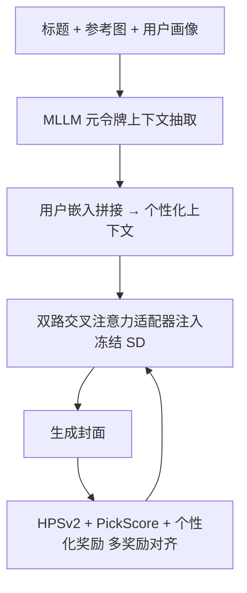
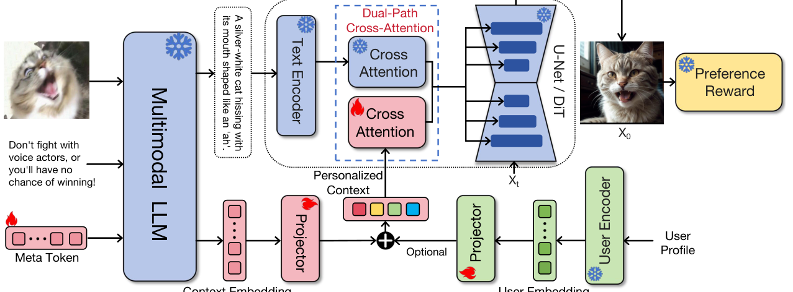

# ICG: Improving Cover Image Generation via MLLM-based Prompting and Personalized Preference Alignment (基于多模态大模型提示与个性化偏好对齐的封面图像生成改进)

- **会议/期刊**: EMNLP 2025 (Main Track)
- **作者与机构**: Zhipeng Bian, Jieming Zhu, Qijiong Liu, Wang Lin, Guohao Cai, Zhaocheng Du, Jiacheng Sun, Zhou Zhao, Zhenhua Dong（华中科技大学 / 华为诺亚方舟实验室 / 香港理工大学 / 浙江大学）
- **推荐链路定位**: 端到端生成式（推荐物料封面生成，服务于下游召回/推荐表征）
- **研究方向**: 多模态推荐 / 生成式推荐
- **论文原文**: [https://arxiv.org/abs/2605.27374v1](https://arxiv.org/abs/2605.27374v1)
- **开源代码**: [https://github.com/westlake-repl/PixelRec](https://github.com/westlake-repl/PixelRec)（数据集仓库；ICG 模型代码暂未单独开源）

## TL;DR (1分钟核心速览)

针对推荐场景中封面图模糊、语义错配、缺乏个性化且无真值监督的痛点，ICG 用 MLLM（Qwen2.5VL-7B）从标题+参考图抽取连续"元令牌"上下文，与用户画像嵌入拼接后经双路交叉注意力适配器注入冻结的 Stable Diffusion，并以 HPSv2、PickScore 与自训练个性化奖励模型做多奖励对齐训练。在 PixelRec 与 MovieLens 上，LPIPS 降至 0.5126/0.4018、FID 降至 33.06/31.23、美学分达 4.87/4.77，均显著优于 PMG 与 Text Inversion；下游 MMGCN 推荐 Recall@10 与 NDCG@10 分别提升 +2.27% 与 +19.1%。

## Background & Motivation (背景与核心矛盾)

- **主流范式**: 当前封面生成依赖 Stable Diffusion / DALLE-3 等文生图模型，需人工精写 prompt；自动化路线则用 MLLM 从物料内容生成 prompt 再喂给扩散模型（如 BeautifulPrompt、Promptist）。
- **前人局限**: 其一，现有 prompt 优化工作以"已有 prompt 文本"为输入，无法从原始标题+参考图冷启动，且封面无 golden prompt 可做监督微调；其二，MLLM 与扩散模型是割裂的两段式管线，MLLM 幻觉无法被下游纠错，语义错配严重。
- **核心洞察 (Key Insight)**: 个性化生成方法（PMG、DiFashion）把"下一个交互物品的图"当作训练目标，隐含假设原封面高质量——这在真实信息流中往往不成立；且 PMG 用 LLM 把偏好压成离散关键词，丢失细粒度且阻断端到端优化。
- **本文切入点**: 放弃"文本 prompt 中转"，改用连续元令牌承载多模态上下文，并以多奖励（美学+相关性+个性化）替代缺失的真值监督，实现 MLLM 与扩散模型的端到端可微对齐。

## Method (核心方法设计)

### 1. 整体框架 (Overall Architecture)

输入为物料标题 $T_{title}$、参考封面$I_{ref}$与用户画像。MLLM 同时产出显式文本 prompt$P_{exp}$与一组连续元令牌嵌入；元令牌经投影后与用户嵌入（来自预训练双塔 CTR 用户编码器）逐位拼接成个性化上下文$C^{per}_{ref}$；该上下文通过新增的双路交叉注意力分支注入冻结的 U-Net/DiT，与原始文本条件并行聚合；生成图再由三个奖励模型打分回传梯度，仅更新适配器与投影层。推理时用户条件可选：无用户时退化为纯上下文增强，有用户时开启个性化。

<figure class="paper-figure" markdown="span">
  <figcaption>图2：所提方法概览。模型接收参考图像、标题和元标记，通过多模态LLM生成上下文嵌入。结合用户嵌入，个性化特征通过双路径适配器注入扩散模型。奖励模型评估输出并通过反馈指导训练。</figcaption>
</figure>

### 2. 关键设计拆解 (Key Designs)

1. **元令牌与多模态生成式学习阶段**：自然语言 prompt 是离散表示、表达力受限，故引入元令牌在连续空间补足细粒度上下文。训练时对参考图做掩码/模糊/裁剪得到 $I^{trans}_{ref}$，令元令牌输出回归 CLIP 图像嵌入：
$\mathcal{L}_{rec}=\big\|\mathrm{MLLM}(V_{enc}(I^{trans}_{ref}),T_{title},\mathrm{MetaToken})-\mathrm{CLIP}(I_{ref})\big\|_2^2$
直觉是迫使元令牌在"文本+退化视觉"条件下重建完整语义，从而比单模态 CLIP 表征更鲁棒、且天然与扩散模型条件空间兼容。

2. **双路交叉注意力适配器**：为在不破坏预训练生成能力的前提下注入个性化，在每个交叉注意力层增设一条个性化 KV 分支，与原文本分支相加：
$Z_{new}=\mathrm{Attention}(Q,K_t,V_t)+\mathrm{Attention}(Q,K_p,V_p)$其中$Q=ZW_q$，$W_q,W^t_k,W^t_v$继承原模型并冻结，仅新增$W^p_k,W^p_v$ 可训练。由于骨干完全冻结，适配器学到的是"注意力调制"而非重绘能力，故可直接插入同一底座衍生的社区 checkpoint（Realistic Vision、Anything v4 等）而无需重训。

3. **多奖励对齐与训练目标**：真值封面不存在，MSE 类监督不可用。个性化奖励模型以 CLIP 编码标题、caption、图像、用户文本，经 Transformer 融合后输出偏好分，用 pairwise BPR 式损失 $\mathcal{L}=-\mathbb{E}[\log\sigma(p_m-p_n)]$训练（过滤交互数 <6 的用户，按点击/评分取 top-$k_1$正、bottom-$k_2$ 负）。总目标为加权和：
$\mathcal{L}_{total}=\lambda_h\mathcal{L}_h+\lambda_{per}\mathcal{L}_{per}+\lambda_p\mathcal{L}_p+\lambda_r\mathcal{L}_{rec}$
四项权重均取 0.25，分别对应 HPSv2、个性化奖励、PickScore 与 CLIP 重建。训练分两阶段：先用弱 CLIP 重建损失初始化对齐，再切入奖励反馈学习；仅更新适配器与投影层，无需负采样。

## Experimental Setup & Evaluation Protocol (实验设置与评估协议)

- **数据集与预处理**: 用户侧过滤交互数 <6 的冷用户以构造可靠偏好对；个性化奖励模型按 80%/10%/10% 划分、使用 0.2M 用户-物品对训练。

| 数据集 | #Users | #Items | #Interactions | 稀疏度/密度 | 特征/场景说明 |
| :--- | :---: | :---: | :---: | :---: | :--- |
| PixelRec (1M 子集) | 1M | 0.3M 封面 / 22 域 | 10M | 极稀疏 | 短视频封面，含点击/点赞/标题/描述 |
| MovieLens | 0.3M | 86K | 3.3M | 稀疏 | 电影封面，含人口统计学与类型元数据 |

- **数据划分与防穿越 (Splitting Strategy)**: 奖励模型采用 `比例划分`（80-10-10）；生成质量评估为全量测试集离线评估，无时序穿越问题。
- **排名评测协议 (Ranking Protocol)**: 生成侧用 LPIPS↓/SSIM↑/FID↓/LAION 美学分↑ 四项全量指标 + 100 人 120 图 1–3 Likert 人工评测；下游推荐侧在 MovieLens 上用 MMGCN 做 `Full-Ranking` 式离线评测，报告 Recall@10 与 NDCG@10。
- **对比基线与超参设置**: 基线为 Rule-based（原生 SD）、Text Inversion、PMG；MLLM 用 Qwen2.5VL-7B，扩散底座 SD v1.5 / Flux，适配器初始化自 IP-Adapter，元令牌长度 1、投影维度 1024，训练 5 万步、lr $10^{-6}$，推理 DDIM 15 步、guidance 7.0。

## Key Experimental Results (实验关键数据)

### 1. 主实验对比 (Main Results)

| 数据集 | 方法 | LPIPS↓ | SSIM↑ | FID↓ | Aesthetics↑ |
| :--- | :--- | :---: | :---: | :---: | :---: |
| PixelRec | Rule-based | 0.6446 | 0.1484 | 47.74 | 4.17 |
| PixelRec | Text Inversion | 0.6282 | 0.1632 | 42.23 | 4.12 |
| PixelRec | PMG | 0.5411 | 0.1624 | 35.18 | 4.21 |
| PixelRec | **ICG** | **0.5126** | **0.1724** | **33.06** | **4.87** |
| MovieLens | Rule-based | 0.6512 | 0.1634 | 46.24 | 4.09 |
| MovieLens | Text Inversion | 0.6345 | 0.2474 | 43.27 | 4.12 |
| MovieLens | PMG | 0.4140 | 0.2515 | 33.93 | 4.11 |
| MovieLens | **ICG** | **0.4018** | **0.2695** | **31.23** | **4.77** |

人工评测（1–3 分）：ICG 在 PixelRec/MovieLens 得 2.419/2.527，显著高于 PMG 的 2.152/1.994 与 Text Inversion 的 1.952/1.923。

### 2. 消融实验 (Ablation Study)

| 配置 | PixelRec LPIPS↓ | PixelRec FID↓ | MovieLens LPIPS↓ | MovieLens FID↓ |
| :--- | :---: | :---: | :---: | :---: |
| ICG 完整 | **0.5126** | **33.06** | **0.4018** | **31.23** |
| w/o Meta token | 0.5912 | 39.24 | 0.5854 | 37.02 |
| w/o User feature | 0.5203 | 32.67 | 0.4284 | 31.43 |
| w/o Both | 0.5893 | 38.45 | 0.5194 | 36.54 |
| w/o CLIP 奖励 | 0.5504 | 35.76 | — | — |
| w/o HPSv2+PickScore | 0.5413 | 34.87 | — | — |
| w/o 个性化奖励 | 0.5653 | 35.81 | — | — |

### 3. 关键实验发现 (Key Findings)

1. **元令牌是最大增益来源**：移除后 PixelRec LPIPS 从 0.5126 恶化到 0.5912（+15.3%），MovieLens 更从 0.4018 崩至 0.5854（+45.7%），说明连续多模态上下文比显式文本 prompt 承载了不可替代的细粒度语义；且微调后元令牌数 $N=2$最优，$N$ 增大反而因嵌入稀释而退化。
2. **个性化奖励不可替代**：去掉个性化奖励后 LPIPS 升至 0.5653、FID 升至 35.81，退化幅度大于去掉 HPSv2+PickScore（0.5413/34.87），证明通用美学奖励无法覆盖用户特定偏好；个性化奖励模型自身偏好预测准确率达 85.2%/86.2%，而仅用图像特征仅 53.8%/54.1%。
3. **生成质量可转化为推荐收益**：在 MMGCN 上，用 ICG 生成封面替代原始封面后 Recall@10 从 18.99% 升至 20.21%（+2.27%），NDCG@10 从 0.0991 升至 0.1016（+19.1%），说明个性化封面确实携带了可被推荐模型利用的用户偏好信号，而非仅视觉美化。

## Highlights & Limitations (亮点、对比与审稿批判)

- **与代表作对比 (vs. Prior Work)**: 相较 PMG 把偏好压成 LLM 离散关键词、以"下一物品图"为监督，ICG 用连续元令牌+可微奖励绕开了对高质量真值的依赖；相较 Text Inversion 仅把偏好嵌入词向量，ICG 增加了 MLLM 多模态上下文与双路适配器两条信息通路；相较 MiniGPT-5/SEED-LLaMA 等统一理解-生成模型，ICG 不追求通用生成，而专注显式用户条件注入与偏好奖励优化，定位互补。
- **可迁移亮点**: (1) "冻结骨干 + 新增 KV 分支"的轻量适配器设计，可直接迁移到任何需要注入侧信息（用户/场景/上下文）的扩散或 DiT 生成管线；(2) 用 pairwise 行为数据自训练领域奖励模型替代人工标注，是生成式推荐中解决"无真值"的通用范式。
- **审稿级局限批判**: (1) 用户表征为静态画像嵌入，无法捕捉短期兴趣漂移，且多奖励训练带来约 20% 额外开销、V100 单图推理约 1.5 秒，实时部署压力大；(2) 用户收益评估仅停留在离线代理指标（Recall@10/NDCG@10）与小规模人工打分，缺少线上 A/B 的 CTR 证据，个性化增益的真实业务价值仍待验证。

## Rating (四维评分)

- **方法创新性 (Novelty)**: ⭐⭐⭐⭐ （元令牌连续上下文 + 双路适配器 + 多奖励对齐三者组合首次系统化用于个性化封面生成，单点算子新颖度中等但工程整合完整）
- **评估协议与实验扎实度 (Protocol & Experiments)**: ⭐⭐⭐ （双数据集 + 自动指标 + 人工评测 + 下游推荐四层验证较全面，但缺少线上 A/B，且生成指标与推荐指标之间缺少显著性检验）
- **写作与数学规范度 (Clarity & Rigor)**: ⭐⭐⭐⭐ （公式简洁、模块边界清晰，元令牌训练与适配器冻结策略交代明确；奖励权重统一取 0.25 略显经验化，缺少敏感性分析）
- **工业落地与复现价值 (Industrial & Practical Value)**: ⭐⭐⭐⭐ （即插即用适配器可跨 checkpoint 复用、无需真值标签，落地路径清晰；但 1.5s/图推理延迟与数据集仓库而非模型代码开源削弱了直接复现性）

