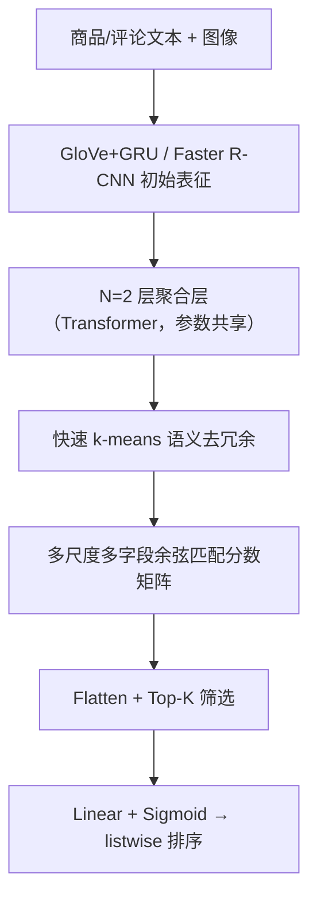
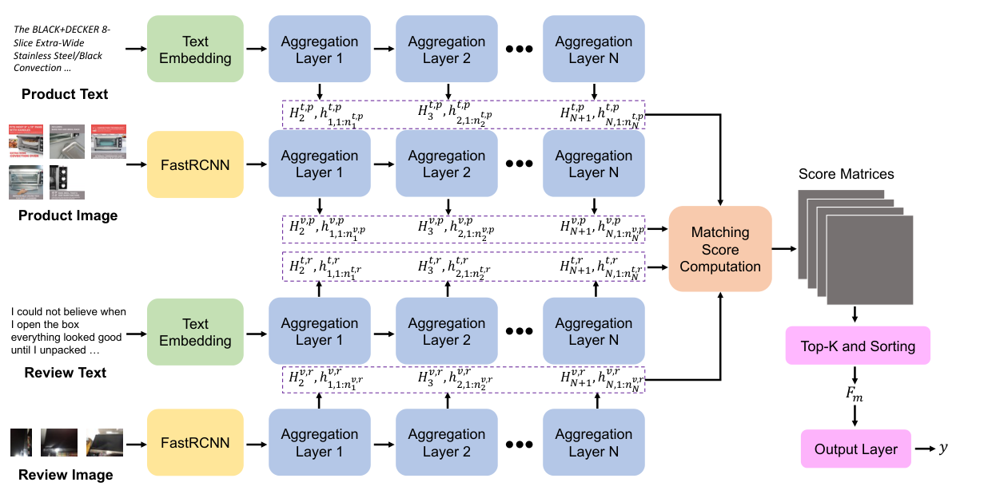

# PREMISE: Matching-based Prediction for Accurate Review Recommendation (基于匹配分数的多模态评论有用性预测)

- **会议/期刊**: ACL 2025
- **作者与机构**: Wei Han, Hui Chen, Soujanya Poria（新加坡科技设计大学 SUTD；新加坡国立大学 NUS）
- **推荐链路定位**: 重排（评论列表按有用性降序重排）
- **研究方向**: 多模态推荐 / 列表级重排
- **论文原文**: [https://arxiv.org/abs/2505.01255v1](https://arxiv.org/abs/2505.01255v1)
- **开源代码**: 暂未开源（仅引用 HuggingFace Transformers 工具链）

## TL;DR (1分钟核心速览)

针对多模态评论有用性预测（MRHP）中"融合式架构堆叠跨模态注意力、参数重且忽略多尺度语义"的痛点，PREMISE 彻底抛弃融合范式：用堆叠聚合层生成"词→句→整段"与"RoI→图→整段"的多尺度、多字段表征，经快速 k-means 去冗余后计算成对余弦匹配分数，取 Top-K 分数直接作为回归特征。在 Amazon-MRHP 与 Lazada-MRHP 六个类目上，MAP 较最强基线 GBDT 提升 5.0–17.5 点，训练时间较 SANCL 缩短 42%。

## Background & Motivation (背景与核心矛盾)

- **主流范式**: MRHP 现有 SOTA（MCR、SANCL、CMCR、GBDT）均走"跨模态融合"路线——用交叉注意力把商品描述/评论的图文表征揉成一个大向量再做回归。
- **前人局限**: 其一，**缺乏显式多尺度建模**，任务相关信息在长评论中分布极不均匀（如表 1 中高有用评论仍含大量离题句），固定 token/patch 尺度无法捕捉；其二，**融合结构臃肿**，成对共轭注意力使复杂度达 $C_f=(2l_1l_2+l_1^2+l_2^2)Nd$，且最终特征向量动辄 512–1000+ 维，冗余严重。
- **核心洞察 (Key Insight)**: 评论是否有用，本质上取决于"评论与商品卖点的匹配程度"以及"评论内部图文自洽程度"——即语义匹配分数本身就是判别信号，无需先融合成表征再预测。
- **本文切入点**: 借鉴关系型学习（Relation Network），把多尺度、多字段的**匹配分数集合**直接当作回归 logits，用 Top-K 筛选替代融合。

## Method (核心方法设计)

### 1. 整体框架 (Overall Architecture)

输入为商品描述 $P_i$与评论$R_{i,j}$的文本与图像。文本经 GloVe/FastText + GRU 得到 token 级表征，图像经 Faster R-CNN（ResNet-101）得到 RoI 级表征，作为最小尺度。随后$N=2$层参数共享的聚合层（Transformer 实现）逐级上采样：文本走"词→句→整段"，图像走"RoI→图→整段"，每层输出同时保留本尺度序列与更大尺度聚合向量。低层用快速 k-means 过滤重复语义。最终将四个字段-模态矩阵（$R_{t,p},R_{t,r},R_{v,p},R_{v,r}$）两两算余弦匹配分数，展平后取 Top-K 作为特征向量，经线性层 + Sigmoid 输出，并以 listwise 损失按商品内评论列表训练。

<figure class="paper-figure" markdown="span">
  <figcaption>图 1：PREMISE 的整体架构。我们隐藏了两个聚合层之间的数据帧重组过程，该过程将生成的更大规模表示合并为新序列；为简洁起见，仅展示来自单个数据块的输出，并省略下标 i。</figcaption>
</figure>

### 2. 关键设计拆解 (Key Designs)

1. **多尺度匹配网络 MSMN（把"尺度金字塔"搬进匹配空间）**：痛点是小尺度特征密集且语义重复、大尺度特征稀疏但语义完整，单一尺度无法兼顾。聚合层以 Transformer 实现，输入序列头部加 `[CLS]`，其输出头即下一尺度聚合向量，其余位置为本尺度细化序列：
$$[H_{k+1,i},\,h_{1:n_k,i}]=\mathrm{Transformer}(V_{k,i};\Theta)$$
各 block 共享参数 $\theta_1=\cdots=\theta_{n_k}$，使"词→句→整段"具备真实语义层级，从而让匹配分数覆盖从字面重合到整体主题一致的全谱系。

2. **语义去冗余 Semantics Refinement（用聚类压缩低层稠密匹配）**：低层 token/RoI 数量巨大，直接两两匹配会产生海量近重复分数并稀释预测层注意力。作者在特征数 $N>C\times r$时启用快速 k-means（Hamerly 加速版），随机初始化$C=\lceil\sqrt{K}\rceil$个中心、期望簇大小$r$（最优取 4），否则退化为随机采样。由于 k-means 非参数、仅在前向做一次聚类，开销可忽略，却显著提升单位维度特征的信息密度。

3. **匹配打分、Top-K 与训练目标**：四矩阵两两余弦相似度共产生 $n_1n_2+n_2n_4+n_3n_4$ 个分数（刻意排除商品内部图文对，因其与评论有用性无关）：
$$S(A,B)=\frac{AB^{\top}}{\|A\|\cdot\|B\|^{\top}},\qquad h=\mathrm{TopK}(\mathrm{FlattenAll}(S'))$$
Top-K 通过掩码实现可微（前向选索引、反向仅回传选中项），使梯度路径随样本动态变化。损失为商品内 listwise 交叉熵 $\mathcal{L}=-\sum_i\sum_j y'_{i,j}\log f'_{i,j}$，其中$f',y'$均为 softmax 归一化后的分布；训练时每商品采 1 条正评（评分>2）+$N-r$ 条负评，**无需显式负采样构造**，推理时对全候选评论打分排序。

## Experimental Setup & Evaluation Protocol (实验设置与评估协议)

- **数据集与预处理**: 两个公开 MRHP 数据集，各含 Clothing & Jewelry / Electronics / Home & Kitchen 三类；标签为点赞数对数并截断至 $[0,4]$ 整数。

| 数据集 | #Products (Train/Dev/Test) | #Reviews (Train/Dev/Test) | 语言/编码器 | 场景说明 |
| :--- | :---: | :---: | :---: | :--- |
| Amazon-MRHP (C&J) | 12,074 / 3,019 / 3,966 | 277,308 / 122,148 / 87,492 | 英语 / GloVe-300d | 图文评论 + 商品描述 |
| Amazon-MRHP (Elec.) | 10,564 / 2,641 / 3,327 | 240,505 / 84,402 / 79,750 | 英语 / GloVe-300d | 同上 |
| Amazon-MRHP (H&K) | 14,570 / 3,616 / 4,529 | 369,518 / 92,707 / 111,593 | 英语 / GloVe-300d | 同上 |
| Lazada-MRHP (三类) | 2,939–6,596 | 36,991–104,093 | 印尼语 / FastText | 非英语迁移验证 |

- **数据划分与防穿越 (Splitting Strategy)**: 采用数据集官方给定的 **Product-level 固定 Train/Dev/Test 划分**（同一商品的评论不跨集合），非 Leave-One-Out。
- **排名评测协议 (Ranking Protocol)**: **Full-Ranking（商品内全部评论全排序）**，指标为 MAP、NDCG@3、NDCG@5；结果取 5 次运行均值，并以 paired t-test 检验（$p<0.05$）。
- **对比基线与超参设置**: 基线含 SSE-Cross、D&R Net、MCR、SANCL、CMCR、GBDT 六类（覆盖统计学习、融合、对比学习、树模型四派）；文本嵌入 300d、图像 256d、共享空间 128d，$r=4$，$K\in\{64,96,128\}$，batch size 32，学习率$1\text{e-}4\sim5\text{e-}4$。

## Key Experimental Results (实验关键数据)

### 1. 主实验对比 (Main Results)

Amazon-MRHP（GloVe 版，三类平均口径下取代表性类目）：

| Model | C&J MAP | C&J N@3 | Elec. MAP | Elec. N@5 | H&K MAP | H&K N@5 |
| :--- | :---: | :---: | :---: | :---: | :---: | :---: |
| SSE-Cross | 65.0 | 56.0 | 53.7 | 47.2 | 60.8 | 54.0 |
| MCR | 66.4 | 57.3 | 54.4 | 48.1 | 62.6 | 56.6 |
| SANCL | 67.3 | 58.6 | 56.2 | 49.9 | 63.4 | 57.4 |
| CMCR | 67.4 | 58.6 | 56.5 | 50.8 | 63.5 | 57.8 |
| GBDT (最强基线) | 82.6 | 80.3 | 74.2 | 69.8 | 81.7 | 78.8 |
| **PREMISE** | **92.3** | **90.4** | **81.4** | **75.6** | **88.6** | **88.4** |
| Improv. vs GBDT | +9.7 | +10.1 | +7.2 | +5.8 | +6.9 | +9.6 |

Lazada-MRHP 上提升更显著：C&J MAP 78.5→**95.3**（+16.8），Elec. MAP 87.9→**96.9**（+9.0），H&K MAP 85.6→**93.9**（+8.3），全指标提升区间 6.8–17.5 点。BERT 初始化版本（PREMISE+BERT）略低于 GloVe 版（C&J MAP 91.5 vs 92.3），但仍全面领先 GBDT+BERT。

### 2. 消融实验 (Ablation Study)

| 设置 | Amazon MAP | Amazon N@3 | Lazada MAP | Lazada N@5 |
| :--- | :---: | :---: | :---: | :---: |
| PREMISE 完整 | 87.4 | 85.8 | 95.4 | 94.9 |
| w/o n-gram token repr | 84.8 | 82.1 | 91.0 | 89.5 |
| w/o sent repr | 86.2 | 84.3 | 93.5 | 92.2 |
| w/o n-gram sent repr | 85.7 | 83.9 | 94.3 | 93.8 |
| w/o n-gram RoI repr | 83.9 | 81.8 | 92.7 | 91.7 |
| w/o image repr | 86.5 | 84.1 | 94.8 | 94.6 |
| w/o n-gram token & n-gram RoI | **75.3** | **69.8** | **80.1** | **79.5** |
| w/o n-gram sent & image repr | 84.1 | 82.5 | 92.3 | 90.1 |

### 3. 关键实验发现 (Key Findings)

1. **低层细粒度匹配是性能命脉**：同时移除 n-gram token 与 n-gram RoI 表征后，Amazon MAP 从 87.4 暴跌至 75.3（−12.1），远超移除高层整段表征的损失（−0.9），说明绝大多数有效匹配分数来自底层字面/局部语义对齐，而非高层主题向量。
2. **Top-K 存在明确最优窗口**：$K\in[64,128]$时性能最佳，$K>160$或$K<32$ 均显著劣化（图 3），印证"少数正确匹配分数即可支撑准确预测"——融合式基线 512–1000 维特征中大量维度实为冗余。
3. **融合并非多模态任务必需品**：PREMISE 参数量仅 2.28M（低于 SANCL 2.38M、GBDT 21.8M），训练时间较 SANCL 缩短 42%、较 GBDT 缩短 65%，理论复杂度 $C_m/C_f\approx0.5$ 与实测吻合；且 BERT 替换 GloVe 几乎无增益（表 6 空白对照中 MAP 差异 <0.3），作者归因于评论文本口语化、逻辑松散，预训练语言模型的上下文优势难以发挥。

## Highlights & Limitations (亮点、对比与审稿批判)

- **与代表作对比 (vs. Prior Work)**: 相较 MCR/SANCL/CMCR 的"交叉注意力融合 + 辅助对比损失"，PREMISE 用匹配分数替代融合表征，结构更浅、特征更短；相较 GBDT 的随机游走树聚合，PREMISE 端到端可微且无需手工特征工程，MAP 领先 5–17 点。
- **可迁移亮点**: ①"多尺度匹配分数 + Top-K 筛选"可作为轻量级 cross-encoder 替代品，迁移至图文商品匹配、评论-卖点一致性校验等场景；②低层 k-means 去冗余是低成本降维技巧，可插入任意长序列匹配模型的前向通路。
- **审稿级局限批判**: ①**适用面窄**——作者自承在 MSCOCO 图文检索上显著落后 SOTA（R@1 42.06 vs MSRM 44.32），方法仅在"匹配度即目标"的任务成立；②**暴力匹配开销**——分数矩阵为全对全计算，长评论 + 多 RoI 时 $O(n_1n_2)$规模膨胀，作者亦承认需更精细的模块设计；③**排序目标与回归标签错位**——预测值经 softmax 落在$(0,1)$而真实标签在$[0,4]$，仅靠 listwise 相对序优化，绝对分数校准能力缺失。

## Rating (四维评分)

- **方法创新性 (Novelty)**: ⭐⭐⭐⭐ （首次将多尺度语义匹配分数直接作为 MRHP 回归 logits，思路反直觉但自洽，有复杂度理论支撑）
- **评估协议与实验扎实度 (Protocol & Experiments)**: ⭐⭐⭐⭐ （双数据集六类目 + 5 次均值 + t 检验 + 完整消融与 K/r 敏感性分析，但缺少线上 A/B 与跨任务泛化正面结果）
- **写作与数学规范度 (Clarity & Rigor)**: ⭐⭐⭐⭐ （聚合层与 Top-K 可微性推导清晰，复杂度分析到位；但部分符号上下标混用、附录与正文记号不完全统一）
- **工业落地与复现价值 (Industrial & Practical Value)**: ⭐⭐⭐⭐ （2.28M 参数、训练提速 42%，适合评论排序线上部署；但未开源、全对全匹配的推理延迟在长文本场景需额外优化）

