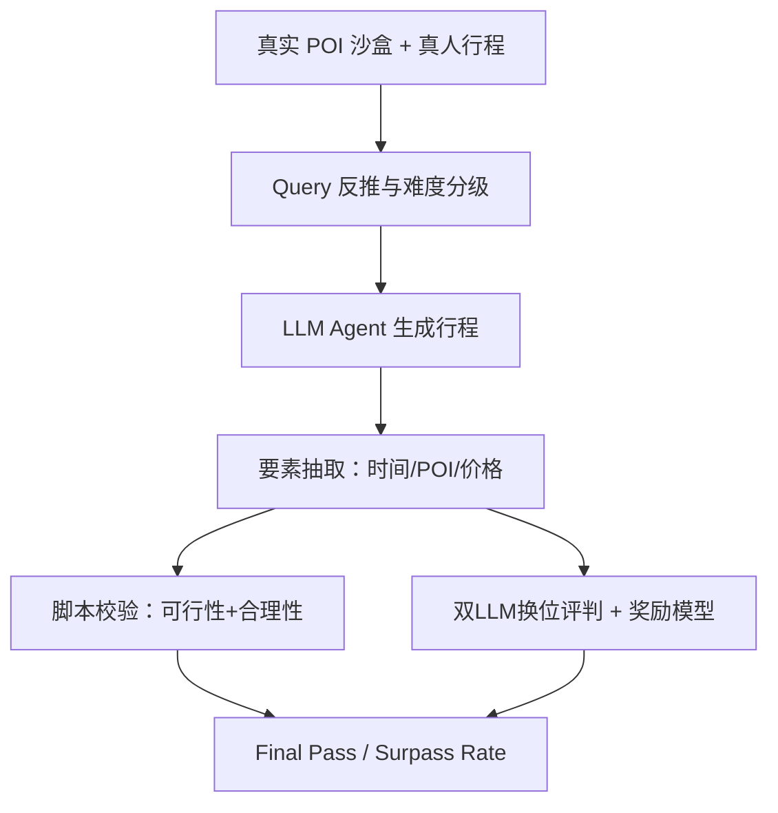
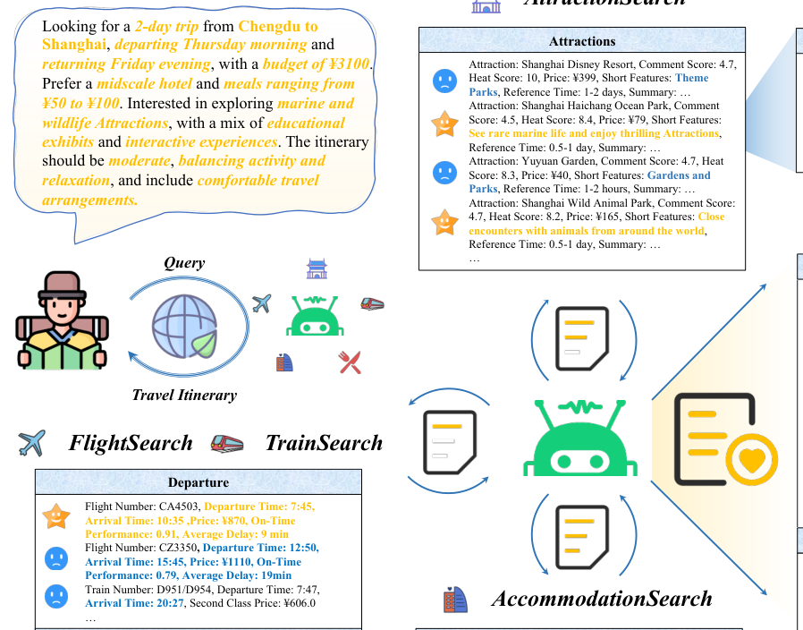

# TripTailor: A Real-World Benchmark for Personalized Travel Planning (TripTailor：面向个性化旅行规划的真实世界基准)

- **会议/期刊**: ACL 2025 Findings
- **作者与机构**: Yuanzhe Shen*, Kaimin Wang*, Changze Lv, Xiaoqing Zheng†, Xuanjing Huang（复旦大学计算机学院）
- **推荐链路定位**: 端到端生成式（LLM Agent 直接生成多日行程，含 POI 选择、时序编排与路线组织）
- **研究方向**: 时空轨迹与 POI 本地生活推荐 / 对话推荐与智能体仿真
- **论文原文**: [https://arxiv.org/abs/2508.01432v1](https://arxiv.org/abs/2508.01432v1)
- **开源代码**: [https://github.com/swxkfm/TripTailor](https://github.com/swxkfm/TripTailor)

## TL;DR (1分钟核心速览)

现有旅行规划基准（TravelPlanner、ChinaTravel）依赖模拟数据、规模小且只考核硬约束，无法回答"LLM 行程能否媲美真人"。本文构建 TripTailor：40 座城市、50 万+ 真实 POI、近 4000 条高评分真人行程，并配套"可行性—合理性—个性化"三维评估（客观脚本 + 双 LLM 换位评判 + 成对奖励模型）。在 703 条测试查询上，最强模型 GPT-4o 的最终通过率仅 21.5%，最终超越真人率 7.5%，o1-mini 亦仅 9.4%——SOTA LLM 全面落后于真人规划师。

## Background & Motivation (背景与核心矛盾)

- **主流范式**: 以 TravelPlanner 为代表的基准把旅行规划建模为"约束满足"任务，用规则脚本检查预算、餐价、不重复等硬性条件，配合 Direct/CoT/ReAct/Reflexion 等通用 Agent 策略评测。
- **前人局限**: 其一，TravelPlanner 主要基于模拟数据，ChinaTravel 虽用真实数据但仅覆盖 10 城、每城约 1200 POI，规模与真实性均不足；其二，纯约束式指标只保证"逻辑正确"，无法度量路线绕行、时间分配是否合理，更无法刻画个性化偏好匹配。
- **核心洞察 (Key Insight)**: 约束全通过 ≠ 高质量。作者发现 GPT-4o 的最终通过率比 DeepSeek-V3 高近 50%，但两者最终超越真人率几乎持平（7.5% vs 7.8%），说明硬约束与"人味"质量之间存在系统性断层；同时 LLM 生成行程的 POI 平均直线间距超 17 km，而真人行程仅 7.3 km，暴露其空间地理认知缺陷。
- **本文切入点**: 用真实 POI 沙盒 + 真人行程作为"参照答案"，把评估从"是否满足约束"升级为"能否在可行性、合理性、个性化三轴上比肩真人"。

## Method (核心方法设计)

### 1. 整体框架 (Overall Architecture)

TripTailor 由"沙盒环境—数据构建—评估框架"三层构成。沙盒覆盖 40 座中国热门旅游城市，含 28,832 条火车班次、15,110 条航线、5,622 个 4A 及以上景点、89,224 家酒店、422,120 家餐厅，并提供 AttractionSearch/HotelSearch/RestaurantSearch/FlightSearch/TrainSearch 五类工具。数据构建分四步：先建沙盒并清洗（仅保留 4A+ 景点、剔除缺价格/评分/类目的酒店餐厅、用高德补齐经纬度）；再从 OTA 采集高评分自助游行程，随机指派出发城市与日期、用沙盒补全交通与餐饮、由 LLM 仅做叙事重写而不补造信息；随后反推生成第一人称用户 Query（2–3 天为 Easy、4–7 天为 Hard）；最后经 LLM 一致性打分与人工复核做质量控制。评估端对生成行程做要素抽取后，分别走脚本客观校验、双 LLM 换位评判与奖励模型打分。

<figure class="paper-figure" markdown="span">
  <figcaption>图 1：TripTailor 概览。给定一个查询，语言智能体利用一系列工具收集、过滤并整合相关信息，从而逐步制定完整的旅行行程。这些智能体不仅需要从多个维度确保行程的可行性与合理性，还需深入分析用户的具体需求和个性化偏好，提供量身定制的旅行方案。</figcaption>
</figure>

### 2. 关键设计拆解 (Key Designs)

1. **路线效率的客观量化（Optimized Route）**：痛点在于"绕路"无法用通过/失败二值刻画。作者用相邻 POI 经纬度计算每日平均段距再对天数取均值：$D_{avg}=\frac{1}{n_d}\sum_{k=1}^{n_d}\frac{1}{M_k-1}\sum_{j=1}^{M_k-1}d^k_{j,j+1}$，其中$n_d$为总天数、$M_k$为第$k$ 天 POI 数。该指标与真人行程的比值（Route Distance Ratio）直接暴露空间认知差距，且无需标准答案即可横向比较。

2. **成对奖励模型作为个性化裁判（Reward-Model-as-a-Judge）**：LLM 评判可解释但受位置偏置与固有偏见影响。作者为每个 Query 构造正样本（其对应真人行程）与难负样本（用 TF-IDF 检索出发地、目的地、时长均相同但非精确匹配的另一 Query 所配行程），以标准 Bradley-Terry 成对损失训练：$-\mathbb{E}_{(x,y_c,y_r)\sim\mathcal{D}}\log\sigma\big(r_\theta(x,y_c)-r_\theta(x,y_r)\big)$。难负样本共享时空上下文，迫使模型学习细粒度偏好差异而非粗粒度城市/天数匹配。

3. **训练目标、负采样与推理效率**：奖励模型基于 Qwen2.5-1.5B-Instruct 微调，负采样为"同城同时长 TF-IDF 检索"的硬负样本而非随机负样本；LLM 评判侧采用 DeepSeek-V3 与 GPT-4o 双模型并交换候选位置取平均以消偏。推理侧所有非 Workflow 基线均预置检索信息（sole-planning 模式），以隔离"信息搜集能力"、专测"规划能力"；可行性判定设 30 步上限。

## Experimental Setup & Evaluation Protocol (实验设置与评估协议)

- **数据集与预处理**: 沙盒与行程统计如下（景点仅保留 4A+ 或已被验证行程引用者；酒店/餐厅剔除缺价格、类目、评分者）：

| 资源 | 规模 | 关键字段 | 过滤/说明 |
| :--- | :---: | :--- | :--- |
| 城市 | 40 | 出发城市 10 个 | 非大城市间缺直达交通，故限 10 个出发地 |
| 景点 | 5,622 | 评分、热度、票价、经纬度、建议时长 | 仅 4A+ 或被真人行程引用 |
| 酒店 | 89,224 | 类目、评分、价格、位置 | 剔除缺价格/类目/评分 |
| 餐厅 | 422,120 | 类目、评分、价格、位置 | 同上 |
| 火车/航班 | 28,832 / 15,110 | 时刻、票价、准点率 | 一周班次 |
| 真人行程 | ~4,000（测试 703） | Query + 逐日时间线 | Easy 354 / Hard 349 |

- **数据划分与防穿越 (Splitting Strategy)**: 按行程时长做难度分层划分（Easy 2–3 天、Hard 4–7 天），测试集 703 条经人工复核；Query 由行程反推生成，故不存在训练/测试泄漏，但 Query 分布偏向 LLM 表达习惯。
- **排名评测协议 (Ranking Protocol)**: 非检索式排序，而是"逐条行程对真人参照的成对比较"——Personalization Surpassing Rate 统计生成行程胜过真人行程的比例，Final Surpassing Rate 要求先通过全部可行性与合理性指标。属**有参照答案的成对评测**，非 Full-Ranking 亦非 Sampled Ranking。
- **对比基线与超参设置**: 6 个 LLM（GPT-4o、GPT-4o mini、DeepSeek-V3、Qwen2.5-7B/32B-Instruct、o1-mini）× 5 种策略（Direct、Zero-shot CoT、ReAct、Reflexion、Workflow 人工流程分解）；树搜索/MCTS 因搜索空间过大被排除。奖励模型微调 Qwen2.5-1.5B-Instruct，评判 LLM 为 DeepSeek-V3 与 GPT-4o。

## Key Experimental Results (实验关键数据)

### 1. 主实验对比 (Main Results)

All（703 条）设置下核心指标（Route Ratio 越低越好，其余越高越好）：

| 模型/策略 | Route Ratio | Feasibility Micro | Rationality Micro | Pers. (LLM) | Pers. (RM) | Final Surpass |
| :--- | :---: | :---: | :---: | :---: | :---: | :---: |
| Workflow + GPT-4o mini | **1.8** | **98.3** | **97.3** | 15.8 | 11.8 | **16.2** |
| Direct Qwen2.5-7B | 3.8 | 68.8 | 49.8 | 2.7 | 4.7 | 0.7 |
| Direct Qwen2.5-32B | 3.4 | 89.9 | 80.5 | 10.7 | 16.4 | 4.7 |
| Direct GPT-4o mini | 4.0 | 89.3 | 79.4 | 5.0 | 10.1 | 1.0 |
| CoT GPT-4o mini | 4.0 | 88.7 | 78.7 | 5.7 | 8.4 | 1.8 |
| ReAct GPT-4o mini | 3.8 | 84.9 | 77.5 | 6.5 | 2.4 | 1.1 |
| Reflexion GPT-4o mini | 3.9 | 86.1 | 78.8 | 6.3 | 2.7 | 0.3 |
| Direct DeepSeek-V3 | 3.4 | 96.4 | 93.3 | **22.5** | 20.8 | 7.8 |
| Direct GPT-4o | 3.3 | 98.3 | 96.6 | 12.9 | **22.3** | 7.5 |
| Direct o1-mini | 3.5 | 87.8 | 78.0 | 20.5 | 23.2 | 9.4 |

分难度看，Easy 上 o1-mini 的 Final Surpass 达 16.1%（全场最高），但 Hard 上骤降至 2.6%；GPT-4o 在 Hard 上 Rationality Micro 仅 73.1，说明长行程的多约束耦合是主要瓶颈。

### 2. 消融实验 (Ablation Study)

原文无模块级消融，但表 3 的"逐指标通过率拆解"与表 4 的"POI 类型组合"提供了等价归因：

| 配置/指标 | DeepSeek-V3 | GPT-4o | o1-mini | Workflow |
| :--- | :---: | :---: | :---: | :---: |
| Within Sandbox | 93.3 | **96.6** | 78.0 | 97.3 |
| Reasonable Meal Prices | 36.3 | 44.0 | 48.8 | **98.6** |
| Appropriate Visit Duration | 65.0 | 64.2 | 61.5 | **72.4** |
| Defined Budget Limit | 68.1 | 76.8 | 79.8 | **91.3** |
| Final Pass Rate | 14.4 | 21.5 | 18.3 | **63.3** |
| Route Ratio (A+R+H) | 3.4 | 3.3 | 3.5 | — |

### 3. 关键实验发现 (Key Findings)

1. **硬约束通过率与个性化质量严重脱钩**：Workflow 把 Final Pass Rate 从 GPT-4o 的 21.5% 拉到 63.3%，但 Final Surpass Rate 仅从 7.5% 升到 16.2%，说明流程分解主要修复"不出错"，几乎不提升"懂用户"。
2. **餐价与时长是最脆弱环节**：所有 LLM 的 Reasonable Meal Prices 通过率仅 36.3%–48.8%，Appropriate Visit Duration 仅 61.5%–65.0%，远低于 Within Sandbox 的 78%–96.6%，表明模型擅长"不幻觉"却不擅长"算账与排时"。
3. **空间认知是系统性短板**：仅看景点时 LLM 行程平均段距 15.9–17.2 km，真人仅 5.5 km，比值高达 5.9–6.1 倍；即便混入酒店餐厅后比值仍为 3.3–3.5，证明模型既不会选邻近景点，也不会把邻近景点排在相邻时段。

## Highlights & Limitations (亮点、对比与审稿批判)

- **与代表作对比 (vs. Prior Work)**: 相较 TravelPlanner（模拟数据、纯约束脚本、GPT-4 成功率 0.6%），TripTailor 用真实 POI 与真人行程把评测从"能否满足约束"推进到"能否比肩真人"；相较 ChinaTravel（10 城、约 1200 POI/城），规模提升一个数量级以上；相较 LLM-Modulo（外部验证器把成功率推到 20.6%）与 Hao et al.（LLM+算法混合达 97%），本文指出高约束通过率并不等价于高行程质量，提供了互补的评测视角。
- **可迁移亮点**: 其一，"同城同时长 TF-IDF 硬负样本 + Bradley-Terry"的奖励模型构造法可直接迁移到任何有参照答案的个性化生成评测（如行程、菜谱、学习计划）；其二，双 LLM 换位取平均的消偏协议是低成本提升 LLM-as-Judge 可靠性的通用手段。
- **审稿级局限批判**: 其一，个性化评估仍依赖 LLM 与奖励模型，模型偏见与幻觉无法根除，且奖励模型仅 1.5B、训练数据来自 LLM 反推 Query，存在自我强化风险；其二，数据仅覆盖中国 40 城、Query 为单轮且由 LLM 生成而非真实用户行为，跨文化泛化与多轮交互场景均未验证。

## Rating (四维评分)

- **方法创新性 (Novelty)**: ⭐⭐⭐⭐ （基准与评估框架创新扎实，"约束通过≠质量"的实证洞察有说服力，但方法层面偏评测而非建模）
- **评估协议与实验扎实度 (Protocol & Experiments)**: ⭐⭐⭐⭐ （三维九指标 + 双裁判 + 难度分层设计完整，703 条人工复核测试集可信；缺模块级消融与跨文化验证）
- **写作与数学规范度 (Clarity & Rigor)**: ⭐⭐⭐⭐ （指标定义与公式清晰，表 1 用颜色区分继承/新增指标很直观；奖励模型与评判细节部分下放附录）
- **工业落地与复现价值 (Industrial & Practical Value)**: ⭐⭐⭐⭐⭐ （代码与 50 万 POI 沙盒全开源，可直接作为旅行 Agent 的离线评测与奖励模型训练底座）

