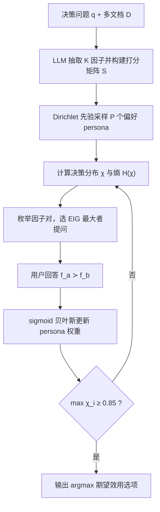
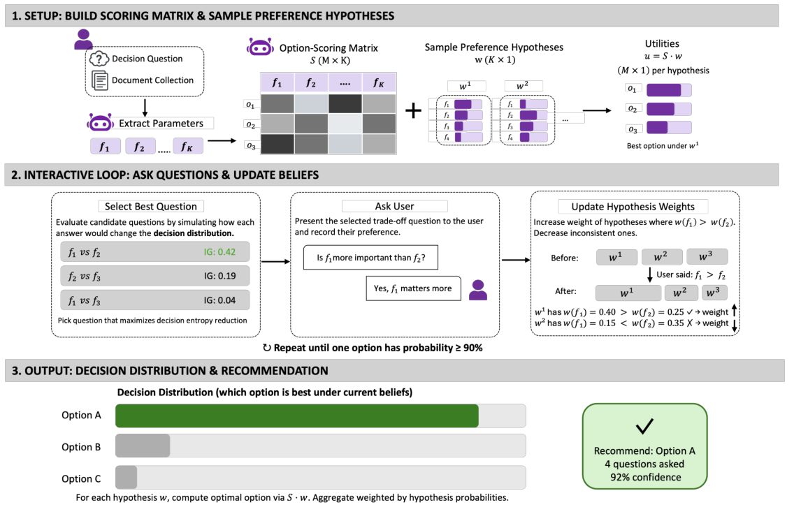

# Decisive: Guiding User Decisions with Optimal Preference Elicitation from Unstructured Documents (基于最优偏好引导的非结构化文档决策框架)

- **会议/期刊**: ACL 2026 Main Conference
- **作者与机构**: Akriti Jain, Anish Mulay, Divyansh Verma, Aishani Pandey, Pritika Ramu, Aparna Garimella (Adobe Research / IIT Madras / IIT Roorkee / IIIT Hyderabad / UMD)
- **推荐链路定位**: 重排（候选选项的交互式精排与决策收敛）
- **研究方向**: 对话推荐与智能体仿真 / 大语言模型推荐
- **论文原文**: [https://arxiv.org/abs/2604.18122v1](https://arxiv.org/abs/2604.18122v1)
- **开源代码**: 暂未开源

## TL;DR (1分钟核心速览)

现有 LLM 决策支持要么一次性输出泛泛建议、把权衡负担甩回用户，要么在理想化单目标场景下做结构化推理，无法处理"证据散落多文档 + 偏好隐式"的双重难题。DECISIVE 将决策显式解耦为**文档派生的客观选项-因子打分矩阵 $S$** 与**用户隐偏好向量$w^*$**，用 Dirichlet 先验 + 粒子采样维护偏好后验，并以"最小化最终决策熵"而非"最小化偏好熵"来选择成对权衡问题。在 Finance/Education/Hiring 三个自建基准上，Top-1 准确率达 78.8%/79.0%/90.2%，较最强全知情 LLM 基线最高提升约 20%，且平均仅需 2–6 轮提问、交互期零 LLM 调用。

## Background & Motivation (背景与核心矛盾)

- **主流范式**: 一类是通用 LLM 直接 Prompt（含 CoT）做一次性决策分析；另一类是 DeLLMa、DecisionFlow 等结构化决策框架，把自然语言场景转成状态/属性/效用并做期望效用最大化。
- **前人局限**: (1) 通用 LLM 是"静态信息提供者"，不建模用户隐偏好，输出抽象建议迫使用户自行核对；(2) DeLLMa/DecisionFlow 假设信息全部显式给出、且由单一目标（如利润最大化）主导，回避了多文档证据聚合与多目标权衡；(3) 对话式澄清方法（如 Active Preference Inference）优化的是"偏好分布熵"，会把提问预算浪费在无法区分候选的因子上。
- **核心洞察 (Key Insight)**: 决策可分解为**用户无关的事实评估**（选项在各因子上的客观得分，可离线预计算一次）与**用户相关的主观偏好建模**（隐向量，需交互获取）；且真正有价值的提问是能改变"最终选谁"的提问，而非泛泛降低偏好不确定性。
- **本文切入点**: 用选项打分矩阵 $S$ 锚定事实、用贝叶斯粒子后验跟踪偏好、用决策熵的期望信息增益 (EIG) 驱动提问，三者拼成闭环。

## Method (核心方法设计)

### 1. 整体框架 (Overall Architecture)

系统先由 LLM 从决策问题 $q$与文档集$\mathcal{D}$中抽取$K$个决策因子（实测平均$K=11.2$），并对每个 (选项, 因子) 对生成 8 级序数评估、映射到$[0,1]$构成$M\times K$的打分矩阵$S$；随后从均匀 Dirichlet 先验采样$P$个偏好向量（persona）作为初始信念；每轮挑选使决策分布熵下降最大的因子对$(a,b)$向用户提问，收到"$f_a \succ f_b$"后对 persona 权重做 sigmoid 贝叶斯更新并归一化；当最高选项置信度$\max_i \chi_i \ge \tau=0.85$ 时停止，输出后验期望效用最大的选项。整个交互阶段纯数值计算，不调用 LLM。

<figure class="paper-figure" markdown="span">
  <figcaption>图 3：DECISIVE 流程概览。系统首先从文档中提取 K 个偏好因素并构建选项评分矩阵 S，该矩阵量化每个选项在每个因素上的表现。Dirichlet 先验对用户偏好权重的不确定性建模，粒子样本表示可能的偏好向量。自适应选择决策感知问题，以最大化对决策分布的信息增益。用户响应触发贝叶斯更新，直到决策置信度超过阈值。</figcaption>
</figure>

### 2. 关键设计拆解 (Key Designs)

1. **客观打分矩阵 $S$与多模型中位数聚合**：痛点在于单次 LLM 打分易受模型偏置与幻觉污染。本文让 GPT-5、Gemini-3-Pro、Claude-4.5-Sonnet 三个模型各自在 8 级序数尺度上打分，再在序数尺度上取中位数后映射为数值，得到$S_{ij}\in[0,1]$。直觉是：序数中位数对单个模型的极端偏差天然鲁棒，且$S$ 与用户无关、可离线预计算，把"事实"与"偏好"彻底解耦。

2. **决策感知的主动提问（Decision-Aware EIG）**：这是与 Active Preference Inference 的本质差异。系统先边缘化 persona 得到选项级决策分布 $\chi_i=\sum_{p=1}^{P}\pi^{(p)}\cdot\mathbb{I}\left[\arg\max_{i'}(S\boldsymbol{w}^{(p)})_{i'}=i\right]$，再对每个候选因子对模拟两种回答、计算期望后验熵，选信息增益最大者：
$$\mathrm{EIG}(a,b)=H(\chi)-\mathbb{E}_{\text{resp}}\left[H(\chi^{(\text{resp})})\right]$$
由于目标函数直接定义在 $\chi$ 上，只有能翻转 top 候选排序的权衡才会被提问，无关因子被自动跳过——这正是"用更少问题达到更高准确率"的机制来源。

3. **软贝叶斯更新、停止准则与推理开销**：收到 $f_a\succ f_b$后按$\pi^{(p)}\leftarrow\pi^{(p)}\cdot\sigma\left(\kappa\,(w_a^{(p)}-w_b^{(p)})\right)$重加权并归一化。与硬性二值消除不同，矛盾 persona 只被降权而非删除，因此单次噪声回答不会造成信息灾难性丢失，也天然支持"两者同等重要"等中性反馈。总目标即最终推荐$o^*=\arg\max_i\sum_p \pi^{(p)}_{\text{final}}(S\boldsymbol{w}^{(p)})_i$。训练/推理均**免负采样、免梯度**；交互期零 LLM 调用，$P=500$ 时单场景全流程约 0.53s。

## Experimental Setup & Evaluation Protocol (实验设置与评估协议)

- **数据集与预处理**: 自建三域基准，Hiring 取自 Kaggle 公开简历库（按职业类别随机抽 10 份简历构成候选），Finance/Education 基于人工抓取的真实种子文档（贷款手册、招生简章）用 GPT-4o 合成并经三领域专家（Upwork 招募，$15/h）校验过滤。每个场景固定$M=10$ 个候选选项，刻意高于既有基准的 2–4 选项。

| 数据集 | #Scenarios | #Options/场景 | 平均因子数 $K$ | 文档来源 | 场景说明 |
| :--- | :---: | :---: | :---: | :---: | :--- |
| Education | 499 | 10 | 12.0 (8–17) | 合成（真实招生简章种子） | 选研究生项目 |
| Finance | 491 | 10 | 13.4 (8–21) | 合成（真实贷款手册种子） | 选信用卡/贷款方案 |
| Hiring | 500 | 10 | 8.3 (5–14) | Kaggle 真实简历 | 岗位候选人筛选 |

- **数据划分与防穿越 (Splitting Strategy)**: 无训练集，属**零样本评测**；每个场景独立采样 ground-truth 偏好向量 $\boldsymbol{w}^*$（对称 Dirichlet），真值决策$o^*=\arg\max_i(S\boldsymbol{w}^*)_i$ 由打分矩阵解析计算，不存在标签泄漏。
- **排名评测协议 (Ranking Protocol)**: 全候选 $M=10$的 **Full-Ranking**（非采样排序）；用户由确定性模拟器扮演（比较$w^*_a$与$w^*_b$ 作答），另设 Bradley-Terry 噪声模拟器（temperature=0.05）做鲁棒性检验。指标为 Top-1 Acc、Top-2 Acc (Hit@2)、NDCG@3、MRR 与平均提问数。
- **对比基线与超参设置**: 决策框架类 DeLLMa、DecisionFlow（二者均被喂入 ground-truth $\boldsymbol{w}^*$）、Active Preference Inference；Prompt 类 LLM-Direct、LLM-CoT（均知情$\boldsymbol{w}^*$）、LLM-Structured Dialogue（≤10 轮 yes/no）、LLM-Free Dialogue（自主决定问法与停止）。主实验$P=500$、$\tau=0.85$、$\kappa$ 控制更新锐度。

## Key Experimental Results (实验关键数据)

### 1. 主实验对比 (Main Results)

| 方法 | 对话? | Education Top-1 / NDCG@3 | Finance Top-1 / NDCG@3 | Hiring Top-1 / NDCG@3 | 平均提问数 |
| :--- | :---: | :---: | :---: | :---: | :---: |
| DeLLMa (知情 $\boldsymbol{w}^*$) | ✗ | 28.1 / 0.733 | 24.0 / 0.719 | 9.8 / 0.667 | – |
| DecisionFlow (知情 $\boldsymbol{w}^*$) | ✗ | 20.2 / 0.706 | 17.1 / 0.694 | 9.2 / 0.665 | – |
| Active Pref. Inference | ✓ | 13.0 / 0.679 | 9.8 / 0.667 | 32.0 / 0.749 | 7.5–9.7 |
| LLM-Direct (B1, 知情) | ✗ | 64.8 / 0.799 | 62.3 / 0.793 | 87.2 / 0.942 | – |
| LLM-CoT (B2, 知情) | ✗ | 65.5 / 0.804 | 67.0 / 0.827 | 87.8 / 0.949 | – |
| LLM-Structured Dialogue (B3) | ✓ | 9.4 / 0.225 | 13.4 / 0.265 | 11.4 / 0.229 | 4.1–6.9 |
| LLM-Free Dialogue (B4) | ✓ | 19.4 / 0.345 | 20.2 / 0.364 | 31.6 / 0.416 | 2.3–2.8 |
| **DECISIVE (Ours)** | ✓ | **78.8 / 0.893** | **79.0 / 0.887** | **90.2 / 0.958** | **1.9–6.1** |
| Improv. vs 最强基线 | – | +20.3% (vs B2) | +17.9% (vs B2) | +2.7% (vs B2) | 更少提问 |

### 2. 消融实验 (Ablation Study)

| 配置 | Top-1 Acc. | Top-2 Acc. | 时间 (s) | 平均提问数 |
| :--- | :---: | :---: | :---: | :---: |
| $P=10$ | 66.9 | 84.5 | 0.021 | 2.41 |
| $P=100$ | 77.5 | 89.5 | 0.086 | 3.23 |
| **$P=500$（主实验）** | **82.7** | **93.7** | **0.533** | **4.24** |
| $P=1000$ | 82.9 | 92.6 | 0.849 | 4.01 |
| $P=2000$ | 83.9 | 93.4 | 1.289 | 4.54 |
| 噪声响应 (Temp=0.05, Edu/Fin/Hiring) | 76.6 / 76.8 / 89.6 | 91.0 / 90.4 / 97.4 | – | 5.5 / 6.2 / 1.8 |
| 候选数 $M=5$ (Edu/Fin/Hiring) | 81.0 / 79.0 / 93.4 | 93.8 / 95.0 / 98.0 | – | 3.7 / 3.4 / 1.2 |

### 3. 关键实验发现 (Key Findings)

1. **"知情"不等于"会用"**：B1/B2 拿到 ground-truth 偏好向量后仍只有 62–67%（Edu/Fin），说明 LLM 在 $10\times 11$ 矩阵上做多步加权数值推理是瓶颈；DECISIVE 在**不知情**条件下反超知情基线 12–20 个百分点，证明把偏好跟踪外包给显式贝叶斯模型比让 LLM 隐式推理更可靠。
2. **对话本身不是解药，状态跟踪才是**：B3/B4 在无 $\boldsymbol{w}^*$ 时准确率崩至 9–32%，而 DECISIVE 用同一交互预算（Hiring 域仅 1.9 轮）达到 90.2%，说明增益来自粒子后验这一显式信念状态，而非"多轮"这一形式。
3. **决策熵目标优于偏好熵目标**：Active Preference Inference 需 7.5–9.7 轮却仅得 9.8–32.0%，DECISIVE 用 5–6 轮即达约 79%，且 $P$从 500 增至 2000 仅带来 1.2 个点提升而耗时翻 2.4 倍，验证$P=500$ 时 EIG 估计已足够稳定；噪声响应下 Top-1 仅掉 2–2.5 个点，印证软重加权而非硬消除的抗噪价值。

## Highlights & Limitations (亮点、对比与审稿批判)

- **与代表作对比 (vs. Prior Work)**: 相比 DeLLMa/DecisionFlow，本文不假设单目标与全显式信息，而是把多文档证据压缩为可复用的 $S$ 并显式建模多目标权衡；相比 Active Preference Inference，提问目标从"偏好熵"改为"决策熵"，从"二值消除"改为"软贝叶斯重加权"；相比 ChoiceMates 等纯对话多智能体方案，本文给出可计算、可停止、可解释的定量决策路径。
- **可迁移亮点**: (1) "用户无关矩阵离线预计算 + 用户相关偏好在线推断"的解耦范式，可直接迁移到电商参数化选品、保险/信贷方案匹配等结构化重排场景；(2) 以最终排序分布熵为采集函数（而非模型参数熵）的主动学习准则，可复用到冷启动问卷设计与对话式澄清策略。
- **审稿级局限批判**: (1) 效用模型为线性加权，假设因子独立，无法刻画"价格低于阈值才看重质量"这类交互/非线性偏好，且 $K$个因子固定，文档外目标（情感、人脉）无法进入；(2) 评测完全依赖模拟用户与合成文档，缺少真人可用性研究，$S$ 的 LLM 打分幻觉虽有中位数聚合缓解但残差仍会传导至最终决策，真实部署的信任度与延迟尚未验证。

## Rating (四维评分)

- **方法创新性 (Novelty)**: ⭐⭐⭐⭐ （解耦"客观打分矩阵 + 贝叶斯偏好粒子"的框架清晰，决策熵 EIG 替代偏好熵是真正有区分度的增量，但各组件均为成熟技术的组合）
- **评估协议与实验扎实度 (Protocol & Experiments)**: ⭐⭐⭐ （三域 1490 场景、Full-Ranking、噪声与 $M$ 消融较完整，但全为模拟用户与合成文档，缺真人研究与公开可复现划分）
- **写作与数学规范度 (Clarity & Rigor)**: ⭐⭐⭐⭐ （问题形式化与更新/EIG 公式定义干净、符号一致，复杂度与 LLM 调用开销分析到位，线性效用假设的局限亦自陈）
- **工业落地与复现价值 (Industrial & Practical Value)**: ⭐⭐⭐⭐ （交互期零 LLM 调用、单场景约 0.5s、提问数 2–6 轮，工程成本极低；但代码未开源且依赖三款闭源大模型打分，复现门槛偏高）

