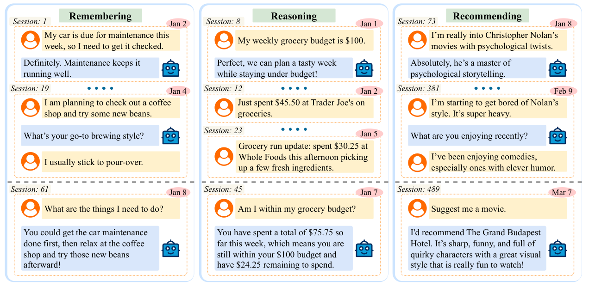
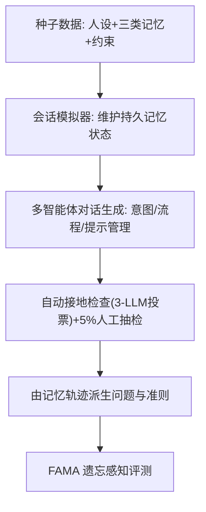

# From Recall to Forgetting: Benchmarking Long-Term Memory for Personalized Agents (从回忆到遗忘：面向个性化智能体的长期记忆基准)

- **会议/期刊**: ACL 2026 Findings
- **作者与机构**: Md Nayem Uddin, Kumar Shubham, Eduardo Blanco, Chitta Baral, Gengyu Wang (Arizona State University / Genies / University of Arizona)
- **推荐链路定位**: 端到端生成式（对话式个性化推荐智能体）
- **研究方向**: 对话推荐与智能体仿真 / 大语言模型推荐
- **论文原文**: [https://arxiv.org/abs/2604.20006v1](https://arxiv.org/abs/2604.20006v1)
- **开源代码**: [https://github.com/geniesinc/Memora](https://github.com/geniesinc/Memora)

## TL;DR (1分钟核心速览)

现有长期记忆基准把"记忆"退化为跨会话事实检索：LoCoMo 中 94%、LongMemEval 中 85% 的问题只需回溯不超过 2 个会话，且几乎不考察记忆的更新与失效。本文提出 Memora——覆盖周/月/季三个时间尺度、平均需整合 5.3/17.3/28.4 个历史会话、含 2.7/8.8/14.8 次记忆突变的个性化智能体基准，并给出 FAMA 指标显式惩罚对过期记忆的复用。在 4 个 LLM 与 6 个记忆智能体上的评测显示：记忆智能体仅在"记忆"任务占优（聚合 FAMA 119.45 vs LLM 65.60），"推理"任务全员崩塌（最高仅 27.55），且遗忘惩罚使智能体分数在季度设定下平均再降 29.5 分。

## Background & Motivation (背景与核心矛盾)

- **主流范式**: 长期记忆评测被操作化为"从历史对话中检索事实"，以 LoCoMo、LongMemEval、PersonaMem 为代表，通过加长上下文或外挂向量库来测召回。
- **前人局限**: 其一，**记忆整合压力过低**——现有基准平均只需参考约 1 个历史会话（表 1），模型靠近期上下文即可蒙对；其二，**记忆突变压力近乎为零**——LongMemEval 最多 2 次更新、PersonaMem 最多 3 次，模型无需调和同一事实的多次修订。
- **核心洞察 (Key Insight)**: 真实长期交互是**非平稳**的，用户偏好会漂移、预算会累加、待办会完成或撤销；而现有指标只奖励"相关信息是否出现"，对"是否误用了已失效信息"零惩罚，导致高分可能建立在混淆过去与现在之上。
- **本文切入点**: 用显式记忆轨迹（memory trace）驱动仿真，把"整合"与"突变"同时拉满，并把"遗忘正确性"写进指标。

<figure class="paper-figure" markdown="span">
  <figcaption>图1：Memora基准的三个任务：1）记忆：回忆并利用先前讨论过的事实，例如待办事项；2）推理：整合多条信息以得出特定答案，例如计算杂货预算状况；3）推荐：根据用户不断变化的偏好推荐相关项目或行动，例如在用户对Christopher Nolan的电影感到厌倦后推荐The Grand Budapest Hotel。每个任务都依赖于从非连续、时间上相隔较远的会话中选择性提取并重用相关信息，em</figcaption>
</figure>

## Method (核心方法设计)

### 1. 整体框架 (Overall Architecture)

Memora 采用"种子数据 → 会话仿真 → 对话生成 → 任务派生"的四段式流水线。先从 10 个职业人设出发，定义偏好/活动/目标三类记忆与操作、时间约束；会话模拟器维护一个持久记忆状态，逐会话决定记忆实体的引入、更新、删除，并混入记忆中性会话；随后由多智能体（用户/助手分角色）把会话规格渲染成多轮对话，经 LLM 三方投票的自动接地检查与 5% 人工抽检双重过滤；最后由记忆轨迹直接派生 Remembering / Reasoning / Recommending 三类问题及原子化评估准则。

### 2. 关键设计拆解 (Key Designs)

1. **记忆轨迹驱动的可控突变仿真**：痛点在于真实长期日志难以采集且无法标注"何时该忘"。Memora 让模拟器在每会话前后快照完整记忆状态，把记忆操作显式参数化为 Add/Update/Delete（季度设定下占比 63%/18%/19%），从而让"哪条信息在哪个时刻失效"成为可验证的 ground truth。这样做的直觉是：只有把遗忘变成可观测事件，遗忘能力才可被度量。

2. **FAMA 遗忘感知准确率**：标准 memory-presence 指标只看"该说的说了没"，不看"不该说的说了没"。FAMA 把每题准则拆成 presence 与 forgetting-absence 两组二值判据，用加权惩罚聚合：

$$\text{FAMA}=\max\left(0,\ \text{MPA}-\lambda\cdot(1-\text{FAA})\right),\quad \lambda=\frac{N_{\text{forget}}}{N_{\text{presence}}+N_{\text{forget}}}$$

其中 MPA 为有效记忆命中率、FAA 为失效记忆排除率。$\lambda$按题目中遗忘准则的占比自适应加权，使"遗忘负担重"的题目惩罚更重；$\max(0,\cdot)$ 保证非负。物理直觉是：记忆系统的错误是**不对称**的，复用过期偏好的代价应高于漏说一条旧事实。

3. **三任务分层与判据原子化**：Remembering 考直接召回（如待办清单），Reasoning 考跨会话聚合（如预算余额计算），Recommending 考偏好漂移后的推荐（如厌倦诺兰后推《布达佩斯大饭店》）。每题配原子判据，由 GPT-4.1 / Claude Haiku 4.5 / Gemini 2.5 Flash 三裁判多数投票，与人工标注一致率 88.3%，Cohen's $\kappa$ 为 0.86–0.90。该设计使"部分召回"与"完全错答"可区分，直接支撑了第 6 节的错误归因。

## Experimental Setup & Evaluation Protocol (实验设置与评估协议)

- **数据集与预处理**: Memora 自身即评测数据，按时间跨度分三档：

| 设定 | #Personas | 平均会话数 | 平均轮次/会话 | 平均记忆操作 | 问题数 | 评估准则数 |
| :--- | :---: | :---: | :---: | :---: | :---: | :---: |
| Weekly | 10 | 155 | 16.1 | 103.2 | 150 | 749 |
| Monthly | 10 | 615 | 15.6 | 374.3 | 150 | 1421 |
| Quarterly | 10 | 1991 | 15.7 | 1171.4 | 300 | 4884 |

  对话多样性经 n-gram 重叠（1-gram 0.126–0.144）与 SBERT 余弦（0.272–0.281）验证，无明显模板复用。

- **数据划分与防穿越 (Splitting Strategy)**: 非传统训练/测试划分，而是**时间轴前向评测**——问题锚定在某一会话时刻，模型只能看到该时刻之前的全部历史，记忆轨迹保证答案随时间演化，天然防穿越。
- **排名评测协议 (Ranking Protocol)**: 非排序式评测，采用**准则级二值判定 + 聚合打分**。每题 FAMA 归一化至 $[0,1]$，任务内求和后线性缩放至$[0,100]$。无负采样，全量问题评测。
- **对比基线与超参设置**: 两组基线。(i) 4 个 LLM（GPT-5.2、Claude Sonnet 4.5、Gemini 3 Pro Preview、Qwen3-32B），各测"带/不带 reasoning token"两档；(ii) 6 个记忆智能体（A-Mem、LangMem、Mem-0、MemoBase、MemoryOS、Nemori），统一以 GPT-4o-mini 为回答后端，覆盖本地向量库、云记忆 API、画像驱动、有状态智能体四类范式。

## Key Experimental Results (实验关键数据)

### 1. 主实验对比 (Main Results)

表 1 为跨三档时间聚合后的 FAMA（满分 300，即三档各 100 求和），保留代表性系统：

| 系统 | Remembering↑ | Recommending↑ | Reasoning↑ |
| :--- | :---: | :---: | :---: |
| GPT-5.2 (无推理) | 68.63 | **159.28** | 5.66 |
| Claude Sonnet 4.5 (带推理) | 67.09 | **165.08** | 6.50 |
| Gemini 3 Pro (带推理) | 62.40 | 139.11 | **24.50** |
| Qwen3-32B (带推理) | 66.62 | 150.81 | 18.00 |
| A-Mem | **154.50** | 107.51 | 9.00 |
| LangMem | 152.30 | 126.81 | **55.00** |
| MemoBase | 78.86 | **173.02** | 26.00 |
| MemoryOS | 106.67 | 155.20 | 32.16 |
| Nemori | 142.97 | 140.40 | 25.16 |
| **LLM 均值** | 65.60 / 65.80 | 144.72 / 153.34 | 12.37 / 13.92 |
| **Agent 均值** | **119.45** | 138.37 | **27.55** |

分档细看（表 3），记忆智能体在 Remembering 上从 Weekly 到 Quarterly 大幅衰减：MemoBase 43.60→15.18、MemoryOS 51.84→25.05、Mem-0 40.42→19.90；Reasoning 上 MemoBase 18.00→1.00、MemoryOS 20.66→5.50。

### 2. 消融实验 (Ablation Study)

本文为基准论文，核心"消融"是**指标消融**——去掉遗忘惩罚项后的分数变化（表 5，括号内为 FAMA 相对 memory-presence 的降幅）：

| 系统 | Weekly | Monthly | Quarterly |
| :--- | :---: | :---: | :---: |
| GPT-5.2 (无推理) | 115.4 (−30.7) | 96.6 (−21.8) | 92.5 (−14.7) |
| Gemini 3 Pro (无推理) | 114.2 (−42.0) | 110.6 (−39.4) | 101.8 (−27.9) |
| A-Mem | 118.0 (−9.1) | 112.0 (−29.5) | 118.6 (−37.9) |
| LangMem | 173.0 (−23.0) | 132.2 (−31.1) | 127.4 (−43.4) |
| MemoryOS | 155.2 (−20.6) | 112.8 (−28.4) | 99.6 (−25.0) |
| Nemori | 159.4 (−22.8) | 105.4 (−15.4) | 106.8 (−26.3) |

### 3. 关键实验发现 (Key Findings)

1. **遗忘惩罚会改写排行榜**：Monthly 设定下 MemoryOS（112.8）与 A-Mem（112.0）的 memory-presence 均高于 Nemori（105.4），但 Nemori 的遗忘降幅仅 15.4，远小于 28.4 与 29.5，最终 FAMA 反超二者。这说明"记得多"与"忘得对"是两种能力，传统指标系统性高估了后者弱的系统。
2. **LLM 与智能体的遗忘失效方向相反**：LLM 的降幅随跨度增大而**收窄**（32.6→17.8），并非记忆变好，而是历史超出上下文窗口、相关信息被整体丢弃；智能体的降幅反而**扩大**（18.2→29.5），因为记忆库越滚越大，过期条目被检索命中的概率随之上升。这直接指向"检索增强"路线的结构性缺陷。
3. **推荐任务被"人设先验"兜底，推理任务无此退路**：Recommending 是唯一 LLM 可匹敌甚至超越智能体的任务（带推理 153.34 vs 138.37），因为推荐允许多种合理答案，模型可凭上下文残留的人设线索猜出大致偏好；而 Reasoning 要求精确整合多条记忆（如算出剩余预算 24.25），全员最高仅 27.55。错误分析佐证：推荐错误中 64% 源于未遗忘过期偏好、28% 源于偏好部分召回；推理错误 100% 源于记忆元素召回不全导致无法整合。

## Highlights & Limitations (亮点、对比与审稿批判)

- **与代表作对比 (vs. Prior Work)**: 相较 LoCoMo / LongMemEval 把长期记忆压缩为"跨会话事实检索"（平均整合约 1 个会话、突变 ≤2 次），Memora 把整合与突变同时提升一个量级（季度档平均 28.4 个会话、14.8 次突变）；相较 PersonaMem 的多选题式个性化推断，Memora 采用开放式生成 + 原子判据，能定位"错在哪一条记忆"；相较 MemoryAgentBench 对遗忘的概念性提及，FAMA 首次把遗忘做成可计算的惩罚项。
- **可迁移亮点**: (i) "记忆轨迹快照 + 前后状态差分"的构造范式，可直接迁移到电商用户画像演化、订阅偏好漂移等场景的评测集构建；(ii) FAMA 的 $\lambda$ 自适应加权思路，可迁移到任何"漏召回"与"误召回"代价不对称的评估任务（如去噪推荐中的假阳性惩罚）。
- **审稿级局限批判**: (i) 全仿真数据，虽作者论证"仿真不降低难度、应视为下界"，但真实交互中的隐式更新与矛盾信号未被覆盖，基准的外部效度仍待验证；(ii) 评测完全依赖 LLM-as-judge 三裁判投票，尽管与人工一致率达 88.3%，裁判模型与被测模型存在同源偏置风险；(iii) 未报告任何时延/开销指标，而记忆智能体的检索开销随季度档 1991 个会话线性增长，工程可行性存疑；(iv) 人设仅 10 个、记忆类型仅三类，社会关系与多用户协同记忆缺席。

## Rating (四维评分)

- **方法创新性 (Novelty)**: ⭐⭐⭐⭐ （基准构造本身是工程整合而非算法创新，但 FAMA 把"遗忘"从口号变成可计算惩罚项，是评估视角的实质推进）
- **评估协议与实验扎实度 (Protocol & Experiments)**: ⭐⭐⭐⭐ （三档时间跨度 + 4 LLM × 2 档推理 + 6 智能体覆盖全面，判据原子化且有人工一致性验证；扣分在于纯仿真与裁判同源风险）
- **写作与数学规范度 (Clarity & Rigor)**: ⭐⭐⭐⭐ （FAMA 公式与 $\lambda$ 定义简洁自洽，表 1 的整合/突变对比极具说服力；但任务级归一化到 [0,100] 的细节略简，跨表分数不可直接相加易误读）
- **工业落地与复现价值 (Industrial & Practical Value)**: ⭐⭐⭐⭐ （代码与数据已开源，记忆轨迹构造范式对个性化助手/陪伴类产品可直接复用；但季度档近 2000 会话的检索开销与缺乏时延报告限制了线上部署参考价值）
