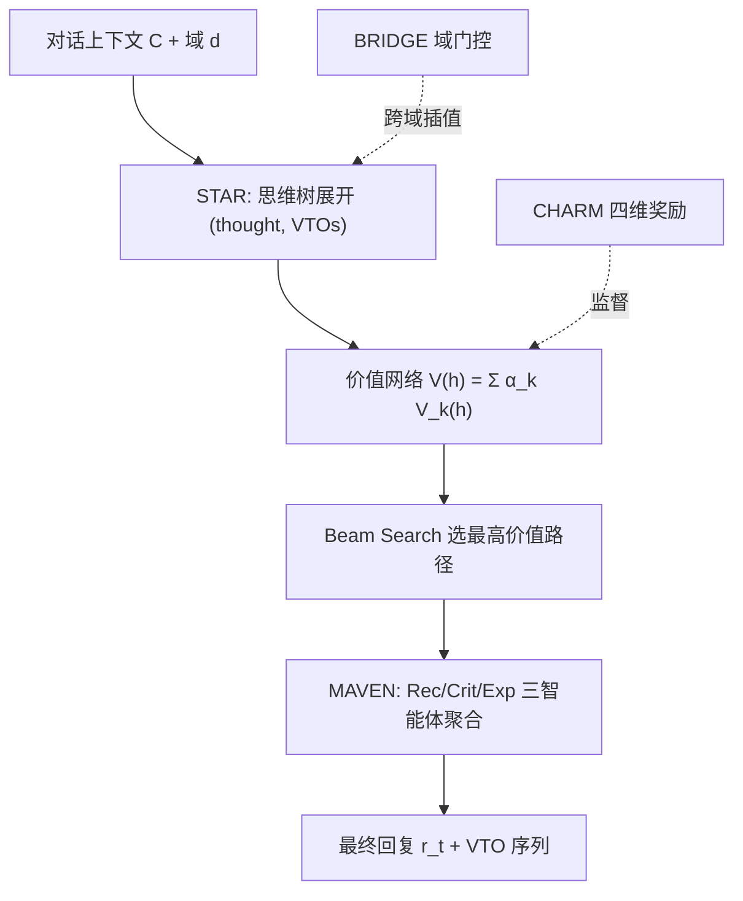
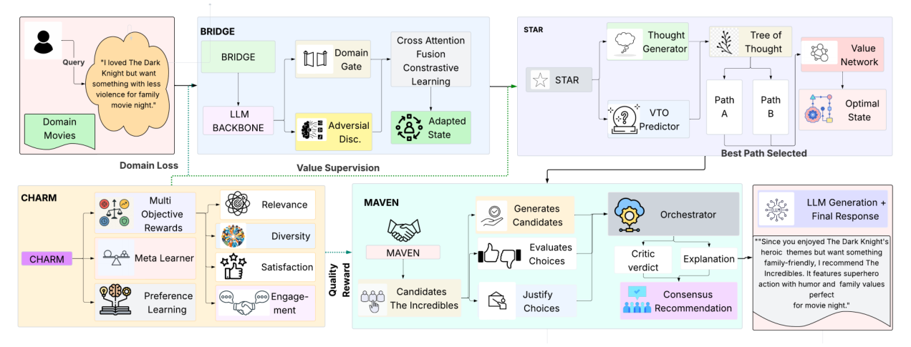

# HARPO: Hierarchical Agentic Reasoning for User-Aligned Conversational Recommendation (面向用户对齐对话推荐的分层智能体推理)

- **会议/期刊**: ACL 2026
- **作者与机构**: Subham Raj, Aman Vaibhav Jha, Mayank Anand, Sriparna Saha (IIT Patna / IIIT Allahabad)
- **推荐链路定位**: 重排（对话内候选策略的推理与选择）
- **研究方向**: 对话推荐与智能体仿真 / 大语言模型推荐
- **论文原文**: [https://arxiv.org/abs/2604.10048v2](https://arxiv.org/abs/2604.10048v2)
- **开源代码**: [https://harpo-bench.github.io](https://harpo-bench.github.io)

## TL;DR (1分钟核心速览)

现有 LLM 对话推荐系统（CRS）在 Recall@K、BLEU 等代理指标上刷分很高，但这些指标与用户真实满意度弱相关——系统能检索到"正确"物品、生成流畅回复，却抓不住"夏季婚礼的休闲装"这类隐含意图。HARPO 把对话推荐重构为**结构化决策问题**：将推荐质量分解为相关性/多样性/满意度/参与度四维分层奖励（CHARM），用该奖励训练价值网络引导树搜索推理（STAR），辅以域无关虚拟工具操作（VTOs）与多智能体精炼（MAVEN）。在 ReDial/INSPIRED/MUSE 上，R@10 分别达 29.8%/27.4%/38.6%，较最强基线提升 12.9%–34.3%，满意度维度提升 18%–29%。

## Background & Motivation (背景与核心矛盾)

- **主流范式**: 以 ReDial 为起点的生成式 CRS（UniCRS、BARCOR、DCRS）及 LLM 智能体方法（RecMind、InteRecAgent）联合优化物品检索似然与回复生成似然，评测依赖 Recall@K、BLEU、工具调用准确率。
- **前人局限**: 其一，代理指标只奖励"技术正确性"，与用户对齐质量仅弱相关（图 1 所示错位）；其二，现有工具增强方法把推理与领域特定工具强耦合，跨域迁移与评测一致性均受限。
- **核心洞察 (Key Insight)**: 推荐推理在不同域共享同一认知结构（抽取约束→检索→排序→解释），差异只在底层工具；因此可把"推荐质量"本身作为一等优化目标，而非生成过程的副产品。
- **本文切入点**: 用可解释的四维质量奖励替代代理目标，并让树搜索在推理路径层面直接最大化该奖励。

## Method (核心方法设计)

### 1. 整体框架 (Overall Architecture)

HARPO 以 DeepSeek-R1-Distill-Qwen-7B 为骨干（LoRA r=16，仅 42.7M 可训练参数），四阶段课程训练：Stage 1 联合 SFT 回复生成与 VTO 序列预测；Stage 2 用 CHARM 在偏好对上训练四维分层奖励头；Stage 3 以 CHARM 奖励为监督蒸馏出 STAR 的快速价值网络；Stage 4 训练 MAVEN 三角色智能体。推理时 STAR 以 beam search 展开推理树，价值网络对每个候选路径打分，选最高价值路径生成最终回复；BRIDGE 的域门控在跨域时插值域不变表征与原始隐状态。

<figure class="paper-figure" markdown="span">
  <figcaption>图2：HARPO框架的整体架构。该模型集成了四个组件：用于结构化智能体推理的STAR、用于分层偏好优化的CHARM、用于跨域迁移的BRIDGE，以及用于多智能体精炼的MAVEN，均构建在共享的语言模型主干之上。</figcaption>
</figure>

### 2. 关键设计拆解 (Key Designs)

1. **CHARM 分层奖励与自适应权重**：单一标量奖励无法区分"相关但无聊"与"多样但跑题"。CHARM 为四维各设一个 tanh 有界奖励头 $R_k(h)=\tanh(\mathbf{W}_k^{(2)}\cdot\text{GELU}(\mathbf{W}_k^{(1)}h))$，总奖励$R(h)=\sum_k w_k R_k(h)$，权重由元学习器依上下文与域嵌入动态生成$w=\text{softmax}(\mathbf{W}_{\text{meta}}[\text{Enc}(h);e_d]+b)$。偏好优化采用自适应间隔的 margin 损失$\mathcal{L}_{\text{pref}}=-\log\sigma(\beta(R(h^+)-R(h^-)-m))$，$m$ 随样本对自适应，防止平凡分离。直觉：显式偏好查询时相关性权重升至 0.42，探索式对话时多样性权重升至 0.31。

2. **STAR 质量引导树搜索**：通用 ToT 以"任务完成"为价值信号，与推荐质量错位。STAR 的推理状态 $s=(h,\tau,v,d)$携带完整轨迹隐状态，价值网络直接预测四维质量$V(h)=\sum_k\alpha_k V_k(h)$，beam search 按$s^*=\arg\max_{s\in\text{Beam}(s_0,w,D)}V(h_s)$ 选路。关键收益在于价值网络由 CHARM 奖励蒸馏而来——把"生成完整回复再评估"的慢奖励压缩为"仅处理隐状态"的快估计，使推理期树搜索可行（额外延迟仅 210ms）。

3. **VTOs 与 BRIDGE 的域解耦**：21 个域无关推理原语（extract_entities、rank_options、handle_rejection 等）把高层推理与具体工具解耦，运行时再映射到真实 API。BRIDGE 用梯度反转做对抗域适应 $\mathcal{L}_{\text{domain}}=\text{CE}(\text{Disc}(\text{GRL}_\alpha(z)),d)$，并以 VTO 预测辅助任务$\mathcal{L}_{\text{task}}$防信息坍缩，最后用域门控$z'=\sigma(g_d)\odot z+(1-\sigma(g_d))\odot h$ 保留域特有信号。总损失为四阶段加权和，训练全程无负采样（偏好对由规则退化、LLM 对比生成、人工标注三路构造）。

## Experimental Setup & Evaluation Protocol (实验设置与评估协议)

- **数据集与预处理**:

| 数据集 | #Users(Conv.) | #Items | #Interactions(Utter.) | 稀疏度/密度 | 特征/场景说明 |
| :--- | :---: | :---: | :---: | :---: | :--- |
| ReDial | 10,006 | 51,699 | 182,150 | 18.2 轮/会话 | 电影，交易型对话 |
| INSPIRED | 1,001 | 8,952 | 35,811 | 35.8 轮/会话 | 电影，社交型+说服策略 |
| MUSE | 7,000 | 13,754 | 83,204 | 11.9 轮/会话 | 时尚，文本+图像，场景化 |

- **数据划分与防穿越**: 沿用官方划分（ReDial 8K/1K/1K，INSPIRED 800/100/101，MUSE 5.6K/0.7K/0.7K），INSPIRED 过滤少于 4 轮的会话；CHARM 奖励模型仅在训练集偏好对上训练后冻结，杜绝测试期 reward hacking。
- **排名评测协议**: 采用 `Sampled Ranking`——每正样本配 99 个随机负样本，在 100 候选内计算 Recall@{1,10,50}、MRR@10、NDCG@10（作者援引 Krichene & Rendle 论证该协议的计算-效度折中）。满意度/参与度为 CHARM 奖励归一化至 [0,1]，另以 3 名专家对每数据集 200 样本做 1–5 分人工评测（Fleiss κ>0.72）。
- **对比基线与超参**: 覆盖知识增强（KBRD/KGSF/UniCRS）、检索增强（BARCOR/DCRS）、LLM（ChatGPT/GPT-4/LLaMA-2）、推理增强（RecMind/InteRecAgent）四类；beam width $w=3$、深度$D=3$、$\beta=0.5$、LoRA$r=16$；3 次随机种子取均值±标准差，配对 t 检验 + Bonferroni 校正，$p<0.01$。

## Key Experimental Results (实验关键数据)

### 1. 主实验对比 (Main Results)

| 方法 | ReDial R@10 | ReDial NDCG@10 | ReDial Sat. | INSPIRED R@10 | MUSE R@10 | MUSE Sat. |
| :--- | :---: | :---: | :---: | :---: | :---: | :---: |
| KGSF | 18.1 | 11.6 | 0.45 | 13.8 | – | – |
| UniCRS | 21.2 | 13.8 | 0.51 | 17.6 | 11.8† | 0.36 |
| DCRS | 25.1 | 15.2 | 0.56 | – | – | – |
| GPT-4 / GPT-4V | 19.4 | 13.2 | 0.55 | 18.8 | 23.2 | 0.54 |
| RecMind | 22.6 | 15.3 | 0.54 | 20.4 | – | – |
| Qwen2-VL-7B | – | – | – | – | 34.2 | 0.61 |
| **HARPO** | **29.8** | **21.2** | **0.68** | **27.4** | **38.6** | **0.72** |
| Improv.% | +18.7% (vs DCRS) | +39.5% | +21.4% | +34.3% (vs RecMind) | +12.9% (vs Qwen2-VL) | +18.0% |

### 2. 消融实验 (Ablation Study)

| 变体 | R@10 | NDCG@10 | Sat. | 说明 |
| :--- | :---: | :---: | :---: | :--- |
| HARPO (Full) | 29.8 | 21.2 | 0.68 | – |
| w/o CHARM | 24.6 | 17.2 | 0.55 | 价值网络改用任务完成信号 |
| w/o STAR | 27.0 | 19.0 | 0.63 | 贪心解码替代树搜索 |
| w/o BRIDGE | 28.4 | 20.2 | 0.66 | 去域适应 |
| w/o MAVEN | 28.0 | 19.9 | 0.65 | 去多智能体 |
| w/o VTOs | 23.4 | 16.4 | 0.53 | $\lambda_v=0$ |
| Flat Reward | 26.0 | 18.2 | 0.58 | 四维坍缩为标量 |
| Fixed Weights | 27.2 | 19.1 | 0.62 | 均匀权重替代元学习 |
| SFT Only | 21.6 | 14.6 | 0.50 | 仅 Stage 1 |

### 3. 关键实验发现 (Key Findings)

1. **VTOs 与 CHARM 是双支柱**：移除 VTOs 掉 21.5% R@10、移除 CHARM 掉 17.4%，二者降幅远超 STAR（9.4%）与 BRIDGE（4.7%），说明"域无关推理原语 + 多维质量奖励"才是增益主源，树搜索只是放大器。
2. **代理指标与用户对齐指标的解耦被实证**：HARPO 在满意度/参与度上的相对提升（+21.4%/+23.1%）系统性高于 Recall 类指标（+18.7%），且人工评测中 ReDial 综合分 4.01 vs GPT-4 的 3.46（+0.55），证明增益并非来自代理指标刷分。
3. **跨域迁移高度依赖 BRIDGE**：ReDial→MUSE 零样本下，去掉 BRIDGE 后 R@10 从 25.4 跌至 17.8（−42.7%）；域门控分析显示视觉属性类门值仅 0.2–0.3，而偏好建模类门值达 0.7–0.8，验证了"推理操作可迁移、域特征需保留"的设计直觉。

## Highlights & Limitations (亮点、对比与审稿批判)

- **与代表作对比 (vs. Prior Work)**: 相比 RecMind/InteRecAgent 的"任务完成式"智能体推理，HARPO 把价值信号换成多维推荐质量；相比 DCRS 的对比检索增强，它不优化检索似然而优化决策质量；相比通用 ToT，其价值网络是领域特化的质量预测器而非通用任务完成度。
- **可迁移亮点**: ①"慢奖励蒸馏为快价值网络"的范式可直接迁移到任何需要推理期搜索的推荐场景（如列表重排的 beam search）；②VTOs 的域无关原语抽象可作为跨域 CRS 的通用中间表示层。
- **审稿级局限批判**: ①满意度/参与度主指标由 CHARM 自身奖励模型计算，存在循环性隐忧，作者仅以相关系数（r=0.64–0.73）与 200 样本人工评测缓解，规模偏小；②排名评测采用 99 负采样的 Sampled Ranking 而非 Full-Ranking，且基线未统一升级到同一骨干，跨方法比较的公平性存疑；③四阶段训练管线与 298ms/轮推理延迟对实时工业部署不友好。

## Rating (四维评分)

- **方法创新性 (Novelty)**: ⭐⭐⭐⭐ （将 CRS 重构为多维质量驱动的结构化决策，CHARM 元学习权重 + 质量蒸馏价值网络组合新颖，但各组件均为已有范式的领域化拼装）
- **评估协议与实验扎实度 (Protocol & Experiments)**: ⭐⭐⭐ （三数据集 + 人工评测 + 跨域零样本较完整，但 Sampled Ranking、奖励模型自评循环性与基线骨干不统一削弱说服力）
- **写作与数学规范度 (Clarity & Rigor)**: ⭐⭐⭐⭐ （四模块公式定义清晰、消融与超参敏感性分析详尽，附录含复杂度与错误分析，符号略冗余）
- **工业落地与复现价值 (Industrial & Practical Value)**: ⭐⭐⭐ （代码与标注管线开源、LoRA 训练仅 2.5 小时成本低，但树搜索延迟与四阶段管线限制实时场景落地）

