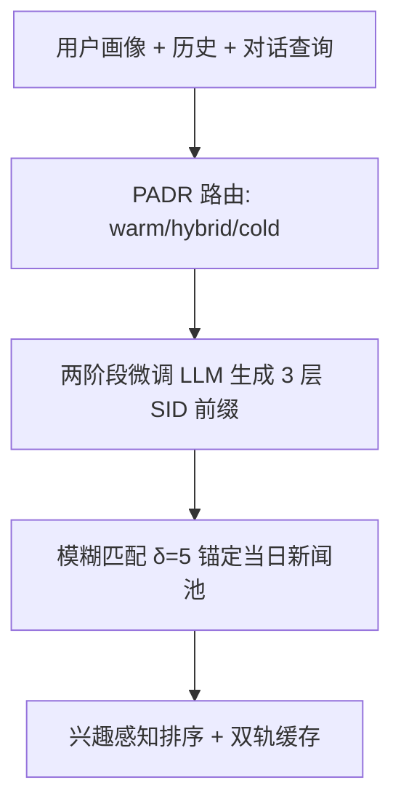
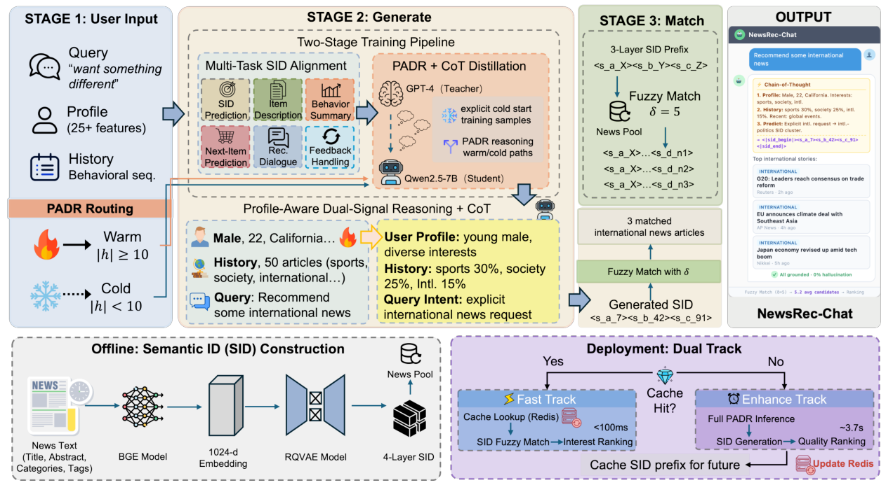

# Intent-Driven Semantic ID Generation for Grounded Conversational News Recommendation (意图驱动的语义 ID 生成式可落地对话新闻推荐)

- **会议/期刊**: ACL 2026 Industry Track (Oral)
- **作者与机构**: Hongyang Su, Beibei Kong, Lei Cheng, Chengxiang Zhuo, Zang Li (腾讯 PCG) / Chenyun Yu (中山大学深圳校区)
- **推荐链路定位**: 端到端生成式召回（对话式）
- **研究方向**: 对话推荐与智能体仿真 / 生成式推荐与离散语义 ID
- **论文原文**: [https://arxiv.org/abs/2605.07613v1](https://arxiv.org/abs/2605.07613v1)
- **开源代码**: 暂未开源

## TL;DR (1分钟核心速览)

对话新闻推荐中 5/6 的意图是隐式的（"随便推点""换点不一样的"），无检索关键词可用，标准 RAG 的 retrieve-first 范式在此结构性失效；同时新闻 24 小时过期、20–30% 用户交互少于 10 次，物品与用户双重冷启动。本文提出 Generate-then-Match：LLM 先由意图、画像与对话上下文直接生成三层语义 ID 前缀，再模糊匹配到当日新闻池，从架构上保证 0% 幻觉。在 163K 文章池、152K SID 开放生成空间上，7B 模型取得 12.4% L1（随机 4 倍）、0% 幻觉，冷启动用户 L1 达 18.0%，端到端延迟 85ms。

## Background & Motivation (背景与核心矛盾)

- **主流范式**: 对话推荐（CRS）从 ReDial 到 UniCRS、LLM-based 方法，普遍假设**稳定物品目录**且用户能显式表达偏好；生成式推荐（TIGER、OneRec）则把物品编码为层级 SID 做单轮 next-item 预测，依赖丰富行为序列。
- **前人局限**: ① 新闻场景下多数文章 24 小时内过期，TIGER 类方法的 SID 模式在测试时已陈旧；② 6 类对话意图中 5 类（续推、多样性、反馈调整、稀疏冷启动、纯冷启动）**不含任何可检索关键词**，BM25/Dense/Hybrid 三种检索在隐式意图上全部退化到随机水平（≈10%）。
- **核心洞察 (Key Insight)**: 检索失败不是检索器不够强，而是**查询本身不携带意图判别信息**——瓶颈在"先检索"这一顺序，而非检索质量。反过来，SID 前缀是"池无关"的意图编码，天然可跨日复用。
- **本文切入点**: 反转流水线为 generate-first：让 LLM 内化用户上下文直接生成 SID 前缀，再用匹配函数把输出约束在新闻池内，幻觉在架构层面被消除。

## Method (核心方法设计)

### 1. 整体框架 (Overall Architecture)

PADR 依据用户历史长度把上下文路由为 warm / hybrid / cold 三条推理路径，两阶段微调的 Qwen2.5-7B 生成三层 SID 前缀 $(s_1,s_2,s_3)$，经$\delta=5$ 的模糊匹配锚定到当日新闻池并排序；工业侧采用双轨架构，Fast Track 查缓存前缀 + 匹配（85ms），Enhance Track 异步跑完整 PADR 推理并回写缓存，缓存条目为池无关的意图前缀，TTL 24 小时。

<figure class="paper-figure" markdown="span">
  <figcaption>图1：Generate-then-Match 框架概览。左：PADR 通过热/冷/混合推理路径路由用户上下文。中：两阶段训练的 LLM（阶段1：SID 对齐，阶段2：CoT 蒸馏）根据意图和上下文生成三层 SID 前缀。右：模糊匹配将前缀锚定到当前新闻池。下：离线 SID 构建（RQ-VAE）与带 SID 前缀缓存的双轨部署。</figcaption>
</figure>

### 2. 关键设计拆解 (Key Designs)

1. **Generate-then-Match 范式（结构级零幻觉）**：RAG 是 $R(q)\to \text{LLM}(R(q),q)$，查询无关键词时$R(q)$即失效；本文改为$\text{LLM}(u,h,q)\to \text{Match}(\text{SID},\mathcal{P})$，并给出池存在性保证$\text{Match}(\text{SID},\mathcal{P})\subseteq\mathcal{P}$。幻觉不是被"抑制"而是被匹配函数在构造上排除，这是与 constrained decoding、graph-RAG 的本质区别——后者仍要求检索成功。

2. **三层前缀 + 分层容错模糊匹配**：只生成 $s_1,s_2,s_3$而非完整四层，因为$s_4$是近唯一文章判别符、每日随池刷新漂移，预测它会耦合到当日库存。匹配式为$\text{Match}(P,\mathcal{P})=\{n\in\mathcal{P}: s'_1=s_1,\, s'_2=s_2,\, |s'_3-s_3|\le\delta\}$，L1/L2 严格相等以保语义连贯（放宽 L1 会使候选类别重合度从 53.6% 崩到 14.8%），仅 L3 容错$\delta=5$（网格搜索下最小可达 0% 幻觉的值），候选按$1-|s'_3-s_3|/(\delta+1)$ 排序，平均返回 5.2 篇。

3. **PADR 双信号推理与两阶段训练**：上下文按 $|h_u|$与阈值$\tau=10$拼接为$x_u=[p_u;h_u;q]$/ 加 "sparse" 标记 / 仅$[p_u;q;\text{"no history"}]$，无需显式路由模块。Stage 1 用 6 个任务（SID 预测、物品描述、行为摘要、next-item、推荐对话、反馈处理，共 483K 样本）建立 SID 语义词表；Stage 2 用 GPT-4 CoT 蒸馏（48K 样本，约 31% 冷启动、意图差异化 CoT、长度控制在 150–300 字）。总目标即两阶段的标准 SFT 交叉熵，无负采样；推理侧靠缓存把 3.7s 的完整推理与 85ms 的在线响应解耦。

## Experimental Setup & Evaluation Protocol (实验设置与评估协议)

- **数据集与预处理**: 某主流中文新闻平台生产数据，**全局时间戳切分**，训练用截止日前新闻、测试仅用其后发布新闻，物品零重叠。

| 数据集 | #Users | #Items | #Interactions | 稀疏度/密度 | 特征/场景说明 |
| :--- | :---: | :---: | :---: | :---: | :--- |
| 新闻池 | 50,000 | 163,560 | — | — | 4 层 RQ-VAE SID，码本占用 >98% |
| Stage 1 | — | — | 483,374 | — | 6 任务 SID 对齐 |
| Stage 2 | — | — | 48,249 | — | PADR CoT 蒸馏，~31% 冷启动 |
| 测试集 | — | — | 9,982 | — | 6 类意图，76% 开放生成 |

- **数据划分与防穿越 (Splitting Strategy)**: 时间切分 + 画像特征审计（附录 T），确认画像不含测试期文章 ID/SID/标题。
- **排名评测协议 (Ranking Protocol)**: 主评测为**开放生成**（152K SID 全空间，无负采样偏差，占 76% 数据），指标 L1 Match（32 类）、L2 Match（2048 主题）、Category Match、幻觉率；辅以候选选择 Hit@1（Rand：4 随机负例；Align：2 同类 + 2 随机，占 24%）。
- **对比基线与超参设置**: 非个性化（Random/Popular/Hist-Pop）、LLM 直推（GPT-4/Qwen-7B）、retrieve-then-rank（BM25/Dense BGE-large-zh/Hybrid）、生成式（TIGER/OneRec-7B）、序列（SASRec/BERT4Rec）；backbone Qwen2.5-7B-Instruct，4×H20-96G，全参微调，有效 batch 64，显著性用配对 bootstrap（10K 重采样）。

## Key Experimental Results (实验关键数据)

### 1. 主实验对比 (Main Results)

| 方法 | Cand. Rand | Cand. Align | L1 | L2 | Cat. | Hal. |
| :--- | :---: | :---: | :---: | :---: | :---: | :---: |
| Random | 20.0 | 20.0 | 5.1 | 0.1 | 10.3 | – |
| Hist-Pop（生产基线） | – | – | 11.6 | 0.7 | 16.8 | – |
| Qwen-7B Direct | 28.1 | 26.0 | 2.4 | 0.0 | 6.9 | 70.0% |
| GPT-4 Direct | 34.4 | 30.9 | 0.9 | 0.0 | 1.4 | 94.6% |
| GPT-4 + BM25 | 34.4 | 30.9 | 11.0 | 0.5 | 15.6 | 0% |
| GPT-4 + Hybrid | 34.4 | 30.9 | 12.4 | 0.5 | 18.8 | 0% |
| **NewsRec-Chat (Ours)** | **59.3** | **30.8** | **12.4** | **1.0** | **20.0** | **0%** |
| Improv. vs 最佳基线 | +24.9 | +0.0 | +0.8 vs Hist-Pop | 2× vs GPT-4 | +1.2pp | – |

### 2. 消融实验 (Ablation Study)

| 变体 | Hit@1 | L1 | Hal. | 延迟 |
| :--- | :---: | :---: | :---: | :---: |
| Full Model | 59.3% | 12.4% | 0% | 85ms |
| w/o Stage 2 (仅 S1) | 51.6% | 8.9% | 18.4% | 0.67s |
| w/o Fuzzy Match | 59.3% | 12.4% | 5.7% | 85ms |
| w/o Dual-Track | 59.3% | 12.4% | 0% | 3.7s |

### 3. 关键实验发现 (Key Findings)

1. **SID 对齐是幻觉的分水岭**：同一 Qwen-7B backbone，不做 SID 训练时幻觉 70%、L1 仅 2.4%；两阶段训练后幻觉归零、L1 升至 12.4%（152K 空间随机基线约 3.1%）。而 Stage 2 的 CoT 蒸馏贡献了主要精度增量（L1 8.9%→12.4%），去掉后幻觉反弹至 18.4%，说明 CoT 同时充当"接地纪律"的正则项。
2. **冷启动反超热启动，且非分布假象**：纯冷启动 L1 18.0% 高于热启动 11.9%（$p<0.01$）。按 L1 码分布做期望随机校正后（warm 6.9% vs cold 6.8%），校正增益仍为 cold 8.1% vs warm 5.0%；机制是画像到簇的映射把有效 L1 搜索空间从 6.8 个候选压到 3.2 个。对比之下 SASRec/TIGER 冷启动 L1 为 0%，OneRec-7B 为 16.1% 但仅覆盖 1/6 意图。
3. **与 GPT-4+Hybrid RAG 的 L1 打平但机制不同**：L1 同为 12.4%（$p=0.98$），但 L2 翻倍（1.0% vs 0.5%，$p<0.01$）、Category +1.2pp（$p<0.05$）、冷启动 +4.7pp / 纯冷启动 +8.2pp（均$p<0.01$），推理成本低约 100 倍；且 9 个零样本类目平均 L1 19.7%（4× 随机），训练频次与测试 L1 的 Spearman 相关不显著（$\rho=0.35$，$p=0.055$），说明模型学到的是语义簇结构而非频次记忆。

## Highlights & Limitations (亮点、对比与审稿批判)

- **与代表作对比 (vs. Prior Work)**: 相比 TIGER/OneRec 的"稳定目录 + 单轮 next-item"，本文把 SID 生成扩展到 6 类对话意图并只生成池无关的三层前缀，规避了新闻场景的目录漂移；相比 GPT-4+RAG，本文不追求更强的检索器，而是论证隐式意图下 retrieve-first 的结构性上限（三种检索在隐式任务上均≈10%）；相比 constrained decoding，本文的接地来自匹配函数而非解码约束，不牺牲表达力。
- **可迁移亮点**: ① "只生成稳定层、容错匹配漂移层"的分层 SID 策略，可直接迁移到短视频、直播、闪购等短生命周期域；② 双轨缓存把池无关意图前缀与池相关匹配解耦，是 LLM 推荐低延迟落地的一个通用工程范式。
- **审稿级局限批判**: ① 绝对精度仍偏低（L1 12.4%），87.6% 的 L1 错误样本完全依赖生产兜底级联，实际体验被兜底策略掩盖；② 仅单平台内部 300+ 用户、38 天试点，缺少与生产推荐器的受控在线 A/B；③ Stage 2 依赖 GPT-4 蒸馏（约 $850）与 RQ-VAE 码本周期性重聚类，码本漂移与 CoT 长度敏感性（>300 字会导致推理期 CoT 塌缩到 29 字）都是隐性运维成本。

## Rating (四维评分)

- **方法创新性 (Novelty)**: ⭐⭐⭐⭐ （generate-first 反转 + 池存在性保证的思路干净有力，但 SID 生成与 CoT 蒸馏本身均为已有组件的组合）
- **评估协议与实验扎实度 (Protocol & Experiments)**: ⭐⭐⭐⭐ （时间切分零重叠、开放生成主评测避免负采样偏差、bootstrap 置信区间与分布校正分析到位，扣分在缺在线 A/B）
- **写作与数学规范度 (Clarity & Rigor)**: ⭐⭐⭐⭐ （匹配式与路由式定义清晰，附录对 $\delta$、$\tau$、CoT 长度的敏感性分析完整，部分关键论证散落在附录）
- **工业落地与复现价值 (Industrial & Practical Value)**: ⭐⭐⭐⭐ （85ms 延迟、0% 幻觉、100× 成本优势极具工程说服力，但未开源且强依赖内部 SID 码本与画像体系）
