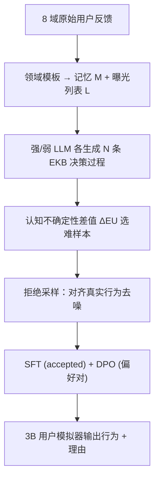
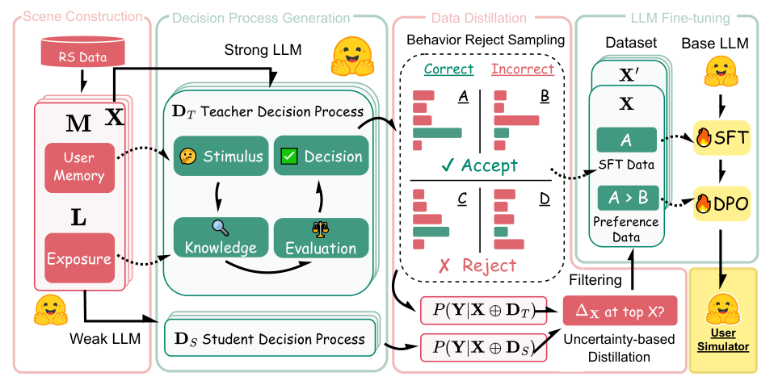

# Mirroring Users: Towards Building Preference-aligned User Simulator with User Feedback in Recommendation (镜像用户：构建与用户反馈偏好对齐的推荐用户模拟器)

- **会议/期刊**: ACL 2026 (Main)
- **作者与机构**: Tianjun Wei, Huizhong Guo, Yingpeng Du, Zhu Sun, Huang Chen, Dongxia Wang, Jie Zhang (南洋理工大学 NTU / 浙江大学 / 新加坡科技设计大学 SUTD)
- **推荐链路定位**: 端到端生成式（离线仿真与评测侧，非线上排序链路）
- **研究方向**: 对话推荐与智能体仿真 / 大语言模型推荐
- **论文原文**: [https://arxiv.org/abs/2508.18142v3](https://arxiv.org/abs/2508.18142v3)
- **开源代码**: [https://github.com/Joinn99/UserMirrorer](https://github.com/Joinn99/UserMirrorer)

## TL;DR (1分钟核心速览)

推荐系统离线评测长期依赖真实用户反馈，成本高且涉隐私；直接用 LLM 当用户模拟器又存在**任务不对齐**（未在推荐反馈上微调）与**推理昂贵**（必须挂大模型）两大痛点。本文提出 USERMIRRORER：把原始反馈统一构造成「记忆 + 曝光列表」仿真场景，用强 LLM 生成 EKB 式决策过程作为"澄清"以消解歧义，再基于**认知不确定性分解**挑选强/弱模型分歧大的难样本、并用拒绝采样剔除噪声行为，最终以 SFT+DPO 微调 3B 小模型。在 8 个领域上，微调后的 Llama-3.2-3B 平均准确率达 **55.0%**，显著超过教师 Qwen2.5-32B（39.7%）与 GPT-5（42.2%）；将其反馈回灌 10 种推荐算法，LightGCN 的 Recall@5 提升 **17.6%**。

## Background & Motivation (背景与核心矛盾)

- **主流范式**: 用户模拟器早期以规则法或强化学习为主，近期转向 LLM Agent——或用 LLM 做特征抽取增强传统模拟器，或直接让 LLM 扮演个体用户做细粒度行为模拟。
- **前人局限**: 其一，现有 LLM 模拟器**过度依赖预训练通用知识**，未在推荐系统海量用户反馈上做任务对齐，导致行为分布偏移；其二，为维持效果必须调用强 LLM 后端，**大规模仿真的算力开销不可承受**，难以蒸馏到轻量模型。
- **核心洞察 (Key Insight)**: 原始反馈只记录"点了什么"而**丢失了"为什么点"的决策过程**，这既带来歧义、也让噪声（误点击）无法识别；同时反馈体量巨大且质量参差，全量微调既不高效也不必要。作者预实验（图 2）证实：直接用反馈微调 3B 模型确实有效，但在 MIND 上仍打不过 32B/GPT-5，说明**数据本身不够、需要"挑数据"**。
- **本文切入点**: 用强 LLM 补出显式决策过程充当"澄清 (clarification)"，把"选哪些样本"转化为可量化的**不确定性分解问题**，一举同时解决歧义、噪声与规模三重障碍。

## Method (核心方法设计)

### 1. 整体框架 (Overall Architecture)

框架分三阶段闭环：**场景构造**将 8 个领域的异构反馈经领域模板转为统一文本场景 $X=\text{Prompt}(M,L)$，其中记忆$M$含用户画像与交互历史，曝光列表$L=\{l_1,\dots,l_k\}$由随机采样、协同过滤、内容近邻三路各取 Top-K 混合而成，并将真实正例随机插入任意位置（$K=32$，$N\sim U[2,12]$），选项以 `[A][B][C]` 字母标识以便解析。**数据蒸馏**阶段让强/弱 LLM 各生成$N=10$ 条 EKB 决策过程，计算认知不确定性差值挑出难样本，再用拒绝采样对齐真实行为去噪。**微调**阶段以接受样本做 SFT、以最高置信度样本构造偏好对做 DPO，得到轻量模拟器。

<figure class="paper-figure" markdown="span">
  <figcaption>图 4：我们提出的 USERMIRRORER 框架示意图。</figcaption>
</figure>

### 2. 关键设计拆解 (Key Designs)

1. **EKB 决策过程生成（消解歧义）**：原始反馈缺失上下文，模型无从判断"为何点击"。作者改造消费者行为学 EKB 模型为四阶段——Stimulus（识别内外触发因素）、Knowledge（抽取曝光中相关属性）、Evaluation（直觉式/逻辑式评估）、Decision（给出选择）。该过程作为"澄清" $C$拼接到输入，使预测变为$P(Y\mid X)=\mathbb{E}_{P(C\mid X)}[P(Y\mid X\oplus C)]$。直觉在于：把隐式决策显式化后，模型不必再从稀疏行为中"猜"意图，歧义被前置消解。

2. **基于不确定性分解的难样本蒸馏**：直接按准确率筛样本会偏向简单题。作者借用认知/偶然不确定性分解：
$$H(P(Y\mid X))=\underbrace{I(Y;C\mid X)}_{\text{偶然(数据)不确定性}}+\underbrace{\mathbb{E}_{P(C\mid X)}H(P(Y\mid X\oplus C))}_{\text{认知(模型)不确定性}}$$
并以强弱模型认知不确定性之差 $\Delta_{EU}(X,(A,B))=\mathbb{E}_{P(D_A\mid X)}H(P(Y\mid X\oplus D_A))-\mathbb{E}_{P(D_B\mid X)}H(P(Y\mid X\oplus D_B))$度量场景难度。图 3 验证弱模型在多数场景认知不确定性更高，$\Delta_{EU}$ 大的场景正是弱模型的能力盲区——优先训练这些样本，等于把强模型的推理能力"精准投送"到学生最薄弱处。

3. **拒绝采样去噪与两阶段训练**：对每个场景比较 $N$条决策过程的预测与真实行为，若**全部预测错误**则判为潜在噪声样本直接丢弃；其余按是否命中标记 accepted/rejected，取最高置信度构成偏好对。总目标为$\mathcal{L}=\mathcal{L}_{\text{SFT}}+\lambda\mathcal{L}_{\text{DPO}}$，无需额外负采样器。推理时仅需 3B 模型单次前向，相比调用 GPT-5 后端大幅降低大规模仿真开销。

## Experimental Setup & Evaluation Protocol (实验设置与评估协议)

- **数据集与预处理**: 覆盖 8 个领域，MIND 具真实曝光，其余用合成曝光；每域蒸馏 10,000 样本（图 5 显示 1 万后收益饱和）。

| 数据集 | 领域 | 曝光类型 | 评测场景数 | 说明 |
| :--- | :---: | :---: | :---: | :--- |
| MIND | 新闻 | 真实 | 1,280 | 唯一含真实曝光日志 |
| Amazon | 电商 | 合成 | 5,120 | 商品评论反馈 |
| KuaiRec2 | 短视频 | 合成 | 5,120 | 密集交互 |
| LastFM | 音乐 | 合成 | 5,120 | 听歌行为 |
| Goodreads | 图书 | 合成 | 5,120 | 书评评分 |
| Movielens | 电影 | 合成 | 5,120 | 经典评分数据 |
| MobileRec | 移动应用 | 合成 | 5,120 | App 使用 |
| Steam | 游戏 | 合成 | 5,120 | 购买/游玩 |

- **数据划分与防穿越 (Splitting Strategy)**: 评测场景随机采样用户后**在构造阶段前即剔除**，防止数据泄漏；训练/测试场景独立采样，曝光长度固定为 5。
- **排名评测协议 (Ranking Protocol)**: 模拟器侧为**列表级分类准确率**（在 $k$个候选中选 1，随机基线$1/k$），每场景采样 5 次输出取均值（temperature=1.0, top-p=0.9）；推荐侧为**全库排序**下的 R@k / N@k / M@k（$k\in\{5,10\}$）。
- **对比基线与超参设置**: 基线含开源模型（Gemma-3-4B/12B、Qwen2.5-7B/14B/32B、Qwen2.5-3B、Llama-3.2-3B）与闭源模型（GPT-5-Nano/Mini/5/5.1、Gemini-2.5-Flash、Gemini-3.0-Pro-Preview）；微调基座为 Llama-3.2-3B 与 Qwen2.5-3B，采用 SFT+DPO 与 SFT+GRPO 两种对齐路径对比。

## Key Experimental Results (实验关键数据)

### 1. 主实验对比 (Main Results)

| 模型类型 | 模型 | MIND | Amazon | KuaiRec2 | Goodreads | Movielens | MobileRec | Overall |
| :--- | :--- | :---: | :---: | :---: | :---: | :---: | :---: | :---: |
| Base | Qwen2.5-32B (Teacher) | 28.7 | 36.3 | 31.1 | 70.7 | 54.6 | 42.4 | 39.7 |
| Base | Llama-3.2-3B | 19.9 | 21.9 | 22.5 | 27.1 | 23.3 | 26.2 | 22.7 |
| Proprietary | GPT-5 | 33.2 | 40.2 | 30.8 | 78.9 | 61.1 | 45.2 | 42.2 |
| Proprietary | Gemini-3.0-Pro-Preview | **34.8** | 48.0 | 32.7 | 82.0 | 73.6 | 48.1 | 47.7 |
| Fine-tuned | Qwen2.5-3B +SFT+DPO | 33.5 | **52.3** | 46.2 | **86.3** | **66.2** | **71.3** | **54.7** |
| Fine-tuned | Llama-3.2-3B +SFT+DPO | 34.0 | 51.8 | **48.7** | 86.9 | **67.3** | 70.0 | **55.0** |
| Improv. (vs GPT-5) | — | +2.4% | +28.9% | +58.1% | +10.1% | +10.1% | +54.9% | **+30.3%** |

推荐侧回灌实验（表 3，Movielens / Steam，R@5 为例）：LightGCN 由 Backbone 5.178 → 6.089（**+17.6%**）；DiffRec 5.197 → 6.449（**+24.1%**）；SASRec 7.303 → 8.365（**+14.5%**）；NARM 6.791 → 8.175（**+20.4%**），Steam 上亦一致提升 8.6%–13.3%。

### 2. 消融实验 (Ablation Study)

| 数据选择策略 | MIND | 合成曝光均值 |
| :--- | :---: | :---: |
| Base Llama-3.2-3B（不微调） | 19.9 | 22.7 |
| Random（无决策过程） | 25.7 | 48.3 |
| Random（含决策过程） | 31.4 | 53.9 |
| High Accuracy 筛选 | 32.4 | 53.3 |
| Low Accuracy 筛选 | 30.9 | 54.5 |
| Diff. Accuracy 筛选 | 30.1 | 53.9 |
| IFD Score 筛选 | 29.9 | 52.7 |
| **Ours（ΔEU + 拒绝采样）** | **34.0** | **55.0** |

### 3. 关键实验发现 (Key Findings)

1. **决策过程是最大增益来源，而非模型规模**：从 Random（无决策过程）到 Random（含决策过程），合成曝光均值从 48.3 跃至 53.9（+5.6 点），远超后续任何筛选策略带来的 1 点级差异——说明"补出为什么"比"挑哪些样本"更根本。
2. **不确定性筛选优于准确率/IFD 筛选，但优势有限且方向敏感**：Ours 在 MIND 上 34.0 高于 High Accuracy 的 32.4，但在合成曝光上仅比 Low Accuracy 的 54.5 高 0.5 点，且 Diff. Accuracy 反而掉到 53.9，暗示 $\Delta_{EU}$ 与"低准确率"高度相关，筛选信号存在冗余。
3. **DPO 稳定优于 GRPO**：Llama-3.2-3B 上 SFT+DPO 达 55.0，SFT+GRPO 为 52.7，作者归因于 GRPO 的奖励仅为规则化行为对错、过于稀疏简单，未能发挥 RL 潜力；同时 3B 微调模型在 6/8 领域反超 32B 教师，证明"对齐数据"可替代"模型规模"。

## Highlights & Limitations (亮点、对比与审稿批判)

- **与代表作对比 (vs. Prior Work)**: 相比 Zhang et al. (2024a,b) 等 LLM Agent 模拟器依赖强模型 in-context 扮演、不做参数更新，本文把对齐落到**权重层面**并蒸馏到 3B；相比 Corecco et al. (2024) 仅用 LLM 做特征抽取喂给传统模拟器，本文让 LLM 直接输出列表级行为分布；相比通用指令数据筛选（IFD），本文的 $\Delta_{EU}$ 是**任务内生的难度度量**，无需额外参考模型打分。
- **可迁移亮点**: ①"生成决策过程作澄清 + 不确定性分解选样"这套蒸馏范式可平移到 CTR 预估的样本加权、或 LLM4Rec 的指令数据清洗；②用强弱模型认知不确定性差值定位能力盲区，是一种廉价可复用的课程学习信号。
- **审稿级局限批判**: ①**合成曝光是根本性评估隐患**——8 域中 7 域曝光由 CF/内容检索混合构造，模拟器学到的可能是"构造器的偏好"而非真实曝光分布下的用户行为，MIND 上的增益（+2.4% vs GPT-5）远小于合成域（+28.9%~+58.1%）正印证此点；②**未建模"不交互/离开"负反馈**，动作空间被强制为 $k$选 1 的封闭分类，与真实场景中用户可能一个都不点存在系统性偏差；③$\Delta_{EU}$需对每场景跑$N=10$次强模型推理，蒸馏阶段成本不低，且对$N$ 与强弱模型配对选择敏感，论文未给出敏感性分析。

## Rating (四维评分)

- **方法创新性 (Novelty)**: ⭐⭐⭐⭐ （把 EKB 决策过程当"澄清"、用认知不确定性分解做难样本蒸馏，思路自洽且有图 3 实证支撑，但各组件均为已有技术的巧妙组合）
- **评估协议与实验扎实度 (Protocol & Experiments)**: ⭐⭐⭐ （8 域 + 10 种推荐算法回灌实验覆盖面广，但 7/8 域用合成曝光、模拟器侧仅报准确率无校准/分布距离指标，削弱结论外部效度）
- **写作与数学规范度 (Clarity & Rigor)**: ⭐⭐⭐⭐ （任务形式化清晰、不确定性分解公式引用规范、附录模板详尽，但 $\Delta_{EU}$ 的符号方向与"越大越难"的论证仅靠一张分布图，缺理论刻画）
- **工业落地与复现价值 (Industrial & Practical Value)**: ⭐⭐⭐⭐⭐ （代码、HuggingFace 数据集与 checkpoint 全部开源，3B 模型可本地部署替代 GPT-5 后端，对大规模离线仿真与 A/B 预演有直接工程价值）

