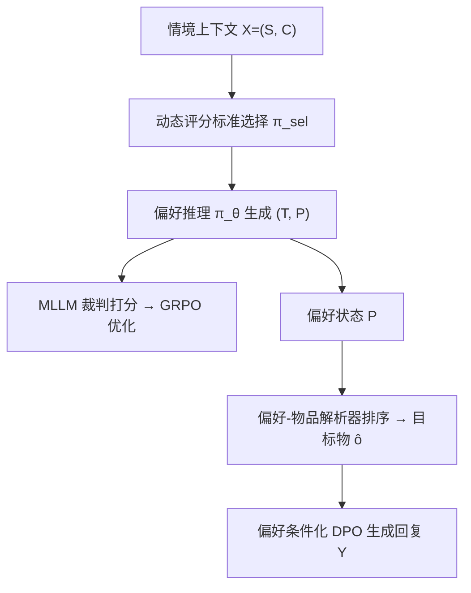
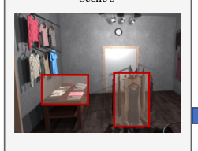

# Re2A: Situated Conversational Recommendation via Rubric-based Preference Reasoning and Alignment (基于评分标准偏好推理与对齐的情境对话推荐)

- **会议/期刊**: EMNLP 2026 Main Conference
- **作者与机构**: Dongding Lin, Jian Wang, Xiaoyan Zhao, Wenjie Li（香港理工大学、四川大学、香港中文大学）
- **推荐链路定位**: 端到端生成式（多模态对话推荐）
- **研究方向**: 对话推荐与智能体仿真 / 多模态推荐
- **论文原文**: [https://arxiv.org/abs/2609.18249v1](https://arxiv.org/abs/2609.18249v1)
- **开源代码**: [https://github.com/DongdingLin/Re2A](https://github.com/DongdingLin/Re2A)

## TL;DR (1分钟核心速览)

情境对话推荐（SCR）要求助手同时理解对话历史、共视场景与场景内物品属性，现有 MLLM 方法存在两大痛点：隐式偏好难以从密集视觉干扰中准确推断（“推理赤字”），且生成回复常在“满足偏好”与“场景落地”之间顾此失彼（对齐困境）。Re2A 将任务重构为“先推理后对齐”：用自动归纳的多维评分标准 + GRPO 训练显式偏好状态，再用情境冲突/偏好冲突两类异构负例做偏好条件化 DPO。在 SIMMC 2.1 与 SCREEN 上，Qwen3-VL 骨干下 Hit@1 分别达 48.12%/49.63%，较最强基线 ReGeS 提升 8.67/7.91pt，视觉幻觉率从 15.2% 降至 5.2%。

## Background & Motivation (背景与核心矛盾)

- **主流范式**: 对话推荐长期以纯文本语义匹配为主（CRAG 的协同检索、ReGeS 的检索-生成互惠），近期工作仅额外挂接视觉编码器做隐式跨模态对齐。
- **前人局限**: 其一，SCR 中用户偏好与所处场景强耦合，可能依赖隐式需求、视觉相似物或随环境动态漂移，黑盒融合易被视觉显著性带偏，产生“幻觉式推理”；其二，回复需同时满足用户偏好与物理可见性，标准 DPO 把多维约束压成单一标量排序，无法区分“事实落地错误”与“偏好不匹配”。
- **核心洞察 (Key Insight)**: 标准 CoT 在 SCR 上反而劣于 ICL（Qwen3-VL 上 17.55% vs. 18.25%），说明自由形式推理会语义漂移；而情境偏好是隐式的、缺乏确定性验证信号，不能照搬数学推理的 verifier 范式。
- **本文切入点**: 用一个**结构化偏好状态**（意图/属性约束/视觉目标）作为推理与生成的共享接口，把“预测选什么”转为“解释为什么选”，并用评分标准提供可验证的过程监督。

## Method (核心方法设计)

### 1. 整体框架 (Overall Architecture)

Re2A 采用三步级联：① 评分标准引导的偏好推理——冻结 MLLM 先离线归纳全局评分标准集，再由动态选择器按当前轮交际意图筛选激活子集，偏好推理模型 $\pi_\theta$生成“偏好思考$T$+ 结构化偏好状态$P$”，由冻结 MLLM 裁判逐条打分构成 GRPO 奖励；② 双重对齐——以$P$与教师强制目标物$o^*$为条件做 SFT，再用情境冲突与偏好冲突两类异构负例做偏好条件化 DPO；③ 级联推理——偏好状态经确定性解析器在可见候选集内排序得到$\hat{o}$，再条件化生成回复。训练期选择器与裁判不参与推理，零额外在线开销。

<figure class="paper-figure" markdown="span">
  <figcaption>图 2：所提出的用于情境对话推荐的 Re2A 框架概览。</figcaption>
</figure>

### 2. 关键设计拆解 (Key Designs)

1. **自动评分标准归纳与动态选择（把隐式偏好变成可验证信号）**：人工标注推理链代价高，故用宪法式元指令驱动 MLLM 从种子集归纳全局标准集 $\mathcal{R}=\mathcal{R}_{sit}\cup\mathcal{R}_{rel}\cup\mathcal{R}_{con}\cup\mathcal{R}_{aux}$，每条标准为二元谓词$r(\cdot)\to\{0,1\}$。若全量套用会引入噪声监督，故用冻结 MLLM 选择器按$X_t$门控出激活子集$\mathcal{R}_{act}$——纯空间查询只激活情境性标准，混合查询同时激活情境性与物品相关性标准，使监督更密更准。

2. **基于评分标准的 GRPO 偏好推理（免人工推理标注）**：每步采样 $G$个候选$O_g=(T_g,P_g)$，奖励为激活标准满足率$R_g=\frac{1}{|\mathcal{R}_{act}|}\sum_{r\in\mathcal{R}_{act}}f_{judge}(O_g,r,X_t)$，再做组内标准化得优势$A_g=(R_g-\mu_R)/(\sigma_R+\epsilon)$，代入 GRPO 目标$\mathcal{J}(\theta)$（含 clip 与 KL 惩罚$\beta\cdot D_{KL}(\pi_\theta\|\pi_{ref})$）。组相对优势既稳定优化，又省去价值网络，显著降低高维多模态输入的显存开销。

3. **异构负例的偏好条件化 DPO（破解对齐困境）**：对每个正例 $Y_w$合成两类负例——情境冲突$Y_{l1}$（推荐场景中不存在的物品/虚构空间地标，惩罚落地违规）与偏好冲突$Y_{l2}$（换成场景内存在但违反价格/属性约束的干扰物，惩罚“落地却不对味”）。损失为$\mathcal{L}_{DPO}=-\mathbb{E}_{\tilde{X},Y_w,Y_l}\left[\log\sigma\left(\beta_{DPO}\left(\log\frac{\phi_\theta(Y_w|\tilde{X})}{\phi_{ref}(Y_w|\tilde{X})}-\log\frac{\phi_\theta(Y_l|\tilde{X})}{\phi_{ref}(Y_l|\tilde{X})}\right)\right)\right]$，在混合集$\mathcal{D}_{mix}$上训练使生成策略同时收敛到场景落地与偏好一致。训练用$o^*$作教师强制锚点，推理替换为检索到的$\hat{o}$，差异仅限锚点来源。

## Experimental Setup & Evaluation Protocol (实验设置与评估协议)

- **数据集与预处理**: 两个 SCR 基准，平均对话约 10 轮（文本历史可入 8K–32K 窗口），核心难点在视觉密度——每场景平均 19.7 个物品，需从大量场景合法干扰物中区分细粒度空间与属性线索。

| 数据集 | 场景特点 | 核心挑战 | 特征/场景说明 |
| :--- | :---: | :---: | :--- |
| SIMMC 2.1 | 照片级 3D 场景（时尚/家具） | 视觉落地与共指消解 | 密集视觉环境，相似家具难区分 |
| SCREEN | 合成对话、演化人设 | 隐式偏好推理 | 多轮逻辑追踪复杂属性约束 |

- **数据划分与防穿越 (Splitting Strategy)**: 沿用两数据集官方划分（逐轮对话样本，非 Leave-One-Out 序列切分）。
- **排名评测协议 (Ranking Protocol)**: 物品推荐在**场景内可见候选集**上排序（非全库 Full-Ranking），报告 Hit@1、Recall@5、MRR@5、NDCG@5；所有推理结果均走完整级联管线，上游偏好状态与物品解析错误不做人工修正。
- **对比基线与超参设置**: 三类基线——推理型（Vanilla/ICL/CoT）、多模态微调（SFT）、适配的对话推荐法（CRAG、ReGeS）；骨干为 LLaVA-NeXT 与 Qwen3-VL，仅训练 LoRA 适配器、冻结视觉模块；回复质量用 GPT-5.2 裁判（VF/CC/CH）、用户模拟器（SR/WMR/VHR）与人工评分（0–2 分三维度）三层协议。

## Key Experimental Results (实验关键数据)

### 1. 主实验对比 (Main Results)

| 骨干 | 方法 | SIMMC Hit@1 | SIMMC NDCG@5 | SCREEN Hit@1 | SCREEN NDCG@5 |
| :--- | :--- | :---: | :---: | :---: | :---: |
| LLaVA-NeXT | SFT | 23.14 | 27.11 | 24.96 | 27.68 |
| LLaVA-NeXT | CRAG | 27.91 | 33.43 | 29.48 | 35.38 |
| LLaVA-NeXT | ReGeS | 32.18 | 43.34 | 35.29 | 45.99 |
| LLaVA-NeXT | **Re2A** | **40.35** | **51.74** | **41.03** | **55.53** |
| Qwen3-VL | SFT | 31.24 | 34.61 | 34.58 | 37.58 |
| Qwen3-VL | CRAG | 35.64 | 40.28 | 37.09 | 42.13 |
| Qwen3-VL | ReGeS | 39.45 | 47.30 | 41.72 | 53.56 |
| Qwen3-VL | **Re2A** | **48.12** | **56.89** | **49.63** | **61.52** |
| — | Improv. (vs. ReGeS) | +8.67 | +9.59 | +7.91 | +7.96 |

回复生成（Qwen3-VL，SIMMC 2.1）：Re2A 的 Judge-Avg 9.31、SR 46.8%、VHR 5.2%、Human-Avg 1.87，全面优于 ReGeS（8.49 / 38.6% / 15.2% / 1.65）。

### 2. 消融实验 (Ablation Study)

| 配置 | Hit@1 | VHR | WMR |
| :--- | :---: | :---: | :---: |
| End-to-End SFT（无推理） | 31.2 | 25.4 | — |
| Fine-tuned CoT（无评分标准） | 40.5 | — | — |
| Re2A 完整 | **48.1** | **5.2** | **7.4** |
| SFT Only（冻结推理状态） | — | 25.4 | — |
| 同构 DPO（无异构负例） | — | 15.2 | 11.2 |

### 3. 关键实验发现 (Key Findings)

1. **推理赤字是主要瓶颈而非上下文长度**：去掉推理模块后 Hit@1 从 48.1% 暴跌 16.9pt 至 31.2%，且微调 CoT 仍落后 7.6pt，说明对话历史虽短，密集场景中的视觉合理干扰物足以让自由推理漂移，评分标准充当逻辑锚点。
2. **异构负例是幻觉抑制的关键**：同构 DPO 的 VHR 高达 15.2%，加入情境/偏好冲突负例后降至 5.2%，同时 WMR 从 11.2% 降至 7.4%，证明“落地错误”与“偏好错配”必须分开监督，否则标量排序会混淆两类失败模式。
3. **精度-时延是可控权衡**：Re2A 每轮总时延 2342.7ms（ReGeS 为 1220.9ms），增量几乎全来自 1423.8ms 的显式推理，但检索与生成反而更快（538.2→267.5ms、682.7→651.4ms）；蒸馏 4B 推理器后时延降至 1838.4ms 仍保留 46.71% Hit@1。

## Highlights & Limitations (亮点、对比与审稿批判)

- **与代表作对比 (vs. Prior Work)**: 相比 CRAG/ReGeS 的隐式跨模态语义匹配，Re2A 显式建模逻辑约束（空间否定、条件属性），在“不要浅色木纹”类否定查询上优势明显；相比标准 CoT/GRPO 数学推理范式，本文用评分标准替代确定性 verifier，适配了 SCR 偏好隐式、无标准答案的特性。
- **可迁移亮点**: ①“动态标准子集选择”可迁移到任意缺乏过程标注的 LLM 推理任务，降低裁判噪声；②异构负例构造（事实冲突 vs. 意图冲突分离）可直接用于其他多约束生成式推荐的对齐训练。
- **审稿级局限批判**: ①级联推理带来约 1.9 倍时延且存在误差传播，错误偏好状态会误导下游解析与生成，缺少回滚/澄清机制；②评分标准归纳与负例合成依赖强教师 LLM，其偏见可能传导；③实验限于静态视觉场景，物品动态变化场景未验证；④主实验对比的是完整系统，未完全隔离训练目标与合成监督的贡献（作者仅以 call-matched 诊断部分回应）。

## Rating (四维评分)

- **方法创新性 (Novelty)**: ⭐⭐⭐⭐ （将 SCR 重构为 reason-then-align 并以结构化偏好状态作共享接口，评分标准 GRPO + 异构负例 DPO 组合新颖，但各组件均为已有技术的针对性改造）
- **评估协议与实验扎实度 (Protocol & Experiments)**: ⭐⭐⭐⭐ （双数据集双骨干、三层回复评估协议、独立裁判与替代模拟器鲁棒性验证齐全，扣分在于场景内候选排序非全库、未完全隔离监督贡献）
- **写作与数学规范度 (Clarity & Rigor)**: ⭐⭐⭐⭐ （公式与符号定义清晰、GRPO/DPO 目标完整，但部分关键细节如解析器排序提示、评分标准示例置于附录，正文自洽性略依赖附录）
- **工业落地与复现价值 (Industrial & Practical Value)**: ⭐⭐⭐⭐ （代码已开源、训练期组件零推理开销、蒸馏 4B 变体给出可行部署路径，但 2.3s 级时延与级联误差传播对实时线上系统仍是门槛）
