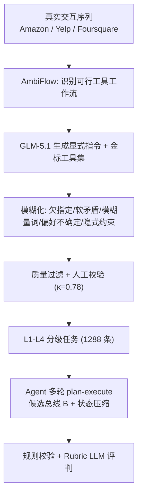
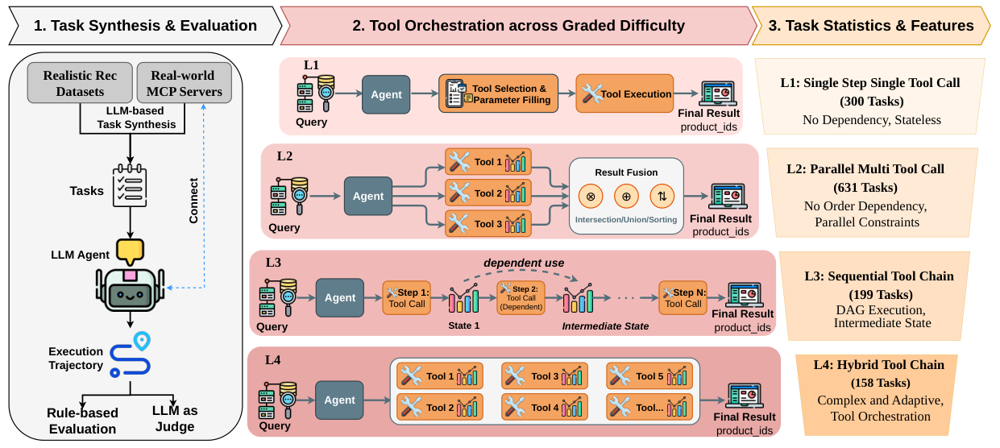

# RecToolBench: Benchmarking Recommendation-Specific Tool Orchestration under Fuzzy User Intent (模糊用户意图下推荐专用工具编排基准)

- **会议/期刊**: EMNLP Findings 2026
- **作者与机构**: Xiao Chen, Yicheng Zhao, Yingying Wu, Zhendong Chu, Changyi Ma, Qingsong Wen, Xuan Song（香港理工大学 / 吉林大学 / Squirrel AI Learning）
- **推荐链路定位**: 端到端生成式（Agent 多轮工具调用 → 最终推荐）
- **研究方向**: 对话推荐与智能体仿真 / 大语言模型推荐
- **论文原文**: [https://arxiv.org/abs/2609.30717v2](https://arxiv.org/abs/2609.30717v2)
- **开源代码**: [https://github.com/ShawnChenn/RecToolBench](https://github.com/ShawnChenn/RecToolBench)

## TL;DR (1分钟核心速览)

现有 Agent 推荐基准要么假设用户意图显式完整（τ-bench、ShoppingBench），要么只测孤立单次函数调用（Shopping MMLU），无法刻画真实场景中"用户说得含糊、Agent 需跨服务器编排多工具"的核心难点。本文提出 RecToolBench：基于 MCP 协议构建 13 个服务器、32 个工具、1288 条可执行任务，用 `synthesize–fuzzify–judge` 流水线注入五类模糊性，并按 L1 单工具→L2 并行→L3 串行依赖→L4 混合编排四级递进。在规则执行校验 + Rubric LLM 评判双协议下，GPT-5.4 在 L4 的 Hit Ratio 仅 54.05%，SLM 普遍 20%–28%，证明"语法合法调用"与"推荐成功"之间存在系统性鸿沟。

## Background & Motivation (背景与核心矛盾)

- **主流范式**: Agentic RecSys 正从被动过滤引擎转向"指令跟随 + 外部工具取证"的主动智能体（InteRecAgent、ToolRec、RecGPT-V2），依赖 LLM 调用检索/评论/评分/地理等工具逐步澄清意图。
- **前人局限一（意图过于干净）**: 通用工具基准（τ-bench、BFCL）与电商 QA 基准（Shopping MMLU、ChineseEcomQA）均假设指令显式、参数可直接填槽，回避了真实推荐中"预算大概三四十、评分差不多四星"这类模糊表达。
- **前人局限二（工具环境过于扁平）**: ShoppingBench 虽提供沙箱 API，但仅 6 个工具、无难度分层、无跨服务器依赖，无法诊断"并行分解失败"与"依赖链断裂"这两类不同病灶。
- **核心洞察 (Key Insight)**: 作者指出**语法–语义评估鸿沟**——工具名合法、Schema 合规、执行无报错，并不等于参数语义对齐用户模糊意图；仅用执行类指标会系统性高估 Agent 能力。
- **本文切入点**: 用 MCP 标准化工具调用协议 + 可控模糊化流水线 + 四级组合依赖难度，把"工具编排能力"拆成可归因的正交诊断维度。

## Method (核心方法设计)

### 1. 整体框架 (Overall Architecture)

任务形式化为工具增强 POMDP：给定 $n$个 MCP 服务器$\Sigma=\{\sigma_1,\dots,\sigma_n\}$与工具集$\mathcal{T}=\bigcup_j \mathcal{T}_j$，任务$\tau=(q,\mathcal{T},C,G)$，其中$q$为欠指定指令、$C$为候选集、$G=(c^\star,A^\star)$同时标注目标物品与期望工具调用序列。Agent 动作空间$\mathcal{A}=\mathcal{A}_{plan}\cup\mathcal{A}_{tool}\cup\mathcal{A}_{final}$，单次工具动作写作$a_{tool}=\langle \sigma_j, t_k, \mathbf{p}_k\rangle$。执行侧采用多轮 plan–execute 循环：规划器仅看压缩后的规划状态$S_p$与候选总线$B$（原始 payload 留在$O^{raw}_t$供最终合成），超预算时对$S_p$做保关键字段的 LLM 压缩，最后$\pi_{final}$从完整轨迹$H$ 合成推荐。数据侧则由真实交互序列（Amazon/Yelp/Foursquare）反推可行工作流，再由 GLM-5.1 生成显式指令、经五类模糊化改写、最后三重质量过滤。

<figure class="paper-figure" markdown="span">
  <figcaption>图1：整体数据合成与智能体评估流程，采用渐进式四级难度方案。针对本质上模糊的用户指令，任务复杂度从易到难递增：L1需要单次工具调用；L2涉及并行工具调用；L3要求串行依赖链；L4则包含混合依赖与工具编排。</figcaption>
</figure>

### 2. 关键设计拆解 (Key Designs)

1. **AmbiFlow 模糊化流水线（把"干净任务"变成"真实任务"）**：痛点在于合成任务天然过于规整，模型可绕过意图推理直接填槽。本文先由真实交互序列确定工具工作流，再让合成 LLM 生成显式指令，随后**删除工具名与流程提示**，按五类歧义（欠指定、软矛盾、模糊量词、偏好不确定、隐式约束）以低/中/高 40%/40%/20% 强度注入不确定性，同时硬约束保留全部候选 ID 与数值阈值。这样保证"意图可恢复但不可直读"，迫使 Agent 做语义参数落地而非模板匹配。

2. **四级组合依赖难度（把"编排能力"正交拆解）**：L1 单工具（300 条）测原子选择；L2 并行多工具（631 条）测无依赖并行分解，用 $R_{para}=\frac{|\mathcal{T}_{r1}\cap \mathcal{T}_{exp}|}{\max(|\mathcal{T}_{exp}|,|\mathcal{T}_{r1}|)}$与$S_{eff}=\frac{N_{exp}}{\max(N_{exp},N_{total})}$ 惩罚冗余调用；L3 串行链（199 条）测中间态跨步传播；L4 混合编排（158 条）测 fan-in 聚合。关键设计是 **L4 不提供参考工作流**（合法组合不唯一），只保留必需工具标注，避免把"唯一解"强加给开放式编排。

3. **双轨评估：规则校验 + Rubric LLM 评判**：规则侧覆盖 Tool Name Validity、Schema Compliance、Execution Success、Tool Selection F1、Hit Ratio；语义侧用 DeepSeek-V3.2（与合成模型 GLM-5.1 不同族，规避生成–评估同源偏差）做**无参考** Parameter Appropriateness 打分，L3/L4 另评 Dependency Awareness、Information Grounding、Planning Coherence、Multi-round Efficiency，每维 1–10 归一化。为抑制位置偏置，对评分维度做随机置换并五次取均值，人工一致性从 1.37 提升至 1.52（满分 2）。

## Experimental Setup & Evaluation Protocol (实验设置与评估协议)

- **数据集与预处理**: 任务由三个真实域的用户交互序列派生，工具返回真实物品元数据：

| 数据集 | #Tasks | L1 | L2 | L3 | L4 | 场景说明 |
| :--- | :---: | :---: | :---: | :---: | :---: | :--- |
| Amazon Electronics | 675 | 130 | 374 | 97 | 74 | 电商配件、评论情感、协同购买 |
| Yelp 2019 | 465 | 100 | 222 | 78 | 65 | 本地商户、营业时间、地理距离 |
| Foursquare | 148 | 70 | 35 | 24 | 19 | POI 检索、签到、地理推理 |
| **合计** | **1288** | **300** | **631** | **199** | **158** | 13 个 MCP 服务器 / 32 个工具 |

- **数据划分与防穿越 (Splitting Strategy)**: 非传统训练/测试切分，而是**按难度层级分层评测**（L1–L4 各自内部全量平均），用于隔离编排复杂度的影响；任务本身由 LLM 合成 + 人工校验（Cohen's κ=0.78），无监督训练信号泄漏问题。
- **排名评测协议 (Ranking Protocol)**: 采用 **Hit Ratio@All**（目标物品是否出现在 Agent 最终推荐结果中），属端到端结果级判定而非全库排序；工具侧另用 Tool Selection Accuracy（L1）/ F1（L2–L4）与执行成功率，二者构成"过程–结果"双视角。
- **对比基线与超参设置**: 9 个模型——6 个 SLM（Llama-3.2-3B、Qwen-2.5-3B、Gemma-3-4B、Qwen-2.5-7B、Mistral-v0.3-7B、Llama-3.1-8B）与 3 个闭源模型（GPT-5.4、Gemini-3.1-Flash-Lite、Claude-Sonnet-4.5）；最大交互轮数 $T_{max}$与 token 预算$B$ 控制上下文，评分做五次置换平均。

## Key Experimental Results (实验关键数据)

### 1. 主实验对比 (Main Results)

L2 并行工具调用（节选核心指标）：

| 模型 | Schema Comp. | Exec. Succ. | Tool F1 | PA | Hit Ratio |
| :--- | :---: | :---: | :---: | :---: | :---: |
| Qwen-2.5-7B | 98.56% | 96.45% | **52.66%** | 68.50% | 31.58% |
| Llama-3.1-8B | **99.79%** | 98.41% | 44.16% | 58.80% | 28.07% |
| GPT-5.4 | 94.46% | 100.00% | 43.55% | **93.00%** | 43.78% |
| Gemini-3.1-Flash-Lite | 86.66% | 100.00% | 37.09% | 85.90% | **55.59%** |
| Claude-Sonnet-4.5 | 96.58% | 98.56% | 42.42% | 82.10% | 47.29% |

L4 混合编排（规则 + Rubric 双轨）：

| 模型 | Schema Comp. | Exec. Succ. | Tool F1 | Hit Ratio | Planning Coher. | Info. Ground. | Overall |
| :--- | :---: | :---: | :---: | :---: | :---: | :---: | :---: |
| Qwen-2.5-7B | 97.27% | 89.59% | **81.39%** | 25.68% | 0.268 | 0.193 | 0.492 |
| Llama-3.1-8B | 99.14% | 91.81% | 67.40% | 28.38% | 0.207 | 0.207 | 0.461 |
| GPT-5.4 | **100.00%** | 99.61% | 78.42% | **54.05%** | **0.408** | **0.418** | **0.627** |
| Gemini-3.1-Flash-Lite | **100.00%** | **100.00%** | 73.52% | 39.19% | 0.347 | 0.384 | 0.566 |
| Claude-Sonnet-4.5 | **100.00%** | **100.00%** | 78.15% | 44.59% | 0.355 | 0.368 | 0.591 |

### 2. 消融实验 (Ablation Study)

本文为基准论文，无传统模块消融，其"消融"体现为**难度层级递进**与**评估维度解耦**：

| 配置 | 关键现象 | Hit Ratio 变化 |
| :--- | :--- | :---: |
| L1 单工具（GPT-5.4） | Tool Acc. 100%，PA 0.93 | — |
| L1 单工具（Gemma-3-4B） | Tool Name Valid 99%，Tool Acc. 仅 49% | — |
| L2 并行（GPT-5.4） | Schema 94.46% 但 Exec. 100% | 43.78% |
| L3 串行（GPT-5.4） | Dependency Aware. 0.458 | 96.67% |
| L4 混合（GPT-5.4） | Planning Coher. 0.408 | 54.05%（较 L3 骤降 42.6 pt） |
| L4 混合（Qwen-2.5-7B） | Tool F1 81.39% 却 Hit 25.68% | 25.68% |

### 3. 关键实验发现 (Key Findings)

1. **格式合法性与语义正确性严重脱钩**：Gemma-3-4B 的 Tool Name Valid 达 99% 但 Tool Selection Accuracy 仅 49%；Qwen-2.5-3B 执行成功率 95% 而 PA 偏低。说明仅靠 Schema 合规类指标会把 SLM 能力高估近一倍，参数语义落地才是真瓶颈。
2. **工具选对 ≠ 编排成功，且随复杂度放大**：Qwen-2.5-7B 在 L4 的 Tool F1 高达 81.39%（甚至超过 GPT-5.4 的 78.42%），但 Hit Ratio 仅 25.68% vs. 54.05%。SLM 倾向"少调用、贴金标"，F1 虚高；闭源模型额外调用 `get_item_details` 等辅助工具取证，F1 反降而结果更好——F1 与任务完成度存在结构性背离。
3. **冗余与串行化是效率黑洞**：Llama-3.2-3B 在 L2 平均发起 37.7 次调用（金标 3.3 次）、4.8 轮，大量重复调用；SLM 在 L3 普遍"一轮一调用"直到上限，无法并行化独立步骤。GPT-5.4 在 L4 错误分析中，依赖推理失败占 54.1%、目标检索失败占 53.6%，二者高度共现，说明中间证据未能正确传播到最终推荐。

## Highlights & Limitations (亮点、对比与审稿批判)

- **与代表作对比 (vs. Prior Work)**: 相较 τ-bench（28 工具但无推荐语义、无模糊指令）与 ShoppingBench（6 工具、无难度分层），本文是首个**推荐原生 + MCP 标准化 + 四级组合依赖 + 模糊意图**四要素齐备的基准；相较 InteRecAgent/ToolRec 等系统工作，本文不提出新 Agent 架构，而是提供可归因的诊断标尺，定位互补而非竞争。
- **可迁移亮点**: (1) "删除工具名与流程提示 + 保留实体 ID/数值阈值"的模糊化改写模板，可直接迁移到对话推荐（CRS）的多轮追问数据构造；(2) 候选总线 $B$ + 规划状态压缩的双视图设计，是长轨迹 Agent 控制上下文膨胀的通用工程技巧。
- **审稿级局限批判**: (1) 受控 MCP 环境无真实工业噪声与延迟，工具返回干净、失败模式单一，线上鲁棒性结论需谨慎外推；(2) L4 无参考工作流，评分完全依赖 DeepSeek-V3.2 单一 Judge，虽做置换平均但缺乏多 Judge 交叉验证与充分的人工对齐样本量；(3) 仅覆盖三域、32 工具，且未评测微调后的专用 Agent，结论对"经过工具对齐训练的模型"是否成立仍待验证。

## Rating (四维评分)

- **方法创新性 (Novelty)**: ⭐⭐⭐⭐ （首个 MCP 推荐工具编排基准，模糊化流水线与四级依赖分层设计扎实，但属基准构建而非算法创新）
- **评估协议与实验扎实度 (Protocol & Experiments)**: ⭐⭐⭐⭐ （规则 + Rubric 双轨、无参考 PA、置换去偏、9 模型覆盖完整；扣分在 L4 单 Judge 与人工校验规模有限）
- **写作与数学规范度 (Clarity & Rigor)**: ⭐⭐⭐⭐ （POMDP 形式化与各层指标定义清晰，附录工具表详尽；部分指标如 Efficiency 在 L2/L3 定义不一致，易混淆）
- **工业落地与复现价值 (Industrial & Practical Value)**: ⭐⭐⭐⭐⭐ （代码与数据全开源、MCP 协议天然对接生产工具生态，可直接作为 Agent 推荐上线前的回归测试集）

