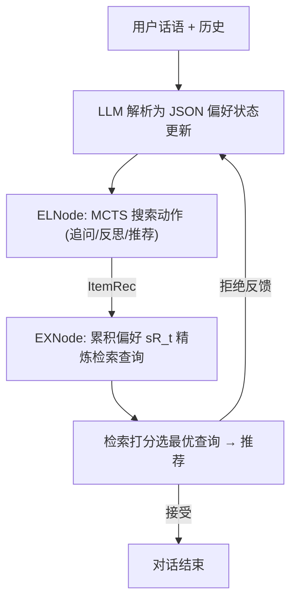
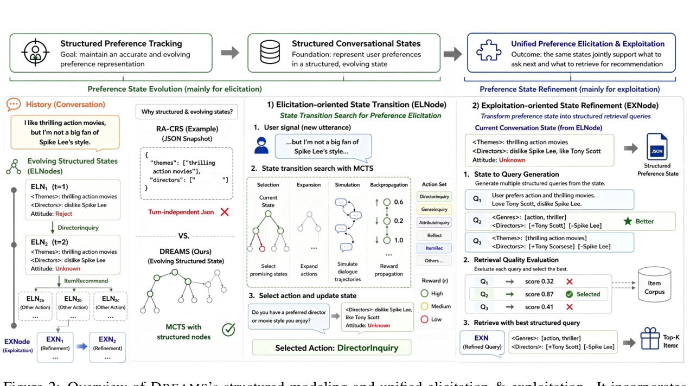

# Towards Effective Structured Context Modeling for Conversational Recommender Systems via Dual-node Monte Carlo Tree Search (基于双节点蒙特卡洛树搜索的对话推荐系统结构化上下文建模)

- **会议/期刊**: EMNLP 2026 Main Conference
- **作者与机构**: Jincheng Zhang, Chen Huang, Wenqiang Lei (四川大学), See-Kiong Ng (NUS), Yang Deng (SMU)
- **推荐链路定位**: 多轮对话决策 + 检索式召回/重排
- **研究方向**: 对话推荐与智能体仿真 / 大语言模型推荐
- **论文原文**: [https://arxiv.org/abs/2609.00618v2](https://arxiv.org/abs/2609.00618v2)
- **开源代码**: [https://github.com/SCUNLP/DREAMS](https://github.com/SCUNLP/DREAMS)

## TL;DR (1分钟核心速览)

现有 LLM 对话推荐把整段对话历史当作自由文本塞进 prompt 或直接编码为稠密查询，导致追问时机错乱（信息过载）与检索噪声（隐式负偏好被淹没）。本文提出 DREAMS，把对话状态建模为 JSON 结构化偏好树，用 ELNode 上的 MCTS 搜索追问/反思/推荐动作，用 EXNode 将偏好状态精炼为结构化检索查询。在 Redial 与 OpenDialKG 的 LLM 用户模拟器协议下，R@1 与 SR 相对最强非 MCTS 基线 ChatCRS 平均提升 8.57% / 9.07%，SR 平均提升 7.43%。

## Background & Motivation (背景与核心矛盾)

- **主流范式**: LLM-based CRS 普遍将多轮对话历史作为自由文本上下文，直接注入 prompt 决定"问还是推"，或整体编码为稠密向量做物品检索。
- **前人局限**: 其一，全量历史注入造成信息过载，系统难以判断何时该追问、该问什么（InterCRS 的粗粒度动作错误 CGE² 高达 0.570）；其二，自由文本编码把无关内容混入查询，即使偏好已完全澄清仍检索失败（InterCRS 的 PE² 为 0.240）。
- **结构化尝试的不足**: RA-CRS 用 JSON 记录偏好，但每轮是孤立快照、不建模状态演化；SAPIENT/T-EPL 用 MCTS 建模探索轨迹，但搜索节点缺乏显式语义偏好表示，且只结构化"问"不结构化"推"。
- **核心洞察 (Key Insight)**: 预实验（表 1）显示 JSON 表示与通用 MCTS 单独使用均无法降低错误率——有效偏好追踪需要"结构化状态 + 在状态上做前瞻搜索"二者合一。
- **本文切入点**: 把 MCTS 的搜索节点直接定义为结构化偏好状态，用两类节点（EL/EX）在同一棵树上联合优化偏好诱导与偏好利用。

## Method (核心方法设计)

### 1. 整体框架 (Overall Architecture)

DREAMS 将 CRS 交互形式化为 MDP，状态空间即结构化偏好状态。每轮收到用户话语后，LLM 解析出键值更新（如"不太喜欢 Spike Lee 的风格"→ `<director>: dislike Spike Lee`），写入 ELNode 的 JSON 状态；ELNode 在该状态上运行 MCTS，在"属性追问 / 失败反思 / 转入推荐 / 物品解释"动作空间中搜索最优动作。若选中 ItemRec，则展开 EXNode：聚合全对话累积偏好 $s^R_t$，由 LLM 提出查询精炼动作（去冗余、重排属性、口语转约束），对每个精炼查询实际检索并按偏好匹配度打分，取最高分查询生成推荐。推荐结果与用户反馈回写状态，若被拒则重新激活 ELNode 修正偏好。

<figure class="paper-figure" markdown="span">
  <figcaption>图2：DREAMS的结构化建模与统一引导及利用概览。它引入ELNodes以显式捕捉估计的用户偏好，并引入EXNodes以支持结构化查询细化。</figcaption>
</figure>

### 2. 关键设计拆解 (Key Designs)

1. **ELNode：结构化状态上的 MCTS 偏好诱导**：痛点在于自由文本历史无法支撑前瞻决策。ELNode 以 UCT 选择动作，节点值由 LLM 先验与树统计融合：
$$a^*=\arg\max_{a}\left(W_{\text{tree}}\cdot\frac{N(f(s_0,a))}{N(f(s_0))}+W_{\text{LLM}}\cdot M(s_0,a)\right)$$
其中 $M(s_0,a)$为 LLM 采样$m$ 次聚合的动作先验，仅扩展先验为正的动作以剪枝。直觉：把"该不该问"从一次性 LLM 判断变成可回滚、可前瞻的搜索问题，避免过早推荐。

2. **EXNode：偏好状态到检索查询的精炼**：痛点在于直接编码噪声历史会稀释偏好。EXNode 以累积状态 $s^R_t$（区别于 ELNode 的轮级状态$s_t$）为条件生成精炼动作$a^R_i$，并**实际执行检索**来评估：
$$RR(\text{EXN}^i_1)=\text{score}\big(\text{retrieve}(a^R_i(\text{EXN}^0))\big)$$
取最高分查询推荐。直觉：用检索结果与偏好属性的可验证重叠度替代 LLM 主观打分，使查询优化有外部信号锚定。

3. **分层可验证奖励与推理效率**：单步奖励 $r_t=\lambda_e r^{\text{explore}}_t+\lambda_r r^{\text{retrieve}}_t+\lambda_u r^{\text{attitude}}_t-\lambda_c r^{\text{cost}}_t$，分别度量偏好状态完整度增量、Top-1 检索物品属性与真实画像的重叠、用户接受度、对话长度惩罚，折扣回报再叠加终止接受奖励。训练免负采样（检索用预计算 embedding 余弦相似度）。推理侧提供 DREAMS(EA) 变体：将 MCTS 轨迹存入经验知识库，用结构相似的历史案例热启动，延迟从 23s 降至 9s（R@1 0.467）。

## Experimental Setup & Evaluation Protocol (实验设置与评估协议)

- **数据集与预处理**: 沿用 CRS 模拟器评测惯例，物品库来自 Redial 与 OpenDialKG（电影/图书两个域），偏好画像由 15/18/16 个高频偏好组 × 10 种人格采样生成 150/180/160 条对话。

| 数据集 | 域 | 偏好组数 | 模拟对话数 | 场景说明 |
| :--- | :---: | :---: | :---: | :--- |
| Redial | Movie | 15 | 150 | 单域电影推荐 |
| OpenDialKG | Movie | 18 | 180 | 多域知识图谱电影 |
| OpenDialKG | Book | 16 | 160 | 多域知识图谱图书 |

- **数据划分与防穿越**: 非传统交互切分，而是 **LLM 用户模拟器在线交互评测**（goal-driven simulator，满足"全部偏好 genre + 至少一个 actor/director"即终止），辅以 60 人真人交互研究。
- **排名评测协议**: 检索侧为 **Full-Ranking 式全库余弦检索**（text-embedding-ada-002 编码，报告 R@1/5/10）；另设三类错误率指标：CGE²（问/推动作与检索正确性错配比例）、FGE²（负反馈后追问不对焦比例）、PE²（偏好完全澄清后仍检索失败比例）。
- **对比基线与超参**: PLM 基线 BARCOR/UniCRS，LLM 基线 InterCRS/MACRS/ChatCRS/PC-CRS/RA-CRS，MCTS 基线 SAPIENT-LLM/T-EPL；统一 GPT-4o-mini 骨干，MCTS 迭代 $n^{(El)}=3$、深度$k^{(El)}=3$、$n^{(Ex)}=3$；LLM 评审与人工标注 Krippendorff's α 达 0.74/0.68。

## Key Experimental Results (实验关键数据)

### 1. 主实验对比 (Main Results)

| 模型 | Redial R@1 | Redial SR | ODKG-Movie R@1 | ODKG-Movie SR | ODKG-Book R@1 | ODKG-Book SR |
| :--- | :---: | :---: | :---: | :---: | :---: | :---: |
| BARCOR (PLM) | 0.193 | 0.107 | 0.094 | 0.211 | 0.106 | 0.219 |
| UniCRS (PLM) | 0.147 | 0.133 | 0.233 | 0.250 | 0.225 | 0.231 |
| InterCRS | 0.213 | 0.313 | 0.439 | 0.494 | 0.356 | 0.394 |
| MACRS | 0.310 | 0.400 | 0.506 | 0.522 | 0.506 | 0.544 |
| ChatCRS | 0.367 | 0.440 | 0.539 | 0.550 | 0.494 | 0.531 |
| PC-CRS | 0.307 | 0.407 | 0.556 | 0.567 | 0.519 | 0.563 |
| RA-CRS | 0.273 | 0.333 | 0.422 | 0.433 | 0.494 | 0.519 |
| SAPIENT-LLM | 0.287 | 0.380 | 0.433 | 0.450 | 0.488 | 0.506 |
| T-EPL | 0.293 | 0.327 | 0.416 | 0.427 | 0.475 | 0.494 |
| **DREAMS** | **0.507** | **0.560** | **0.600** | **0.639** | **0.550** | **0.594** |
| Improv. vs ChatCRS | +38.1% | +27.3% | +11.3% | +16.2% | +11.3% | +11.9% |

错误率侧（表 3）：Redial 上 DREAMS 的 CGE² 0.289 vs ChatCRS 0.561、PE² 0.160 vs 0.200；OpenDialKG-Movie 上 FGE² 0.117 为全表最低。

### 2. 消融实验 (Ablation Study)

| 变体 | Redial R@1 | Redial SR | Redial FGE²↓ | Redial CGE²↓ | Redial PE²↓ |
| :--- | :---: | :---: | :---: | :---: | :---: |
| DREAMS 完整 | **0.507** | **0.560** | **0.100** | **0.289** | **0.160** |
| w/o EXNode | 0.407 | 0.487 | 0.133 | 0.311 | 0.193 |
| w/o ELNode | 0.393 | 0.427 | 0.173 | 0.417 | 0.173 |
| w/o ELNode & Json | 0.287 | 0.347 | 0.340 | 0.539 | 0.233 |
| w/ Json Only | 0.327 | 0.360 | 0.200 | 0.455 | 0.240 |

### 3. 关键实验发现 (Key Findings)

1. **结构化状态是地基，搜索是放大器**：同时去掉 ELNode 与 JSON 时 R@1 从 0.507 崩至 0.287、CGE² 从 0.289 升至 0.539；但保留 JSON 仅换成直接 LLM 决策（w/ Json Only）仍只有 0.327，说明"记录偏好"与"在偏好上搜索"缺一不可。
2. **增益不来自 MCTS 本身**：SAPIENT-LLM 与 T-EPL 的 SR 仅 0.380/0.327，低于非 MCTS 的 ChatCRS（0.440），而 DREAMS 达 0.560——证明收益源于"搜索节点被锚定为结构化偏好状态"而非树搜索框架。
3. **EXNode 的精炼优于随机改写**：图 4 显示 EXNode 精炼查询与真实物品描述的余弦相似度逐轮上升，而 LLM 随机改写甚至低于原始查询，印证检索对上下文噪声高度敏感；去掉 EXNode 使 PE² 从 0.160 升至 0.193。

## Highlights & Limitations (亮点、对比与审稿批判)

- **与代表作对比 (vs. Prior Work)**: 相比 RA-CRS 的"轮级孤立 JSON 快照"，DREAMS 建模状态演化并让状态驱动决策；相比 SAPIENT/T-EPL 的"无语义自由文本搜索节点"，DREAMS 的节点即偏好状态且同时覆盖诱导与利用两侧；相比 ChatCRS 的领域知识增强，DREAMS 的增益来自上下文结构而非外部知识。
- **可迁移亮点**: ①"用实际检索结果的可验证重叠度作为查询精炼奖励"可直接迁移到 RAG 查询改写与生成式检索的 query planning；②经验知识库热启动（EA 变体）为树搜索类推荐策略提供了低延迟部署范式。
- **审稿级局限批判**: ①评测高度依赖 LLM 用户模拟器与 LLM-as-judge，虽报告 α=0.74/0.68 的一致性，但模拟器偏好本体与 prompt 设计仍可能系统性偏置结论，且仅覆盖电影/图书两域；②vanilla DREAMS 单轮延迟 23s（EA 版 9s 但 R@1 掉至 0.467），且 MCTS 迭代数 $n$ 从 3 增至 10 时 R@1 从 0.489 升至 0.600，性能-延迟权衡敏感，缺少与真实线上流量的验证。

## Rating (四维评分)

- **方法创新性 (Novelty)**: ⭐⭐⭐⭐ （首次将 MCTS 搜索节点与结构化偏好状态统一，双节点因子化在线策略的设计有清晰的问题针对性）
- **评估协议与实验扎实度 (Protocol & Experiments)**: ⭐⭐⭐⭐ （三数据集 + 三类细粒度错误率 + 60 人真人研究 + LLM 评审可靠性验证，但缺真实用户大规模线上验证）
- **写作与数学规范度 (Clarity & Rigor)**: ⭐⭐⭐⭐ （MDP 形式化与 UCT/奖励公式定义完整，附录给出伪代码与全部 prompt，符号略多但自洽）
- **工业落地与复现价值 (Industrial & Practical Value)**: ⭐⭐⭐⭐ （代码已开源、内存占用约 375MB，EA 变体给出 9s 延迟方案，但树搜索延迟仍是线上部署主要门槛）

