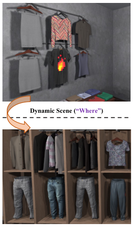
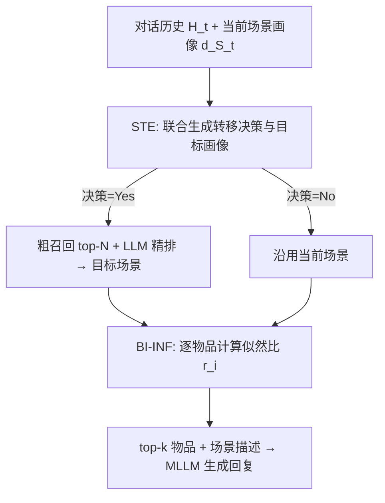

# Where and What: Reasoning Dynamic and Implicit Preferences in Situated Conversational Recommendation (情境对话推荐中的动态与隐式偏好推理：去哪与要什么)

- **会议/期刊**: ACL 2026
- **作者与机构**: Dongding Lin, Jian Wang, Yongqi Li, Wenjie Li（香港理工大学计算学系；四川大学计算机学院）
- **推荐链路定位**: 重排（场景级路由 + 场景内候选物品排序）+ 生成式回复
- **研究方向**: 对话推荐与智能体仿真 / 多模态推荐
- **论文原文**: [https://arxiv.org/abs/2604.20749v1](https://arxiv.org/abs/2604.20749v1)
- **开源代码**: [https://github.com/DongdingLin/SiPeR](https://github.com/DongdingLin/SiPeR)

## TL;DR (1分钟核心速览)

情境对话推荐（SCR）要求系统在**不断切换的视觉场景**中与用户多轮对话，但现有工作只做数据集构建，缺乏框架级解法。本文指出两大痛点：用户偏好随场景漂移（“去哪”），且真实意图常被表面话语掩盖（“要什么”）。SiPeR 用**场景转移估计（STE）** 先判断当前场景是否失配、生成目标场景语义画像并做粗到精检索定位新场景；再用**贝叶斯逆向推理（BI-INF）** 把用户话语视为潜在目标下的理性动作，用 MLLM 似然比在“喜欢/不喜欢”两个假设间打分排序候选物品。在 SIMMC 2.1 与 SCREEN 上，R@1 分别达 38.75%/39.41%，较最强基线平均提升 10.9%/10.6%，且 7B 骨干的 GPT-Score（8.92）反超 GPT-4o（7.56）。

## Background & Motivation (背景与核心矛盾)

- **主流范式**: SCR 近期工作集中在数据集建设（SIMMC 2.1、SCREEN、MUSE），模型侧多直接把 MLLM 当零样本/ICL 推理器，或沿用文本对话推荐（CRS）的偏好抽取范式。
- **前人局限**: 其一，场景会随对话演进，用户兴趣被环境牵动，系统必须主动决定**是否换场景、换到哪个场景**，而现有方法默认场景固定；其二，用户话语常是“尺寸对了但想看看别的”这类隐式信号，单遍 CoT 提示难以从视觉干扰项中分辨真实目标。
- **核心洞察 (Key Insight)**: 用户的话语不是随意文本，而是**在潜在目标 $m_i$与当前场景$s_t$下按隐策略$\pi(a_t|m_i,p_t,s_t)$ 产生的理性动作**——因此可以反向做贝叶斯推断，用“若他想要这件商品，说出这句话的概率有多大”来排序。
- **本文切入点**: 把 SCR 拆成“Where”（场景路由）与“What”（场景内偏好推断）两个可分别建模的子问题，前者用生成式画像+检索落地，后者用似然比替代启发式猜测。

<figure class="paper-figure" markdown="span">
  <figcaption>图 1：来自改造后的 SIMMC 2.1（Kottur and Moon, 2023）数据集的示例，用于情境化对话推荐，其中用户与虚拟助手之间的交互过程基于不断演变的场景。在底部面板中，尽管最初建议的蓝色牛仔裤满足尺寸约束，但用户的最终接受表明灰色裤子才是真实目标，突显了对隐式偏好进行推理的必要性。</figcaption>
</figure>

## Method (核心方法设计)

### 1. 整体框架 (Overall Architecture)

输入为对话历史 $H_t$、当前场景$S_t$及其物品集$I_t$。系统先用 MLLM 将每个候选场景离线转成文本化“情境画像”$d_{S_i}$（含空间关系与物品视觉属性目录），把场景预测转化为语义匹配问题；STE 模块联合生成转移决策 token 与目标场景画像$\tilde{d}_S$，再经稠密编码器粗召回 top-$N$、LLM 重排器精排得到目标场景；若决策为 No 则沿用当前场景。随后 BI-INF 在该场景内对每个候选物品计算“喜欢 vs 不喜欢”假设的似然比$r_i$并排序，取 top-$k$ 连同场景描述、对话历史拼成提示，交由 MLLM 生成下一轮回复。

### 2. 关键设计拆解 (Key Designs)

1. **场景转移估计 STE（解决“去哪”）**：直接对原始视觉场景推理代价高且噪声大，故先离线生成文本画像，再做“生成—检索”两段式。转移概率由决策 token 的归一化 logit 给出 $s_{\text{trans}}=\frac{\exp(z_{\text{Yes}})}{\exp(z_{\text{Yes}})+\exp(z_{\text{No}})}$；粗召回用余弦相似度$\text{Score}(S_i)=\frac{\phi(\tilde{d}_S)\cdot\phi(d_{S_i})}{\|\phi(\tilde{d}_S)\|\|\phi(d_{S_i})\|}$取 top-$N$，精排器$f_\theta$以负对数似然训练$\mathcal{L}_r=-\log\frac{\exp(f_\theta(\tilde{d}_S,d_{S^*}))}{\sum_{S_j\in S_{\text{top}}\cup\{S^*\}}\exp(f_\theta(\tilde{d}_S,d_{S_j}))}$。**直觉**：生成画像只是中间查询，最终落点被真实候选池约束，从而缓冲画像幻觉。

2. **贝叶斯逆向推理 BI-INF（解决“要什么”）**：把用户建成 POMDP 中的理性 agent，后验 $P(m_i,p_t|a_{\le t},s_{\le t})\propto\prod_{\tau=1}^{t}\pi(a_\tau|m_i,p_\tau)P(p_\tau|p_{\tau-1},s_\tau)P(p_0)P(m_i)$。由于策略空间不可积，用微调 MLLM 摊销$\pi$，并只比较两个对立假设$H(m_i,p_t^l)$（喜欢）与$H(m_i,p_t^{\neg l})$（不喜欢），得到排序分数$r_i=\frac{P(H(m_i,p_t^l))}{P(H(m_i,p_t^{\neg l}))}$。**直觉**：把“生成一句解释”换成“给已观测对话状态打分”，既避免了对每个候选自回归生成整句的开销，又让隐式否定信号（“还有别的吗”）在概率上被显式区分。

3. **训练目标、负采样与推理效率**：STE 重排器用上述交叉熵（批内其余场景即负样本，无需额外负采样）；BI-INF 用交叉熵微调 Qwen2.5-VL 预测结构化对话状态 $a_t$，推理时直接读 logits 而非逐候选生成。唯一闭源组件 GPT-4o 仅离线做一次场景画像构建，在线全用开源 7B 模型；延迟随场景内物品数从约 0.8s 近线性增至约 2.9s，与强训练基线 Qwen2.5-VL 相当。

## Experimental Setup & Evaluation Protocol (实验设置与评估协议)

- **数据集与预处理**: SIMMC 2.1（3D 虚拟购物多模态任务型对话）与 SCREEN（2 万余条合成 SCR 对话）。评估集被**平衡为 50% 需要场景转移的对话**，SCREEN 中超过 90% 对话需要超出初始请求的隐式偏好细化。

| 数据集 | 场景/物品规模 | 对话规模 | 关键特性 | 评估集构造 |
| :--- | :---: | :---: | :---: | :--- |
| SIMMC 2.1 | 多场景、场景内多物品 | 多模态任务型对话语料 | 3D 沉浸式购物环境 | 50% 转移需求平衡采样 |
| SCREEN | 基于 SIMMC 2.1 重构 | 20,000+ 合成对话 | >90% 需隐式偏好细化 | 同上 |

- **数据划分与防穿越 (Splitting Strategy)**: 沿用两数据集官方划分；场景画像由 GPT-4o 离线预生成，不参与在线逐轮推理，避免信息泄漏。
- **排名评测协议 (Ranking Protocol)**: 场景内候选物品排序，报告 R@1/3/5 与 MRR@3/5；回复质量用 BLEU-1/2、ROUGE-1/L、GPT-4o 打分（1–10）及 30 例三人盲评（Coherence / Informativeness / Situatedness，Fleiss' $\kappa\in[0.47,0.53]$）。
- **对比基线与超参设置**: 三类范式——零样本 CoT（LLaVA-NeXT、Qwen2.5-VL、GPT-4o）、ICL 增强同批骨干、训练式（ALBEF 全参微调、ReGeS、Qwen2.5-VL LoRA）。SiPeR 骨干为 Qwen2.5-VL-7B-Instruct，粗召回用 Qwen3-Embedding-4B，精排用 Qwen3-Reranker-4B，AdamW 优化，显著性 $p<0.05$（t 检验）。

## Key Experimental Results (实验关键数据)

### 1. 主实验对比 (Main Results)

| 类型 | 模型 | SIMMC 2.1 R@1 | R@5 | MRR@5 | SCREEN R@1 | R@5 | MRR@5 |
| :--- | :--- | :---: | :---: | :---: | :---: | :---: | :---: |
| CoT | GPT-4o | 28.12 | 53.18 | 38.05 | 33.45 | 58.15 | 44.58 |
| ICL | GPT-4o | 29.15 | 55.45 | 39.95 | 35.06 | 60.16 | 45.96 |
| Train | LLaVA-NeXT | 23.67 | 30.18 | 27.77 | 24.63 | 30.46 | 29.11 |
| Train | Qwen2.5-VL | 29.47 | 37.16 | 30.42 | 32.06 | 37.26 | 35.32 |
| Train | ReGeS | 27.68 | 54.12 | 37.46 | 31.42 | 59.24 | 41.75 |
| Train | **SiPeR** | **38.75** | **58.61** | **46.83** | **39.41** | **63.80** | **51.95** |
| Improv. | vs. 次优 | +9.28 | +3.16 | +6.88 | +4.35 | +3.64 | +5.99 |

回复生成侧：SiPeR 在 SIMMC 2.1 上 BLEU-1/2 = 33.77/21.67、ROUGE-1/L = 32.61/25.52、GPT-Score = 8.92；SCREEN 上 49.50/36.44、45.48/38.50、9.35，全面领先 GPT-4o（7.56/8.12）与 ReGeS（7.52/8.08）。

### 2. 消融实验 (Ablation Study)

| 变体 | SIMMC R@1 | SIMMC MRR@5 | SCREEN R@1 | SCREEN MRR@5 | GPT-Score (SIMMC) |
| :--- | :---: | :---: | :---: | :---: | :---: |
| SiPeR 完整 | **38.75** | **46.83** | **39.41** | **51.95** | **8.92** |
| w/o STE | 33.69 | 41.66 | 30.26 | 42.54 | 8.45 |
| w/ Random 转移 | 34.17 | 42.08 | 31.84 | 43.13 | — |
| w/ Non-target 转移 | 33.92 | 41.92 | 31.13 | 42.77 | — |
| w/o BI-INF | 31.88 | 39.13 | 33.96 | 47.92 | 8.62 |
| w/ Vanilla Prompting | — | 40.19 | — | — | 8.55 |

### 3. 关键实验发现 (Key Findings)

1. **STE 是性能天花板的主要决定项**：去掉 STE 后 SCREEN R@1 从 39.41% 骤降至 30.26%（-9.15），且随机/错误转移变体虽优于完全移除（+1.6~+1.9 R@1），仍远逊完整版，说明增益来自**精确的场景估计**而非“多一步决策”的结构复杂度；条件分析进一步显示，一旦场景预测错误，下游 R@1 从 40.0 掉到 29.8，误差传播路径被直接量化。
2. **BI-INF 的价值集中在排序质量而非召回上限**：去掉后 MRR@5 在 SIMMC 上从 46.83 降至 39.13（-7.70），降幅大于 R@1（-6.87），且 Vanilla Prompting 介于两者之间，证明“似然比概率推理”比单遍提示更能把真目标从视觉干扰项中顶到前列。
3. **小骨干 + 结构化推理可胜过大模型直推**：7B 的 SiPeR 在 GPT-Score 上以 8.92 反超 GPT-4o 的 7.56，人类评估中 Situatedness 达 1.84（GPT-4o 1.71、纯文本 ReGeS 仅 1.42），说明 SCR 的瓶颈是场景落地与意图对齐，而非语言流畅度。

## Highlights & Limitations (亮点、对比与审稿批判)

- **与代表作对比 (vs. Prior Work)**: 相比 SCREEN/MUSE 等只提供数据的工作，本文是较早的框架级 SCR 解法；相比 ReGeS 这类纯文本生成式推荐，它显式引入视觉场景路由，R@1 高出约 11 个点；相比 GPT-4o 的 CoT/ICL 直推，它用“生成画像+真实候选池约束”和“似然比打分”替换了不可控的自由生成。
- **可迁移亮点**: ①“离线场景画像 + 生成式查询 + 粗到精检索”可迁移到任何需要在大规模候选池中做语义路由的场景（如跨域推荐的目标域选择）；②用 MLLM logits 对**已观测动作**打分而非逐候选生成，是降低 LLM 排序延迟的通用技巧。
- **审稿级局限批判**: ①BI-INF 需对场景内每个候选物品各算一次似然，延迟随物品数近线性增长（0.8s→2.9s），密集货架场景下成本偏高，作者也承认需前置轻量粗筛；②STE 与 BI-INF 均继承底层 MLLM 的校准与幻觉风险，画像生成噪声在场景选错时会向下游传播，且评估集被人为平衡为 50% 转移需求，可能与真实分布存在偏差。

## Rating (四维评分)

- **方法创新性 (Novelty)**: ⭐⭐⭐⭐ （把认知科学的贝叶斯逆向规划引入 SCR 偏好推断，并用生成—检索两段式落地场景路由，问题拆解清晰且有理论出处）
- **评估协议与实验扎实度 (Protocol & Experiments)**: ⭐⭐⭐⭐ （双数据集 + 三类范式基线 + 消融/变体/误差传播/人工评估齐全，但评估集 50% 平衡采样削弱了真实分布代表性）
- **写作与数学规范度 (Clarity & Rigor)**: ⭐⭐⭐⭐ （POMDP 与似然比推导完整、符号统一，但 Eq.6 的近似与信念状态摊销细节略依赖附录）
- **工业落地与复现价值 (Industrial & Practical Value)**: ⭐⭐⭐⭐ （代码开源、在线全用 7B 开源模型、闭源仅离线预处理，延迟与强基线相当；短板是候选数增长带来的线性打分开销）
