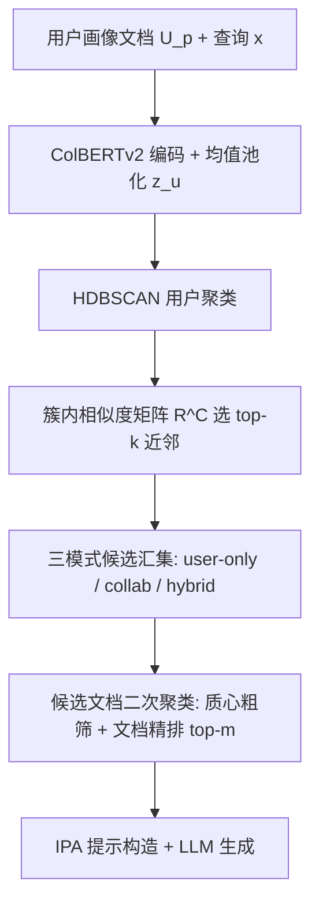
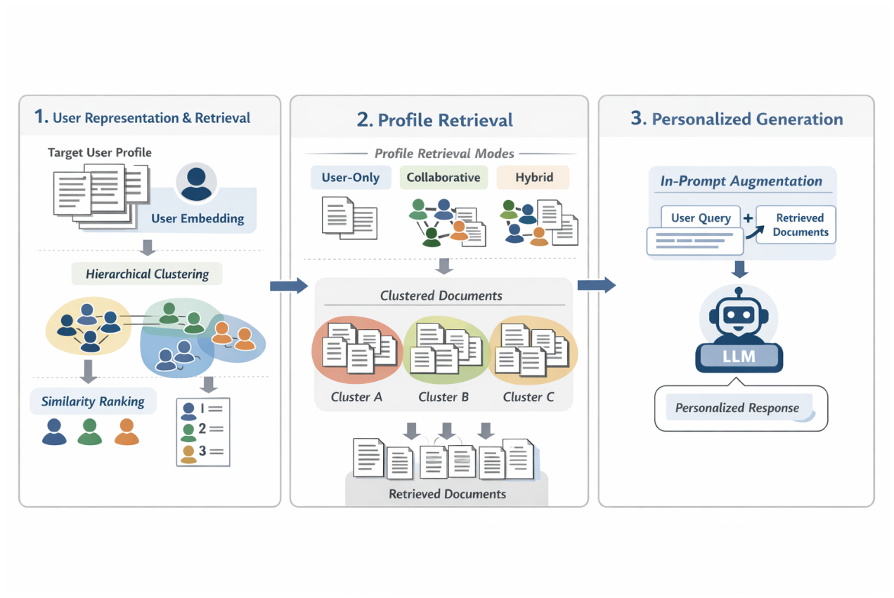

# ClusterRAG: Cluster-Based Collaborative Filtering for Personalized Retrieval-Augmented Generation (基于聚类的协同过滤个性化检索增强生成)

- **会议/期刊**: ACL 2026
- **作者与机构**: Gibson Nkhata, Uttamasha Anjally Oyshi, Susan Gauch (University of Arkansas)；Quan Mai (Walmart Inc.)
- **推荐链路定位**: 召回（个性化文档检索 + 提示构造）
- **研究方向**: 协同过滤与双塔召回 / 大语言模型推荐 (LLM4Rec)
- **论文原文**: [https://arxiv.org/abs/2605.18769v1](https://arxiv.org/abs/2605.18769v1)
- **开源代码**: [https://github.com/huggingface/transformers](https://github.com/huggingface/transformers)（论文匿名仓库未公开，仅给出 HF transformers 依赖）

## TL;DR (1分钟核心速览)

个性化 RAG 的两难：只用本人画像在稀疏/噪声场景失效，完全忽略用户又丢失个性化；而全量用户两两算相似度代价为 $O(N^2)$。ClusterRAG 把每个用户的画像文档均值池化为用户向量，用 HDBSCAN 做密度聚类，仅在簇内用 ColBERTv2 打分构建相似度矩阵选 top-$k$ 近邻，再对"本人 + 近邻"候选文档做簇中心粗筛 + 文档级精排的两级检索，最后以 In-Prompt Augmentation 融合进提示。在 LaMP 六个任务、时间切分协议下，Hybrid 模式全面最优，LaMP-2 Acc 0.661（较 LaMP-IPA 0.570 提升 16.0%），且仅需 2 篇画像文档即超越需 4 篇的基线。

## Background & Motivation (背景与核心矛盾)

- **主流范式**: 个性化 RAG 分两派——用户画像内提示增强（LaMP-IPA、ROPG 优化检索器）与协同式检索（CFRAG 用对比学习学用户向量找相似用户）。
- **前人局限**: ① 用户自身画像常稀疏、含噪或与当前意图不匹配，user-only 检索退化；② 跨百万用户暴力算 pairwise 相似度不可扩展，且固定密度假设（如 k-means）在用户分布不均时近邻选择不稳。
- **核心洞察 (Key Insight)**: 相似用户的历史文档能补足目标用户缺失的上下文，但"找谁"必须结构化——密度聚类天然适配未知簇数、变密度用户群，且把相似度计算限制在簇内可将复杂度从 $O(N)$降到$O(K+B\cdot N/K)$。
- **本文切入点**: 首次把"用户级聚类 + 文档级协同检索 + 簇级相似度排序矩阵"串成一条可插拔流水线，并系统比较 user-only / collaborative / hybrid 三种画像融合模式。

## Method (核心方法设计)

### 1. 整体框架 (Overall Architecture)

输入为目标用户 $u$的查询$x$与其画像$U_p=\{d_1,\dots,d_n\}$。第一阶段把每篇画像文档经 ColBERTv2 编码后均值池化为用户向量$z_u$，用 HDBSCAN 将全体用户聚成变密度簇；第二阶段在簇内构建相似度矩阵选 top-$k$近邻，按三种模式（user-only / collaborative / hybrid）汇集候选文档，再对候选集二次 HDBSCAN 聚类，用簇质心做粗筛、文档级精排取 top-$m$；第三阶段按提示长度预算把画像文档拼入 IPA 提示，交由 FlanT5 或 Qwen2 生成。全流程无 LLM 参数微调，嵌入可离线预计算。

<figure class="paper-figure" markdown="span">
  <figcaption>图1：ClusterRAG框架概览。</figcaption>
</figure>

### 2. 关键设计拆解 (Key Designs)

1. **簇内相似度排序矩阵（把 $O(N^2)$压成簇内打分）**：痛点是对全体用户两两算相似度不可行。做法是先对每簇$C$只计算$R^C_{u,v}=\mathrm{ColBERTv2}(z_u,z_v)$（$u,v\in C$，$v\neq u$，丢弃对角线），再对每个$u$保留簇内 top-$k$ 有序近邻。直觉：行为一致的同簇用户才值得比较，既降复杂度又避免跨簇噪声近邻污染；ColBERTv2 的 token 级晚交互比单向量内积更能刻画画像间的细粒度语义重合。

2. **簇-文档两级检索（质心粗筛 + 文档精排）**：候选画像文档先被 HDBSCAN 按主题聚成 $K$簇并算质心$\{\mu_1,\dots,\mu_K\}$，查询嵌入$e_q$先与全部质心比对选出 top-$B$簇，再在簇内按$e_q$精排取 top-$m$。复杂度由$O(N)$降为$O(K+B\cdot N/K)$。直觉：主题级粗筛保证召回的主题覆盖，文档级精排保证证据质量，且 HDBSCAN 自动推断主题数，无需预设$K$。

3. **提示预算分配与训练/推理开销**：画像长度按 $|U_p|=G_t(L_{\max}-\min(|q|,\lfloor\gamma L_{\max}\rfloor))$分配，$\gamma=0.55$ 平衡画像上下文与查询特异性。全流程无监督（HDBSCAN 无参数、ColBERTv2 仅约 0.1M 线性投影，总参数量约 110M），无负采样、无对比损失，训练仅发生在下游生成器微调；推理以相似度计算为主，用户/文档嵌入离线预计算，延迟低。

## Experimental Setup & Evaluation Protocol (实验设置与评估协议)

- **数据集与预处理**: LaMP 基准六个任务（LaMP-6 因数据未公开剔除），沿用官方时间切分：

| 数据集 | #Users | #Train | #Dev | #Test | 任务类型 |
| :--- | :---: | :---: | :---: | :---: | :--- |
| LaMP-1 引用识别 | 6,542 | 6,542 | 1,500 | 1,500 | 二分类 (Acc/F1) |
| LaMP-2 电影标签 | 929 | 5,073 | 1,410 | 1,557 | 15 类分类 (Acc/F1) |
| LaMP-3 商品评分 | 20,000 | 20,000 | 2,500 | 2,500 | 序数回归 (MAE/RMSE) |
| LaMP-4 新闻标题 | 1,643 | 12,500 | 1,500 | 1,800 | 生成 (R-1/R-L) |
| LaMP-5 论文标题 | 14,682 | 14,682 | 1,500 | 1,500 | 生成 (R-1/R-L) |
| LaMP-7 推文改写 | 13,437 | 13,437 | 1,498 | 1,500 | 生成 (R-1/R-L) |

- **数据划分与防穿越 (Splitting Strategy)**: 官方 `time-based split`（按时间戳划分 train/dev/test），画像仅取查询时刻之前的历史文档，避免未来信息泄漏。
- **排名评测协议 (Ranking Protocol)**: 非排序式评测，直接以生成/分类指标衡量端到端质量；检索侧固定 top-$k=1$近邻用户、top-$m=2$ 画像文档，属"小候选集"设定而非全库排序。
- **对比基线与超参设置**: vanillaRAG（无个性化）、LaMP-IPA、ROPG（user-only 检索器优化）、CFRAG（唯一协同基线，对比学习用户向量）。生成器 FlanT5-base 微调，另测零样本 FlanT5-XXL 与 Qwen2-7B-Instruct；AdamW，lr $5\times10^{-5}$，wd$10^{-4}$，warm-up 0.05，30 epoch，$L_{\max}=512$，beam size 4；显著性用双尾配对 t 检验（生成/序数）与 McNemar 检验（分类），$p<0.05$。

## Key Experimental Results (实验关键数据)

### 1. 主实验对比 (Main Results)

| Models | LaMP-1 Acc | LaMP-2 Acc | LaMP-3 MAE↓ | LaMP-4 R-1 | LaMP-5 R-1 | LaMP-7 R-1 |
| :--- | :---: | :---: | :---: | :---: | :---: | :---: |
| vanillaRAG | 0.630 | 0.520 | 0.371 | 0.171 | 0.462 | 0.310 |
| LaMP-IPA | 0.674 | 0.570 | 0.289 | 0.175 | 0.472 | 0.508 |
| ROPG | 0.644 | 0.468 | 0.346 | 0.184 | 0.464 | 0.353 |
| CFRAG | 0.633 | 0.534 | 0.354 | 0.162 | 0.473 | 0.375 |
| ClusterRAG-C | 0.674 | 0.644 | 0.284 | 0.179 | 0.480 | 0.507 |
| ClusterRAG-U | 0.645 | 0.649 | 0.271 | 0.184 | 0.475 | 0.514 |
| **ClusterRAG-H** | **0.690** | **0.661** | **0.270** | **0.190** | **0.490** | **0.521** |
| Improv. vs 最优基线 | +2.4% | +16.0% | -6.6% | +3.3% | +3.6% | +2.6% |

### 2. 消融实验 (Ablation Study)

| 变体 | LaMP-3 MAE↓ | LaMP-3 RMSE↓ | LaMP-7 R-1↑ | LaMP-7 R-L↑ |
| :--- | :---: | :---: | :---: | :---: |
| w/o user clustering | 0.320 | 0.637 | 0.458 | 0.371 |
| w/o intra-cluster sim | 0.329 | 0.639 | 0.501 | 0.442 |
| w/o doc ranking | 0.331 | 0.642 | 0.462 | 0.413 |
| Centroids only | 0.400 | 0.643 | 0.472 | 0.438 |
| k-means 替代 HDBSCAN | 0.291 | 0.610 | 0.502 | 0.453 |
| **ClusterRAG** | **0.270** | **0.594** | **0.521** | **0.470** |

### 3. 关键实验发现 (Key Findings)

1. **协同信号是主增益来源，但必须"结构化"**：去掉用户聚类改为随机采样近邻，LaMP-7 R-1 从 0.521 暴跌至 0.458（-12.1%），说明增益不来自"多给文档"，而来自"给对的人"；簇内相似度排序再贡献 0.501→0.521 的增量。
2. **文档级证据不可被质心替代**：仅用簇质心代表画像时 LaMP-3 MAE 恶化到 0.400（+48%），是全部消融中最大跌幅，证明主题级摘要丢失了生成所需的具体事实片段，两级检索中的精排环节是刚需。
3. **Hybrid 模式在稀疏与稠密场景双赢，且低资源友好**：ClusterRAG-H 在全部六任务最优，LaMP-2 上较 CFRAG 提升 23.8%（0.534→0.661）；同时仅用 2 篇画像文档即超过需 4 篇文档才达最优的基线，说明协同补全显著降低了对本人画像密度的依赖。

## Highlights & Limitations (亮点、对比与审稿批判)

- **与代表作对比 (vs. Prior Work)**: 与 CFRAG 的本质区别在于——CFRAG 用对比学习把用户压成单向量后全局检索，本文改用密度聚类限定搜索空间并显式建模簇内相对相似度；与 LaMP-IPA 相比，本文不改生成器、只改"喂什么文档"，因而对任意 LLM 即插即用；与 ROPG 相比，本文引入跨用户信号而非仅优化本人检索器。
- **可迁移亮点**: ① "簇内打分 + 质心粗筛 + 文档精排"的两级检索范式可直接迁移到大规模内容召回，把 $O(N)$扫描换成$O(K+B\cdot N/K)$；② 提示预算按$\gamma$ 在画像与查询间分配的做法，可复用于任何长上下文拼接场景。
- **审稿级局限批判**: ① 用户嵌入为离线静态均值池化，画像演化需周期性重聚类，论文仅在讨论中给出设想而无动态实验；② 评测限于英文纯文本、top-$k=1$/$m=2$ 的极小候选设定，未报告检索延迟与全库排序下的表现，且所有结果为单次运行，统计功效存疑。

## Rating (四维评分)

- **方法创新性 (Novelty)**: ⭐⭐⭐ （聚类 + 协同检索的组合在 RAG 场景属首次系统化，但各组件均为现成技术拼接，缺少新的学习目标或理论分析）
- **评估协议与实验扎实度 (Protocol & Experiments)**: ⭐⭐⭐⭐ （LaMP 六任务全覆盖、时间切分防穿越、显著性检验规范、消融与检索器/LLM 泛化实验完整，扣分在单次运行与极小候选集设定）
- **写作与数学规范度 (Clarity & Rigor)**: ⭐⭐⭐⭐ （三阶段流水线叙述清晰、复杂度推导明确，但公式较少、相似度矩阵与提示预算的符号定义偏简）
- **工业落地与复现价值 (Industrial & Practical Value)**: ⭐⭐⭐⭐ （无监督、无负采样、嵌入可离线预计算、模型无关可插拔，工程友好；但匿名代码仓库未真正公开，复现需自行补齐）
