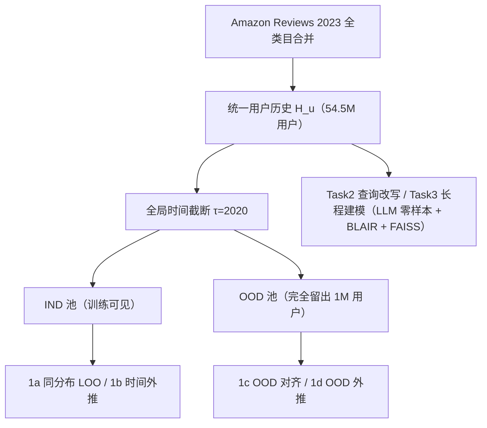
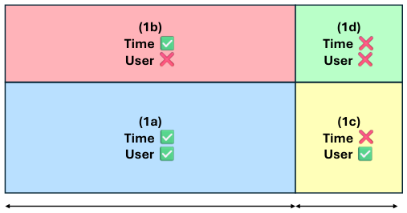

# HORIZON: A Benchmark for In-the-wild User Behaviour Modeling (面向真实用户行为建模的基准)

- **会议/期刊**: ACL 2026 (Findings)
- **作者与机构**: Arnav Goel, Pranjal A. Chitale, Bhawna Paliwal, Bishal Santra, Amit Sharma (CMU / Microsoft Research India / UC Berkeley)
- **推荐链路定位**: 召回 / 端到端序列建模（评测基准）
- **研究方向**: 跨域与多场景推荐 / 序列推荐
- **论文原文**: [https://arxiv.org/abs/2604.17259v1](https://arxiv.org/abs/2604.17259v1)
- **开源代码**: [microsoft/horizon-benchmark](https://github.com/microsoft/horizon-benchmark)

## TL;DR (1分钟核心速览)

现有序列推荐基准普遍是「单域 + 短会话 + 同分布 Leave-One-Out」，无法检验跨域、跨时间、跨用户的泛化。本文把 Amazon Reviews 2023 的 33 个类目合并为统一用户历史，构建 54.5M 用户 / 34.5M 物品 / 4.86 亿交互的 HORIZON，并以全局时间戳 $\tau=2020$ 切分，沿「时间（τ 前/后）× 用户（已见/未见）」两轴构造四象限评估，另设 LLM 查询改写与长程建模两个任务。核心发现：BERT4Rec 在同分布 NDCG@10 达 26.4，但时间外推后骤降至 1.1；OOD 用户下 SASRec 反超 BERT4Rec（17.8 vs 11.8），LLM 零样本 Recall@100 仅 2.8–3.5。

## Background & Motivation (背景与核心矛盾)

- **主流范式**: 序列推荐以 MovieLens / Amazon Reviews 单类目子集为基准，采用 Leave-One-Out 或 8:1:1 比例划分，只做同域 next-item 预测。
- **前人局限一（域割裂）**: Amazon Reviews 按类目切分为独立任务，用户跨类目迁移信号被人工边界切断，单类目内稀疏性被放大；MIND 仅两周历史，Amazon-M2 仅会话级，PinnerFormer/USE 数据私有不可复现。
- **前人局限二（分布泄漏）**: Leave-One-Out 把未来交互混入训练，比例划分则允许不同用户的时间窗重叠，二者都使测试集与训练集同分布，无法度量时间漂移与新用户泛化。
- **核心洞察 (Key Insight)**: 真实用户行为是跨域、长程、且随时间演化的；把「时间位置」与「用户可见性」作为两个正交因子显式解耦，才能暴露被同分布指标掩盖的失效模式。
- **本文切入点**: 用统一跨域历史 + 固定时间截断 + 留出用户池，把评测从「预测下一个物品」升级为「在分布漂移下预测用户行为」。

## Method (核心方法设计)

### 1. 整体框架 (Overall Architecture)

HORIZON 本身是基准而非模型：先将 Amazon Reviews 2023 全部 33 类目按用户 ID 合并为单一时间序交互序列 $H_u=[i_1,\dots,i_t]$，得到 53.5M 用户、34.5M 物品、约 4.86 亿交互；再以$\tau=2020$ 为全局截断，把用户划分为训练可见的 IND 池与完全留出的 OOD 池（1M 用户），由此派生四个评估象限；最后在此协议上跑 ID-based 序列模型（Task 1）与 LLM 零样本查询改写/长程建模（Task 2/3）。

<figure class="paper-figure" markdown="span">
  <figcaption>图1：针对任务1在HORIZON基准上提出的评估划分。</figcaption>
</figure>

### 2. 关键设计拆解 (Key Designs)

1. **时间-用户双轴四象限评估协议**：痛点在于单一划分无法区分「时间漂移」与「新用户」两种分布偏移。作者固定唯一训练集（1a：IND 用户在 $\tau$前做 Leave-One-Out），其余三个象限共享同一模型权重：1b 对同批用户评估$\tau$后全部交互（真值逐步揭示），1c 对 OOD 用户在$\tau$前做 LOO，1d 对 OOD 用户评估$\tau$ 后全部交互。这样任一象限的性能差都可归因到单一因子，而非划分随机性。

2. **LLM 查询改写与长程建模任务（Task 2/3）**：传统 next-item 只考 ID 判别，无法检验语义理解。Task 2 让 LLM 把历史改写为 10 条查询（4 条直接相关、3 条弱相关、3 条探索性），经 BLAIR 物品编码器映射到共享空间后用 FAISS-HNSW 检索 top-$K$；Task 3 进一步要求自回归生成未来 10 个物品的一句话描述再检索。评估用$\text{Recall}@K$、$\text{Precision}@K$，本质是把「用户建模」转化为「语义桥接 + 向量召回」的可度量问题。

3. **训练目标、负采样与推理效率**：Task 1 沿用 RecBole 标准配置，BERT4Rec/GRU4Rec/SASRec 用 BPR + 动态负采样，CORE 用全 softmax 交叉熵；统一 $d=256$、3 层、4 头、dropout 0.15、最大序列长 100、学习率$2\times10^{-5}$、种子 2025。测试阶段每用户采样 100 个负例（Sampled Ranking）。LLM 侧零样本推理，温度 0.7、top-p 0.8，全量 1M 用户端到端约需 5 天（4×A100），是明显的工程瓶颈。

## Experimental Setup & Evaluation Protocol (实验设置与评估协议)

- **数据集与预处理**: 由 Amazon Reviews 2023 全类目合并重构，未做 5-core 过滤（保留长尾），统计如下：

| 数据集 | #Users | #Items | #Interactions | 平均历史长 | 特征/场景说明 |
| :--- | :---: | :---: | :---: | :---: | :--- |
| HORIZON | 54.51M | 34.52M | 485.89M | 9.07 | 跨域、含时间戳、开源 |
| Amz-Reviews | 54.51M | 34.52M | 485.89M | 3.86 | 按类目割裂评估 |
| MIND | 1M | 0.16M | 24.15M | — | 单域、仅两周 |
| Amz-M2 | — | 1.42M | 16.78M | 4.2 | 会话级、无长程 |

- **数据划分与防穿越 (Splitting Strategy)**: 全局时间戳切分 $\tau=2020$+ 留出用户划分。IND 池 53M 中采样 1M 构造 1c 测试集；受算力限制，训练用 IND 的 100K 子集，1b/1d 各评估 25K 用户。OOD 池为$\tau$ 后有交互的 1M 随机用户。
- **排名评测协议 (Ranking Protocol)**: `Sampled Ranking`，测试时每用户采样 100 个负例，报告 MRR、Recall@$\{10,50,100\}$、NDCG@$\{10,50,100\}$；Task 2/3 用 FAISS 全库 ANN 检索的 Recall/Precision@$\{10,50,100\}$。
- **对比基线与超参设置**: ID 基线 GRU4Rec、SASRec、BERT4Rec、CORE（RecBole 统一实现）；LLM 基线 LLaMA-3.1-8B、Qwen3-8B、Gemma2-9B 零样本，另含 LoRA/全参微调对照。嵌入维度 $d=256$，未报告显著性检验。

## Key Experimental Results (实验关键数据)

### 1. 主实验对比 (Main Results)

Task 1 四象限（NDCG@10 / MRR@10 / Recall@100，单位 %）：

| 象限 | 模型 | N@10 | M@10 | R@100 |
| :--- | :--- | :---: | :---: | :---: |
| 1a IND-对齐 | **BERT4Rec** | **26.4** | **23.9** | 42.9 |
| 1a IND-对齐 | SASRec | 25.2 | 22.5 | **46.6** |
| 1a IND-对齐 | CORE | 8.5 | 7.25 | 13.4 |
| 1a IND-对齐 | GRU4Rec | 0.08 | 0.07 | 0.43 |
| 1c OOD-对齐 | **SASRec** | **17.8** | **15.2** | 34.6 |
| 1c OOD-对齐 | BERT4Rec | 11.8 | 9.96 | **34.7** |
| 1c OOD-对齐 | CORE | 5.9 | 4.19 | 17.9 |
| 1b IND-外推 | **SASRec** | **2.9** | **1.88** | 11.0 |
| 1b IND-外推 | BERT4Rec | 1.1 | 0.56 | **17.8** |
| 1d OOD-外推 | **SASRec** | **3.1** | **2.01** | 11.6 |
| 1d OOD-外推 | BERT4Rec | 1.1 | 0.55 | **18.9** |

LLM 任务（Recall@10/50/100，%）：

| 任务 | 模型 | R@10 | R@50 | R@100 |
| :--- | :--- | :---: | :---: | :---: |
| Task2 查询改写 | **Qwen3-8B** | **2.06** | **2.95** | **3.50** |
| Task2 查询改写 | LLaMA-3.1-8B | 1.62 | 2.37 | 2.84 |
| Task2 查询改写 | Gemma2-9B | 1.45 | 2.26 | 2.66 |
| Task3 长程建模 | **Qwen3-8B** | **1.51** | **7.78** | **15.75** |
| Task3 长程建模 | LLaMA-3.1-8B | 1.26 | 6.52 | 13.25 |
| Task3 长程建模 | Gemma2-9B | 0.98 | 5.07 | 10.39 |

### 2. 消融实验 (Ablation Study)

本文为基准论文，无模块消融，但提供了「训练策略 × 分布」的对照（Recall@100，%）：

| 配置 | 1c IND-外推 | 1d OOD-外推 |
| :--- | :---: | :---: |
| LLaMA3 全参微调 | **2.02** | **1.71** |
| LLaMA3 LoRA | 2.09 | 1.07 |
| Qwen3 LoRA | 1.93 | 1.67 |
| 零样本查询改写（Task2） | 2.84 | — |

### 3. 关键实验发现 (Key Findings)

1. **同分布指标严重高估泛化**：BERT4Rec 在 1a 的 NDCG@10 为 26.4，到 1b 时间外推只剩 1.1（跌幅 96%），而 OOD 用户下 SASRec 反超 BERT4Rec（17.8 vs 11.8），说明「双向掩码 + 同分布」的优势在分布漂移下完全失效。
2. **时间漂移比用户漂移更致命**：同一批 IND 用户跨时间（1b）的 Recall@100 为 11.0，而 OOD 用户同时间窗（1c）可达 34.6，即模型对「新物品/新品牌」的 ID 表示缺乏语义外推能力，跨时间泛化难度显著高于跨用户。
3. **LLM 微调收益近乎为零**：LoRA/全参微调后 Recall@10 仅 1.38–1.65，与零样本查询改写（2.06）持平甚至更差；Qwen3-235B 推理模式 Recall@100 仅 2.96，说明单纯扩规模或加推理链无法弥补生成式目标缺乏负样本对比监督的结构性缺陷。

## Highlights & Limitations (亮点、对比与审稿批判)

- **与代表作对比 (vs. Prior Work)**: 相比 Amazon Reviews 2023（按类目割裂、比例划分），HORIZON 首次把跨域历史合并并引入固定时间截断；相比 MIND/Amazon-M2（短窗/会话级），它提供 9.07 平均历史长与近半交互在 $\tau$ 后的时间纵深；相比 PinnerFormer/USE（私有数据），它是唯一可复现的亿级跨域长程公开基准。
- **可迁移亮点**: ①「时间 × 用户」双轴解耦的评估矩阵可直接移植到任何带时间戳的推荐日志，用于诊断模型失效来源；②用 LLM 生成查询 + 冻结物品编码器 + ANN 检索的零样本评估管线，可作为生成式召回的轻量基线模板。
- **审稿级局限批判**: ①受算力限制，Task 1 仅用 100K 用户训练、25K 评估，与 54M 全量规模严重不匹配，结论的规模外推性存疑；②Task 2/3 的 Recall 绝对值极低（<4%），且 Task 3 多真值设定与 Task 2 单真值不可直接比较，指标可比性弱；③仅英文、仅文本模态、仅电商域，且未报告显著性检验与方差。

## Rating (四维评分)

- **方法创新性 (Novelty)**: ⭐⭐⭐⭐ （基准构建本身非新算法，但时间-用户双轴解耦协议与 LLM 语义桥接任务设计具有明确的方法论增量）
- **评估协议与实验扎实度 (Protocol & Experiments)**: ⭐⭐⭐ （四象限设计严谨、基线覆盖 ID 与 LLM 两族，但训练规模被大幅裁剪、缺显著性检验、LLM 指标绝对值过低）
- **写作与数学规范度 (Clarity & Rigor)**: ⭐⭐⭐⭐ （任务定义与切分逻辑清晰，附录统计详实；但正文与附录的用户数表述存在 53.5M/54.5M 不一致）
- **工业落地与复现价值 (Industrial & Practical Value)**: ⭐⭐⭐⭐ （全开源、RecBole 兼容、含预计算预测子集，可直接作为跨域长程用户建模的离线评测沙盒；但 LLM 全量推理 5 天成本偏高）
