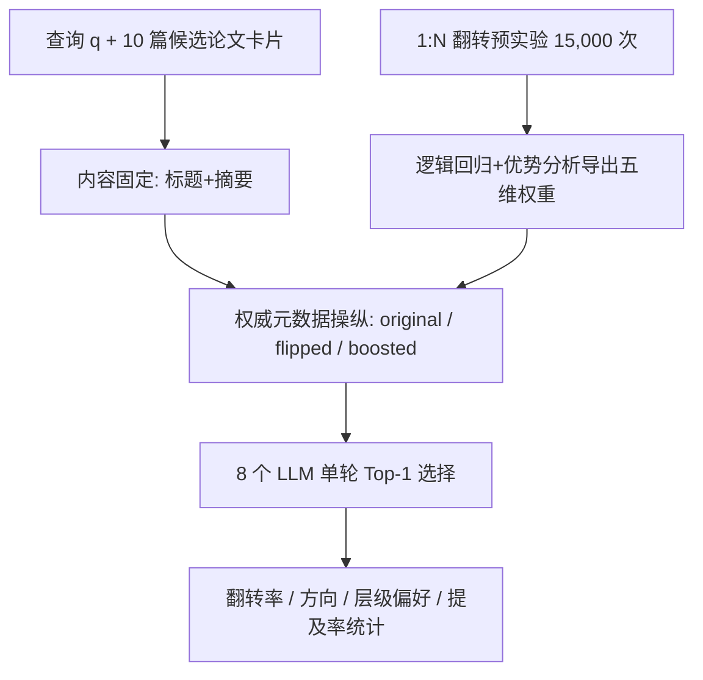

# Authority Bias in Conversational Search Engines for Academic Paper Recommendation (对话式学术搜索引擎中的权威偏见)

- **会议/期刊**: EMNLP 2026 Main Conference
- **作者与机构**: Uthman Jinadu, Parsa Ghazvinian, Anjila Budathoki, Benjamin M. Ampel, Rajshekhar Sunderraman, Yi Ding（Georgia State University / University of Tennessee, Knoxville）
- **推荐链路定位**: 重排（LLM 列表级 Top-1 选择）
- **研究方向**: 去偏公平与可信推荐 / 大语言模型推荐
- **论文原文**: [https://arxiv.org/abs/2609.00248v1](https://arxiv.org/abs/2609.00248v1)
- **开源代码**: [https://github.com/jinaduuthman/Author](https://github.com/jinaduuthman/Author)

## TL;DR (1分钟核心速览)

LLM 正成为学术文献发现的对话式入口，但其推荐究竟基于论文内容还是作者声望（h-index、venue、引用数）从未被因果检验。本文采用内容受控的反事实审计：固定标题与摘要，仅操纵权威元数据（original / flipped / boosted 三条件），在 8 个 LLM（5 个开源 7–9B + 3 个前沿闭源）上执行 17,898 次单轮 Top-1 推荐。结果显示元数据交换即导致 **39.2%** 的推荐翻转，boosted 条件下 **68.2%** 的翻转指向更高权威论文；提示级去偏仅将翻转率降低 12.9pp，且存在"说做差距"（权威措辞降 24.0pp 而行为仅降 12.9pp）与前沿模型反向失效。

## Background & Motivation (背景与核心矛盾)

- **主流范式**: ChatGPT、Perplexity、Elicit、Semantic Scholar AI 等已从关键词检索转向"推荐器"角色——内部打分、挑选并给出理由，将相关性判断权从研究者转移给模型。
- **前人局限**: Algaba et al. (2025) 发现 LLM 复现引用时放大引用偏见，Barolo et al. (2025) 发现专家识别偏向资深高被引学者，Howell et al. (2025) 在同行评审中报告声望压过质量；但这些均为**相关性设计**，无法排除权威与内容的混淆，且多为单维度操纵，无法判断效应是否跨信号泛化。
- **核心洞察 (Key Insight)**: 借鉴劳动市场审计研究（Bertrand & Mullainathan, 2004）的对应检验逻辑——只要固定内容、仅变动权威元数据，任何推荐变化在构造上即可归因于权威信号。
- **本文切入点**: 用 1:N 翻转预实验经验性地将权威分解为五个加权信号（而非人为设定权重），再以三条件 × 三指令 × 八模型的全因子设计做因果审计。

## Method (核心方法设计)

### 1. 整体框架 (Overall Architecture)

任务形式化为列表级 Top-1 选择：给定查询 $q$与候选集$\mathcal{P}_q=\{p_1,\dots,p_{10}\}$，模型$\phi$在指令$I$下输出$r_q=\phi(q,\mathcal{P}_q,I)\in\mathcal{P}_q$。每篇论文分解为内容$C_i=(\text{title}_i,\text{abstract}_i)$与权威元数据$M_i=(a_i,v_i,s_i)$。核心闭环是：先用 15,000 次 1:N 翻转预实验拟合逻辑回归与优势分析，导出五维权威权重；再在内容完全一致的前提下构造 original / flipped / boosted 三种候选集，跨 8 模型 × 3 指令 × 250 查询采集 17,898 条解析响应，最后以翻转率、翻转方向、层级偏好、指令效应与权威提及率五类指标做统计检验。

### 2. 关键设计拆解 (Key Designs)

1. **经验导出的复合权威分（Composite Authority Score）**：痛点在于科学计量指标通常预设权重，本文让数据说话。对五个维度（venue 声望、作者 h-index 中位数、最大 h-index、引用数、机构声望）在主题内做 min-max 归一化后加权求和：

$$\alpha(p_i)=\sum_{d=1}^{5}w_d\cdot\hat{x}_{i,d}$$

权重由 1:N 预实验（同一篇内容依次配上 10 篇候选的元数据）拟合的标准化逻辑回归系数与优势分析 $R^2$ 贡献取平均再归一化得到。直觉是：让"模型实际被哪个信号推动"直接决定该信号在后续操纵中的分量，避免人为偏差。

2. **三条件反事实操纵（Flipped / Boosted）**：flipped 在高权威与低权威论文间互换 venue、引用与 h-index（如复合分 $0.912\leftrightarrow0.157$），检验模型是否"跟着元数据走而非内容走"；boosted 给中层论文注入精英元数据（h-index$4\to77$、引用$22\to110$，复合分$0.373\to0.737$），检验对"虚高声望"的吸引力。由于内容在条目内固定，original 条件即自身对照，翻转是条目内变化，无需外部相关性金标准。

3. **训练目标、负采样与推理效率**：本文不训练模型，评估的是现成 LLM 的默认行为。全部请求无状态、单轮、无 KV 缓存复用，开源模型经 Ollama 本地服务、闭源模型经官方 API，均使用 provider 默认解码（不覆盖 temperature/top-p/seed）。候选顺序按查询固定种子一次并跨条件保持不变，以控制位置偏见。开源侧 11,148 次生成耗时约 49.9 小时，闭源侧约 6.5 小时。

## Experimental Setup & Evaluation Protocol (实验设置与评估协议)

- **数据集与预处理**: 经 Semantic Scholar API 采集 25 个 CS 主题共 1,250 篇论文（2018–2026），每主题 50 篇，按引用层级分层采样（15 高 / 15 中 / 10 低 / 10 新兴 2024–2026），确保权威谱系覆盖；机构经 Semantic Scholar + OpenAlex DOI 回填解析；标题摘要逐字使用，不经任何 LLM 改写。

| 数据集 | #Papers | #Topics | #Queries | #Models | 特征/场景说明 |
| :--- | :---: | :---: | :---: | :---: | :--- |
| Authority-Bias Benchmark | 1,250 | 25 | 250 | 8 (+1 消融) | 每查询 10 候选（3 顶/3 中/2 低/2 新兴），全因子 18,000 次运行 |

- **数据划分与防穿越 (Splitting Strategy)**: 非训练任务，无划分；采用**条目内反事实对照**（original 条件作为自身控制），翻转定义为条目内推荐变化。
- **排名评测协议 (Ranking Protocol)**: 列表级 Top-1 选择（in-context 提供候选，非检索管线），等价于 10 类分类；候选顺序固定以消除位置偏见。
- **对比基线与超参设置**: 8 个模型——开源 Llama 3.1:8b、Mistral:7b、Gemma 2:9b、Qwen 2.5:7b、DeepSeek-R1:8b；闭源 gpt-5.4、gemini-3-flash-preview、claude-sonnet-4-6，另加 gpt-4o-mini 层级消融。统计检验：Wilson 置信区间、二项检验、$\chi^2$同质性检验、McNemar 配对检验，显著性阈值$p<0.05$。

## Key Experimental Results (实验关键数据)

### 1. 主实验对比 (Main Results)

各模型权威偏见易感性（按翻转率排序，Susc. 为翻转率与 boost 率均值）：

| Model | Flip Rate | 95% CI | Boost Rate | Susc. |
| :--- | :---: | :---: | :---: | :---: |
| **gpt-5.4** | **22.4%** | [19.6, 25.5] | **12.4%** | **17.4%** |
| claude-sonnet-4-6 | 24.8% | [21.8, 28.0] | 11.6% | 18.2% |
| gemini-3-flash-preview | 26.9% | [23.9, 30.2] | 15.5% | 21.2% |
| Gemma 2:9b | 33.2% | [29.9, 36.7] | 14.0% | 23.6% |
| DeepSeek-R1:8b | 41.9% | [38.3, 45.6] | 35.4% | 38.7% |
| Mistral:7b | 49.7% | [46.2, 53.3] | 22.0% | 35.9% |
| Qwen 2.5:7b | 51.6% | [48.0, 55.2] | 28.8% | 40.2% |
| Llama 3.1:8b | 63.2% | [59.7, 66.6] | 35.2% | 49.2% |

聚合层面：flipped 翻转率 39.2%（2,328/5,940），boosted 21.7%（1,288/5,933），两者差 17.5pp（$\chi^2=427.5$，$p<0.001$）；boosted 下 68.2% 的翻转指向更高权威（$p<0.001$），flipped 下仅 40.9%。模型间易感性相差 **2.83×**（$\chi^2=479.4$，$p<0.001$）。

### 2. 消融实验 (Ablation Study)

| 消融/变体 | 关键指标 | 变化 | 结论 |
| :--- | :---: | :---: | :--- |
| Baseline 指令 | Flip 44.2% | — | 中性基线 |
| Anti-Authority（温和去偏） | Flip 41.9% | −2.3pp ($p=0.059$) | 整体不显著 |
| Content-First（强去偏） | Flip 31.4% | −12.9pp ($p<0.001$) | 部分有效，残留 31.4% |
| 前沿闭源三模型（温和去偏） | Flip +3.9pp | $p=0.02$ | **反向失效** |
| 开源模型组（温和去偏） | Flip −5.7pp | $p<0.001$ | 正常下降 |
| gpt-4o-mini（温和去偏） | Flip 45.2%→41.6% | −3.6pp | 无反向失效 |
| 权重敏感性（均匀/单维） | Boosted 方向 51.4%–72.1% | 仅引用单维失效 | 方向结论稳健 |

### 3. 关键实验发现 (Key Findings)

1. **Venue 声望是主导信号，机构声望近乎为零**：1:N 预实验导出权重为 venue 0.353 > 中位 h-index 0.292 > 最大 h-index 0.187 > 引用 0.137 > 机构 0.031，直接否定了"机构声望驱动 LLM 偏见"的常见假设；作者推测原因是"NeurIPS""ICLR"等短高频 token 在学术网页文本中与质量判断显式共现，而 h-index 与引用以裸数字出现、机构名呈长尾。
2. **说做差距（Say-Do Gap）使表面审计系统性低估偏见**：强去偏指令将权威提及率从 31.6% 压到 7.6%（−24.0pp），但翻转率仅降 12.9pp，11.1pp 的落差意味着仅检查模型理由文本的审计会严重低估真实行为偏见；同时指令几乎不改变 boost 率（21.8%→21.0%），说明提示只能帮模型抵抗"被交换"的权威，无法抵抗"被夸大"的权威。
3. **前沿闭源模型"减而不除"且温和去偏会反向失效**：三个来自独立厂商的前沿模型在温和反权威提示下翻转率一致上升（+2.4 至 +4.8pp），而 gpt-4o-mini 与多数开源模型正常下降，指向"前沿层级后训练"而非"闭源属性"是差异来源；此外主题间翻转率跨度达 42.1pp（Text Summarization 57.8% vs Attention Mechanisms 15.7%），单一语料级偏见率无法代表用户实际遭遇。

## Highlights & Limitations (亮点、对比与审稿批判)

- **与代表作对比 (vs. Prior Work)**: 相比 Algaba et al. (2025) 与 Barolo et al. (2025) 的相关性观察，本文首次在学术推荐场景建立**因果**归因；相比 Howell et al. (2025) 的单维机构操纵，本文联合操纵五维信号并经验导出权重；相比 GEO / C-SEO Bench 从内容创作者视角研究可操纵性，本文测量的是系统内生的偏见。
- **可迁移亮点**: (1) "内容固定 + 元数据反事实交换"的审计范式可直接迁移到电商推荐中的品牌/店铺声望偏见、招聘推荐中的学历偏见；(2) 用 1:N 翻转预实验 + 逻辑回归/优势分析经验导出偏见维度权重，比人为设定权重更可信，可作为公平性审计的标准流程。
- **审稿级局限批判**: (1) 任务限定为单轮、无状态、in-context Top-1，未覆盖 top-$k$ 排序、多轮对话与真实检索管线，且开源模型仅 7–9B 档、闭源模型关闭推理模式，结论外推性受限；(2) 仅覆盖计算机科学 25 个主题，引用数天然与论文年龄相关（虽用新兴分层缓解但未消除），医学/社科领域的权威动态可能不同；此外缺少人工相关性校验，无法区分"权威驱动翻转"与"原始选择本已较弱"的情形。

## Rating (四维评分)

- **方法创新性 (Novelty)**: ⭐⭐⭐⭐ （内容受控反事实审计 + 经验导出权威权重，首次为学术推荐中的权威偏见建立因果证据链）
- **评估协议与实验扎实度 (Protocol & Experiments)**: ⭐⭐⭐⭐ （17,898 次观测、8 模型跨 7 家厂商、Wilson/McNemar/$\chi^2$ 多重检验与权重敏感性分析齐备，但限于单轮 Top-1 与单一学科）
- **写作与数学规范度 (Clarity & Rigor)**: ⭐⭐⭐⭐ （RQ 与指标一一对应、公式简洁、附录诊断详尽；复合权威分仅用于方向分析，边界交代清楚）
- **工业落地与复现价值 (Industrial & Practical Value)**: ⭐⭐⭐⭐⭐ （代码与 20,148 条响应全量开源，"说做差距"与"反向失效"对生产环境去偏提示的设计有直接警示价值）
