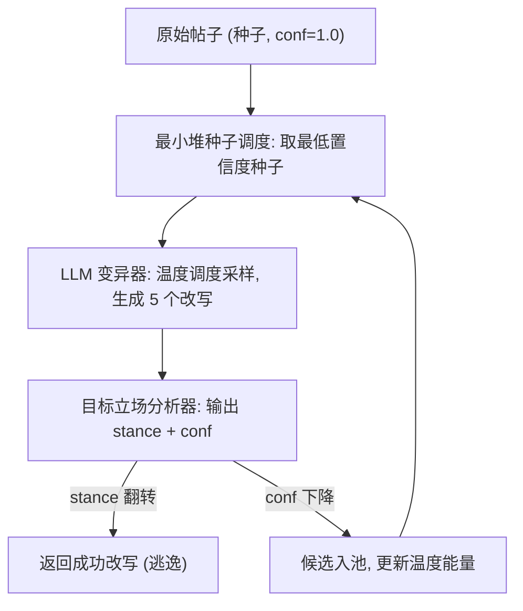

# Content Fuzzing for Escaping Information Cocoons on Digital Social Media (内容模糊测试：让社交媒体帖子逃出信息茧房)

- **会议/期刊**: ACL 2026 Findings
- **作者与机构**: Yifeng He, Ziye Tang (UC Davis), Hao Chen (HKU)
- **推荐链路定位**: 重排（立场条件化 Feed 排序的上游信号）
- **研究方向**: 去偏公平与可信推荐 / 大语言模型推荐
- **论文原文**: [https://arxiv.org/abs/2604.05461v1](https://arxiv.org/abs/2604.05461v1)
- **开源代码**: [https://github.com/EYH0602/ContentFuzz](https://github.com/EYH0602/ContentFuzz)

## TL;DR (1分钟核心速览)

现代平台把**立场检测**作为推荐/排序管线的关键信号，导致帖子被路由进同质亲和簇（信息茧房），而现有缓解手段（多样性重排）全在平台侧、创作者无权限。本文提出 CONTENTFUZZ：从创作者视角，把"改写帖子使机器立场标签翻转、但人类语义不变"建模为**灰盒模糊测试**问题，用立场分析器的**置信度（softmax 概率 / 生成 logprobs）**作反馈，引导 LLM 迭代重写。在 Sem16/VAST/C-STANCE-A 三数据集、BERT/RoBERTa/Zero-shot/COLA 四类分析器上，逃逸成功率 ESR 达 0.41–0.91，BERTScore 保持 0.75–0.90，PPLr 全部 < 1.0。

## Background & Motivation (背景与核心矛盾)

- **主流范式**: 平台用立场检测（微调编码器或生成式 LLM）作为 Feed 排序信号，按立场条件化分发内容；缓解茧房的研究几乎全是平台侧多样性重排（如 Ma et al. 2025）。
- **前人局限**: ① 推荐管线是黑盒，创作者既无法修改算法、也看不到帖子如何被过滤排序，**缺乏能动性**；② 现有文本改写工作（去毒、降极化、控互动）优化的是文本的社会属性，**没有工作把优化目标对准分类器决策边界**。
- **核心洞察 (Key Insight)**: 立场分析器的**预测置信度**天然指示样本离决策边界的距离——置信度越低，越接近翻转。这一信号无需访问模型内部（梯度/神经元覆盖），对百亿参数 LLM 分析器同样可得。
- **本文切入点**: 把软件测试中的灰盒模糊测试迁移到内容改写：以置信度为 fitness，迭代搜索"语义保持但标签翻转"的改写。

## Method (核心方法设计)

### 1. 整体框架 (Overall Architecture)

以单条帖子为初始种子入池；每轮从种子池按最小置信度优先选种，交给 LLM 变异器一次生成 5 个语义保持的改写候选；对每个候选调用目标立场分析器，若标签翻转则立即返回成功，若置信度低于父种子则作为新种子入池并累加该温度的能量；迭代至成功或耗尽 $N$ 轮。三个核心组件为置信度反馈、种子调度与温度调度。

### 2. 关键设计拆解 (Key Designs)

1. **置信度反馈（Analysis Confidence as Feedback）**：梯度/神经元覆盖类反馈需模型内部结构，对 LLM 不可行。本文改用分析器自身输出的置信度：对 softmax 分类器取 $\text{Conf}_{\text{mlm}}(x,\hat{k})=P_\theta(\hat{k}\mid x)$；对生成式分析器取生成序列联合 logprob 的指数$\text{Conf}_{\text{clm}}(x,y)=\exp\big(\sum_{i=1}^{m}l_i\big)$，其中$l_i=\log p_\theta(y_i\mid x,y_{<i})$。直觉：置信度单调关联"离边界多远"，且完全黑盒可得，无需插桩。

2. **最小堆种子调度（Seed Scheduling）**：FIFO/随机调度在有限迭代预算下浪费算力。本文用最小堆始终弹出全池置信度最低的种子——它最接近决策边界，最可能一轮翻转。消融显示该策略 ESR 最高（0.670 vs FIFO 0.620）。

3. **温度调度（Temperature Scheduling）**：固定温度难以兼顾不同平台/话题的改写创造力需求。将温度离散为 $\mathcal{T}=\{0.0,0.1,\dots,2.0\}$，每个温度维护能量$E_t$，按$P(t)=E_t/\sum_{t'}E_{t'}$采样；若温度$t$生成$N$个候选中$s$个降低置信度，则$E_t\leftarrow E_t+s/N$。本质是把模糊测试的"能量分配"用于探索-利用权衡。

4. **训练目标、负采样与推理效率**：本方法**无训练、无负采样**，是纯推理期搜索。变异器用 Gemini-2.5-Flash-Lite 并关闭思维链（thinking budget=0）以提升吞吐；单轮生成 5 候选，成功帖平均仅需约 15 轮（中位数 2 轮），成本可控。

## Experimental Setup & Evaluation Protocol (实验设置与评估协议)

- **数据集与预处理**: 三数据集均为专家标注三分类（Favor/Neutral/Against），标签一一映射无粒度损失：

| 数据集 | 语言/平台 | 规模与特点 | 场景说明 |
| :--- | :---: | :---: | :---: |
| Sem16 | 英/Twitter | 6 个目标，短文本 | 经典立场检测基准 |
| VAST | 英/NYT | 304 个目标，议论文 | 多主题零样本立场 |
| C-STANCE-A | 中/微博 | 48,126 个目标 | 中文目标级立场 |

- **数据划分与防穿越**: 沿用各数据集官方 train/val/test 划分；微调编码器按验证集 macro-F1 选 checkpoint（Sem16/VAST lr=$2\times10^{-5}$，C-STANCE lr=$5\times10^{-6}$，5 epoch，batch 32）。
- **排名评测协议**: 非排序评测，采用**逃逸成功率 ESR**（原被正确分类、改写后被误分类的比例），辅以 BERTScore（语义完整性）、PPL 与 PPLr（流畅度相对原帖）、NLI 双向蕴含/矛盾率。
- **对比基线与超参**: 目标分析器含 BERT、RoBERTa、Zero-shot Gemini-2.5-Flash-Lite、COLA（SOTA 提示工程）；对抗基线为 BERT-Attack、Reinforce-Attack；最大迭代 300，报告中心 95% 均值以抗离群。

## Key Experimental Results (实验关键数据)

### 1. 主实验对比 (Main Results)

CONTENTFUZZ 在四类分析器上的逃逸成功率与质量（表 1 摘录）：

| 数据集 | 分析器 | ESR ↑ | BERTScore ↑ | PPL ↓ | PPLr ↓ |
| :--- | :--- | :---: | :---: | :---: | :---: |
| Sem16 | BERT | 0.563 | 0.889 | 71.3 | 0.422 |
| Sem16 | RoBERTa | **0.670** | 0.876 | 69.4 | 0.360 |
| Sem16 | Zero-shot | **0.773** | 0.885 | 112.6 | 0.601 |
| Sem16 | COLA | 0.480 | 0.882 | 52.2 | 0.458 |
| VAST | BERT | **0.883** | 0.878 | 10.0 | 0.322 |
| VAST | COLA | 0.410 | 0.896 | 16.8 | 0.537 |
| C-STANCE-A | BERT | **0.910** | 0.752 | 21.2 | 0.164 |
| C-STANCE-A | RoBERTa | 0.879 | 0.774 | 16.7 | 0.163 |

与对抗攻击基线对比（BERT 分析器，表 6）：

| 数据集 | 方法 | ASR ↑ | BERTScore | PPL ↓ | PPLr ↓ |
| :--- | :--- | :---: | :---: | :---: | :---: |
| Sem16 | BERT-Attack | 0.371 | 0.934 | 1246.8 | 4.119 |
| Sem16 | Reinforce-Attack | 0.177 | 0.970 | 464.8 | 1.613 |
| Sem16 | **CONTENTFUZZ** | **0.563** | 0.889 | **71.3** | **0.422** |
| VAST | BERT-Attack | 0.679 | 0.959 | 81.3 | 2.379 |
| VAST | **CONTENTFUZZ** | **0.883** | 0.878 | **10.0** | **0.322** |
| C-STANCE-A | **CONTENTFUZZ** | **0.910** | 0.752 | **21.2** | **0.164** |

### 2. 消融实验 (Ablation Study)

Sem16 + RoBERTa，200 任务，最大 300 轮（表 3、表 4）：

| 配置 | ESR ↑ | 平均迭代 ↓ | 中位数 | 标准差 |
| :--- | :---: | :---: | :---: | :---: |
| 固定温度 1.0 | 0.620 | 16.70 | 2 | 36.36 |
| **温度调度** | **0.670** | **15.32** | 2 | 36.93 |
| FIFO 种子调度 | 0.620 | 22.80 | 3 | 47.83 |
| Random 种子调度 | 0.645 | 18.33 | 3 | 35.51 |
| Weighted 种子调度 | 0.665 | 15.99 | 2 | 38.14 |
| **Priority（最小堆）** | **0.670** | **15.32** | 2 | 36.93 |

### 3. 关键实验发现 (Key Findings)

1. **中文与议论文更易逃逸，短推文最难**：C-STANCE-A 上 BERT 分析器 ESR 高达 0.910、VAST 0.883，而 Sem16 仅 0.563；但中文 BERTScore 降至 0.752，说明高逃逸率部分以语义保真度为代价，短文本的改写空间更受限。
2. **零样本 LLM 分析器最鲁棒但非免疫**：Zero-shot 的 ESR 在三数据集均为最低档（0.655–0.773），且需更激进改写导致绝对 PPL 偏高（Sem16 达 112.6），但 PPLr 仍为 0.601，证明改写相对原帖依旧流畅；跨模型迁移图中零样本列整体偏低，佐证 LLM 对语义保持扰动更稳健。
3. **调度策略是效率关键而非仅精度**：温度调度把平均迭代从 16.70 降到 15.32，最小堆调度相对 FIFO 把平均迭代从 22.80 压到 15.32（降约 33%），说明"低置信度优先 + 自适应温度"主要收益在搜索效率；同时 NLI 双向矛盾率 ≤1.12%、BERTScore 随迭代线性斜率 $\beta=-6.66\times10^{-5}$（$p=0.213$ 不显著），证明迭代加深不会系统性侵蚀语义。

## Highlights & Limitations (亮点、对比与审稿批判)

- **与代表作对比 (vs. Prior Work)**: 相比平台侧多样性重排（Ma et al. 2025），本文首次给出**创作者侧**可执行路径；相比 BERT-Attack/Reinforce-Attack 这类词级替换对抗攻击，本文是整句 LLM 重写，ASR 相对提升约 51% 且 PPL 低 90% 以上，流畅度是本质差异；相比 LLM 越狱模糊测试（LLM-Fuzzer），本文把反馈从"是否越狱"改为连续置信度，适配三分类立场任务。
- **可迁移亮点**: ① "置信度即边界距离"的灰盒反馈可直接迁移到任何带概率输出的排序/分类信号（如毒性、情感、政治倾向分类器）做鲁棒性审计；② 温度能量调度是低成本的多臂探索方案，可复用于任何"单一变异算子 + 有限预算"的 LLM 搜索。
- **审稿级局限批判**: ① 仅针对立场检测这一单一信号，未验证端到端推荐管线中的真实曝光增益，也缺乏线上 A/B；② 依赖分析器暴露 logprobs，对不返回 logprobs 的闭源模型需用微调损失近似，且语义保持仅靠 BERTScore/NLI 计算指标 + 小规模人工核验，缺大规模人类标注；③ 存在被滥用于规避内容审核的双用途风险（作者已在伦理章节声明约束）。

## Rating (四维评分)

- **方法创新性 (Novelty)**: ⭐⭐⭐⭐ （首次把模糊测试的置信度反馈引入内容侧茧房缓解，问题建模新颖，但组件多为已有技术的组合迁移）
- **评估协议与实验扎实度 (Protocol & Experiments)**: ⭐⭐⭐⭐ （3 数据集 2 语言 4 类分析器 + 对抗基线 + NLI 交叉验证较完整，但缺端到端推荐曝光与大规模人工评估）
- **写作与数学规范度 (Clarity & Rigor)**: ⭐⭐⭐⭐ （置信度公式与算法伪代码清晰，温度/种子调度定义严谨，复杂度分析略简）
- **工业落地与复现价值 (Industrial & Practical Value)**: ⭐⭐⭐⭐ （代码开源、无训练成本、中位 2 轮即成功，但依赖 LLM API 调用成本与 logprobs 可得性）

