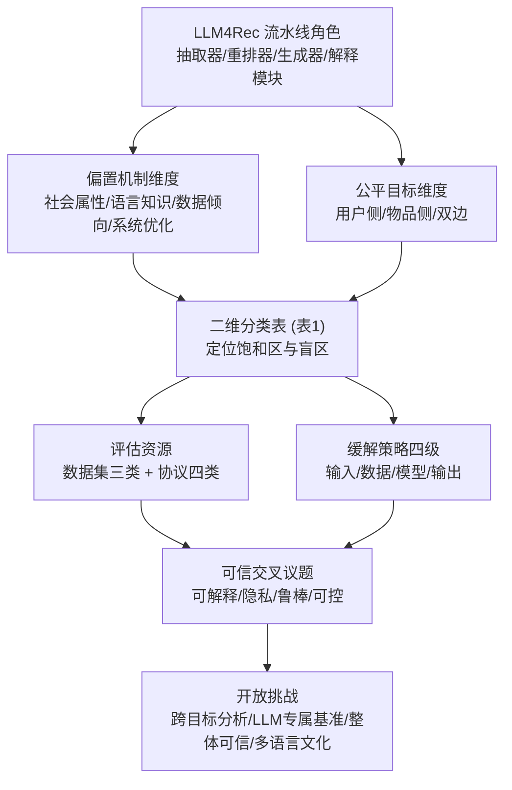

# Rethinking Fairness in LLM-Based Recommender Systems: A Survey (重思基于大语言模型推荐系统的公平性：综述)

- **会议/期刊**: Findings of EMNLP 2026
- **作者与机构**: Song-Duo Ma, Chu-Yun Chen, Bang-An Li, Pin-Yu Chen, Shau-Yung Hsu, Yun-Nung Chen（台湾大学）
- **推荐链路定位**: 全链路（输入 Prompt / 数据 / 模型参数 / 输出解码与重排）
- **研究方向**: 去偏公平与可信推荐 / 大语言模型推荐
- **论文原文**: [https://arxiv.org/abs/2606.28340v2](https://arxiv.org/abs/2606.28340v2)
- **开源代码**: [https://github.com/MiuLab/FairLMRec](https://github.com/MiuLab/FairLMRec)

## TL;DR (1分钟核心速览)

LLM4Rec 把推荐从 ID 匹配推向语义推理，但偏置来源也随之从「交互数据 + 曝光分布」扩展到「预训练知识 + Prompt 设计 + 生成解码 + 反馈回路」，而现有文献在偏置机制、公平目标、评估资源与缓解策略上高度碎片化。本文是首篇聚焦 LLM4Rec 公平性的系统综述：提出「4 类偏置机制 × 3 类公平目标」二维分类法（表 1），将数据集归为精选候选池 / 行为交互 / 构造评估场景三类（图 1），将评估协议归为敏感属性 / 偏好对齐 / 目标特定 / 物品侧四类（图 2），并把缓解策略按干预深度分为输入、数据、模型、输出四级。核心结论是：物品侧社会偏置与双边语言知识偏置仍是显式研究的空白格，且公平性应作为跨可解释性、隐私、鲁棒性、可控性的系统级属性来评估。

## Background & Motivation (背景与核心矛盾)

- **主流范式**: 传统 RecSys 依赖协同过滤与 user/item ID 捕获行为模式；LLM4Rec 则以 LLM 作为用户/物品抽取器、重排器、生成器或解释模块，用语义理解替代纯 ID 匹配，缓解稀疏性、冷启动与可解释性不足。
- **前人局限一（偏置源扩张）**: 传统公平性研究只处理交互数据与曝光分布带来的偏置；LLM4Rec 中偏置还可来自预训练语料的文化先验、Prompt 措辞、候选排序与自回归解码，原有「数据去偏」框架无法覆盖。
- **前人局限二（文献碎片化）**: 现有工作分散在 RecSys、NLP、可信 AI 三个社区，各自使用不同的任务设定、Prompt 模板、候选池构造与指标定义，导致跨研究不可比、无法判断哪些交叉方向真正被研究过。
- **核心洞察 (Key Insight)**: 若把「偏置从哪来」与「谁受影响」拆成两个正交维度，就能把碎片化文献投影到一张稀疏矩阵上——矩阵的空白格并非不重要，而是**测量约束**（如 provider 侧受保护属性缺失、双边收益难定义）所致。
- **本文切入点**: 用二维分类法显式标出「已饱和区」与「盲区」，再沿干预深度重组缓解策略，最后把公平性与四类可信属性打通，给出评估规范化的路线图。

## Method (核心方法设计)

### 1. 整体框架 (Overall Architecture)

本文是综述而非模型论文，其「方法」即一套组织文献的分析框架：先界定 LLM 在推荐流水线中的四种角色（抽取器 / 重排器 / 生成器 / 解释模块），据此论证偏置源已从数据侧扩展到知识与生成侧；随后用「偏置机制 × 公平目标」二维表对每篇文献做**唯一主格分配**（按其主要评估或缓解的偏置源 + 直接测量的利益相关方），并规定只有同时评估或联合优化双边时才计入双边公平；接着按「数据构造方式」与「评估焦点」分别对数据集与评估协议做三级/四级归类；最后按干预发生在流水线的位置（输入 / 数据 / 模型 / 输出）重组缓解策略，并与可解释性、隐私、鲁棒性、可控性四个可信维度交叉讨论。

### 2. 关键设计拆解 (Key Designs)

1. **二维分类法：把碎片文献投影为可诊断的稀疏矩阵**：痛点是各研究只谈单一偏置源或单一受害方，无法回答「哪类偏置对哪类主体被真正测量过」。作者定义偏置机制集合 $\mathcal{M}=\{\text{社会属性},\text{语言知识},\text{数据倾向},\text{系统优化}\}$与公平目标集合$\mathcal{T}=\{\text{用户侧},\text{物品侧},\text{双边}\}$，每篇文献$p$被映射到唯一主格$(m_p,t_p)$，且双边格要求满足联合评估条件$\mathbb{I}[\text{eval}_u(p)\land\text{eval}_i(p)]=1$。这样得到的矩阵直接暴露结构性空白：用户侧×社会属性高度饱和，而物品侧×社会属性、双边×语言知识几乎为空。其价值在于把「研究不足」从模糊判断变成可复核的计数事实。

2. **评估协议四分类：区分「输出变了」与「人受损了」**：痛点是敏感属性扰动类协议（如 FaiRLLM 的 SNSR/SNSV、Jaccard@K、SERP*@K）只测推荐列表在性别/年龄改写下的相似度变化，但列表变化未必等于不公平——也可能只是合理的偏好差异。作者据此划出「偏好对齐」一类，用收益偏差 $\Delta B$ 衡量不同敏感群体是否获得可比效用，把评估从「表征差异」推进到「福利差异」；再补「目标特定」（求职/学术场景的 SP、EO、PPV_diff、DRS、GRS、U-NDCG）与「物品侧」（Gini、HHI、熵、MGU/DGU、长尾覆盖）两类。四类的分野本质是**假设强度递增、可迁移性递减**。

3. **缓解策略按干预深度分层与「公平-效用非必然权衡」论断**：作者不按技术族而按流水线位置分层：输入级（在线 Prompt 优化、保形阈值修复对抗 Prompt）、数据级（反事实数据增广、因果干预纠正倾向偏置）、模型级（PEFT 门控适配器、双层优化解耦效用与公平约束、MoE+对比学习处理交叉性偏置）、输出级（D3 去偏多样化解码修正长度归一化伪影、IPS 双重去偏重排）。关键论断是：输入/输出级可用于闭源黑盒、部署成本低但脆弱；数据/模型级触及深层偏置但需训练访问权。同时指出纠正流行度偏置、选择偏置与虚假相关时，公平与效用可**同时提升**，故不应把二者预设为零和。

## Experimental Setup & Evaluation Protocol (实验设置与评估协议)

作为综述，本文不设自有实验，其「评估协议」体现为对领域评估生态的审计与规范化建议。

- **数据集与预处理**: 按构造方式分三类（图 1），而非按 5-core 等过滤规则统计：

| 数据集类别 | 代表资源 | 规模/稀疏度特征 | 适用评估场景 |
| :--- | :--- | :---: | :--- |
| 精选候选池 (Curated Candidate-Pool) | IMDb、MTV、Spotify、QS 排名、Shopping Queries | 候选池固定、可任意构造用户画像 | 控制变量下检验 LLM 排序偏好是否随人口/文化/机构属性漂移 |
| 行为交互 (Behavioral Interaction) | MovieLens、LastFM、Steam、Book-Crossing、Goodreads、Amazon Review、Yelp、ZhihuRec、AliEC、CareerBuilder、MIND | 真实日志、长尾与流行度偏斜显著 | 用户侧效用差异、物品侧曝光不平等、流行度偏置、效用-公平权衡 |
| 构造评估场景 (Constructed Scenario) | CS-Domain Job Rec、SynthTRIPS、University-Profile、Prompt 合成图书/电影/歌曲数据 | 模拟环境或 Prompt 合成，规模小但可控 | Prompt 敏感性、反事实画像、场景级偏置、高风险决策审计 |

- **数据划分与防穿越 (Splitting Strategy)**: 综述层面指出领域普遍缺失统一划分规范；多数公平性研究采用**固定候选池 + 扰动式对照**（同一用户画像仅改写敏感属性）而非时间切分，因而存在 Prompt 与候选构造上的隐性信息泄漏风险，作者将其列为可比性障碍之一。
- **排名评测协议 (Ranking Protocol)**: 归纳为四族——敏感属性扰动（相似度/排名型指标）、偏好对齐（$\Delta B$ 收益偏差）、目标特定（SP/EO/PPV_diff 等分类公平指标向排序迁移）、物品侧（Gini/HHI/熵/长尾覆盖）。作者明确批评现有协议多为**单次运行、静态单轮**，未报告生成随机性下的方差，也未覆盖多轮对话与反馈回路。
- **对比基线与超参设置**: 不适用；本文的「基线」是既有分类体系，其贡献在于指出跨论文数值聚合本身具有误导性（任务设定、Prompt 协议、模型访问级别、指标定义均不同），故选择概念化组织而非定量元分析。

## Key Experimental Results (实验关键数据)

### 1. 主实验对比 (Main Results)

本文的核心「实验结果」是分类覆盖度审计，即表 1 的文献分布（按主格计数，括号内为该格代表文献数）：

| 偏置机制 \ 公平目标 | 用户侧 | 物品侧 | 双边 |
| :--- | :---: | :---: | :---: |
| 社会与属性偏置 | **12（最饱和）** | 0（显式研究极少） | 2 |
| 语言与知识偏置 | 4 | 3 | 1 |
| 数据与倾向偏置 | 4 | 1 | 4 |
| 系统与优化偏置 | 2 | **11** | 3 |

### 2. 消融实验 (Ablation Study)

综述无消融实验，代之以对评估生态缺陷的逐项诊断，可视为对「领域现有协议」的消融式拆解：

| 移除/缺失的评估要素 | 观察到的后果 |
| :--- | :--- |
| 统一公平定义 | 跨研究结论不可比，结果强依赖模型、Prompt 模板、候选构造、解码设置与群体定义 |
| 多次重复运行 | 生成式推荐的随机性下方差未知，公平性差异的稳定性无法判断 |
| 真实交互/多轮设定 | 仅覆盖静态单轮输出，反馈回路与对话轨迹中的公平演化未知 |
| 人工或任务锚定校验 | LLM-as-judge 引入评估者偏置，解释忠实度无法验证 |

### 3. 关键实验发现 (Key Findings)

1. **研究分布严重偏斜且偏斜方向与「可测量性」一致**：用户侧×社会属性一格聚集 12 篇，而物品侧×社会属性为 0、双边×语言知识仅 1 篇。作者强调这些空白源于 provider 侧受保护属性缺失与 provider 收益的领域依赖性，属测量约束而非重要性判断——这直接解释了为何「物品侧公平」在 LLM4Rec 中长期停留在流行度/曝光层面。
2. **系统与优化偏置是唯一「物品侧主导」的机制（11 vs 2）**：说明 Prompt 设计、候选排序、解码策略与反馈累积这些 LLM 特有环节，目前主要通过曝光类指标（Gini/HHI/熵/MGU/DGU）被审计，而其对用户侧效用的系统性影响尚未被同等测量，构成明显的评估不对称。
3. **缓解策略的可行性与干预深度成反比**：输入级与输出级方法可作用于闭源模型、部署门槛低，但效果依赖模型推理能力且易受 Prompt 扰动而脆弱；数据级与模型级（PEFT、双层优化、MoE+对比学习）能触及倾向偏置与交叉性偏置的根源，却需要训练数据或参数访问权。作者据此主张缓解策略的选择应由「偏置源 + 部署约束」共同决定，而非追求单一最强方法。

## Highlights & Limitations (亮点、对比与审稿批判)

- **与代表作对比 (vs. Prior Work)**: 相较 Deldjoo (2025) 等聚焦 LLM4Rec 某类偏置或某阶段干预的工作，本文首次把「偏置机制」与「公平目标」正交化，使「哪一格被研究过」成为可计数事实；相较传统 RecSys 公平性综述（如用户侧/物品侧二分框架），本文额外纳入预训练知识、Prompt、解码与反馈回路四类 LLM 特有偏置源，并把评估协议从「相似度扰动」推进到「收益偏差」的假设强度分层。
- **可迁移亮点**: (1) 「唯一主格分配 + 双边需联合评估」的标注规则可直接迁移到其他可信维度（如鲁棒性、隐私）的文献计量与基准设计；(2) 按干预深度（输入/数据/模型/输出）而非技术族组织缓解策略，便于工程侧按「是否有参数访问权」快速选型。
- **审稿级局限批判**: (1) 全文为概念化组织，明确放弃跨研究定量聚合，因此无法给出「某类方法平均提升多少公平性」的可操作结论，对工程选型的指导偏定性；(2) 覆盖范围限定在「显式以公平为评估目标/偏置现象/缓解对象」的工作，使用 LLM 做推荐但未直接分析公平结果的研究仅作背景引用，可能低估某些隐含公平效应的实证积累；此外对多语言与文化公平仅指出证据以英语为中心，未给出可执行的跨语言协议草案。

## Rating (四维评分)

- **方法创新性 (Novelty)**: ⭐⭐⭐⭐ （二维正交分类法把碎片文献转为可诊断稀疏矩阵，并以「测量约束」解释空白格，视角新颖但属组织性而非技术性创新）
- **评估协议与实验扎实度 (Protocol & Experiments)**: ⭐⭐⭐ （对四类评估协议的假设、优势与局限拆解到位，且诚实指出单次运行、静态单轮、LLM-as-judge 三大缺陷，但无自有实验与定量元分析）
- **写作与数学规范度 (Clarity & Rigor)**: ⭐⭐⭐⭐ （分类规则与主格分配判据表述明确、边界清晰，附录提供数据集-文献与指标-文献映射，数学仅涉及 $\Delta B$ 等少量符号，规范无冗余）
- **工业落地与复现价值 (Industrial & Practical Value)**: ⭐⭐⭐⭐ （按干预深度分层给出闭源/开源场景的选型指引，配套 GitHub 资源库便于复现检索，但缺少统一基准与可执行评测脚本）
