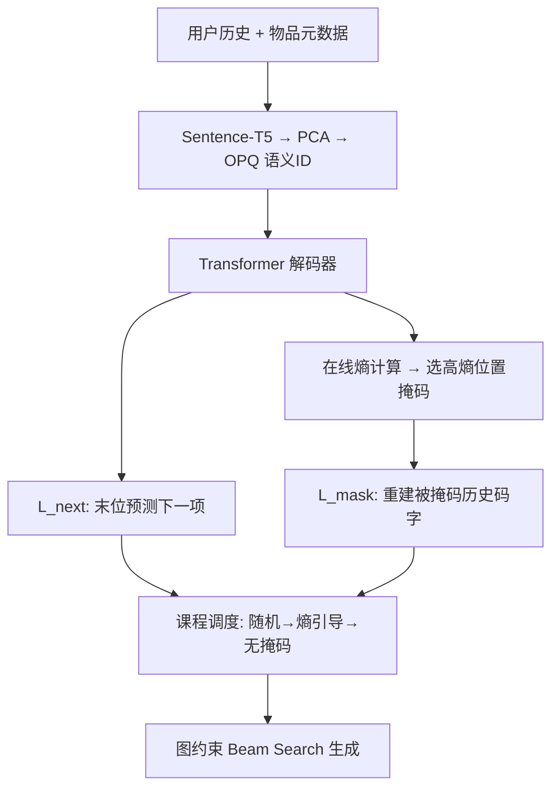
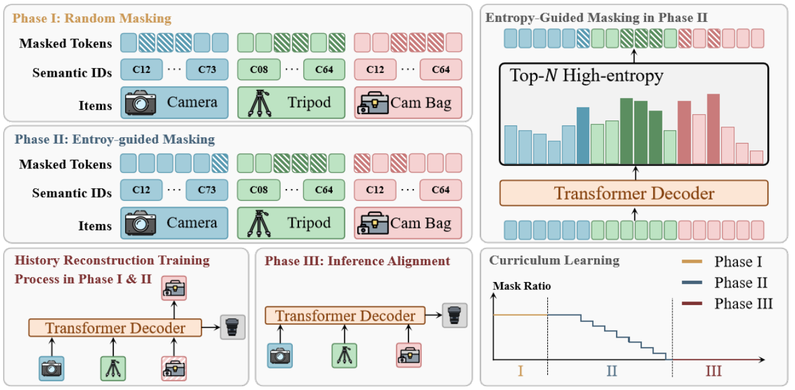

# From Past To Path: Masked History Learning for Next-Item Prediction in Generative Recommendation (从过去到路径：面向生成式推荐下一项预测的掩码历史学习)

- **会议/期刊**: ACL 2026
- **作者与机构**: Kaiwen Wei, Kejun He, Xiaomian Kang, Jie Zhang, Yuming Yang, Li Jin, Zhenyang Li, Jiang Zhong, He Bai, Junnan Zhu（重庆大学、中科院自动化所 MAIS、中科院空天院、香港城市大学）
- **推荐链路定位**: 端到端生成式（语义 ID 自回归生成）
- **研究方向**: 生成式推荐与离散语义 ID / 序列推荐
- **论文原文**: [https://arxiv.org/abs/2509.23649v2](https://arxiv.org/abs/2509.23649v2)
- **开源代码**: [https://github.com/CQU-MM-Intelligent-Lab/MHL](https://github.com/CQU-MM-Intelligent-Lab/MHL)

## TL;DR (1分钟核心速览)

生成式推荐（TIGER/RPG 等）几乎只用左到右自回归预测下一项，模型只学"什么接什么"的局部共现，学不到"为什么形成这条路径"的全局意图，且对近期交互存在严重近因偏置。本文提出 MHL：在标准 $\mathcal{L}_{next}$上叠加"掩码历史项重建"辅助任务，并配以熵引导掩码（挑模型最不确定的历史位置）与三阶段课程调度（随机掩码$\to$熵引导$\to$ 无掩码对齐推理）。在 Amazon 2014 三域 Leave-One-Out Full-Ranking 协议下，NDCG@5 相对 TIGER 提升最高 37.6%，且截断近期历史后仍领先最强基线 40% 以上。

## Background & Motivation (背景与核心矛盾)

- **主流范式**: 以 TIGER、RPG、HSTU 为代表的生成式推荐，先用 RQ/OPQ 将物品量化成 K 位语义 ID，再用 T5/Transformer 解码器自回归逐位生成下一物品的 ID。
- **前人局限**: ① 训练目标单一，只优化 $P(i_{T+1}\mid i_{\le T})$，把用户历史压缩为"局部转移统计"，中间噪声项（如买相机途中顺手买的衣服）会污染意图；② 严重近因偏置——附录实验显示截断近期历史后 SOTA 模型性能崩塌，说明其依赖的是"最近一项"而非"全局意图"。
- **核心洞察 (Key Insight)**: 若强迫模型重建被挖空的历史项，它必须理解物品间的逻辑互补关系（三脚架是相机机身的逻辑配套），从而把"统计共现"升级为"路径结构理解"；同时重建任务天然要求模型学会忽略噪声交互。
- **本文切入点**: 不改骨干、不改推理，只在训练期加一个辅助重建目标 + 两个调度策略，把"预测结果"变成"理解过程"。

## Method (核心方法设计)

### 1. 整体框架 (Overall Architecture)

输入为用户历史 $S_T=(i_1,\dots,i_T)$，每物品经 Sentence-T5 编码、PCA 降维、OPQ 量化得到$K$位语义 ID$\phi(i)=\{w^1_i,\dots,w^K_i\}$，物品表示由 K 位码本嵌入均值池化得到，送入与 RPG 同构的 Transformer 解码器。训练时联合优化两条损失：末位隐状态$h_T$经 K 个并行码本分类头做下一项预测；同时按掩码策略挖空历史中若干位置，用各位置上下文隐状态$h_t$重建被掩码的码字。掩码策略由在线熵计算驱动，掩码比例由三阶段课程调度控制，最终阶段$\gamma=0$ 完全对齐推理。推理沿用图约束 beam search（beam=50，3 步传播）。

<figure class="paper-figure" markdown="span">
  <figcaption>图2：MHL框架概览。在线熵计算选择具有挑战性的位置进行掩码。课程训练从随机掩码逐步过渡到自适应掩码，然后与推理条件对齐。</figcaption>
</figure>

### 2. 关键设计拆解 (Key Designs)

1. **掩码历史重建辅助目标（Masked History Reconstruction）**：痛点是从不建模历史内部依赖 $\to$对掩码集$\mathcal{M}$中每个被挖空的码字$w^k_{i_t}$，用位置$t$的上下文状态重建，$\mathcal{L}_{mask}=-\frac{1}{|\mathcal{M}|}\sum_{w^k_{i_t}\in\mathcal{M}}\log P^k_\theta(w^k_{i_t}\mid h_t)$。与 BERT4Rec 的双向编码器不同，这里保留单向 decoder-only 架构，只把重建当作辅助正则，因此不破坏原生生成能力；直觉上，能重建"三脚架"的模型必然编码了"相机机身—三脚架"的逻辑配套而非频次共现。作者在 item / token / mixed 三种粒度上都做了实例化。

2. **熵引导掩码（Entropy-Guided Masking）**：随机掩码把高信息量与冗余交互一视同仁 $\to$每步先做一次无梯度前向，计算各位置各码本的 Shannon 熵$H^k_t=-\sum_{v\in\mathcal{W}^k}P^k_\theta(v\mid h_t)\log P^k_\theta(v\mid h_t)$，聚合为物品级重要性$\bar{H}_t=\frac{1}{K}\sum_k H^k_t$，降序排序后取 top-$N$构成$\mathcal{M}$，其中预算$N\sim\mathcal{U}(1,\lfloor\gamma\cdot T\rfloor)$ 随机采样以防过拟合固定密度。高熵位置恰是"关键决策点"或"复杂语义单元"，把梯度集中投放在模型最不懂的地方，信息增益最大。

3. **三阶段课程调度与训练目标**：直接上熵引导会因早期熵估计不可靠而训练崩溃，且掩码训练与无掩码推理存在分布鸿沟 $\to$Phase I 低比例随机掩码热身；Phase II 切换熵引导并让比例按$\gamma\leftarrow\max(\gamma_{min},\gamma\cdot\eta)$指数衰减；Phase III 令$\gamma=0$只用$\mathcal{L}_{next}$对齐推理。总损失$\mathcal{L}_{MHL}=\lambda_1\mathcal{L}_{next}+\lambda_2\mathcal{L}_{mask}$，实验取$\lambda_1=\lambda_2=1$（敏感性分析显示 1.0–1.8 区间最优）。负采样方面沿用生成式推荐的图约束 beam search 解码，不引入额外负采样器；额外开销仅为训练期一次前向，推理零成本。

## Experimental Setup & Evaluation Protocol (实验设置与评估协议)

- **数据集与预处理**: Amazon Reviews 2014 三个类目，均做 `5-core` 过滤；物品元数据（标题、价格、品牌、特征、类目、描述）拼接为自然语言句。

| 数据集 | #Users | #Items | #Interactions | 稀疏度/密度 | 特征/场景说明 |
| :--- | :---: | :---: | :---: | :---: | :--- |
| Beauty | 22.4k | 12.1k | 198.5k | 7.3e-4 | 美妆，序列较短 |
| Toys and Games | 19.4k | 11.9k | 167.6k | 7.3e-4 | 玩具，语义跨度大 |
| Sports and Outdoors | 35.6k | 18.4k | 296.3k | 4.5e-4 | 运动户外，逻辑配套关系最复杂 |

- **数据划分与防穿越 (Splitting Strategy)**: 标准 `Leave-One-Out`——最后一项测试、倒数第二项验证、其余训练。
- **排名评测协议 (Ranking Protocol)**: 无偏 `Full-Ranking`（对全库未交互物品排序），指标 Recall@{5,10} 与 NDCG@{5,10}；三次随机种子取均值。
- **对比基线与超参设置**: Item-ID 类（Caser、GRU4Rec、HGN、BERT4Rec、SASRec、FDSA、S³-Rec）与 Semantic-ID 类（RecJPQ、VQ-Rec、TIGER、HSTU、RPG）。骨干为 2 层、4 头、隐层 448 的 Transformer 解码器；Sentence-T5-base 768 维经 PCA 降至 128 维，OPQ 量化为 32 位语义 token；AdamW，lr=5e-4，batch=64，10k warmup 余弦调度，最多 300 epoch。

## Key Experimental Results (实验关键数据)

### 1. 主实验对比 (Main Results)

| 模型 | Beauty R@10 | Beauty N@10 | Toys R@10 | Toys N@10 | Sports R@10 | Sports N@10 |
| :--- | :---: | :---: | :---: | :---: | :---: | :---: |
| SASRec | .0605 | .0318 | .0675 | .0374 | .0350 | .0192 |
| S³-Rec | .0647 | .0327 | .0700 | .0376 | .0385 | .0204 |
| VQ-Rec | .0664 | .0383 | .0737 | .0423 | .0300 | .0173 |
| TIGER | .0648 | .0384 | .0712 | .0432 | .0400 | .0225 |
| HSTU | .0704 | .0389 | .0669 | .0357 | .0414 | .0215 |
| RPG | .0745 | .0436 | .0778 | .0460 | .0436 | .0246 |
| **MHL (ours)** | **.0795** | **.0495** | **.0903** | **.0564** | **.0511** | **.0298** |
| Improv.% (vs 最强基线) | +6.7% | +13.5% | +16.1% | +22.6% | +17.2% | +21.1% |

### 2. 消融实验 (Ablation Study)

以 codebook=16、掩码比例 0.15 为统一设置，报告 N@10：

| 掩码策略 | 课程策略 | Beauty | Toys | Sports |
| :--- | :--- | :---: | :---: | :---: |
| 无掩码 | 直接推理 | .0436 | .0460 | .0246 |
| Token 级 | 随机 | .0457 | .0488 | .0231 |
| Token 级 | 熵引导（无课程） | .0410 | .0191 | .0090 |
| Token 级 | 随机→推理 | .0480 | .0533 | .0281 |
| Token 级 | 熵引导→推理 | .0445 | .0396 | .0224 |
| Token 级 | **随机→熵→推理** | **.0495** | **.0533** | **.0284** |
| Item 级 | 随机→熵→推理 | .0429 | .0470 | .0241 |
| Mixed 级 | 随机→熵→推理 | .0455 | .0503 | .0278 |

### 3. 关键实验发现 (Key Findings)

1. **课程调度是熵引导生效的前提，而非可选项**：单独使用熵引导掩码（无课程）在 Toys 上 N@10 从 .0460 暴跌至 .0191、Sports 从 .0246 跌至 .0090，甚至远差于无掩码基线；而完整 R→E→Inf 在 Toys 上达到 .0533（+15.9% vs 无掩码），说明早期熵估计不可靠会直接摧毁训练，三阶段过渡是必要设计而非锦上添花。
2. **掩码粒度与数据集复杂度强相关**：Token 级在 Beauty/Toys 最优（.0495/.0533），Mixed 级在 Sports 上更稳（.0278 vs Token 级 .0284 接近但方差更小），作者归因于 Sports 的物品逻辑配套更复杂、需要粗粒度 item 级信号兜底；而 Item 级在所有数据集上均劣于 Token 级，说明细粒度码字重建提供的监督更密集。
3. **冷启动与鲁棒性收益显著**：按目标物品训练频次分桶后，MHL 在 [0,5] 最冷桶上相对 RPG 的领先幅度最大，且两模型均呈倒 U 型（[11,15] 桶峰值、[16,20] 桶因流行度偏置回落）；此外在纯文本 token 序列（非语义 ID）上，MHL 仍比 RPG 的 N@10 提升 8.8%–14.5%，证明增益来自训练范式而非语义 ID 的特定性质。

## Highlights & Limitations (亮点、对比与审稿批判)

- **与代表作对比 (vs. Prior Work)**: 与 BERT4Rec/S³-Rec 的本质区别在于——后者用双向编码器做掩码预测，只能服务判别式打分，牺牲了生成能力；MHL 在单向 decoder-only 上把重建降格为辅助正则，完整保留自回归生成。与 TIGER/RPG 的区别在于训练目标从"单点预测"扩展为"路径理解 + 预测"双目标，且推理阶段零额外开销。
- **可迁移亮点**: ① "在线熵选掩码位置"这一无梯度前向打分机制可直接迁移到任何 token 级序列生成任务（如会话推荐、对话推荐）的难例挖掘；② "辅助任务高比例 $\to$指数衰减$\to$ 归零对齐推理"的三阶段课程模板，是解决"训练增广与推理分布不一致"的通用配方。
- **审稿级局限批判**: ① 熵引导每步多一次前向，训练成本约增加 30%–50%，论文未给出具体 wall-clock 对比，且 $\gamma_{min}$、$\eta$、衰减触发条件（验证 plateau 判定）等超参缺乏敏感性分析；② 仅用文本元数据构造语义 ID，未验证多模态码本下的表现，且三数据集均来自 Amazon 2014 单域，缺少跨域/工业级规模验证；③ 主实验仅报告 Recall/NDCG，未给出覆盖率、多样性等生成式推荐常被质疑的指标。

## Rating (四维评分)

- **方法创新性 (Novelty)**: ⭐⭐⭐⭐ （把 NLP 的掩码语言建模 + 课程学习迁移到生成式推荐，思路朴素但组合新颖，熵引导选点有清晰的信息论直觉）
- **评估协议与实验扎实度 (Protocol & Experiments)**: ⭐⭐⭐⭐ （三域 Full-Ranking + 三次种子 + 12 个基线 + 完整消融与冷启动/文本泛化分析，但缺显著性检验与效率对比）
- **写作与数学规范度 (Clarity & Rigor)**: ⭐⭐⭐⭐ （公式简洁、符号统一、算法流程完整，但熵引导的预算采样与衰减触发条件描述偏工程化，理论分析较弱）
- **工业落地与复现价值 (Industrial & Practical Value)**: ⭐⭐⭐⭐ （推理零开销、代码已开源、骨干与 RPG 完全兼容，仅训练期增加一次前向，落地门槛低）

