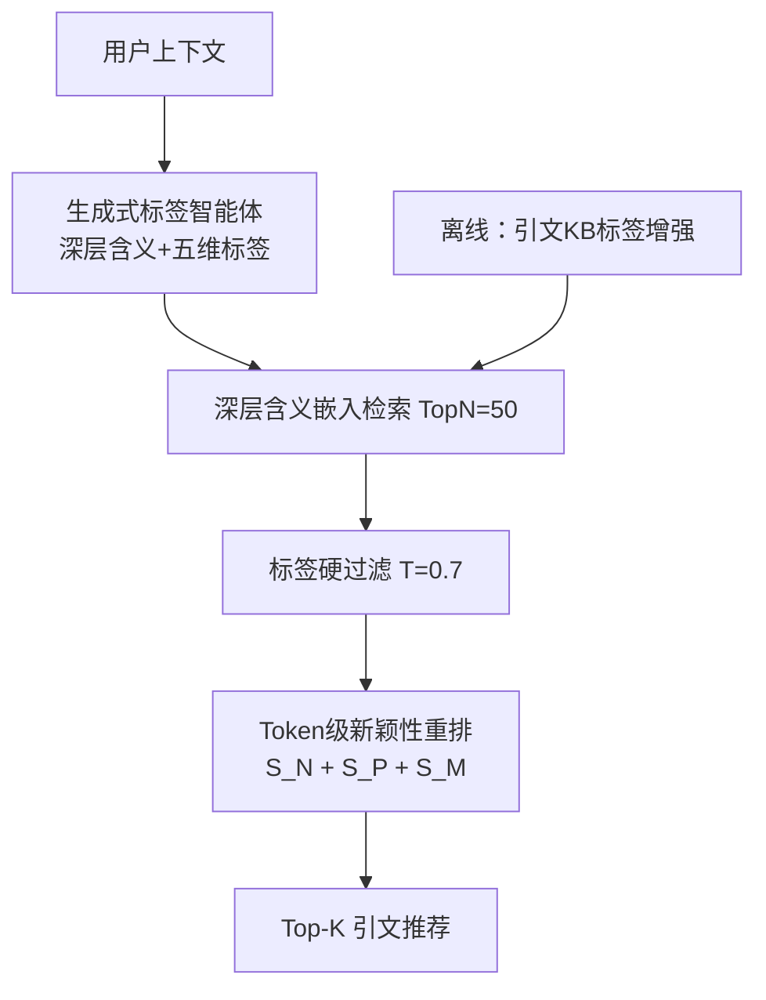
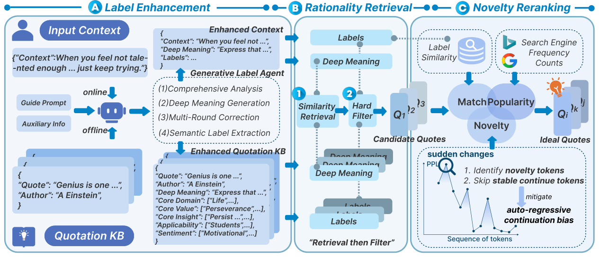

# What Makes an Ideal Quote? Recommending "Unexpected yet Rational" Quotations via Novelty (何为理想引文？基于新颖性推荐"意料之外却情理之中"的引文)

- **会议/期刊**: ACL 2026 (Main)
- **作者与机构**: Bowei Zhang, Jin Xiao, Guanglei Yue, Qianyu He, Yanghua Xiao, Deqing Yang, Jiaqing Liang* (复旦大学数据科学学院 / 上海市数据科学重点实验室)
- **推荐链路定位**: 召回（标签增强检索）+ 重排（新颖性重排）
- **研究方向**: 生成式推荐与离散语义ID / 大语言模型推荐
- **论文原文**: [https://arxiv.org/abs/2602.22220v2](https://arxiv.org/abs/2602.22220v2)
- **开源代码**: [https://github.com/Chang-pw/NoQuote](https://github.com/Chang-pw/NoQuote)

## TL;DR (1分钟核心速览)

现有引文推荐系统只优化表层主题相关性，产出"贴合但陈词滥调"的引文，忽视让引文令人难忘的深层语义与审美属性。本文基于陌生化理论（Defamiliarization）与 964 人用户调研，将理想引文形式化为"意料之外却情理之中"（unexpected yet rational），提出 NovelQR：生成式标签智能体把引文与上下文映射为多维深层语义标签以支撑标签增强检索，再用 token 级新颖性估计器缓解自回归续写偏差完成重排。在 QuoteR / QUILL / NovelQR-Bench 三个双语测试集上，HR@5 达 0.70（相对最强基线 LR+GPT 的 0.66 提升 6.1%），人类多选实验中 78% 的选择偏好本系统。

## Background & Motivation (背景与核心矛盾)

- **主流范式**: 引文推荐长期被建模为引文文本上的语义匹配/排序问题（QuoteR、QUILL 等），以 BERT/LLM 嵌入相似度或 RAG 式生成检索为核心，优化目标几乎只有"上下文贴合度"。
- **前人局限**: 其一，现有系统在**孤立引文**上做嵌入，而实证发现即使 GPT-4o 在 EASY 子集上对引文深层含义的评分也低于高质量理解阈值，作者/出处识别同样薄弱，导致检索到的候选"表面相关、深层错位"；其二，基于 logit 的新颖性度量（Surprisal、KL 散度）受**自回归续写偏差**污染——引文首句难预测、后续短语却"必然"，词级/引文级平均会把续写段落的低 surprisal 错误计入。
- **核心洞察 (Key Insight)**: 大规模问卷（N=964）显示理想引文在"贴合度"上评分 9.1、"新颖性"上 7.4，二者互补而非冲突；受控实验（N=100）中，在贴合度受控前提下用户系统性偏好"新颖但合理"的引文（78% 二选一胜出，填空任务中 67% 选 defam-like 而非 cliché 18% 或 surprising-only 15%）。同时发现：给 LLM 补充辅助信息（作者、出处、语境）后，连 Qwen3-8B 都能在 HARD 项上逼近 9.0 分——说明"增强输入即可理解深层含义"。
- **本文切入点**: 先用生成式标签智能体把引文"翻译"成可解释的深层语义标签空间，在该空间检索保证合理性；再在 token 级只对"新颖 token"加权度量上下文新颖性，绕开续写偏差。

## Method (核心方法设计)

### 1. 整体框架 (Overall Architecture)

NovelQR 是"离线建库 + 在线检索重排"的三段式流水线。离线阶段，生成式标签智能体（Qwen3-8B 为骨干）对知识库中每条引文执行四步：综合分析（作者背景/历史文化语境/情感内涵）→ 生成 50 词内深层含义 → 最多 R=3 轮自我批判修正（约 4.6% 输出被拒）→ 抽取 Core Domain/Value/Insight/Applicability/Sentiment 五维结构化标签，形成带标签的深层语义知识库。在线阶段，对用户上下文做同样的标签增强，先在深层含义嵌入空间检索 TopN=50 候选，再用标签相似度硬过滤（阈值 T=0.7）剔除语义不合理项，最后以新颖性、流行度、语义匹配三信号加权重排输出。

<figure class="paper-figure" markdown="span">
  <figcaption>图 3：我们的新颖性驱动引用推荐框架概览：(1) 标签增强，由生成式标签智能体增强对引用知识库（KB）和用户给定上下文的理解；(2) 合理性检索，利用深层含义和标签对引用进行“先检索后过滤”；(3) 新颖性重排序，突出延续偏差，并引入缓解该偏差及估计新颖性的方法。</figcaption>
</figure>

### 2. 关键设计拆解 (Key Designs)

1. **标签增强检索 (Label-enhanced Retrieval, LR)**：痛点在于原始引文文本嵌入只捕捉字面相似，跳过人类"先解读再选引文"的步骤。本文将检索对象从引文原文替换为其深层含义嵌入 $h_q$与上下文嵌入$h_c$，并以标签相似度做硬过滤：仅保留 Core Domain/Value/Insight 三维标签相似度超过$T=0.7$ 的候选。人工核验显示生成标签失真率低于 3%，因此该过滤能可靠剔除语义不合理项而极少误杀；t-SNE 可视化（图 4）显示 LR 的簇比原文检索更紧致、语义更一致。

2. **Token 级新颖性估计 (Novelty-token Estimator)**：痛点在于 Surprisal 类度量把"续写必然段"的低 surprisal 混入平均。本文先离线计算无上下文自困惑度序列 $\mathrm{PPL}_t=\exp(-\log p(x_t|x_{<t}))$，取一阶与二阶差分$|\delta_2(t)|=|\delta_1(t)-\delta_1(t-1)|$，大值标志局部 PPL 突变（即"转折点"）；经$\Delta_2(t)=\log(1+|\delta_2^{pad}(t)|)$平滑、min-max 归一化并转成分布$\tilde{w}_t$，得到加权新颖性分数：

$$S_N=\sum_{t=1}^{T}\tilde{w}_t\big[\log p(x_t|x_{<t})-\log p(x_t|C,x_{<t})\big]$$

   直觉：只有"上下文使其突然变难预测"的 token 贡献正分，平滑续写段权重趋零，从而抑制续写偏差。

3. **训练目标、负采样与推理效率**：本文为免训练（training-free）框架，无 BPR/InfoNCE 类损失，最终排序分数为线性融合 $S_{final}=\lambda_1 S_N+\lambda_2 S_P+\lambda_3 S_M$，其中流行度$S_P=\sigma((\log(1+c)-\mu)/\sigma)$由 Bing 精确短语检索计数$c$经 logistic 映射得到（$\mu=10.53,\sigma=2.21$），用于压制"极冷僻即新颖"的伪新颖；语义匹配$S_M$为深层含义嵌入余弦相似度重缩放至$[0,1]$。权重经留出集调优固定为$\{0.70,0.20,0.10\}$。重组件全部离线，在线仅需一次上下文标签生成 + 嵌入检索 + logit 差分，端到端延迟约 772.2 ms/query。

## Experimental Setup & Evaluation Protocol (实验设置与评估协议)

- **数据集与预处理**: 三个双语测试集各 100 条实例，知识库引文来自 QUILL，用 ACGE 嵌入：

| 数据集 | #Instances | 主要领域 | 上下文风格 |
| :--- | :---: | :---: | :--- |
| QuoteR | 100 | 文学、哲学 | 短叙事/说明 |
| QUILL | 100 | 书籍、访谈、论坛 | 现代、对话式 |
| NovelQR-Bench | 100 | 报告、新闻、学生作文 | 说明/议论 |

- **数据划分与防穿越 (Splitting Strategy)**: 采用**人工标注相关性划分**——NovelQR-Bench 从公开报告、新闻、学生作文采样 80–300 token 上下文，去重后由三名语言学/文学背景标注者独立标出至多 3 条"贴合且有表现力"的引文，取并集为相关集（Fleiss' κ=0.68）；标注时隐藏系统身份与分数，候选随机打乱以消除位置偏差。
- **排名评测协议 (Ranking Protocol)**: 基于人工相关标签计算 HR@5 / nDCG@5 / MRR@5（配对 bootstrap 检验，95% 置信）；辅以 LLM-as-judge（GPT-4o）对 Match/Novelty 打 1–5 分，三个随机种子平均，与专家评分相关性 ρ>0.79（Match ICC=0.81，Novelty ICC=0.76）。
- **对比基线与超参设置**: 基线分两类——模型式生成（GPT-based LLM、QuoteR）与检索增强推荐（QR、QUILL、LR 及 BM25/Bge-large/Qwen3-Reranker/GPT 重排器）；检索超参 TopN=50、T=0.7，重排权重 $\{0.70,0.20,0.10\}$，均经留出集调优。

## Key Experimental Results (实验关键数据)

### 1. 主实验对比 (Main Results)

| 方法 | QuoteR Avg | QUILL Avg | NovelQR-Bench Avg | HR@5 | nDCG@5 | MRR@5 |
| :--- | :---: | :---: | :---: | :---: | :---: | :---: |
| LLM (GPT-based) | 2.93 | 2.93 | 2.92 | – | – | – |
| QuoteR (Bert-based) | 3.66 | 3.82 | 3.54 | – | – | – |
| QR + w/o Reranker | 3.76 | 3.80 | 3.57 | 0.35 | 0.26 | 0.24 |
| QUILL | 3.66 | 3.72 | 3.62 | 0.15 | 0.12 | 0.11 |
| LR + w/o Reranker | 3.87 | 3.95 | 3.98 | 0.55 | 0.44 | 0.40 |
| LR + Qwen3-Reranker | 3.88 | 4.00 | 4.10 | 0.62 | 0.48 | 0.45 |
| LR + GPT | 3.85 | 4.01 | 4.12 | 0.66 | 0.47 | 0.43 |
| **LR + Ours** | **3.88** | **4.09** | **4.16** | **0.70** | **0.51** | **0.45** |
| Improv.% (vs. 最强基线) | – | +2.0% | +1.0% | **+6.1%** | **+8.5%** | **+4.7%** |

### 2. 消融实验 (Ablation Study)

| 消融设置 | Match | Δ | 说明 |
| :--- | :---: | :---: | :--- |
| Quote-only 嵌入 (QR) | 4.15 | – | 原文检索基线 |
| 仅深层含义嵌入 | 4.45 | +0.30 | 深层语义空间贡献最大 |
| 仅标签嵌入 | 4.25 | +0.10 | 标签单独使用弱于深层含义 |
| 深层含义 + 标签过滤 (LR) | **4.50** | **+0.35** | 完整 LR |
| 无标签过滤 | 4.39 | – | 去掉硬过滤掉 0.11 |
| Domain+Value+Insight 三维 | **4.50** | **+0.11** | 三维联合最优，单维仅 +0.05~0.06 |
| 新颖性估计：Surprisal | 3.66 (Nov) | – | 受续写偏差污染 |
| Surprisal + Novelty-token | 3.73 (Nov) | +0.07 | 加权机制可迁移 |
| Uniform Avg / TopK Avg | 3.66 / 3.68 | – | token 级消融均不及完整法 |
| **Ours (Qwen3-8B)** | **3.81 (Nov)** | – | 新颖性与匹配双优 |

### 3. 关键实验发现 (Key Findings)

1. **深层语义检索是收益主引擎**：从 QR 到 LR（均不带重排），NovelQR-Bench 的 Match 从 3.99 跃升至 4.55（+0.56），远超任何重排器带来的增益（LR+GPT 仅 4.50），说明"候选池质量"比"排序器强度"更决定最终合理性。
2. **续写偏差是新颖性度量的真实瓶颈**：Surprisal 与 KL-Div 在 NovelQR-Bench 上 Novelty 仅 3.66/3.48，而给二者加上 novelty-token 加权后分别升至 3.73/3.64，且完整 $S_N$ 达 3.81；同时 Uniform/TopK 两种 token 级消融（3.66/3.68）均不及突变点加权，证明"只对转折 token 计分"而非"均匀/取头部"是关键。
3. **估计器对骨干模型鲁棒**：Qwen3-0.6B 到 Qwen3-32B、Qwen2.5-7B、Llama3-8B、GLM3-6B 上 HR@5 波动仅 0.61–0.71，0.6B 小模型即达 0.66，说明该新颖性信号不依赖大模型容量，具备轻量部署潜力；流行度项消融（w/o $S_P$ 时 HR 0.66→0.70）与三种搜索引擎（Bing/Google/Baidu 均 0.68–0.70）进一步验证其必要性与引擎不敏感性。

## Highlights & Limitations (亮点、对比与审稿批判)

- **与代表作对比 (vs. Prior Work)**: 与 QuoteR/QUILL 的本质区别在于优化目标从"表层语义匹配"升级为"深层语义合理性 + 上下文新颖性"双目标，且用标签智能体替代了原文嵌入；与 Qwen3-Reranker/GPT 等通用重排器相比，本文的 token 级新颖性估计器显式建模并消解了自回归续写偏差这一被通用重排器忽略的系统性误差源。
- **可迁移亮点**: 其一，"生成式标签智能体 + 标签硬过滤"的两阶段检索范式可直接迁移到任何需要深层语义对齐的检索任务（如法律条文、诗歌推荐）；其二，基于 PPL 二阶差分的 novelty-token 加权是一种模型无关的通用去偏技巧，可套用到任何 logit 差分型新颖性/惊喜度度量上。
- **审稿级局限批判**: 其一，新颖性本质主观（作者亦在 Limitations 中承认），LLM-as-judge 虽与人类 ρ>0.79 但仍是代理指标，且测试集仅 3×100 条、规模偏小，统计功效有限；其二，流行度信号依赖 Bing 精确短语检索计数，存在时效性与区域偏差风险，且在线延迟 772 ms 对实时写作助手场景偏高，离线建库的 LLM 调用成本未量化。

## Rating (四维评分)

- **方法创新性 (Novelty)**: ⭐⭐⭐⭐ （以陌生化理论驱动"意料之外却情理之中"的形式化，并用 PPL 二阶差分识别 novelty token 来消解续写偏差，机制新颖且有清晰的行为学实证支撑）
- **评估协议与实验扎实度 (Protocol & Experiments)**: ⭐⭐⭐⭐ （964 人问卷 + 100 人受控实验 + 三数据集人工标注 + LLM-as-judge 校准，协议完整；扣分在测试集规模仅 300 条）
- **写作与数学规范度 (Clarity & Rigor)**: ⭐⭐⭐⭐ （三阶段流水线与公式定义清晰，偏差分析有附录详证；部分符号如 $\delta_2^{pad}$ 的边界处理仅在附录展开）
- **工业落地与复现价值 (Industrial & Practical Value)**: ⭐⭐⭐⭐ （代码开源、离线/在线解耦、小模型即可支撑新颖性估计；扣分在 772 ms 在线延迟与 Bing 计数依赖）

