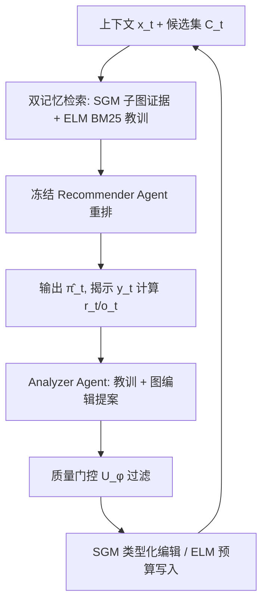
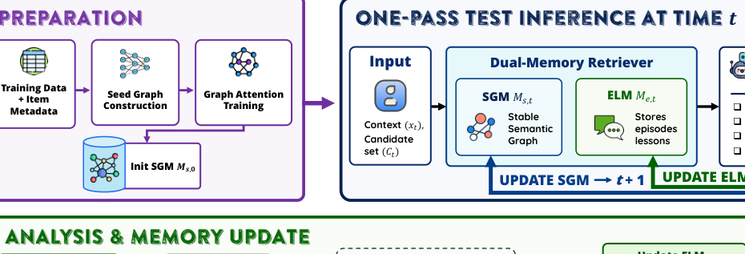

# Continual Graph Memory for Adaptive Recommendation under Intent Drift (意图漂移下基于持续图记忆的自适应推荐)

- **会议/期刊**: Findings of EMNLP 2026
- **作者与机构**: Hao Nguyen Ngoc, Tung Nguyen, Nguyen Thi Hanh, Hoang Thai Dinh, Nguyen Xuan Tung (Phenikaa University / HUST / UTS)
- **推荐链路定位**: 重排（候选集 Reranking）
- **研究方向**: 图神经网络与知识图谱推荐 / 大语言模型推荐
- **论文原文**: [https://arxiv.org/abs/2609.04651v1](https://arxiv.org/abs/2609.04651v1)
- **开源代码**: 暂未开源（匿名仓库 https://anonymous.4open.science/r/CGM-17DD）

## TL;DR (1分钟核心速览)

KG 增强推荐把图当作只读检索源，反馈揭示的"缺失/误导关系"无法回写，意图漂移下持续检索噪声。CGM-Rec 把图状态改为**可写双记忆**：语义图记忆 (SGM) 经质量门控的类型化编辑保守固化稳定关系，情景教训记忆 (ELM) 快速缓存近期成败与纠错提示；测试期参数与提示全冻结，仅靠记忆写入自适应。在冻结参数、单遍采样候选重排协议下，Bundle 上 HR@1 较最强 LLM 基线提升 29.58%，ML-100K 上 HR@5 达 0.5941 vs. K-RagRec 0.4746。

## Background & Motivation (背景与核心矛盾)

- **主流范式**: KG 增强推荐（RippleNet/KGAT）沿属性路径传播偏好；KG-RAG 类 LLM 推荐（K-RagRec）把多跳子图注入提示做语义推理。
- **前人局限**: ① 图在推理期是**只读检索源**，反馈暴露的噪声关系会被反复检索、有用关系无法新增或强化；② 提示优化/文本记忆/参数更新类自适应方法，其自适应状态是提示、错误缓冲或参数，而非**类型化图结构**，无法区分"该信什么"。
- **核心洞察 (Key Insight)**: 每次推荐结果本身就是一条监督信号——它告诉我们所用关系证据是"有用、缺失还是误导"。因此自适应对象应是**图状态本身**，而非模型参数。
- **本文切入点**: 把图当作可写记忆，用双时间尺度（快 ELM / 慢 SGM）+ 质量门控写策略，在冻结参数下实现"预测—揭示—更新"的持续适应。

## Method (核心方法设计)

### 1. 整体框架 (Overall Architecture)

离线阶段用训练流子集+物品元数据构建种子图 $G_0$，训练关系感知图编码器后冻结。测试第$t$步：双记忆检索器从 SGM 抽取候选条件子图证据$R_t^s$、从 ELM 用 BM25 取 top-$k$教训$R_t^e$，拼成结构化提示交给冻结的 Recommender Agent 重排$C_t$得$\hat{\pi}_t$。目标$y_t$揭示后计算排名$r_t$与成败标签$o_t$，Analyzer Agent 产出文本教训（写入 ELM）与结构化图编辑提案（须过质量门控才能改 SGM）。全流程参数$\theta$与阈值$\phi$ 冻结，仅记忆状态演化。

<figure class="paper-figure" markdown="span">
  <figcaption>图2：具有持续双记忆更新的CGM-Rec工作流程</figcaption>
</figure>

### 2. 关键设计拆解 (Key Designs)

1. **语义图记忆 SGM 与类型化编辑**：痛点是一次 LLM 提案就可能污染图。每条边携带属性 $A_{s,t}(e)=(w_{e,t},c_{e,t},n_{e,t},q_{e,t},p_e)$（权重/置信/支持数/质量/来源）。仅接受 6 类动作：`add_tentative_edge`（低置信插入）、`reinforce_edge`、`suppress_edge`、`promote_to_semantic`、`prune_stale_edge`、`store_lesson`。强化按固定步长保守更新$c_{e,t+1}=\min(1,c_{e,t}+\Delta_c)$、$w_{e,t+1}=w_{e,t}+\Delta_w$；剪枝需同时满足$w_{e,t}<\omega_{\min}\wedge c_{e,t}<c_{\min}\wedge n_{e,t}<n_{\min}$。直觉：单次观测不能成为永久知识，必须累积支持。

2. **质量门控写策略**：痛点是无约束 LLM 编辑会幻觉。门控是确定性阈值过滤器而非学习模型，对提案 $p$ 计算
$$\text{WriteScore}_t(p)=\theta_1 O_t(p)+\theta_2 Q_t(p)+\theta_3\text{Support}_t(p)+\theta_4\text{Recency}_t(p)-\theta_5\text{Conflict}_t(p)-\theta_6\text{Cost}_t(p)$$
当 $\text{WriteScore}_t(p)\ge\eta_a$时接受，即$\text{Accept}(p)=\mathbb{I}[\text{WriteScore}_t(p)\ge\eta_a]$。正项奖励有用结果/提案质量/重复支持/新近性，负项惩罚与 SGM 冲突及记忆开销；动作级规则进一步约束（如抑制需重复误导证据）。

3. **训练目标、负采样与推理效率**：图编码器离线用候选集内 softmax 排序损失训练 $\mathcal{L}_{\text{rank}}=-\sum\log\frac{\exp(s_\theta(y_t|x_t,G_0))}{\sum_{i\in C_t}\exp(s_\theta(i|x_t,G_0))}$，负样本即同候选集内其他物品（in-candidate 负采样，无额外全局负采样）。测试期零梯度更新；单实例平均 9.6 s（Recommender 4.6 s + Analyzer 4.8 s + 记忆操作 0.2 s），约 19.93K 输入 / 1.17K 输出 token。

## Experimental Setup & Evaluation Protocol (实验设置与评估协议)

- **数据集与预处理**（处理后为推荐 episode 流，非原始交互）：

| 数据集 | 源交互 | 可排序物品 | 训练/测试 episode | 上下文长度(均值) | 场景说明 |
| :--- | :---: | :---: | :---: | :---: | :--- |
| Bundle | 18,886 | 14,240 | 146 / 238 | 5.53 / 6.05 | 商品捆绑短上下文 |
| Games | 497,577 | 17,389 | 141 / 1,000 | 3.25 / 3.61 | 游戏短会话 |
| ML-1M | 1,000,209 | 3,416 | 150 / 1,000 | 19.00 / 18.01 | 用户-电影上下文 |
| ML-100K | 100,000 | 1,500 | 200 / 743 | 42.74 / 41.73 | 元数据丰富（分类路径/描述/关键词） |

- **数据划分与防穿越**: 训练流/测试流切分；种子图仅用训练流 20% 预热子集 + 元数据构建。严格 **predict–reveal–update** 协议：$y_t$ 在排序后才揭示；ELM 教训经脱敏（剔除目标 ID/标题、候选位置、精确排名、原始 Analyzer 输出与可执行提案），仅保留属性/关系级摘要以防泄漏。
- **排名评测协议**: **Sampled-Candidate Reranking**（候选池 $C=20$，所有方法共享同一候选集与顺序），非全库排序；附录另做$C\in\{20,50,80\}$ 嵌套候选池扩展与 ML-1M 全库 sanity check（3,416 物品）。
- **对比基线与超参**: 传统/神经（MostPop、SKNN、FPMC、NARM、STAMP、GCE-GNN、SASRec）、多意图（MCPRN、HIDE、Atten-Mixer）、持续（ReLoop2）、LLM（NIR、PO4ISR、LLMGreenRec、K-RagRec），LLM 统一 GPT-4.1-mini 骨干；图编码器隐维 32，5 个匹配种子 $\{0,10,42,625,2023\}$，配对 t 检验。

## Key Experimental Results (实验关键数据)

### 1. 主实验对比 (Main Results)

| 数据集 | 指标 | Atten-Mixer | SASRec | ReLoop2 | LLMGreenRec | K-RagRec | **CGM-Rec** | Improv. |
| :--- | :--- | :---: | :---: | :---: | :---: | :---: | :---: | :---: |
| Bundle | HR@1 | 0.0630 | 0.0261 | 0.1454 | 0.2518 | — | **0.3263** | +29.58% vs LLMGreenRec |
| Bundle | HR@5 | 0.2832 | 0.2185 | 0.4185 | 0.5160 | — | **0.5716** | +10.8% |
| Bundle | NDCG@5 | 0.1677 | 0.1174 | 0.2831 | 0.3996 | — | **0.4495** | +12.5% |
| Games | HR@1 | 0.0594 | 0.0988 | 0.2336 | 0.2739 | — | **0.3092** | +12.9% |
| Games | HR@5 | 0.2578 | 0.2920 | **0.5962** | 0.5494 | — | 0.5898 | −1.1% |
| ML-1M | HR@1 | 0.1380 | 0.2018 | 0.1132 | 0.1633 | — | **0.2049** | +1.5% |
| ML-1M | NDCG@5 | 0.3189 | 0.3692 | 0.2338 | 0.3537 | — | **0.3878** | +5.0% |
| ML-100K | HR@5 | — | — | — | 0.1318 | 0.4746 | **0.5941** | +25.2% vs K-RagRec |
| ML-100K | NDCG@5 | — | — | — | 0.0713 | 0.3318 | **0.4508** | +35.9% |

### 2. 消融实验 (Ablation Study)

| 配置 | Bundle HR@5 | Games HR@5 | ML-1M HR@5 | ML-100K HR@5 |
| :--- | :---: | :---: | :---: | :---: |
| SGM only | 0.5486 | 0.5864 | 0.5086 | 0.3220 |
| ELM only | 0.5538 | 0.5848 | 0.5500 | 0.4050 |
| Static SGM+ELM（禁写） | 0.5634 | 0.5877 | 0.5572 | 0.4460 |
| **Full CGM-Rec** | **0.5716** | **0.5898** | **0.5786** | **0.5941** |

### 3. 关键实验发现 (Key Findings)

1. **写回机制的价值随元数据丰富度放大**：从 Static 到 Full 的增益在 Bundle/Games 仅 +0.008/+0.002，在 ML-1M 为 +0.021，在 ML-100K 高达 **+0.148**（0.4460→0.5941）——说明质量门控写回的核心收益在于把海量元数据"蒸馏"为无噪检索状态，而非简单堆叠上下文。
2. **双记忆互补而非冗余**：单记忆均弱于 Static 双记忆（ML-100K 上 SGM-only 0.3220、ELM-only 0.4050 vs. Static 0.4460），ELM 在短上下文 Games 上几乎与 SGM 持平，印证"快反应 + 慢固化"分工。
3. **意图漂移后可恢复**：Bundle 三段 regime（Food→Electronics JSD=1.000，Electronics→Clothing JSD=0.979）切换后，CGM-Rec 的 HR@5 恢复率 37.5%/42.9%，显著高于 Static（11.1%/16.7%）与 K-RagRec（28.6%/33.3%）；候选池扩至 $C=80$ 时对 K-RagRec 的 HR@5 相对增益反升至 18.1%（Games），说明优势不依赖小候选池。

## Highlights & Limitations (亮点、对比与审稿批判)

- **与代表作对比 (vs. Prior Work)**: 与 K-RagRec 的本质差异是"只读检索 vs. 可写记忆"——前者把静态多跳子图塞进提示，元数据过载会淹没上下文窗口；后者把元数据映射到结构化层并经门控压缩。与 ReLoop2 相比，自适应状态从错误补偿缓冲变为类型化图编辑；与 PO4ISR 的提示优化相比，适应对象从指令文本升级为带来源与置信度的关系结构。
- **可迁移亮点**: ① "LLM 只提案、确定性门控才落库"的两段式写回范式，可直接迁移到任何 LLM-as-memory 系统以抑制幻觉污染；② 用支持数+置信度+冲突+开销的加权 WriteScore 做记忆淘汰，可复用于会话级缓存与 RAG 知识库维护。
- **审稿级局限批判**: ① 每实例 9.6 s、两次 LLM 调用，且需维护图存储与门控逻辑，在线成本远高于静态检索；② 评估限于采样候选重排（$C\le 80$），未做全库排序；Bundle 的"漂移"是流级 regime 切换而非真实用户内偏好漂移，且 episodic→semantic 提升仍可能传播有偏证据。

## Rating (四维评分)

- **方法创新性 (Novelty)**: ⭐⭐⭐⭐ （把 KG 从只读检索源重构为双时间尺度可写记忆，问题形式化清晰，但各组件均为已有技术的组合式创新）
- **评估协议与实验扎实度 (Protocol & Experiments)**: ⭐⭐⭐⭐ （5 种子+配对 t 检验+防泄漏脱敏+候选池扩展+regime 漂移分析齐全，扣分在仅采样候选、Games/ML-1M 差异不显著）
- **写作与数学规范度 (Clarity & Rigor)**: ⭐⭐⭐⭐ （任务定义、门控公式与动作表定义严谨，但核心机制大量细节外放附录，正文公式偏符号化）
- **工业落地与复现价值 (Industrial & Practical Value)**: ⭐⭐⭐ （冻结参数、免训练上线思路诱人，但 9.6 s/实例与双 LLM 调用难支撑高 QPS 场景，代码仅匿名仓库）

