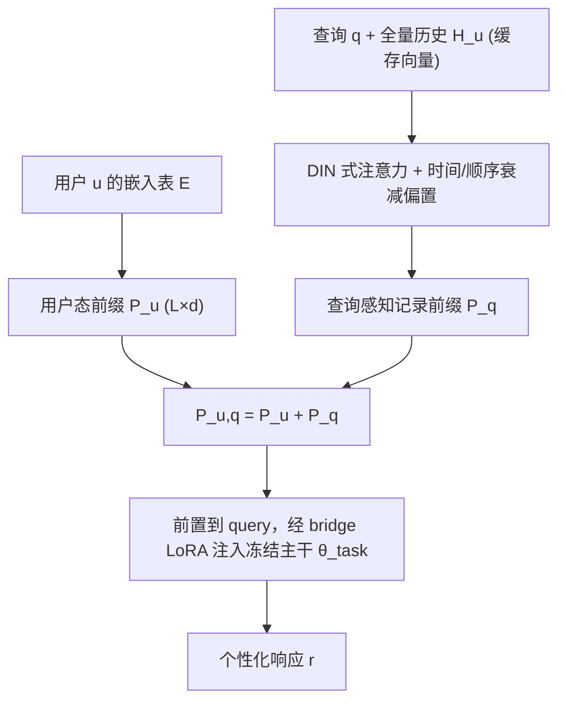
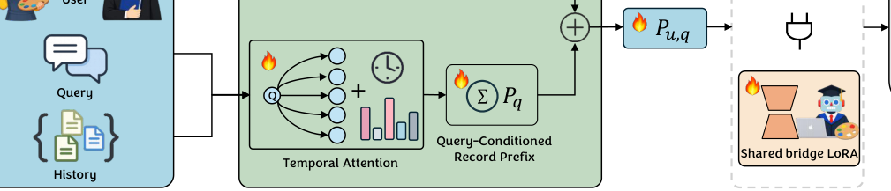

# Beyond Retrieval: Learning Compact User Representations for Scalable LLM Personalization (超越检索：面向可扩展 LLM 个性化的紧凑用户表征学习)

- **会议/期刊**: EMNLP 2026 Findings
- **作者与机构**: Heng Cao, Fan Zhang, Jian Yao 等（Microsoft / 上海外国语大学 / 浙江大学 / 香港理工大学）
- **推荐链路定位**: 端到端生成式（个性化生成）
- **研究方向**: 大语言模型推荐 / 序列与会话推荐
- **论文原文**: [https://arxiv.org/abs/2606.04547v3](https://arxiv.org/abs/2606.04547v3)
- **开源代码**: [https://github.com/heng380/TAP-PER](https://github.com/heng380/TAP-PER)

## TL;DR (1分钟核心速览)

现有 LLM 个性化要么走输入级（RAG/PAG 把历史序列化进 prompt，对检索质量与模板极度敏感），要么走参数级（OPPU/PER-PCS 为每用户维护 LoRA，存储随用户数线性膨胀）。本文提出 TAP-PER，把用户偏好编码为**可学习前缀**：持久偏好的用户态前缀 $P_u$与查询感知的时序记录前缀$P_q$ 相加后前置到 query，再由共享 bridge LoRA 深度注入冻结的任务主干。在 LaMP 六个任务上，Llama-3.1-8B 主干下全部 12 个任务-指标对均最优（LaMP-2M Acc 0.751 vs. OPPU 0.679，LaMP-5 R-1 0.538 vs. 0.510），每用户可训练参数较 OPPU 减少 130×，1000 用户规模下总参数仅为 PER-PCS 的约 53%。

## Background & Motivation (背景与核心矛盾)

- **主流范式**: 输入级方法（RAG 检索历史、PAG 摘要画像）把个性化外包给检索器与 prompt 模板；参数级方法（OPPU 逐用户 LoRA、PER-PCS 分解重组适配器、P2P 超网生成适配器）把偏好写进模型参数。
- **前人局限**: 其一，RAG/PAG 的最优 $k$与是否叠加 PAG 在不同任务间剧烈漂移（表 1 中 LaMP-2M 最优$k=4$、LaMP-3 最优$k=1$），鲁棒性差且原始历史暴露带来隐私风险；其二，逐用户适配器参数量随用户数线性增长，OPPU 每用户约 4.2M 参数，部署成本不可控。
- **核心洞察 (Key Insight)**: 推荐系统早已证明用户偏好是**多时间尺度**的——既有持久兴趣，也有随查询瞬时激活的上下文意图，且时间间隔与序列顺序对意图判别至关重要；而现有 LLM 个性化方法普遍把历史当作静态上下文，**时间盲**。
- **本文切入点**: 不做检索、不建 prompt、不存重适配器，而是把 PAG/RAG 的语义角色分别"参数化"为两个前缀向量，端到端优化。

## Method (核心方法设计)

### 1. 整体框架 (Overall Architecture)

两阶段训练。**Stage 1 任务适配**：在全体用户聚合数据上用 LoRA 微调主干（交叉熵损失），训练完将 $\Delta W = B^{(t)}A^{(t)}$合并进权重得到$\theta_{\text{task}}$，使主干具备共享任务能力。**Stage 2 个性化前缀学习**：冻结$\theta_{\text{task}}$，从每用户嵌入表取出$P_u$，同时对用户全量历史做时序衰减注意力生成$P_q$，二者逐元素相加得$P_{u,q}$前置到 query，并联合训练一个共享 bridge LoRA$\Delta\theta_{\text{bridge}}$ 使主干内部表征深度受前缀条件化。推理时历史记录向量因嵌入层冻结可离线预计算缓存，无需每步编码。

<figure class="paper-figure" markdown="span">
  <figcaption>图 2：TAP-PER 个性化前缀学习概览。在任务适配主干 θtask 冻结的情况下，从每用户嵌入表中获取用户状态前缀 Pu，并通过用户完整交互历史上的时间衰减注意力生成查询感知记录前缀 Pq。二者相加并前置到查询，同时联合训练共享桥接 LoRA ∆θbridge，使主干深度受前缀信号条件化。阶段 1（任务级 LoRA 适配）先于本阶段，图中省略。</figcaption>
</figure>

### 2. 关键设计拆解 (Key Designs)

1. **查询感知记录前缀 + 时序衰减偏置（免检索器的软 RAG）**：痛点在于 RAG 依赖 BM25 等外部检索器且 top-$k$ 截断会丢弃稀疏检索器判为不相关的有用信号。本文对全量历史做 DIN 式注意力打分，并在 softmax 前减去可学习的时间/顺序衰减项：
$$\tilde{s}_j = s_j - \lambda_t \log(1+\Delta t_j) - \lambda_o \log(1+\Delta \pi_j),\quad P_q = \text{MLP}\Big(\sum_{j=1}^{n}\alpha_j \mathbf{z}_{h_j}\Big)$$
其中 $s_j = \text{MLP}(\mathbf{z}_q \| \mathbf{z}_{h_j} \| (\mathbf{z}_q - \mathbf{z}_{h_j}) \| (\mathbf{z}_q \odot \mathbf{z}_{h_j}))$。直觉是：对数衰减让"越近越重要"成为可学习的软先验而非硬截断，模型可自行降权噪声记录，从而在保留长尾证据的同时聚焦当前意图。

2. **用户态前缀 + 共享 Bridge LoRA（轻量参数化的软 PAG）**：$P_u \in \mathbb{R}^{L\times d}$从$|\mathcal{U}|\times(Ld)$ 的嵌入表取出，仅约 32K 标量/用户，承担跨查询的持久偏好；但前缀 token 只通过注意力与前缀交互，对中间层表征影响有限，故引入作用于每个 Transformer 块 Q/K/V/O 投影的共享 bridge LoRA，把个性化信号"深灌"进主干。消融显示移除 bridge 是最大跌幅来源（LaMP-1 Acc 0.732→0.659），说明浅层前缀注入不足。

3. **训练目标与效率**：总损失为 $\mathcal{L}_{\text{pers}} = \sum_{(u,q,r)} \text{CE}(\text{LLM}(P_{u,q}, q; \theta_{\text{task}}+\Delta\theta_{\text{bridge}}), r)$，仅优化前缀参数（用户嵌入表、注意力 MLP、$\lambda_t,\lambda_o$、投影 MLP）与 bridge LoRA，**无负采样**（生成式交叉熵）。推理开销：1000 条缓存记录的全历史注意力+投影仅 1.04 ms，约为 32-token 生成总时长的 0.1%。

## Experimental Setup & Evaluation Protocol (实验设置与评估协议)

- **数据集与预处理**: LaMP 基准六个任务，沿用 OPPU 的划分与数据统计（LaMP-1 引用识别、LaMP-2N/2M 新闻/电影标签、LaMP-3 产品评分、LaMP-4 新闻标题生成、LaMP-5 学术标题生成）；LaMP-7 因历史与查询不配对被排除。

| 数据集 | 任务类型 | 指标 | 历史/场景说明 |
| :--- | :---: | :---: | :--- |
| LaMP-1 | 分类（候选选择） | Acc / F1 | 学者论文历史→引用识别 |
| LaMP-2N / 2M | 分类（15 类标签） | Acc / F1 | 新闻/电影描述→标签 |
| LaMP-3 | 回归（1–5 分） | MAE / RMSE | 用户评论历史→评分 |
| LaMP-4 / 5 | 生成 | ROUGE-1 / ROUGE-L | 文章→标题、摘要→标题 |

- **数据划分与防穿越 (Splitting Strategy)**: 沿用 OPPU 的按用户划分协议（每用户历史/查询分离），Stage 2 训练与测试用户查询严格不重叠；冷启动实验另做严格 user-level 50/50 切分。
- **排名评测协议 (Ranking Protocol)**: 非排序式评测，采用任务原生指标（Acc/F1/MAE/RMSE/ROUGE），在固定测试集上全量评估，无采样负例。
- **对比基线与超参设置**: 主干 Llama-3.1-8B（附录另验 Qwen3-4B）；基线含 prompt 级 RAG（$k\in\{1,2,4\}$，BM25 检索）、PAG（$k\in\{0,1\}$），参数级 OPPU、PER-PCS（含 +rag/+pag 叠加）、P2P、PROPER；前缀长度默认$L=8$，全历史注意力（无预检索）。

## Key Experimental Results (实验关键数据)

### 1. 主实验对比 (Main Results)

Llama-3.1-8B 主干，摘取代表性基线（完整表见原文表 1）：

| 任务 | 指标 | RAG(k=4) | PAG(k=1) | OPPU+rag+pag | PER-PCS+rag+pag | P2P(single) | **TAP-PER** | Improv. |
| :--- | :---: | :---: | :---: | :---: | :---: | :---: | :---: | :---: |
| LaMP-1 | Acc↑ | 0.659 | 0.675 | 0.715 | 0.691 | 0.642 | **0.732** | +1.7pt |
| LaMP-2N | Acc↑ | 0.803 | 0.790 | 0.817 | 0.809 | 0.789 | **0.838** | +2.1pt |
| LaMP-2M | Acc↑ | 0.598 | 0.596 | 0.679 | 0.645 | 0.595 | **0.751** | +7.2pt |
| LaMP-3 | MAE↓ | 0.393 | 0.357 | 0.250 | 0.201 | 0.286 | **0.170** | −0.031 |
| LaMP-4 | R-1↑ | 0.201 | 0.200 | 0.195 | 0.209 | 0.202 | **0.219** | +1.0pt |
| LaMP-5 | R-1↑ | 0.516 | 0.512 | 0.491 | 0.495 | 0.512 | **0.538** | +2.2pt |

### 2. 消融实验 (Ablation Study)

| 配置 | LaMP-1 Acc | LaMP-2M Acc | LaMP-3 MAE↓ | LaMP-5 R-1 |
| :--- | :---: | :---: | :---: | :---: |
| Base（仅 Stage 1） | 0.642 | 0.595 | 0.286 | 0.512 |
| Full TAP-PER | **0.732** | **0.751** | **0.170** | **0.538** |
| − bridge LoRA | 0.659 | 0.702 | 0.241 | 0.508 |
| − $P_q$ | 0.699 | 0.733 | 0.241 | 0.523 |
| − $P_u$ | 0.699 | 0.657 | 0.188 | 0.507 |
| 去时间+顺序偏置 | — | 0.714 | — | 0.513 |

### 3. 关键实验发现 (Key Findings)

1. **Bridge LoRA 是最大单点贡献**：移除后 LaMP-1 Acc 从 0.732 跌至 0.659（−7.3pt）、LaMP-3 MAE 从 0.170 恶化到 0.241，证明仅靠注意力层的前缀注入不足以改变中间层表征，必须"深灌"。
2. **$P_u$与$P_q$分工明确且互补**：$P_u$在依赖稳定偏好的任务上更关键（LaMP-2M 去掉后 0.751→0.657，−9.4pt），$P_q$ 在需要查询级历史证据的任务上更关键（LaMP-3 去掉后 MAE 0.170→0.241）；两者同时移除的跌幅大于各自单独移除，说明非冗余。
3. **全历史注意力优于任何预检索**：插入 BM25 预过滤后 $k\in\{10,20,30,50\}$均无法追平 "All" 设置，说明稀疏检索器丢弃的记录中含有时序注意力可自行利用的信号；同时$L=8$ 为前缀长度甜点，过短欠拟合、过长无增益。

## Highlights & Limitations (亮点、对比与审稿批判)

- **与代表作对比 (vs. Prior Work)**: 相比 OPPU/PER-PCS，本文把"每用户参数"从 4.2M 级适配器压缩为 32K 级前缀，且无需 RAG/PAG 叠加即可超越其最优组合；相比 P2P，无需先构造文本画像再经超网生成适配器，省去一条用户上下文流水线；相比 PPlug/CURP 的单嵌入或原型码本，本文显式引入查询条件化与时序衰减，把推荐系统的 DIN/TiSASRec 归纳偏置迁移到 LLM 个性化。
- **可迁移亮点**: ①"冻结嵌入层→历史向量离线缓存"使全历史注意力在推理侧几乎零成本，可迁移到任何长历史条件化场景；②把检索器替换为带可学习对数衰减偏置的软注意力，是消除 RAG 对 top-$k$ 敏感性的通用手段。
- **审稿级局限批判**: ①缓存存储仍随历史长度线性增长（1000 用户 × 1000 条 FP16 记录约 8.2 GB），论文未研究剪枝/量化，且超长噪声历史下注意力质量可能退化；②在线适应实验是固定干净测试集上的受控模拟，未覆盖延迟、选择偏差与对抗性反馈；③Qwen3-4B 上 LaMP-5 反被 RAG(k=2) 与 OPPU 超越，说明小主干下前缀个性化在短文本生成任务上收益不稳；④无交互历史的新用户只能退回 Stage 1 任务模型，未做从画像归纳生成 $P_u$。

## Rating (四维评分)

- **方法创新性 (Novelty)**: ⭐⭐⭐⭐ （把 PAG/RAG 语义角色参数化为双轨前缀并引入时序衰减注意力，思路清晰但组件均为已知技术的巧妙重组）
- **评估协议与实验扎实度 (Protocol & Experiments)**: ⭐⭐⭐⭐ （六任务 × 双主干 + 组件/时序/敏感性/冷启动/噪声反馈多维消融齐全，但缺更大规模主干与真实线上验证）
- **写作与数学规范度 (Clarity & Rigor)**: ⭐⭐⭐⭐ （公式简洁、符号一致，两阶段解耦动机交代清楚；时序偏置的理论依据偏经验）
- **工业落地与复现价值 (Industrial & Practical Value)**: ⭐⭐⭐⭐⭐ （代码开源，130× 存储压缩与 0.1% 级推理开销，前缀可异步在线更新，部署路径明确）
