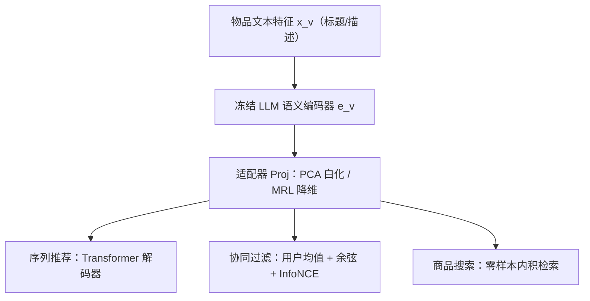
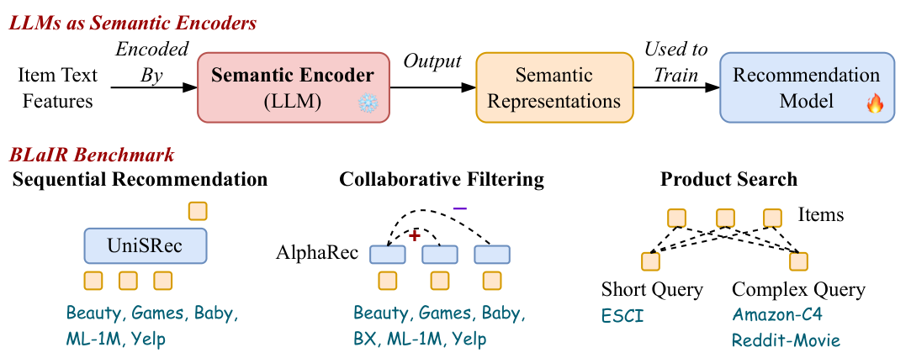

# Bridging Language and Items for Retrieval and Recommendation: Benchmarking LLMs as Semantic Encoders (连接语言与物品：将 LLM 作为语义编码器的检索与推荐基准)

- **会议/期刊**: ACL 2026
- **作者与机构**: Yupeng Hou, Jiacheng Li, Xiangjun Fu, Zhankui He, An Yan, Xiusi Chen, Julian McAuley (UC San Diego / UCLA)
- **推荐链路定位**: 召回（物品语义表征供给下游模型）
- **研究方向**: 大语言模型推荐 / 冷启动与表征
- **论文原文**: [https://arxiv.org/abs/2403.03952v2](https://arxiv.org/abs/2403.03952v2)
- **开源代码**: [https://github.com/hyp1231/BLaIR-Bench](https://github.com/hyp1231/BLaIR-Bench)

## TL;DR (1分钟核心速览)

本文针对"用 LLM 做推荐物品语义编码器时，该选哪个模型、其行为如何"这一空白，提出 BLaIR 基准：发布 Amazon Reviews 2023（5.7 亿评论、4818 万物品）新数据集，统一序列推荐、协同过滤、商品搜索三大场景，并新增"复杂查询商品搜索"子任务（半合成 Amazon-C4 + 真实 Reddit-Movies）。在 11 个 MTEB 顶尖 LLM 上的实验表明，BLaIR 排名与 MTEB 排名几乎不相关（Spearman $-0.476$），且复杂下游任务中编码器规模扩展收益显著减弱。

## Background & Motivation (背景与核心矛盾)

- **主流范式**: 将物品文本（标题/描述）经冻结 LLM 编码为稠密向量 $e_v=\mathrm{LLM}(x_v)$，再作为特征训练下游推荐模型（UniSRec、AlphaRec 等），即 modality-based recommendation。
- **前人局限**: ① 现有工作选 LLM 时直接照搬 MTEB 等通用文本嵌入榜单，但推荐要求表征"高判别性"且输入短噪声大（如商品标题），与 MTEB 的聚类/摘要任务目标错位；② 旧版 Amazon Reviews 数据集停留在 2018 年，元数据噪声大、时间戳仅到天级，无法支撑时序敏感评测。
- **核心洞察 (Key Insight)**: 推荐场景对语义编码器的能力需求（语义相似度建模、判别性特征、指令推理）与通用嵌入基准并不重合，因此 MTEB 排名不能作为选型依据。
- **本文切入点**: 以"统一数据集 + 统一下游架构 + 参数受控适配器"的方式，把 LLM 编码器质量从下游模型容量中解耦出来做公平横评。

## Method (核心方法设计)

### 1. 整体框架 (Overall Architecture)

BLaIR 将 LLM 视为**冻结的第一阶段语义编码器**，输出经适配器对齐维度后送入第二阶段下游模型（序列推荐用 Transformer 解码器、协同过滤用线性层、商品搜索零样本内积检索）。为消除编码器维度差异带来的参数量不公平，所有任务统一插入可学习投影层 $e'_v=\mathrm{Proj}(e_v)\in\mathbb{R}^{d'}$，使下游模型参数量与 LLM 规模无关。评测覆盖 5 个序列推荐数据集、6 个协同过滤数据集、1 个短查询与 2 个复杂查询搜索数据集。

<figure class="paper-figure" markdown="span">
  <figcaption>图1：BLAIR 基准概览。我们将 LLM 作为语义编码器，把物品文本特征转换为语义表示，再用于训练下游推荐模型。该基准涵盖三种场景：(i) 序列推荐（如 UniSRec (Hou et al., 2022)）；(ii) 协同过滤（如 AlphaRec (Sheng et al., 2024)）；(iii) 短查询与复杂查询下的商品搜索。</figcaption>
</figure>

### 2. 关键设计拆解 (Key Designs)

1. **参数受控的适配器对齐（PCA 白化 vs. MRL）**：痛点是不控维度则大模型仅靠"下游参数更多"就赢，比较失真。默认用带白化的 PCA 将任意维度压到 $d'$，白化使各主成分方差归一，提升表征判别性；对比实验显示序列推荐（复杂下游）PCA 更优（text-emb-3-large 上$0.0440$vs. MRL$0.0383$），而协同过滤（线性层）MRL 反而更好（$0.0379$vs.$0.0366$），说明适配器应与下游复杂度匹配。
2. **复杂查询商品搜索子任务构建（Amazon-C4 / Reddit-Movies）**：真实"长而模糊"查询与物品的配对因隐私不可得。作者用 ChatGPT 将 Amazon 5 星长评论改写为第一人称求购查询（去除商品名防泄漏），得半合成 Amazon-C4；另从 Reddit 求片帖（`is_seeker=True` 且回答 ≥20 赞）构建真实 Reddit-Movies。二者 NDCG@100 的 Pearson 相关达 $0.94$（$p<0.01$），证明半合成数据可作低成本代理。
3. **训练目标、负采样与推理效率**：序列推荐用下一项交叉熵 $\mathcal{L}_{\text{seq}}=-\log P(v_t\mid S_{t-1})$，其中$P(v_t\mid S_{t-1})\propto \mathrm{Trm}(e'_{v_1},\dots,e'_{v_{t-1}})\cdot e'_{v_t}$；协同过滤用 InfoNCE + in-batch 负采样，打分$\cos(We'_u,We'_v)/\tau$；商品搜索完全零样本、免训练。LLM 编码离线预计算一次，在线仅需 ANN 检索，开销可控。

## Experimental Setup & Evaluation Protocol (实验设置与评估协议)

- **数据集与预处理**:

| 数据集 | #Users | #Items | #Interactions | 过滤/说明 |
| :--- | :---: | :---: | :---: | :--- |
| Amazon'23 (Beauty/Games/Baby) | 5.4千万(全库) | 4818万(全库) | 5.72亿(全库) | 序列推荐**不做**交互数过滤，保自然分布 |
| ML-1M | 6,040 | 3,043 | 98万 | 迭代剔除 <20 交互 |
| Yelp | 30,431 | 20,033 | 25.5万 | 迭代剔除 <5 交互，仅留 2019 |
| Book-Crossing | 75,862 | 5,335 | 10.1万 | 仅协同过滤，剔除 <20 |
| ESCI / Amazon-C4 / R-Movies | — | 136万 / 105万 / 5.1万 | — | 每真值对采 50 个同域候选 |

- **数据划分与防穿越**: 序列推荐中 Amazon'23 用**全局时间戳切分**（8:1:1，毫秒级时间戳），ML-1M/Yelp 用 `Leave-Last-Out`；协同过滤按 **4:3:3 比例划分**（丢弃时间戳）；商品搜索沿用原始划分，仅用测试集。
- **排名评测协议**: 序列推荐与协同过滤为 **Full-Ranking 全库排序**（NDCG@10 / NDCG@20）；商品搜索在"50 同域 + 跨域"混合候选池上排序（NDCG@100），零样本。
- **对比基线与超参**: 11 个 MTEB 顶尖模型，分三档——<1B（RoBERTa-large、SimCSE、Sentence-T5）、≥1B（Qwen3-Emb 0.6B/4B/8B、SFR-Mistral、E5-Mistral、GritLM-7B）、闭源（gemini-embedding-001、text-embedding-3-large）。学习率搜 $\{1\text{e-}3,3\text{e-}4,1\text{e-}4\}$，主排序用 Borda Count 聚合。

## Key Experimental Results (实验关键数据)

### 1. 主实验对比 (Main Results)

| 模型 | Borda↓ | Avg.Overall | Seq.Rec. | Col.Fil. | Short | Complex |
| :--- | :---: | :---: | :---: | :---: | :---: | :---: |
| roberta-large | 11 | 0.0263 | 0.0393 | 0.0269 | 0.0096 | 0.0001 |
| Qwen3-Emb-0.6B | 10 | 0.0507 | 0.0415 | 0.0274 | 0.1876 | 0.0750 |
| Qwen3-Emb-8B | 6 | 0.0637 | 0.0415 | 0.0362 | 0.2328 | 0.1172 |
| SFR-Emb-Mistral | 4 | 0.0679 | 0.0433 | 0.0372 | **0.2560** | 0.1273 |
| E5-Mistral-7B | 3 | 0.0666 | **0.0434** | 0.0377 | 0.2437 | 0.1232 |
| GritLM-7B | **2** | **0.0685** | **0.0434** | **0.0385** | 0.2537 | **0.1290** |
| gemini-emb-001 | 5 | 0.0629 | **0.0434** | 0.0355 | 0.2233 | 0.1140 |
| text-emb-3-large | **1** | 0.0665 | 0.0440 | 0.0366 | 0.2366 | 0.1278 |

### 2. 消融实验 (Ablation Study)

| 配置 | Seq.Rec. | Col.Fil. | 说明 |
| :--- | :---: | :---: | :--- |
| Qwen3-8B + PCA | 0.0415 | 0.0362 | 默认适配器 |
| Qwen3-8B + MRL | 0.0359 | **0.0392** | 简单下游 MRL 更优 |
| text-emb-3 + PCA | **0.0440** | 0.0366 | 复杂下游 PCA 更优 |
| text-emb-3 + MRL | 0.0383 | 0.0379 | — |
| 仅标题 vs. 标题+描述 | 无一致提升 | 无一致提升 | 长文本引入噪声 |

### 3. 关键实验发现 (Key Findings)

1. **MTEB 排名不可迁移**：BLaIR 与 MTEB(eng,v2) 的 Spearman 相关为 $-0.476$（$p=0.233$），text-emb-3-large 在 MTEB 仅排 42 名却在 BLaIR 拿 Borda 第 1，说明通用嵌入榜单对推荐选型几乎无指导价值。
2. **规模扩展在复杂下游失效**：协同过滤（线性层）上 Qwen3 从 0.6B 到 8B 的 Col.Fil. 由 $0.0274$升至$0.0362$（+32%），但序列推荐（Transformer 解码器）几乎持平（$0.0415$vs.$0.0415$），提示"参数加在哪一阶段"与"加多少"同等重要。
3. **半合成数据可作真实代理**：Amazon-C4 与 Reddit-Movies 的 NDCG@100 Pearson 相关 $0.94$（$p<0.01$），但绝对水平极低（GritLM-7B 仅$0.0734$），失败案例显示模型只捕捉"僵尸/忍者"等表层词，未理解"过火动作片"的核心意图，复杂意图建模仍有巨大空间。

## Highlights & Limitations (亮点、对比与审稿批判)

- **与代表作对比 (vs. Prior Work)**: 相比 UniSRec/AlphaRec 只验证"某单一 LLM 有效"，本文首次把编码器选择作为受控变量横评 11 个模型；相比 MTEB 聚焦通用嵌入，本文指出推荐需要"判别性 + 指令推理"的差异化能力；相比旧 Amazon'18，新数据集规模 3.18×、时间戳毫秒级。
- **可迁移亮点**: ① 用 PCA 白化做跨维度公平对齐，可直接复用于任何"预训练编码器 + 下游模型"的两阶段对比实验；② 用 LLM 改写评论合成复杂查询、并以真实数据验证相关性，是低成本构造长尾意图评测集的通用套路。
- **审稿级局限批判**: ① 仅覆盖英文与 Amazon 部分类目，跨语言与更多类目泛化性未验证；② 商品搜索候选池仅 50 同域 + 跨域采样，非真正全库 Full-Ranking，且复杂查询绝对指标过低（NDCG@100 < 0.08），基准区分度在头部模型间偏弱。

## Rating (四维评分)

- **方法创新性 (Novelty)**: ⭐⭐⭐ （非新模型而是系统性基准与数据集贡献，复杂查询子任务与"MTEB 不相关"结论具洞察力，但方法层面增量有限）
- **评估协议与实验扎实度 (Protocol & Experiments)**: ⭐⭐⭐⭐ （三场景 12 数据集、11 模型、参数受控适配器与 Borda 聚合严谨，惟搜索候选池非全库略打折）
- **写作与数学规范度 (Clarity & Rigor)**: ⭐⭐⭐⭐ （任务定义与公式简洁清晰，附录给出完整划分/元数据/失败案例分析，符号规范）
- **工业落地与复现价值 (Industrial & Practical Value)**: ⭐⭐⭐⭐⭐ （Amazon'23 与 BLaIR-Bench 工具链全开源，离线编码 + 在线 ANN 架构直接可落地，选型指导价值高）
