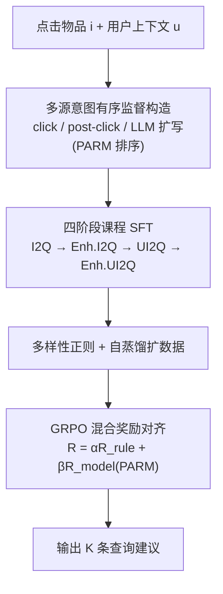
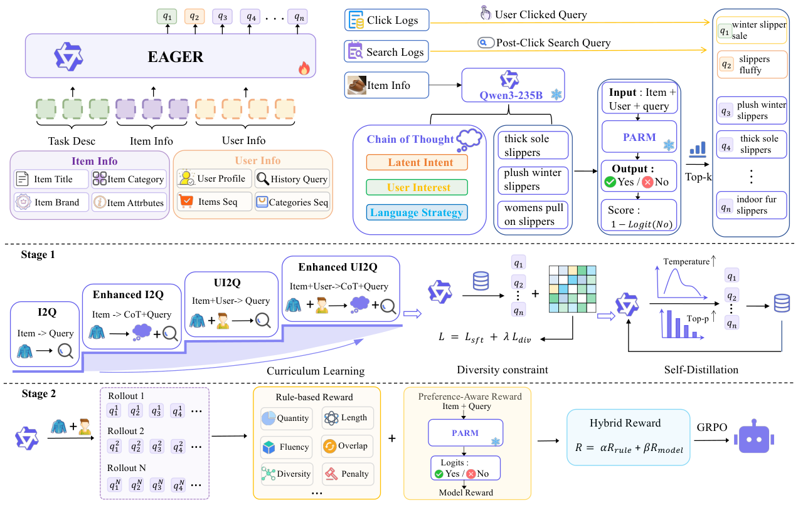

# EAGER: Enrich-and-Align Generative Query Recommendation from Clicked Items in E-commerce Search (电商搜索中“点击物品→生成查询”的富化-对齐式生成推荐)

- **会议/期刊**: EMNLP 2026 Industry Track
- **作者与机构**: Shuwei Yuan, Mingqian Ding, Luxin Liu, Rong Xiao, Xiaoyi Zeng（阿里巴巴国际数字商业集团）
- **推荐链路定位**: 端到端生成式（推荐流内嵌搜索意图承接，位于推荐与搜索的衔接点）
- **研究方向**: 大语言模型推荐 / 生成式推荐
- **论文原文**: [https://arxiv.org/abs/2609.07143v1](https://arxiv.org/abs/2609.07143v1)
- **开源代码**: 暂未开源

## TL;DR (1分钟核心速览)

针对“用户点击推荐流物品后需即时给出 K 条可点击查询建议”（I2Q）这一工业场景，日志挖掘法受限于历史共现、无法覆盖长尾与个性化意图，而现成 LLM 生成的查询流畅却泛化、与真实点击脱节。EAGER 提出两阶段框架：先用四阶段课程化 SFT（物品→物品+理由→物品+用户→物品+用户+理由）配合多样性正则与自蒸馏扩张意图覆盖空间，再用 GRPO 以“8 条规则奖励 + PARM 点击偏好奖励”的混合奖励把生成约束到线上可部署形态。离线在 Soft HR@1 上达 77.96%（Qwen3-1.7B 骨干），9 天 5% 流量 A/B 中 UCTR +0.83%、PCTR +1.28%、Pay Count +3.49%（$p<0.05$）。

## Background & Motivation (背景与核心矛盾)

- **主流范式**: 线上 I2Q 主要依赖协同过滤式统计特征，从历史行为共现中挖掘 item–query 关联，且必须依赖预先存在的查询池做检索式召回。
- **前人局限**: 其一，统计共现只能复现历史行为，对长尾/新品会退化为头部泛化查询，无法建模细粒度语义与个性化偏好；其二，直接调用通用 LLM 缺乏平台知识，产出“流畅但通用”的查询，且无法同时满足点击率、转化与格式/多样性等异质约束。
- **核心洞察 (Key Insight)**: 线上流量日志显示“查询池丰富度”与下游转化呈明显正相关——候选空间本身是瓶颈，因此应把任务从“池内检索”改为“开放词表生成”；同时单次点击只暴露一个显式选择，却需产出覆盖多个潜在意图的查询集合，这是一对多的开放生成问题。
- **本文切入点**: 把“意图覆盖”与“部署对齐”拆成先后两个互补阶段——SFT 先把生成空间撑大，GRPO 再把它收拢到业务可行域，并用同一个 PARM 点击信号锚定两阶段，保证训练一致性。

## Method (核心方法设计)

### 1. 整体框架 (Overall Architecture)

输入为最近点击物品 $i$（标题/类目/品牌/属性）、用户上下文$u$（画像、历史查询、物品序列、类目序列）与线上约束$c$，输出大小为$K$的查询集合$Y=\{q_1,\dots,q_K\}$。第一阶段构造多源意图有序监督$Y=[q_{\text{click}};Q_{\text{post}};Q_{\text{llm}}]$，其中 LLM 扩写候选由 PARM 打分排序转为弱有序标签；随后按“信息丰富度×推理深度”四阶段课程做 SFT，并叠加多样性正则与高温采样自蒸馏迭代扩数据。第二阶段以 GRPO 在混合奖励下做策略优化，规则奖励管合规、PARM 奖励管点击偏好。两阶段共享同一 PARM，形成“先扩空间、后收可行域”的闭环。

<figure class="paper-figure" markdown="span">
  <figcaption>图2：EAGER概览。该框架包含两个阶段：（1）利用多源监督、课程学习和自蒸馏进行查询丰富化的监督微调；（2）基于GRPO的混合奖励对齐，用于在线部署。</figcaption>
</figure>

### 2. 关键设计拆解 (Key Designs)

1. **四阶段理由增强课程（Rationale-Augmented Curriculum）**：单阶段混合训练会让模型只模仿唯一日志查询、忽略多意图探索。本文按难度递进拆成 I2Q（仅物品）→ Enhanced I2Q（引入 235B 教师 LLM 生成的属性/场景/搜索方向理由）→ UI2Q（引入用户上下文）→ Enhanced UI2Q（理由+用户联合），损失仍为标准自回归 NLL：$\mathcal{L}_{\text{SFT}}=-\sum_{t=1}^{T}\log p_\theta(y_t\mid y_{<t},x)$。直觉是“先学物品语义映射、再学推理展开、最后学个性化”，使模型探索多条合理搜索路径而非复述单条查询。

2. **多样性正则 + 自蒸馏扩空间**：多查询生成易同质化。在高质量子集上继续微调并加入集合内相似度惩罚：$\mathcal{L}=\mathcal{L}_{\text{SFT}}+\lambda\mathcal{L}_{\text{div}}$，其中$\mathcal{L}_{\text{div}}=\frac{1}{K(K-1)}\sum_{i\neq j}\text{sim}(q_i,q_j)$；再用多样性增强模型以高温、大 top-p 采样，过滤格式/长度/规则违规后回灌为下一轮训练数据。物理直觉：显式压低集合内冗余 + 采样外推，等价于对“合法查询流形”做数据增广。

3. **GRPO 混合奖励与 PARM 统一信号**：规则奖励无法估计“该用户在该物品下是否会点这条查询”。PARM 为 Qwen-4B 在生产点击日志上微调的生成式点击判别器，输出 yes/no，取 $r_{\text{model}}(i,u,q)=1-p_{\text{PARM}}(\text{no}\mid i,u,q)$，集合级奖励取均值$R_{\text{model}}=\frac{1}{K}\sum_k r_{\text{model}}(i,u,q_k)$；总奖励$R=\alpha R_{\text{rule}}+\beta R_{\text{model}}$，其中$R_{\text{rule}}=\sum_{m=1}^{M}w_m r_m$覆盖数量、长度、流畅度、重叠、多样性惩罚等 8 条可验证规则。关键工程点：同一$1-p_{\text{PARM}}(\text{no}\mid\cdot)$既用于 SFT 阶段候选排序，又作 RL 模型奖励，避免“监督信号”与“优化目标”错位。训练为免负采样（纯生成式策略梯度），推理为单次自回归解码$K$ 条查询，开销与骨干规模线性相关。

## Experimental Setup & Evaluation Protocol (实验设置与评估协议)

- **数据集与预处理**: 基于某大型电商平台生产日志构建 I2Q 样本（物品信息、用户画像与行为序列、点击查询、点击后搜索查询），并对热门物品用 Qwen3-235B 做离线查询扩写补稀疏；论文未披露用户/物品规模统计表，属工业数据不可公开的典型情况。

| 数据集 | #Users | #Items | #Interactions | 稀疏度/密度 | 特征/场景说明 |
| :--- | :---: | :---: | :---: | :---: | :--- |
| 生产 I2Q 日志（未披露规模） | 未披露 | 未披露 | 未披露 | 未披露 | 物品标题/类目/品牌/属性 + 用户画像/历史查询/物品序列/类目序列 + 点击与点击后搜索日志 |

- **数据划分与防穿越 (Splitting Strategy)**: 采用生产日志的离线留出评估（按时间先后切分训练/评测样本，避免未来点击泄漏），论文正文未给出比例细节。
- **排名评测协议 (Ranking Protocol)**: 开放词表生成式评测，非池内全库排序。**Soft HR@K** 为主指标：生成查询与日志点击查询完全一致，或其词项至少 60% 出现在用户进入搜索后所点物品标题中（锚定二跳物品点击，即本场景真实目标）；**Hard HR@K** 仅作精确复现诊断（一对多场景下低 Hard HR 不等于低质量）。多样性用 APD 与 Distinct-2，合规用 Rule score；线上报 UCTR、PCTR、DAC、Pay Count、L2P。
- **对比基线与超参设置**: 基线含闭源 Gemini 3.1 / GPT-5.2、开源 Qwen3-1.7B/4B/8B 与 Qwen3.5-397B-A17B 零样本，以及 SFT、GRPO、SFT-GRPO、EAGER-base 四档自研变体；主模型基于 Qwen3-1.7B，另做 4B/8B 骨干扩展；多样性权重 $\lambda$峰值约 0.1，自蒸馏温度峰值 0.9–1.0；线上 9 天 5% 流量 A/B，显著性$p<0.05$。

## Key Experimental Results (实验关键数据)

### 1. 主实验对比 (Main Results)

| 方法 | Hard HR@1 | Hard HR@all | Soft HR@1 | Soft HR@all | APD | Distinct-2 | Rule |
| :--- | :---: | :---: | :---: | :---: | :---: | :---: | :---: |
| Gemini 3.1 | 0.42 | 0.52 | 70.04 | 93.08 | 69.46 | 76.59 | 7.83 |
| GPT-5.2 | 0.32 | 0.58 | 75.73 | **94.52** | 67.74 | 77.17 | 8.57 |
| Qwen3-8B (zero-shot) | 0.14 | 0.37 | 52.83 | 73.97 | 54.49 | 72.83 | 5.72 |
| Qwen3.5-397B-A17B | 0.08 | 0.10 | 69.08 | 87.98 | 64.91 | 76.33 | 8.19 |
| SFT | 0.33 | 0.67 | 74.04 | 86.85 | 53.05 | 76.79 | 7.65 |
| GRPO (无 SFT 初始化) | 0.27 | 0.61 | 66.58 | 79.36 | 62.84 | 76.48 | 7.73 |
| SFT-GRPO | 0.36 | 0.68 | 74.19 | 86.91 | 53.34 | 78.65 | 7.88 |
| EAGER-base | **0.65** | **1.27** | 74.83 | 93.27 | 72.13 | **83.75** | 9.04 |
| **EAGER (1.7B)** | 0.44 | 0.87 | **77.96** | 93.82 | **72.96** | 83.04 | **9.16** |
| Improv. vs GPT-5.2 (Soft HR@1) | — | — | **+2.23** | −0.70 | +5.22 | +5.87 | +0.59 |

骨干扩展：EAGER-4B 取得最高 APD 79.13，EAGER-8B 取得最高 Soft HR 78.65，Hard HR 随规模升至 0.56，说明框架对骨干规模良性可扩展。

### 2. 消融实验 (Ablation Study)

| 配置 | Hard HR@1 | Hard HR@all | Soft HR@1 | Soft HR@all | APD | Distinct-2 | Rule |
| :--- | :---: | :---: | :---: | :---: | :---: | :---: | :---: |
| EAGER (full) | 0.44 | 0.87 | 77.96 | 93.82 | 72.96 | 83.04 | 9.16 |
| w/o GRPO | 0.36 | 0.64 | 77.45 | 93.76 | 72.84 | 81.77 | 7.21 |
| w/o Self-Distill | 0.41 | 0.65 | 75.60 | 93.42 | 69.62 | 81.73 | 8.53 |
| w/o DIV | 0.38 | 0.56 | **78.34** | 93.49 | 68.24 | 78.86 | 8.42 |
| w/o DIV + Self-Distill | 0.37 | 0.51 | 78.07 | 92.03 | 65.05 | 78.23 | 8.17 |

课程增量（其余组件固定）：I2Q 71.39 → +Enh.I2Q 73.03 → +UI2Q 77.09 → +Enh.UI2Q 77.96（Soft HR@1），APD 65.99 → 72.96。

### 3. 关键实验发现 (Key Findings)

1. **GRPO 的主职是“合规”而非“相关性”**：去掉 GRPO 后 Soft HR@all 几乎不动（93.76 vs. 93.82），但 Rule 从 9.16 崩到 7.21、Distinct-2 从 83.04 降到 81.77；且无 SFT 初始化的纯 GRPO 相关性反降至 66.58，证明“先扩空间、后对齐”的顺序不可颠倒。
2. **多样性正则存在明确的覆盖–精度权衡**：去掉 DIV 后 Soft HR@1 反升 0.38（78.34 vs. 77.96），但 APD 掉 4.72、Distinct-2 掉 4.18；由于场景同时曝光 K 条且下游有重排器，牺牲单点精确复现换取集合覆盖是划算的，线上转化数据也支持这一取舍。
3. **课程中“理由”与“用户上下文”分工清晰**：理由监督（Enhanced I2Q）带来最大单步 APD 增益 +3.17，说明推理展开促进多方向探索；用户上下文（UI2Q）带来最大 Soft HR@1 增益 +4.06，说明个性化才是二跳相关性的主导因素；课程合计贡献 +6.57 Soft HR@1 与 +6.97 APD。线上 5% 流量 9 天 A/B 中 UCTR +0.83%、PCTR +1.28%、DAC +2.98%、Pay Count +3.49%、L2P +2.38%，验证离线多样性收益可传导至支付转化。

## Highlights & Limitations (亮点、对比与审稿批判)

- **与代表作对比 (vs. Prior Work)**: 相比 CF 统计挖掘（Bie et al., 2026 等），EAGER 摆脱查询池依赖，可对长尾/新品生成语义化查询；相比零样本通用 LLM（GPT-5.2、Qwen3.5-397B），它以 1.7B 小模型在 Soft HR@1 上反超 2.23 个点、APD 高 5.22，说明平台内监督与奖励对齐比参数规模更关键；相比 SFT-GRPO 朴素串联，本文的课程化 + 自蒸馏 + PARM 排序把 APD 从 53.34 拉到 72.96，是“扩空间”环节的真正增量。
- **可迁移亮点**: ① 用同一个判别式偏好模型同时充当“SFT 数据排序器”和“RL 模型奖励”，可低成本消除监督–优化目标错位，适用于任何生成式推荐的冷启动数据筛选；② “规则奖励管合规 + 模型奖励管偏好”的混合奖励拆分，是把生成式推荐落地到有强业务约束场景的通用范式。
- **审稿级局限批判**: ① 数据规模、划分比例与 PARM 训练细节大量下放附录/未披露，离线结果难以独立复现，且 Soft HR 的 60% 词项匹配阈值带有较强业务定制性；② PARM 依赖历史曝光与点击日志，天然继承位置偏差与曝光偏差，规则奖励又需人工设计与随业务变更重调，二者叠加可能使 RL 阶段把偏差进一步固化；③ 仅优化查询级生成，未与下游搜索排序/转化做端到端联合优化，且单次解码 K 条查询的推理延迟与 235B 教师蒸馏成本在文中缺乏量化。

## Rating (四维评分)

- **方法创新性 (Novelty)**: ⭐⭐⭐⭐ （课程化 SFT + GRPO 混合奖励的组合在 I2Q 场景属首次系统落地，PARM 双用是真正巧思，但单点技术均为已有组件的工程化编排）
- **评估协议与实验扎实度 (Protocol & Experiments)**: ⭐⭐⭐⭐ （离线三轴指标 + 四档变体 + 课程增量消融 + 9 天线上 A/B 且带显著性，链条完整；扣分在数据统计与划分细节缺失、Soft HR 阈值偏定制）
- **写作与数学规范度 (Clarity & Rigor)**: ⭐⭐⭐⭐ （两阶段动机与公式交代干净、消融归因清晰；但 8 条规则奖励与 PARM 训练细节外置附录，主文公式偏少、缺复杂度分析）
- **工业落地与复现价值 (Industrial & Practical Value)**: ⭐⭐⭐⭐⭐ （已在大规模电商生产部署并有正向 A/B，1.7B 小模型即可超越闭源大模型，工程性价比极高；唯代码未开源、复现需自建 PARM 与规则集）
