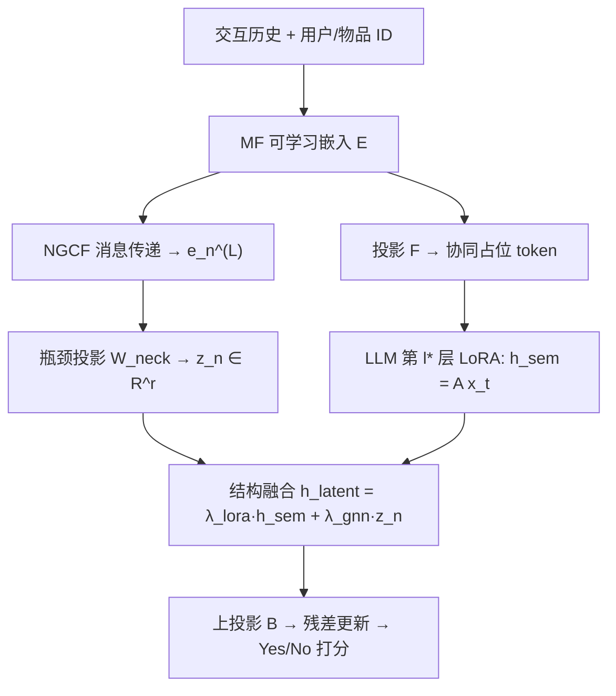
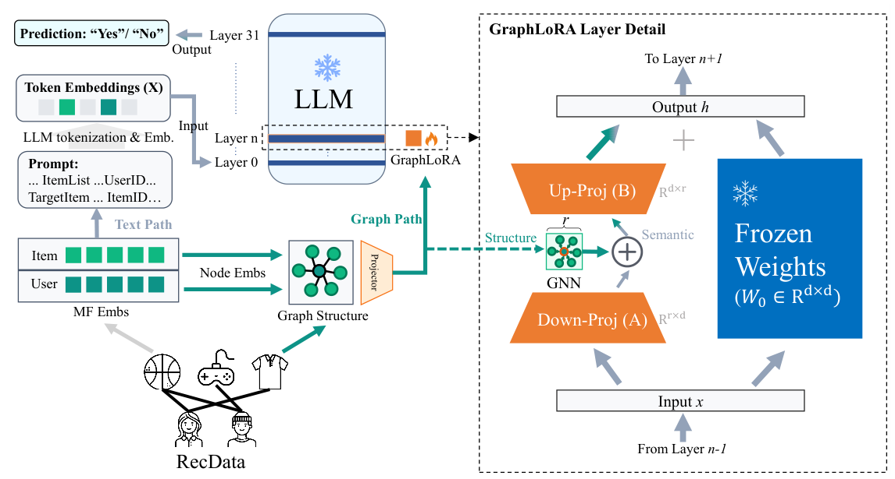

# GraphLoRA: Structure-Aware Low-Rank Adaptation for Large Language Model Recommendation (结构感知低秩适配的大语言模型推荐)

- **会议/期刊**: ACL 2026 Findings
- **作者与机构**: Lin Mu, Guoji Wang, Li Ni, Lei Sang, Zhize Wu, Peiquan Jin, Yiwen Zhang（安徽大学、合肥大学、中国科学技术大学）
- **推荐链路定位**: 精排（LLM 判别式打分，Yes/No 二分类）
- **研究方向**: 大语言模型推荐 / 图神经网络与知识图谱推荐
- **论文原文**: [https://arxiv.org/abs/2606.07526v1](https://arxiv.org/abs/2606.07526v1)
- **开源代码**: [https://github.com/wgj15965/GraphLoRA](https://github.com/wgj15965/GraphLoRA)

## TL;DR (1分钟核心速览)

LLM4Rec 的核心痛点是文本语义与协同结构信号难以对齐：输入空间对齐（TALLRec/CoLLM）把图压平成文本或软 token，丢失高阶拓扑；参数空间对齐（CoRA）虽把协同嵌入注入 LoRA 权重，但注入的是**静态、外部预训练**的嵌入，结构无法与 LLM 联合精炼。GraphLoRA 把可训练 GNN 消息传递模块塞进 LoRA 的瓶颈（下投影 $A$与上投影$B$之间），让协同拓扑直接在低秩参数空间动态传播。在 ML-1M 与 Amazon-Book 上，以$r=8$、仅$\{q,v\}$的极小预算，AUC 达 0.7472 / 0.8205，UAUC 达 0.7102 / 0.6303，全面超越$r=16$、$\{q,k,v,o\}$ 的 CoRA-MF。

## Background & Motivation (背景与核心矛盾)

- **主流范式**: 早期 ICL 靠提示词零样本推荐；随后 TALLRec/P5 将交互历史线性化为文本指令，CoLLM/LLaRA/BinLLM 把 MF 或外部编码器得到的 ID 嵌入投影为软 token 塞进输入（输入空间对齐）；CoRA 则把协同嵌入直接注入 LoRA 权重（参数空间对齐）。
- **前人局限**: 其一，输入空间对齐把复杂图拓扑压平成线性序列或静态 token，形成信息瓶颈，结构归纳偏置被抹平；其二，CoRA 虽进入参数空间，但依赖**外部预训练且冻结**的嵌入作为静态权重，结构信息无法与 LLM 语义表征联合优化，且需在全部 Transformer 层以 $r=16$、$\{q,k,v,o\}$ 高容量注入，参数开销达 7.6 倍。
- **核心洞察 (Key Insight)**: LoRA 的低秩瓶颈 $A\to B$ 本身就是一个天然的"压缩-传播-还原"通道，若在此处插入可微图消息传递，协同拓扑即可作为**动态结构偏置**直接引导梯度更新，而非被动"被读取"。
- **本文切入点**: 将 LoRA 从"独立低秩适配"推广为"结构感知低秩传播"，在瓶颈内实现结构-语义的联合精炼。

## Method (核心方法设计)

### 1. 整体框架 (Overall Architecture)

模型以 Vicuna-7B 为骨干，输入为混合序列：文本 token + 协同占位 token（`<UserID>`、`<TargetItemID>`）。协同嵌入由可学习 MF 矩阵 $\mathbf{E}=[\mathbf{P};\mathbf{Q}]$初始化，经投影网络$\mathcal{F}$映射到$d_{model}$维填入占位位置；同时同一份$\mathbf{E}$作为图编码器（3 层 NGCF）的初始节点状态，在采样的用户-物品子图上做消息传递，得到结构增强表示后经瓶颈投影压到秩$r$，在指定层（ML-1M 第 31 层、Amazon-Book 第 15 层）注入 LoRA 的$A$与$B$ 之间。训练端到端以 BCE 损失联合优化 LLM 适配参数、MF 嵌入与 GNN。

<figure class="paper-figure" markdown="span">
  <figcaption>图 2：GraphLoRA 概览。（左）融合文本提示与协同信号的端到端推荐过程。（右）GraphLoRA 层的详细结构，其中基于 GNN 的结构编码器被注入低秩矩阵 A 与 B 之间，以实现结构感知的低秩传播。注：“Embs”指“Embeddings”。</figcaption>
</figure>

### 2. 关键设计拆解 (Key Designs)

1. **瓶颈内结构注入（Structure-Aware Parameter Injection）**：痛点在于 CoRA 的静态嵌入无法随任务演化。本文对协同 token 位置 $(b,t)\in\mathcal{S}$，先用下投影压缩语义$h_{sem}=\mathbf{A}x_t\in\mathbb{R}^{r}$，再把图信号$z_n$ 与之线性融合后经上投影还原：
$$\Delta x_t=\mathbf{B}\big(\lambda_{lora}h_{sem}+\lambda_{gnn}z_n\big),\quad h=\mathbf{W}_0x_t+\tfrac{\alpha}{r}\Delta x_t$$
非协同 token 走标准 LoRA。直觉：融合发生在任务相关的低秩子空间，结构信号以"最小充分统计量"形式参与梯度回传（$B\to z_n\to W_{neck}\to$ GNN），从而被塑造成与语义对齐的结构偏置。

2. **瓶颈对齐与稀疏单层注入（Bottleneck Alignment & Sparse Injection）**：$d_{emb}=256$远大于$r=8$，直接注入会参数爆炸。用$\mathbf{W}_{neck}\in\mathbb{R}^{r\times d_{emb}}$把$e_n^{(L)}$压到$z_n=\mathbf{W}_{neck}e_n^{(L)}$，且只在单层$l^*$注入。投影复杂度从$\mathcal{O}(d_{model}\times d_{emb})$降到$\mathcal{O}(r\times d_{emb})$，总参数仅比 LoRA-only 多 1.67%。

3. **训练目标、负采样与推理效率**：总损失为 BCE（Yes/No 二分类），AdamW 优化 LLM、Adam 优化 GNN，学习率网格 $\{5e^{-4},1e^{-4},5e^{-5}\}$。图消息传递在批内采样子图上进行，复杂度$\mathcal{O}(|E_{sub}|)$，每批只算一次结构嵌入并注入单层，与 LLM 深度解耦；实测训练/推理开销仅 1.029× / 1.014×。

## Experimental Setup & Evaluation Protocol (实验设置与评估协议)

- **数据集与预处理**: 严格沿用 CoRA 的预处理协议：

| 数据集 | #Users | #Items | #Train | #Valid | #Test | 说明 |
| :--- | :---: | :---: | :---: | :---: | :---: | :--- |
| ML-1M | 839 | 3,256 | 33,891 | 10,401 | 7,331 | 电影评分，二值化为正/负反馈 |
| Amazon-Book | 22,967 | 34,154 | 727,468 | 25,747 | 25,747 | 图书评论，稀疏度极高 |

- **数据划分与防穿越 (Splitting Strategy)**: 沿用 CoRA 的固定 train/valid/test 划分（非 Leave-One-Out），验证集用于早停与超参选择（如注入层位置）。
- **排名评测协议 (Ranking Protocol)**: 主指标为 **AUC**（全局排序）与 **UAUC**（逐用户 AUC 再平均），属全测试集判别式打分；额外补充 **NDCG@10** 做 Top-K 列表评估。未采用负采样排序。
- **对比基线与超参设置**: 四类基线——传统 CF（MF/NGCF/LightGCN/SASRec）、LLM 推荐（ICL/Prompt4NR/TALLRec）、输入空间对齐（PersonPrompt/CoLLM/BinLLM）、参数空间对齐（CoRA-MF/LightGCN/SAS）。GraphLoRA 用 $r=8$、$\{q,v\}$，$\lambda_{lora}=1.0$、$\lambda_{gnn}=0.1$，batch size 8，序列长度 1024，4×RTX 3090 训练。

## Key Experimental Results (实验关键数据)

### 1. 主实验对比 (Main Results)

| 方法 (设置) | ML-1M AUC | ML-1M UAUC | Amazon AUC | Amazon UAUC |
| :--- | :---: | :---: | :---: | :---: |
| SASRec | 0.7005 | 0.6734 | 0.6675 | 0.5614 |
| TALLRec | 0.7044 | 0.6741 | 0.6583 | 0.4971 |
| CoLLM-MF ($r$=8,$\{q,v\}$) | 0.7028 | 0.6714 | 0.8021 | 0.5782 |
| BinLLM ($r$=8,$\{q,v\}$) | 0.7132 | 0.6815 | 0.8157 | 0.5724 |
| CoRA-MF ($r$=16,$\{q,k,v,o\}$) | 0.7361 | 0.6884 | 0.8179 | 0.6262 |
| CoRA-LightGCN ($r$=16) | 0.7128 | 0.6966 | 0.7886 | 0.5689 |
| **GraphLoRA ($r$=8,$\{q,v\}$)** | **0.7472** | **0.7102** | **0.8205** | **0.6303** |
| Improv. vs 最强基线 | +1.51% | +1.95% | +0.32% | +0.65% |

匹配预算对比（同为 $r=8$、$\{q,v\}$）：CoRA-MF 在 Amazon-Book 上 UAUC 崩至 0.4995（"感知坍塌"），GraphLoRA 保持 0.6303；NDCG@10 上 ML-1M 0.7847 vs 0.7636、Amazon 0.7067 vs 0.6990。

### 2. 消融实验 (Ablation Study)

| 设置 | ML-1M AUC | ML-1M UAUC | Amazon AUC | Amazon UAUC |
| :--- | :---: | :---: | :---: | :---: |
| LoRA-only（冻结 MF） | 0.6981 | 0.6548 | 0.8012 | 0.6026 |
| LoRA-only（可训练 MF） | 0.7178 | 0.6952 | 0.8136 | 0.6153 |
| GraphLoRA (GCN) | 0.7417 | 0.6934 | 0.8168 | 0.6277 |
| GraphLoRA (LightGCN) | 0.7382 | 0.7034 | 0.8132 | 0.6170 |
| **GraphLoRA (NGCF)** | **0.7472** | **0.7102** | **0.8205** | **0.6303** |

### 3. 关键实验发现 (Key Findings)

1. **结构注入是增益主源，而非参数膨胀**：可训练 MF 相比冻结 MF 带来 ML-1M AUC +1.97pt，而完整 GraphLoRA 再叠加 +2.94pt；在严格匹配 $r=8$ 预算下 CoRA-MF 的 Amazon UAUC 从 0.6262 跌至 0.4995，GraphLoRA 仍达 0.6303，证明增益来自结构感知机制本身。
2. **冷启动场景优势更显著**：按用户交互频次切分 warm/cold 子集后，warm 场景 GraphLoRA 与最强基线持平，cold 场景优势明显扩大——联合优化的图编码器聚合邻域上下文，为稀疏用户补足结构信号。
3. **注入位置与深度敏感但规律清晰**：Pre-A 注入（$d_{model}$ 空间）参数达 5.224×，而 Middle 注入仅 1.017×；注入层越深越好（ML-1M 第 31 层、Amazon 第 15 层最优），与 LLM 深层编码抽象任务语义的可解释性结论一致。少样本 Book-Crossing 上 16/64/256 样本 AUC 为 60.90/61.08/67.90，全面领先 TALLRec（56.36/60.39/64.38）。

## Highlights & Limitations (亮点、对比与审稿批判)

- **与代表作对比 (vs. Prior Work)**: 相比 TALLRec/CoLLM 的输入空间对齐，本文让结构信号参与梯度回传而非被"阅读"；相比 CoRA 的静态外部嵌入注入，本文的 GNN 与 LLM 联合优化，且以 1/7.6 的参数开销取得更优性能；相比 GraphGPT/HiGPT 的 projector 全量对齐，本文保持 PEFT 的轻量性。
- **可迁移亮点**: ①"在 LoRA 瓶颈内注入任意模态编码器"的范式可迁移到多模态推荐（视觉/文本编码器替代 GNN）；②稀疏单层注入 + 瓶颈投影的组合，是控制 PEFT 参数开销的通用技巧。
- **审稿级局限批判**: ①仅在 ML-1M 与 Amazon-Book 两个数据集、Vicuna-7B/LLaMA-7B 两个骨干上验证，且 ML-1M 仅 839 用户，规模偏小；②注入层位置需逐数据集网格搜索（31 vs 15），缺乏自适应选择机制；③评估以 AUC/UAUC 判别式为主，未与生成式推荐（TIGER 类）对比，且未报告线上延迟。

## Rating (四维评分)

- **方法创新性 (Novelty)**: ⭐⭐⭐⭐ （把 LoRA 瓶颈重解释为结构传播通道，视角新颖且有清晰的参数-结构耦合推导）
- **评估协议与实验扎实度 (Protocol & Experiments)**: ⭐⭐⭐⭐ （主实验+消融+匹配预算+冷启动+少样本+效率分析齐全，但数据集规模与基线覆盖略窄）
- **写作与数学规范度 (Clarity & Rigor)**: ⭐⭐⭐⭐ （三种对齐范式对比图清晰，公式与复杂度分析完整，符号统一）
- **工业落地与复现价值 (Industrial & Practical Value)**: ⭐⭐⭐⭐⭐ （仅 1.67% 参数增量、~1% 延迟，代码开源，工程部署友好）
