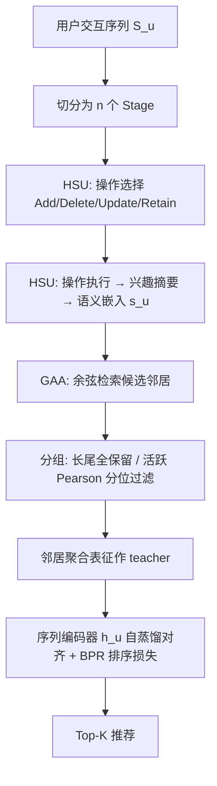
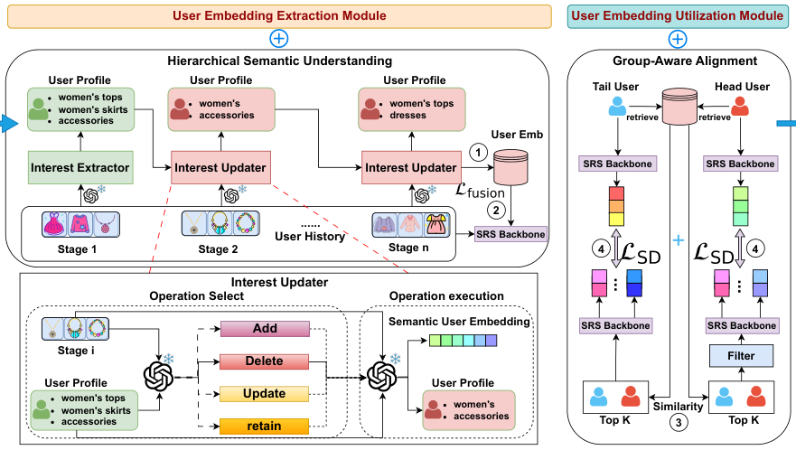

# HSUGA: LLM-Enhanced Recommendation with Hierarchical Semantic Understanding and Group-Aware Alignment (层级语义理解与分组感知对齐的 LLM 增强推荐)

- **会议/期刊**: ACL 2026 Findings
- **作者与机构**: Guorui Li, Dugang Liu, Lei Li, Xing Tang, Zhong Ming（深圳大学计算机与软件学院；深圳技术大学人工智能学院）
- **推荐链路定位**: 召回（语义表征增强的序列召回/排序）
- **研究方向**: 大语言模型推荐 / 冷启动与长尾推荐
- **论文原文**: [https://arxiv.org/abs/2605.11662v1](https://arxiv.org/abs/2605.11662v1)
- **开源代码**: 暂未开源

## TL;DR (1分钟核心速览)

LLM 增强序列推荐的两大环节——用户语义嵌入的**抽取**与**利用**——都存在结构性缺陷：长交互序列直接喂给 LLM 会触发 lost-in-the-middle，推理不可靠；而所有用户共用同一套语义对齐强度，忽视了活跃度差异。HSUGA 提出两个即插即用插件：HSU 把历史切成阶段，用 Add/Delete/Update/Retain 四类原子编辑做受控兴趣演化；GAA 按活跃度分组，长尾用户多检索邻居、强对齐，活跃用户做 Pearson 分位过滤、弱对齐。在 Steam/Fashion/Beauty 三数据集、GRU4Rec/BERT4Rec/SASRec 三骨干上，HSUGA 全面超越 LLM-ESR 等 SOTA，SASRec 骨干下 Beauty 的 Tail User HR@10 从 0.2257 提升至 0.2415。

## Background & Motivation (背景与核心矛盾)

- **主流范式**: LLM4Rec 分两条线——LLMEmb/LLM2Rec 类工作专注**语义嵌入抽取**（让 LLM 从交互序列总结偏好），ICSRec/RCL/LLM-ESR 类工作专注**语义嵌入利用**（邻居检索、偏好对齐、嵌入精炼）。
- **前人局限一（抽取侧）**: 直接把完整长序列或长片段塞进 LLM 做偏好摘要，上下文过长导致推理困难并触发 lost-in-the-middle，推断出的语义向量不可靠；且一次性摘要无法刻画兴趣的**时序演化**。
- **前人局限二（利用侧）**: 对所有用户施加**同一强度**的语义利用算子（相同邻居数、相同对齐损失权重）。长尾用户表征不稳、需要更强引导，活跃用户表征已稠密一致、强对齐反而引入噪声邻居与过正则。
- **核心洞察 (Key Insight)**: 兴趣演化本质是**可控的增量编辑过程**而非一次性重写；语义利用强度应与用户**行为证据量**成反比。
- **本文切入点**: 抽取侧用「阶段化 + 原子编辑」把开放式语义更新约束为结构化操作；利用侧用「活跃度分组 + 分位阈值过滤」实现差异化对齐。

## Method (核心方法设计)

### 1. 整体框架 (Overall Architecture)

HSUGA 是骨干无关（backbone-agnostic）框架，两个插件可单独或联合使用。抽取侧：用户交互序列按固定长度切分为若干 stage，每个 stage 内 LLM 先做**操作选择**（从 Add/Delete/Update/Retain 中选一），再做**操作执行**（生成该操作对应的兴趣摘要），迭代得到最终用户语义嵌入 $s_u$。利用侧：以$s_u$ 的余弦相似度检索邻居，按用户活跃度分组决定邻居数量与过滤策略，聚合邻居表征作为 teacher，对目标用户序列编码器输出做自蒸馏对齐。最终推荐损失与对齐损失联合端到端优化。

<figure class="paper-figure" markdown="span">
  <figcaption>图2：所提出的HSUGA框架概览</figcaption>
</figure>

### 2. 关键设计拆解 (Key Designs)

1. **层级语义理解 HSU（分阶段受控兴趣演化）**：痛点是一次性长序列摘要推理不稳且无法建模演化。做法是把序列切成 stage，每阶段 LLM 先选原子操作类型再执行，形成「操作选择 → 操作执行」两级分解。Add 引入本阶段新概念、Delete 移除过时兴趣、Update 精炼已有偏好、Retain 保持不变。该设计把开放式语义空间的自由更新压缩为离散操作空间，显著降低语义歧义并阻断跨阶段误差累积；同时支持增量更新——新交互只需重跑最后一个 stage，无需对全历史重推理。

2. **分组感知对齐 GAA（活跃度自适应的语义利用强度）**：痛点是对所有用户统一对齐强度。做法是按交互数 $n_u$ 排序，前 20% 为活跃用户、其余 80% 为长尾用户。先按余弦相似度检索候选邻居：

$$\mathcal{N}^{(g)}_u = \arg\max_{v \subset \mathcal{U}\setminus\{u\}} \sum_{i=1}^{K}\cos(\mathbf{e}_u, \mathbf{e}_v)$$

长尾用户全量保留 $\mathcal{N}^{\text{long-tail}}_u=\mathcal{N}^{(g)}_u$；活跃用户再用 Pearson 相似度的**分位阈值**过滤（而非固定绝对阈值，避免不同用户相似度分布尺度差异）：

$$\mathcal{N}^{\text{active}}_u=\{v\in\mathcal{N}^{(g)}_u \mid \text{Pearson}(u,v)\geq Q_\tau(\mathcal{S}_u)\}$$

直觉是：稀疏历史需要更多邻居补信号，稠密历史的多余邻居只会带来噪声。

3. **训练目标、负采样与推理效率**：推荐侧用 pairwise BPR 排序损失 $\mathcal{L}_{\text{Rank}}=-\sum_{u}\sum_{k}\log\sigma(\hat{y}^{+}_{u,k}-\hat{y}^{-}_{u,k})$，负样本为标准负采样；对齐侧用自蒸馏损失：

$$\mathcal{L}_{\text{SD}}=\frac{1}{|\mathcal{U}|}\sum_{u\in\mathcal{U}}\left\|f(u)-\frac{1}{|\mathcal{N}_u|}\sum_{v\in\mathcal{N}_u}f(v)\right\|^2$$

总损失 $\mathcal{L}=\mathcal{L}_{\text{Rank}}+\alpha\cdot\mathcal{L}_{\text{SD}}$。HSU 单独使用时通过融合算子$\tilde{h}_{u}=\phi(h_u,s_u)$（加法/门控/拼接投影）注入语义。效率上 HSU 离线 0.381 s/user（CoT 为 0.189 s），但每 stage 输入 token 从 964.7 降至 644.9、输出从 517.3 降至 284.7，且支持增量更新避免全量重算。

## Experimental Setup & Evaluation Protocol (实验设置与评估协议)

- **数据集与预处理**: Steam、Amazon Fashion、Amazon Beauty，沿用 SASRec 系列标准预处理（迭代 5-core 过滤）与数据划分。

| 数据集 | 领域 | 稀疏特性 | 场景说明 |
| :--- | :---: | :---: | :--- |
| Steam | 游戏 | 中长序列 | 物品品类集中，序列较长 |
| Amazon Fashion | 时尚电商 | 长尾显著 | 服饰/配饰，兴趣漂移快 |
| Amazon Beauty | 美妆 | 极稀疏 | 长尾用户占比高，冷启动压力大 |

- **数据划分与防穿越 (Splitting Strategy)**: 沿用 Kang & McAuley 的 `Leave-One-Out` 划分（末位交互为测试、倒数第二位为验证），属标准序列推荐协议。
- **排名评测协议 (Ranking Protocol)**: 采用 `Full-Ranking (全库未交互物品排序)`，指标为 HR@10 与 NDCG@10；显著性用 paired t-test，$p<0.05$。
- **对比基线与超参设置**: 骨干为 GRU4Rec / BERT4Rec / SASRec；基线含长尾方法 CITIES、MELT，LLM 增强方法 RLMRec、LLMInit、LLM-ESR，以及兼容性实验中的 LLMEmb、LLM2Rec、ICSRec、RCL。LLM 默认 Qwen2.5-7B-Instruct，另测 14B；分组阈值默认 20%，过滤分位默认在 25/50/75 百分位间做敏感性分析。

## Key Experimental Results (实验关键数据)

### 1. 主实验对比 (Main Results)

Fashion 与 Beauty 上 HSUGA 对最强基线 LLM-ESR 的对比（Full-Ranking，HR@10 / NDCG@10）：

| 数据集 | 骨干 | LLM-ESR | HSUGA | Improv. (HR@10) |
| :--- | :---: | :---: | :---: | :---: |
| Fashion | GRU4Rec | 0.5409 / 0.4567 | **0.5485 / 0.4615** | +1.41% |
| Fashion | BERT4Rec | 0.5487 / 0.4529 | **0.5667 / 0.4802** | +3.28% |
| Fashion | SASRec | 0.5619 / 0.4743 | **0.5880 / 0.4943** | +4.64% |
| Beauty | GRU4Rec | 0.4917 / 0.3140 | **0.4936 / 0.3190** | +0.39% |
| Beauty | BERT4Rec | 0.5393 / 0.3590 | **0.5711 / 0.3804** | +5.90% |
| Beauty | SASRec | 0.5672 / 0.3713 | **0.5831 / 0.3911** | +2.80% |

长尾分桶（Beauty，SASRec 骨干，Tail User HR@10）：LLM-ESR 0.2257 → HSUGA **0.2415**（+7.0%）；Tail Item HR@10：0.1714（LLMInit）→ **0.2415**，相对 LLM-ESR 的 0.2257 提升约 7.0%。Fashion 上 Tail Item HR@10 从 LLM-ESR 的 0.0807 提升至 **0.0868**。

兼容性实验（表 1）显示：GAA 插入 LLMEmb/LLM2Rec/LLM-ESR 后，Steam 上 BERT4Rec 骨干的 LLM2Rec 从 0.5176 提升至 **0.5889**（HR@10，+13.8%）；HSU 插入 ICSRec/RCL/LLM-ESR 后，Fashion 上 SASRec 骨干的 ICSRec 从 0.4549 提升至 **0.5048**（+11.0%），验证两插件与既有 LLM4Rec 管线的正交可组合性。

### 2. 消融实验 (Ablation Study)

Fashion 数据集，HR@10 / NDCG@10：

| 变体 | GRU4Rec | BERT4Rec | SASRec |
| :--- | :---: | :---: | :---: |
| HSUGA 完整 | **0.5562 / 0.4655** | **0.5774 / 0.4838** | **0.5946 / 0.4979** |
| w/o Add | 0.5497 / 0.4598 | 0.5695 / 0.4773 | 0.5881 / 0.4921 |
| w/o Delete | 0.5488 / 0.4602 | 0.5713 / 0.4787 | 0.5892 / 0.4929 |
| w/o Update | 0.5496 / 0.4598 | 0.5687 / 0.4773 | 0.5869 / 0.4929 |
| w/o Retain | 0.5480 / 0.4585 | 0.5678 / 0.4779 | 0.5845 / 0.4918 |
| w/o Interest Updater | 0.5464 / 0.4593 | 0.5681 / 0.4779 | 0.5872 / 0.4930 |
| w/o Group-Aware SD | 0.5485 / 0.4597 | 0.5623 / 0.4732 | 0.5841 / 0.4904 |
| w/o Active User Filter | 0.5445 / 0.4621 | 0.5656 / 0.4793 | 0.5903 / 0.4928 |

### 3. 关键实验发现 (Key Findings)

1. **分组感知对齐是最大增益来源**：移除 Group-Aware SD 在 BERT4Rec 上 HR@10 掉 1.51 个点（0.5774→0.5623），在 SASRec 上 Tail Item HR@10 从 0.1930 暴跌至 0.1573（-18.5%），说明统一对齐强度对长尾物品的伤害远大于对头部的影响，印证了「强度应与证据量成反比」的核心假设。
2. **四类原子编辑缺一不可且 Delete/Retain 更关键**：移除 Retain 在 SASRec 上 HR@10 掉 1.01 个点、Tail Item 掉 2.73 个点，移除 Delete 掉 0.57 个点；说明「不更新」与「显式遗忘」两类操作对抑制误差累积、维持兴趣摘要稳定性贡献最大，而非仅靠 Add 引入新信号。
3. **增益来自结构化推理而非模型规模**：HSUGA-7B（0.6445 / 0.3975）已超过 CoT-14B（0.6391 / 0.3892），HSUGA-14B 进一步到 0.6586 / 0.4087；同时分组阈值在 15%/20%/25% 间波动仅 ±0.005 HR@10，分位阈值 25/50/75 亦稳定，说明方法对超参不敏感、鲁棒性强。

## Highlights & Limitations (亮点、对比与审稿批判)

- **与代表作对比 (vs. Prior Work)**: 与 LLM-ESR 相比，本文不改进语义抽取的编码器，而是把「长序列一次性摘要」换成「阶段化受控编辑」，把「全局统一对齐」换成「分组差异化对齐」，两者都是**算子层面的替换**而非架构重设计；与 ICSRec/RCL 相比，本文的 GAA 引入了活跃度先验与分位过滤，避免了固定邻居数在活跃用户上引入噪声；与 RLMRec/LLMInit 相比，HSU 显式建模兴趣演化轨迹而非静态语义快照。
- **可迁移亮点**: (1) 「操作选择 → 操作执行」的两级分解可迁移到任何 LLM 驱动的用户画像/记忆更新场景（对话推荐、Agent 用户模拟）；(2) 用**分位阈值**替代固定绝对相似度阈值做邻居过滤，可低成本迁移到图推荐/对比学习的邻居采样中，天然适配不同用户的相似度分布尺度。
- **审稿级局限批判**: (1) 推理开销仍是硬伤——HSU 离线 0.381 s/user 是 CoT 的 2 倍，且每 stage 一次 LLM 调用，工业级千万用户场景下成本难以承受，论文仅在 Limitations 中提及按 stage 数分组并行，缺乏端到端延迟实测；(2) 分组阈值 20% 与分位阈值虽做了敏感性分析，但仅在 Steam + BERT4Rec 单一组合上验证，跨数据集泛化性证据不足；且 GAA 的邻居检索依赖语义嵌入质量，若 HSU 抽取失败则对齐信号会同步劣化，论文未做该失效链路的分析。

## Rating (四维评分)

- **方法创新性 (Novelty)**: ⭐⭐⭐⭐ （把可编辑记忆的原子操作引入兴趣演化建模，配合活跃度反比对齐，思路清晰但组件本身多为已有范式的组合迁移）
- **评估协议与实验扎实度 (Protocol & Experiments)**: ⭐⭐⭐⭐ （三数据集 × 三骨干 × Full-Ranking + 显著性检验 + 长尾分桶 + 兼容性双面板，覆盖充分；但分组敏感性仅在单组合上验证）
- **写作与数学规范度 (Clarity & Rigor)**: ⭐⭐⭐⭐ （两级分解与分组公式定义干净，符号一致；但缺少 HSU 阶段数与序列长度的复杂度分析，融合算子 $\phi$ 的具体选择未在正文交代）
- **工业落地与复现价值 (Industrial & Practical Value)**: ⭐⭐⭐ （插件式设计与增量更新利于集成，但每 stage 一次 LLM 调用的离线成本与未开源代码削弱了直接落地与复现的可行性）
