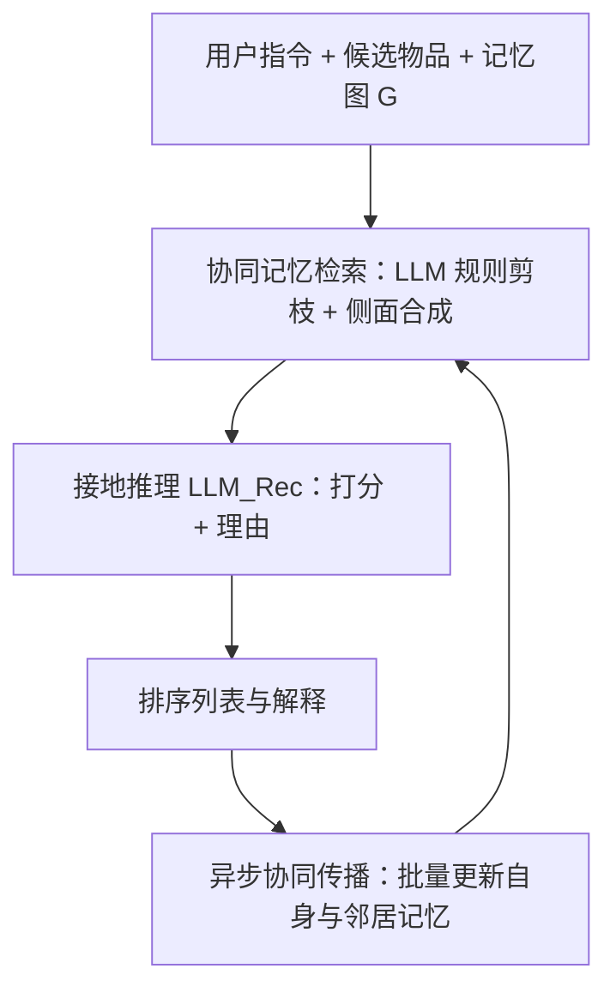
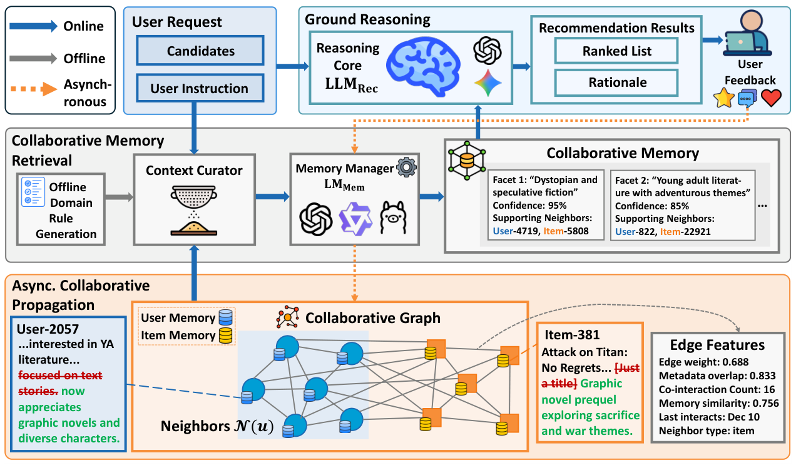

# MemRec: Collaborative Memory-Augmented Agentic Recommender System (协同记忆增强的智能体推荐系统)

- **会议/期刊**: ACL 2026 Main Conference
- **作者与机构**: Weixin Chen, Yuhan Zhao, Jingyuan Huang, Zihe Ye, Clark Mingxuan Ju, Tong Zhao, Neil Shah, Li Chen, Yongfeng Zhang（香港浸会大学 / Rutgers University / Snap Inc.）
- **推荐链路定位**: 重排（LLM 候选打分与理由生成）
- **研究方向**: 大语言模型推荐 / 图神经网络与知识图谱推荐
- **论文原文**: [https://arxiv.org/abs/2601.08816v3](https://arxiv.org/abs/2601.08816v3)
- **开源代码**: [https://github.com/rutgerswiselab/memrec](https://github.com/rutgerswiselab/memrec)

## TL;DR (1分钟核心速览)

现有 LLM 智能体推荐把用户记忆与物品记忆各自孤立维护，丢掉了协同过滤最核心的用户-物品共现与同伴关系信号，稀疏用户尤其吃亏。MemRec 提出"协同记忆"范式，并把记忆管理从推理中**架构解耦**：轻量 $\text{LM}_{\text{Mem}}$在后台维护一张动态协同记忆图，用零样本 LLM 生成领域规则做"先剪枝后合成"，只把蒸馏出的高信号偏好侧面喂给重型$\text{LLM}_{\text{Rec}}$ 打分。在 Books/Goodreads/MovieTV/Yelp 四基准的候选集重排协议下，H@1 相对最强基线 i²Agent 分别提升 +14.91%/+28.98%/+19.75%/+15.77%，且在线推理成本显著低于单体式 Agent。

## Background & Motivation (背景与核心矛盾)

- **主流范式**: Agentic RS 已从无记忆提示、静态画像（iAgent）演进到动态自反思记忆（i²Agent、AgentCF、RecBot），记忆以自然语言叙事形式持久化并随交互演化。
- **前人局限**: 其一，所有记忆更新都**封闭在单个用户/物品的孤岛内**，无法把暖物品的交互信号经共现迁移到冷物品，也无法借同伴偏好补全稀疏用户；其二，若朴素地把原始协同邻域直接拼进上下文，会触发**认知过载**（长上下文噪声导致幻觉与指令遵循下降）与**更新瓶颈**（每次交互需对每个邻居独立调用 LLM，复杂度 $O(|\mathcal{N}'_k|)$）。
- **核心洞察 (Key Insight)**: 协同信号本身极强，问题不在"要不要用"，而在"如何压缩后再用"——这正对应信息瓶颈（IB）理论：保留与任务互信息最大的部分，丢弃冗余。
- **本文切入点**: 用**架构解耦**替代"单模型硬扛"：让专职轻量记忆管理器承担压缩与演化，推理器只读蒸馏结果。

## Method (核心方法设计)

### 1. 整体框架 (Overall Architecture)

MemRec 在统一记忆图 $\mathcal{G}=(\mathcal{V},\mathcal{E})$上运作，节点$\mathcal{V}=\mathcal{U}\cup\mathcal{I}$各存一份演化中的语义记忆$\mathcal{M}_v$，边编码交互与派生关系。三阶段闭环：**协同记忆检索**从图中抽取并合成紧凑的$\mathcal{M}_{\text{collab}}$；**接地推理**由$\text{LLM}_{\text{Rec}}$ 结合指令与候选物品记忆输出分数与理由；**异步协同传播**在后台批量更新节点记忆，不阻塞在线延迟。关键在于重活（图压缩、记忆演化）全部下沉到离线/异步批处理，在线只查询蒸馏后的协同记忆。

<figure class="paper-figure" markdown="span">
  <figcaption>图2：MemRec的整体框架，将推理（LLMRec）与记忆管理（LMMem）解耦。三阶段流水线包括：协同记忆检索，从记忆图合成高阶连通性上下文；基于上下文的推理，根据指令和上下文对物品打分；以及异步协同传播，在后台演化语义记忆图。</figcaption>
</figure>

### 2. 关键设计拆解 (Key Designs)

1. **零样本 LLM-as-Rule-Generator 上下文剪枝**：规则启发式（随机游走）缺乏语义感知，GNN 注意力打分器又需昂贵训练且不可解释。MemRec 让 $\text{LM}_{\text{Mem}}$离线分析领域统计$\mathcal{D}_{\text{domain}}$与元提示$\mathcal{P}_{\text{meta}}$，自动生成可解释的领域规则$\mathcal{R}_{\text{domain}}\leftarrow\text{LM}_{\text{Mem}}(\mathcal{D}_{\text{domain}}\|\mathcal{P}_{\text{meta}})$，推理时以毫秒级过滤出 top-$k$邻居$\mathcal{N}'_k(u)=\text{Curate}(\mathcal{N}(u),\mathcal{R}_{\text{domain}},k)$。直觉：把"该信谁"的先验从昂贵在线计算转为一次性领域知识固化，Books 偏内容相似度、Yelp 偏类目与时效，规则天然自适应。

2. **协同记忆合成（Curate-then-Synthesize）**：剪枝后仍需把原始邻居压成推理器可消化的形式。$\text{LM}_{\text{Mem}}$以分层表示（目标用户给全量记忆$\mathcal{M}_u^{t-1}$，邻居给截断的紧凑表示）合成一组带置信度与证据邻居的偏好侧面：$\mathcal{M}_{\text{collab}}=\{\mathcal{F}\}\leftarrow\text{LM}_{\text{Mem}}(\text{Rep}(\mathcal{N}'_k)\|\mathcal{M}_u^{t-1}\|\mathcal{P}_{\text{synth}})$。这对应 IB 的第二段压缩：输出是"主题 + 置信度 + 支撑邻居"的结构化证据，而非冗长历史，直接缓解 lost-in-the-middle。

3. **异步协同传播与 $O(1)$更新复杂度**：受标签传播启发，新交互发生时把自反思（更新$\mathcal{M}_u^t,\mathcal{M}_{i_c}^t$）与邻居增量$\{\Delta\mathcal{M}_{\text{neigh}}\}$合并为**单次批量异步调用**，用统一提示$\mathcal{P}_{\text{update}}$一次产出全部更新。相比朴素同步的$O(|\mathcal{N}'_k|)$次调用与重复上下文冗余，实现每次交互$O(1)$ 调用复杂度，且与在线推理循环解耦。训练侧无梯度优化，全部依赖提示工程与温度 0.0 的确定性解码。

## Experimental Setup & Evaluation Protocol (实验设置与评估协议)

- **数据集与预处理**: 沿用 InstructRec 提供的带自然语言用户指令版本，未额外做 k-core 过滤（原始划分）：

| 数据集 | #Users | #Items | #Interactions | 密度 | 场景说明 |
| :--- | :---: | :---: | :---: | :---: | :--- |
| Books | 7.4K | 120.9K | 207.8K | 2.33e-4 | 极稀疏、内容驱动 |
| Goodreads | 11.7K | 57.4K | 618.3K | 9.19e-4 | 稠密、社交与系列阅读 |
| MovieTV | 5.6K | 29.0K | 79.7K | 4.87e-4 | 时效敏感、口味波动 |
| Yelp | 3.0K | 31.6K | 63.1K | 6.77e-4 | 类目/价格/位置强约束 |

- **数据划分与防穿越 (Splitting Strategy)**: 直接采用 InstructRec 的官方划分（按时间留出测试交互），保证与指令遵循类基线公平可比。
- **排名评测协议 (Ranking Protocol)**: 候选集重排协议，主实验候选列表规模 $N=10$（附录补充$N=20$），在完整测试集上报告 H@1/H@3/N@3/H@5/N@5；后续分析用随机采样的 1000 用户子集。**注意：并非全库 Full-Ranking**，候选集由外部召回给定。
- **对比基线与超参设置**: 基线分两类——传统隐向量模型（LightGCN、SASRec、P5）与 AgentRS 记忆范式（Vanilla LLM 无记忆、iAgent 静态记忆、AgentCF/RecBot/i²Agent 动态孤立记忆）。$\text{LLM}_{\text{Rec}}$与$\text{LM}_{\text{Mem}}$均用 gpt-4o-mini，$k=16$、侧面数$N_f=7$、上下文预算$\tau=1800$tokens，所有提升经$p<0.05$ 显著性检验。

## Key Experimental Results (实验关键数据)

### 1. 主实验对比 (Main Results)

| 模型 | Books H@1 | Books N@5 | Goodreads H@1 | Goodreads N@5 | MovieTV H@1 | MovieTV N@5 | Yelp H@1 | Yelp N@5 |
| :--- | :---: | :---: | :---: | :---: | :---: | :---: | :---: | :---: |
| LightGCN | 0.1753 | 0.3592 | 0.2499 | 0.5263 | 0.3482 | 0.5241 | 0.3444 | 0.5494 |
| SASRec | 0.0914 | 0.2824 | 0.1324 | 0.3349 | 0.3399 | 0.4942 | 0.2305 | 0.3980 |
| P5 | 0.2192 | 0.3671 | 0.1569 | 0.3256 | 0.1696 | 0.3290 | 0.1444 | 0.4785 |
| Vanilla LLM | 0.3138 | 0.5226 | 0.2864 | 0.5041 | 0.4050 | 0.6445 | 0.1692 | 0.4360 |
| iAgent | 0.3925 | 0.5409 | 0.2617 | 0.4626 | 0.4253 | 0.5871 | 0.3995 | 0.5681 |
| AgentCF | 0.3457 | 0.5512 | 0.2951 | 0.5399 | 0.3906 | 0.6006 | 0.1925 | 0.4147 |
| i²Agent | 0.4453 | 0.6138 | 0.3099 | 0.5481 | 0.4912 | 0.6672 | 0.4205 | 0.6007 |
| **MemRec** | **0.5117** | **0.6601** | **0.3997** | **0.6112** | **0.5882** | **0.7422** | **0.4868** | **0.6463** |
| Improv. | +14.91% | +7.54% | +28.98% | +11.51% | +19.75% | +11.24% | +15.77% | +7.59% |

### 2. 消融实验 (Ablation Study)

| 配置 | H@1 | H@3 | N@3 | H@5 | N@5 | H@1 跌幅 |
| :--- | :---: | :---: | :---: | :---: | :---: | :---: |
| MemRec (Full) | **0.527** | **0.713** | **0.634** | 0.803 | **0.670** | - |
| w/o Collab. Write | 0.505 | 0.702 | 0.619 | **0.814** | 0.665 | 4.2% |
| w/o LLM Curation | 0.498 | 0.685 | 0.606 | 0.788 | 0.648 | 5.5% |
| w/o Collab. Read | 0.475 | 0.650 | 0.575 | 0.769 | 0.624 | 9.9% |

### 3. 关键实验发现 (Key Findings)

1. **协同读是命门，写是精度微调**：去掉协同检索（退化为孤立记忆）H@1 暴跌 9.9%，而关闭异步传播仅跌 4.2% 且 H@5 反而略升（0.814 vs 0.803）——说明静态图足以支撑粗粒度召回，动态传播主要精修 top-1 排序精度。
2. **架构解耦突破信息瓶颈**：与"单模型直接吞原始邻域"的 Naive Agent 相比，解耦后在 Books/Yelp/MovieTV 上 H@1 分别从 0.390/0.242/0.418 提升到 0.524/0.489/0.563，Books 相对增益约 +34%，证明瓶颈不在上下文长度而在"压缩与推理抢同一模型容量"。
3. **稀疏用户受益最大且抗噪**：按活跃度分桶后，低活跃组相对 Vanilla LLM 的 H@1 提升高达 +91.4%（中/高活跃组为 +63.8%/+50.3%）；注入 30% 假物品噪声后 H@1 仍保持 0.491，剪枝环节充当了噪声缓冲垫。

## Highlights & Limitations (亮点、对比与审稿批判)

- **与代表作对比 (vs. Prior Work)**: 相比 i²Agent/AgentCF 的"孤立自反思记忆"，MemRec 把记忆从单节点叙事升级为图上的协同侧面，本质是把 CF 的高阶连通性以自然语言形式注入 LLM；相比 LightGCN 类图模型，它不做梯度训练却借 LLM 语义推理在稀疏 Books 上反超（0.5117 vs 0.1753）；相比 MemGPT/Generative Agents 等通用记忆架构，它专门针对推荐的高阶协同结构设计剪枝与传播。
- **可迁移亮点**: (1) "LLM 离线生成领域剪枝规则"可零成本迁移到任何需要图邻居采样的 GNN/Agent 管线；(2) 把记忆维护与在线推理拆成两个不同规模模型，是控制 LLM 推荐在线成本的通用的工程范式。
- **审稿级局限批判**: (1) 评估是 $N=10/20$ 的**候选集重排**而非全库排序，候选集由外部给定，实际召回上限未被检验，H@1 的绝对数值不宜与 Full-Ranking 结果直接横比；(2) 传播仅限一跳邻居，规则来自离线静态统计，在新闻类高动态领域可能迅速失效；且天花板性能仍依赖闭源强模型，本地 7B 部署（Qwen-2.5-7B H@1=0.470）与 gpt-4o（0.580）仍有明显差距。

## Rating (四维评分)

- **方法创新性 (Novelty)**: ⭐⭐⭐⭐ （"协同记忆"范式与架构解耦的组合有新意，IB 视角的剪枝-合成论证自洽，但单点技术均为已有组件的巧妙重组）
- **评估协议与实验扎实度 (Protocol & Experiments)**: ⭐⭐⭐⭐ （四领域基准 + 消融 + 分桶 + 扰动 + 成本分析齐全，显著性检验到位；扣分在候选集重排协议与单次运行、缺少方差报告）
- **写作与数学规范度 (Clarity & Rigor)**: ⭐⭐⭐⭐ （三阶段流水线叙述清晰、公式简洁，但方法以提示工程为主，缺少复杂度与收敛性的形式化分析）
- **工业落地与复现价值 (Industrial & Practical Value)**: ⭐⭐⭐⭐⭐ （代码开源、$O(1)$ 更新复杂度、给出从云端 API 到本地 7B 的完整成本-性能帕累托前沿，工程可落地性强）
