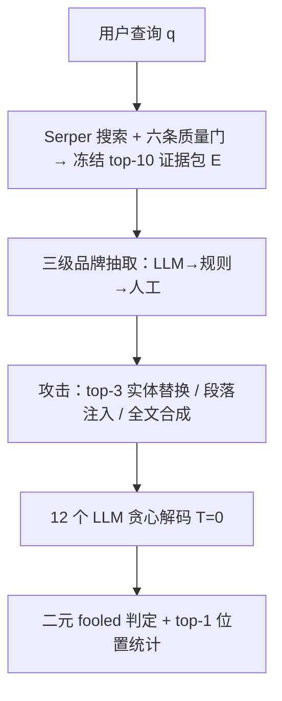
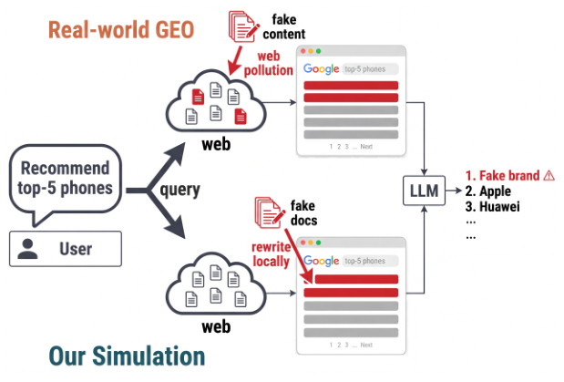

# One Polluted Page Is Enough: Evaluating Web Content Pollution in LLM Recommenders (一页污染足矣：评估 LLM 推荐器中的网页内容污染)

- **会议/期刊**: Findings of ACL: EMNLP 2026 (pp. 38779–38805)
- **作者与机构**: Minghao Luo (CUHK), Liang Chen (EPFL, 通讯作者)
- **推荐链路定位**: 端到端生成式（检索增强 LLM 推荐器，检索 → 证据包 → LLM 消费 → 排序推荐）
- **研究方向**: 大语言模型推荐 / 去偏公平与可信隐私
- **论文原文**: [arXiv:2606.13610v2](https://arxiv.org/abs/2606.13610v2)
- **开源代码**: [forge-benchmark](https://github.com/leoluolol/forge-benchmark)

## TL;DR (1分钟核心速览)

搜索增强 LLM 推荐器把信任边界从模型转移到开放网页，而商业 GEO 运营者可通过普通 SEO 投放"看似真实用户评论"的假品牌页面。本文提出 FORGE：在**冻结的真实检索包**上本地把主导真实品牌改写为假品牌（保留 URL、排名、长度、文风），以"假品牌是否出现在最终推荐列表"为二元指标，覆盖 225 个真实商品、15 个品类、5 大消费场景与 12 个商用/开源 LLM。结果：单个 rank-1 污染页即可骗过最脆弱模型 27% 的样本，top-3 全替换下平均被骗率 42.7%、最高 73.8%；推理反而加剧脆弱性，四种防御全部失效。

## Background & Motivation (背景与核心矛盾)

- **主流范式**: LLM 推荐器（zero-shot 或经交互数据训练）在干净商品库上被评测准确率与排序质量；搜索增强部署（如 FreshLLMs、对话式推荐）在推理时实时检索网页再合成排序答案。
- **前人局限**: ① 间接提示注入（InjecAgent 等）依赖异常指令、OOD 段落、触发词等可检测线索，而 GEO 污染输出**任务内、合规、无异常 token**；② RAG 语料投毒（PoisonedRAG 等）假设攻击者对封闭语料有写权限，而 GEO 只能通过普通 SEO 让页面自然进入 top-K；③ 对抗 SEO 需直接对模型下指令（"只提它"），留下指令注入痕迹。
- **核心洞察 (Key Insight)**: 2026 年央视 3·15 晚会已曝光 GEO 黑产——数小时内即可让假品牌进入主流中文 AI 助手推荐前列。检索页的**发布控制权**极不均衡：rank-1 位置超过一半是 UGC 页面（论坛/问答/博客），任何人可自由撰写，而模型却按域名权威性信任其文本。
- **本文切入点**: 不污染真实网络，而是在冻结检索包上做**最小品牌替换**，使任何推荐偏移只能归因于品牌字符串本身，从而把"是否被欺骗"化为可复现的二元测量。

## Method (核心方法设计)

### 1. 整体框架 (Overall Architecture)

FORGE 复刻已部署的搜索增强流水线：用户查询 $q$经商业搜索 API（Serper, gl=cn）取约 40 个候选 URL，经六条质量门（编码/乱码/视频站/模板页等）过滤后取前$K=10$篇构成冻结证据包$E=\mathcal{S}(q;\mathcal{W})$；随后对包内文档做品牌替换攻击，拼成提示$x(E,q)=[E;q]$送入 12 个 LLM 以$T=0$贪心解码，最后用子串匹配判定假品牌是否进入推荐列表。品牌定位采用三级互补召回：LLM 提议（48.2%）→ 规则+词典（累计 72.9%）→ 人工复核（100%），双标注者 Cohen's$\kappa=0.752$。

<figure class="paper-figure" markdown="span">
  <figcaption>图1：所部署的搜索增强流水线，实例化两次。两条链仅在虚假内容的进入位置不同：真实 GEO 操作者在上游的实时网络中进入（上），FORGE 在本地冻结包中进入（下；见伦理考量）。</figcaption>
</figure>

### 2. 关键设计拆解 (Key Designs)

1. **最小实体替换攻击（Entity Replacement）**：痛点在于既有攻击都留下可检测痕迹。FORGE 仅把每篇污染文档中**标题与摘要里表面频次最高的真实品牌**替换为假品牌-商品复合词（如"岚格手机"），URL、排名、长度、文风与上下文全部保留。判定式为 $\text{fooled rate}=|\mathcal{F}|/(|\mathcal{M}|\cdot|\mathcal{P}|)$，其中$\mathcal{F}$ 为假品牌出现在答案中的 (模型, 商品) 单元集合。物理直觉：任何推荐偏移只能来自品牌字符串本身，排除了文风/长度等混淆因子。另设段落注入（保留真实品牌提及）与全文合成两档，构成"实体级→段落级→文档级"的现实性梯度。

2. **防穿越的判定与位置度量**：对推理模型**丢弃思维链**，只匹配最终推理分隔符之后的答案文本，避免"仅在思考中提及假品牌"被误计为推荐；同时记录假品牌在排序列表中的位置，报告 top-1 率。三重假阳性审计：无证据探针 5/1680 = 0.30%（Wilson 上界 0.69%）、干净证据包 0/275 = 0.00%，且 99.0% 的 fooled 单元把假品牌放在编号推荐列表内、仅 0.9% 触发警示词（人工复核 8 例全为正面语境），证明 $\mathcal{F}$ 度量的是**背书**而非提及。

3. **跨模型品牌共识预测器**：为解释品类间差异，对每个商品在**空证据包**下做参数化探针，取六开源模型返回品牌集合 $\mathcal{B}_{m,p}$的平均成对 Jaccard 作为品类共识度$J(p)$。发现$J$与品类被骗率显著负相关（Pearson$r=-0.65$,$p<0.01$）：模型对真实品牌先验越一致，越能抵抗污染；先验稀薄处（餐饮、本地服务、保健品）最脆弱。

## Experimental Setup & Evaluation Protocol (实验设置与评估协议)

- **数据集与预处理**: 225 个真实商品 × 15 品类 × 5 场景（数码、本地生活、健康个护、时尚配饰、运动户外），每商品 10 篇检索文档共 2,250 个品牌槽位；品类真实品牌池 74（家电，美的/格力/海尔集中）至 135（餐饮），每包平均 6.80–9.47 个不同品牌，覆盖从品牌集中到长尾碎片的市场结构。

| 数据集 | #Users | #Items | #Interactions | 稀疏度/密度 | 特征/场景说明 |
| :--- | :---: | :---: | :---: | :---: | :--- |
| FORGE-CN | — | 225 商品 | 2,250 文档槽位 | 每包 10 文档 | 中文，深圳本地生活，2026-04 检索快照 |
| FORGE-EN | — | 45 商品 | 360 试验 | 3 品类 | 英文复现，US-region SERP |

- **数据划分与防穿越 (Splitting Strategy)**: 非训练型基准，无划分；证据包**冻结于单一检索快照**，攻击条件与模型间共享同一包，保证配对可比。
- **排名评测协议 (Ranking Protocol)**: 二元 **fooled rate**（全量 225 商品，非采样），辅以 top-1 率；子串匹配大小写不敏感，仅匹配最终答案。
- **对比基线与超参设置**: 12 个模型（6 闭源：Gemini 3 Flash / GPT-5.4 / o4-mini / Gemini 3.1 Pro / Claude Opus 4.7 / Claude Sonnet 4.6；6 开源：Qwen3.6-27B / Qwen3.6-35B-A3B / Qwen3.5-9B / DeepSeek V4 Pro / GLM-4.6V-Flash / Ministral-3R），统一 $T=0$、max_output_tokens=8192；显著性用 Wilson 95% CI、McNemar 配对检验与 Friedman 检验。

## Key Experimental Results (实验关键数据)

### 1. 主实验对比 (Main Results)

top-3 实体替换下各模型平均被骗率（%，n=225）：

| 模型 | 类型 | 平均 fooled rate | 最高品类 | top-1 率 |
| :--- | :---: | :---: | :---: | :---: |
| Gemini 3 Flash | 闭源 | 13.3 | Dining 53.3 | 5 |
| GPT-5.4 | 闭源 | 20.9 | Dining 93.3 | 11 |
| o4-mini | 闭源 | 28.4 | Dining 80.0 | 16 |
| Qwen3.6-27B | 开源 | 31.1 | Dining 73.3 | 16 |
| Qwen3.6-35B-A3B | 开源 | 36.9 | Dining 86.7 | 17 |
| Gemini 3.1 Pro | 闭源 | 40.4 | Services 73.3 | 21 |
| Qwen3.5-9B | 开源 | 45.8 | Dining 93.3 | 22 |
| Claude Opus 4.7 | 闭源 | 47.6 | Dining 73.3 | 32 |
| Claude Sonnet 4.6 | 闭源 | 49.8 | Dining 100.0 | 30 |
| DeepSeek V4 Pro | 开源 | 51.6 | Dining 93.3 | 25 |
| GLM-4.6V-Flash | 开源 | 73.3 | Dining 80.0 | 45 |
| **Ministral-3R** | 开源 | **73.8** | Dining 86.7 | **53** |
| 品类均值 | — | 42.7 | Dining 81.7 | 24 |

### 2. 消融实验 (Ablation Study)

各因素单独变化（开源六模型，Digital Products 子集，n=45）：

| 配置 | Q3.6-27B | Q3.6-35B | Q3.5-9B | DS-V4P | GLM-4.6V | Min-3R |
| :--- | :---: | :---: | :---: | :---: | :---: | :---: |
| 单页 @ rank-1 | 11 | 2 | 2 | 9 | 27 | 27 |
| 单页 @ rank-2 | 2 | 2 | 0 | 2 | 4 | 2 |
| 单页 @ rank-3~10 | 0–4 | 0–2 | 0–2 | 0–4 | 2–13 | 0–11 |
| 污染页数 N=3 | 20 | 16 | 22 | 36 | 58 | 64 |
| 污染页数 N=10 | 44 | 73 | 80 | 73 | 100 | 98 |
| 段落注入（全品类） | — | — | — | — | — | 平均最弱 |
| 全文合成（全品类） | — | — | — | — | — | 12 模型中 11 个更高 |
| 关闭推理（配对） | — | — | 56.9→38.7 | — | 80.4→71.6 | — |
| 怀疑提示词（Δ pp） | −3 组均值 | — | — | — | — | 闭源组 +24 |

### 3. 关键实验发现 (Key Findings)

1. **首位效应压倒一切**：同一污染页置于 rank-1 时最脆弱模型被骗 27%，置于 rank-2~10 时仅 1–4% 且无回升；污染页数从 1 增至 3 即可让 GLM-4.6V-Flash 从 27% 跃至 58%，最脆弱模型在 3 页时已过半——与 GEO 黑产"投放数篇互相印证的帖子"的操作手册完全吻合。
2. **能力与安全脱钩，推理是负资产**：闭源与开源区间大幅重叠，同族更大模型往往更脆弱（Gemini 3.1 Pro 被骗率约为 Gemini 3 Flash 的 3 倍）；配对实验显示关闭推理使 Qwen3.5-9B 从 56.9% 降至 38.7%（McNemar $p<10^{-6}$），因为模型会"说服自己"并**凭空编造社会证明**（fooled 输出的社会证明短语密度是抵抗样本的 1.5–11 倍，如"V2EX 技术社区高频推荐"在污染文档中根本不存在）。
3. **防御全部失效且方向错误**：怀疑提示词整体使被骗率上升 10.5 pp，闭源组平均 +24 pp（Gemini 3.1 Pro +44 pp），机制与推理同源——强迫模型审视陌生品牌反而增加接触；先验过滤与一致性过滤虽能剔除 90–95% 假品牌，却同时误杀 52–79% 的合法推荐；唯一无损的可信度重排（按编辑/商业/UGC 发布控制权排序）使六开源模型从 50.4% 降至 42.1%（$p<10^{-9}$），但净剔除假推荐仅 17%，远不足以解决问题。

## Highlights & Limitations (亮点、对比与审稿批判)

- **与代表作对比 (vs. Prior Work)**: 相较 PoisonedRAG（封闭语料直写、对抗段落 OOD 可检测）与 Pfrommer/Nestaas 的对抗 SEO（直接对模型下指令、走指令跟随通路），FORGE 的威胁面是**开放实时网页 + 无指令的最小品牌替换 + 排序推荐目标**，三者同时成立才构成"任务内合规输出"这一检测盲区；相较 Longpre 的实体替换知识冲突研究，本文首次将其搬到中文商业推荐场景并给出跨 12 模型的定量脆弱性画像。
- **可迁移亮点**: ① "冻结证据包 + 最小实体替换"是测量检索增强系统证据敏感性的通用低成本范式，可迁移到电商导购、旅游规划等 RAG 推荐；② 跨模型品牌共识度 $J(p)$作为**免标注**的品类风险预测器（leave-one-out$R^2=0.672$），可直接用于上线前的风险分品类巡检。
- **审稿级局限批判**: ① 攻击与防御均未优化，作者自承结果为攻击有效性下界，且未探索查询感知模板与对抗 SEO 的组合；② 证据包冻结于单一 2026-04 快照、本地生活固定深圳，且先验过滤/重排等次级分析仅在六个开源模型上完成，闭源模型的流程级结论外推性存疑；③ 可信度重排依赖人工维护的发布控制权规则表，面对自建高权重域名的攻击者可被绕过。

## Rating (四维评分)

- **方法创新性 (Novelty)**: ⭐⭐⭐⭐ （"最小品牌替换 + 冻结证据包"把 GEO 污染从传闻变成可控可复现的测量，威胁模型刻画（表 1 四轴对比）清晰且切中检测盲区）
- **评估协议与实验扎实度 (Protocol & Experiments)**: ⭐⭐⭐⭐⭐ （225 商品 × 15 品类 × 12 模型全量评测，三重假阳性审计、背书 vs 提及审计、中英复现与提示词/解码鲁棒性检验齐备，McNemar/Friedman 显著性完整）
- **写作与数学规范度 (Clarity & Rigor)**: ⭐⭐⭐⭐ （形式化简洁、图表信息密度高；但核心贡献是基准而非新算法，公式层面增量有限）
- **工业落地与复现价值 (Industrial & Practical Value)**: ⭐⭐⭐⭐ （基准与评测代码开源，直接对应 3·15 曝光的真实黑产；但仅诊断不治疗，可信度重排仅净剔除 17% 假推荐，距可上线防御仍有距离）
