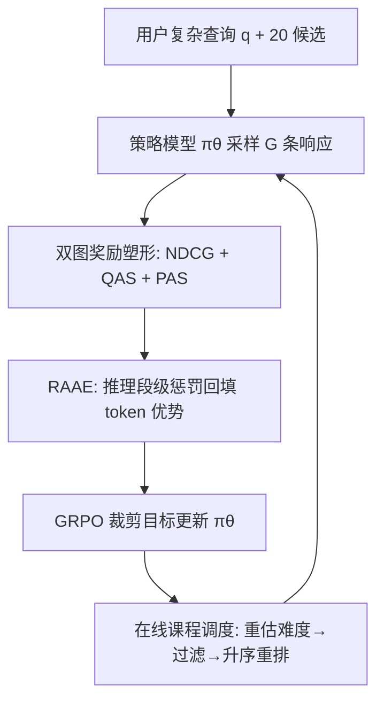
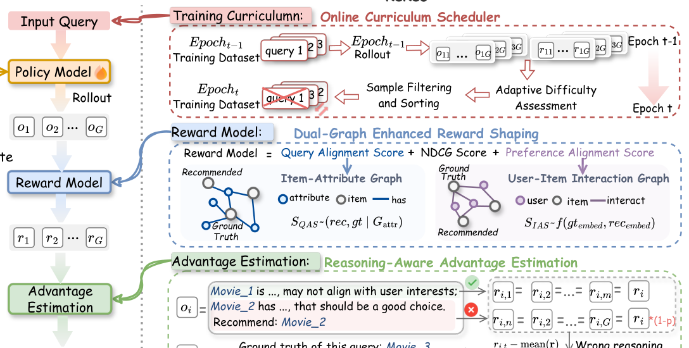

# ReRec: Reasoning-Augmented LLM-based Recommendation Assistant via Reinforcement Fine-tuning (基于强化微调的推理增强大模型推荐助手)

- **会议/期刊**: ACL 2026
- **作者与机构**: Jiani Huang, Shijie Wang, Liangbo Ning, Wenqi Fan, Qing Li（香港理工大学）
- **推荐链路定位**: 端到端生成式（LLM 直接输出推理链 + 推荐项）
- **研究方向**: 大语言模型推荐 / 对话推荐与智能体
- **论文原文**: [https://arxiv.org/abs/2604.07851v1](https://arxiv.org/abs/2604.07851v1)
- **开源代码**: [https://github.com/jiani-huang/ReRec](https://github.com/jiani-huang/ReRec)

## TL;DR (1分钟核心速览)

针对复杂自然语言查询（多跳、隐式条件、错误信息纠正）下 LLM 推荐助手多步推理能力不足的问题，本文提出 ReRec 强化微调框架：用**双图增强奖励塑形**（NDCG + 查询对齐分 QAS + 偏好对齐分 PAS）解决 NDCG 奖励过于稀疏的问题，用**推理感知优势估计**对错误推理段做 token 级惩罚，用**在线课程调度**按模型当前能力动态排序样本。在 RecBench+ 的 1 正 19 负候选排序协议下，Llama-3.2-3B 骨干在 Movie 域 Hard 子类从 0.644 提升至 0.729（+13.2%），且通用推理能力反升 21.6%。

## Background & Motivation (背景与核心矛盾)

- **主流范式**: 传统 MF/GNN 无法理解自然语言查询；LLM 推荐助手（TallRec、InteRecAgent、CRAG 等）多面向"推荐一部科幻片"这类简单模板化对话，仅需浅层属性匹配。
- **前人局限**: ① 现有 CRS 基准查询推理深度浅，模型在"先识别电影→再定位主演→再推荐同主演作品"的多跳链路上失效；② 直接把 RFT（GRPO 类）搬到推荐上，奖励仅用 NDCG@K，与 ground-truth 不完全匹配但满足查询约束的合理推荐同样得 0 分，奖励极度稀疏，探索效率低。
- **核心洞察 (Key Insight)**: 推荐任务的"正确性"是**多粒度**的——满足查询约束（genre/actor）与符合协同偏好（相似用户共现）都应被视为部分正确；同时推理链的中间步骤质量与最终答案质量应当解耦监督。
- **本文切入点**: 在 RFT 框架内同时改造**奖励信号**（稠密化）、**优势分配**（token 级细粒度化）与**训练调度**（动态课程化）三个环节。

## Method (核心方法设计)

### 1. 整体框架 (Overall Architecture)

给定查询 $q$与候选列表，策略模型$\pi_\theta$采样$G$条含推理链与 `\boxed{}` 最终答案的响应；奖励模型对每条响应计算塑形奖励$r_i$，RAAE 将奖励按推理段回填到 token 级并归一化为优势$A_{i,t}$，代入 GRPO 式裁剪目标更新策略；每个 epoch 结束后，课程调度器依据上一轮 rollout 的平均逆奖励重估样本难度，过滤已掌握样本并按难度升序重排训练集。整个流程无需额外过程奖励模型或人工标注，仅复用已有 rollout 数据。

<figure class="paper-figure" markdown="span">
  <figcaption>图2：所提出的ReRec的整体模型架构。</figcaption>
</figure>

### 2. 关键设计拆解 (Key Designs)

1. **双图增强奖励塑形 (Dual-Graph Enhanced Reward Shaping)**：痛点在于 NDCG 只认精确匹配，合理替代品与完全无关项同得 0 分。本文在物品-属性图上定义查询对齐分 $S_{\text{QAS}}(p_i,gt)=\frac{|\mathcal{R}^{G_{attr}}_{p_i}\cap\mathcal{R}^{G_{attr}}_{gt}|}{|\mathcal{R}^{G_{attr}}_{gt}|}$，在用户-物品交互图上用预训练 LightGCN 嵌入的余弦相似度定义偏好对齐分$S_{\text{PAS}}$，最终$r_i=\text{NDCG}+w_1 S_{\text{QAS}}+w_2 S_{\text{PAS}}$。直觉：前者奖励"满足硬约束的替代品"，后者奖励"协同信号上像正样本的替代品"，把零奖励的荒漠变成有梯度的地形。

2. **推理感知优势估计 (RAAE)**：GRPO 给整条响应同一优势，模型无法区分哪一步推理错了。本文将输出按段落切分为 $K$个推理段$S_i=\{s_{i,1},\dots,s_{i,K}\}$，若某段讨论了最终被推荐但非 ground-truth 的物品，则该段奖励打折：$r_{s_{i,k}}=(1-w_{penalty})\cdot r_i$（当$p_i\neq gt$且$p_i\in s_{i,k}$），否则保持$r_i$；再映射到 token 并做组内标准化$A_{i,t}=\frac{r_{i,t}-\text{mean}(r)}{\text{std}(r)}$。直觉：错误推理段被"连坐"降权，正确段保留高优势，形成段内对比梯度。

3. **在线课程调度与训练目标**：早期复杂查询全零奖励导致学不动。调度器用上一轮平均逆奖励 $d_{t-1}=\frac{1}{G}\sum_i(1-r_i)$度量难度，过滤$d_{t-1}<\tau$的已掌握样本，其余按难度升序组成新 epoch 数据。总目标即 GRPO 裁剪目标$\mathcal{J}(\theta)=\mathbb{E}\big[\frac{1}{N}\sum_i\sum_t\min(h_{i,t}(\theta)A_{i,t},\text{clip}(h_{i,t},1-\epsilon,1+\epsilon)A_{i,t})\big]$，其中$h_{i,t}=\pi_\theta/\pi_{\theta_{old}}$。负采样为候选池内 1 正 19 负（非 in-batch），推理时单次前向即可，无额外开销。

## Experimental Setup & Evaluation Protocol (实验设置与评估协议)

- **数据集与预处理**: RecBench+，按查询类别分布采样，训练/测试各 10,000 / 12,000 条查询，Movie 与 Book 两域独立训练。

| 数据集 | #Users | #Items | #Interactions | 稀疏度/密度 | 特征/场景说明 |
| :--- | :---: | :---: | :---: | :---: | :--- |
| RecBench+ Movie | 未披露 | 未披露 | 22,000 查询 | — | 显式/隐式/误导条件 + 兴趣/人口统计五类 |
| RecBench+ Book | 未披露 | 未披露 | 27,585 查询 | — | 四类（无人口统计类） |

- **数据划分与防穿越 (Splitting Strategy)**: 按查询类别分层采样划分训练/测试集（非时间切分）；RQ2 个性化实验显式选用训练集中未出现的条件类查询，避免泄漏。
- **排名评测协议 (Ranking Protocol)**: `Sampled Ranking`，每查询 1 正 + 19 随机负，指标为 Accuracy（选中正样本比例）；RQ2 额外构造 3 个满足查询条件但非正样本的 hard negative。
- **对比基线与超参设置**: 三类基线——LLM 骨干（Qwen-2.5-3B、Llama-3.2-3B、DS-R1-Distill-Qwen-7B、GPT-4o、DeepSeek-R1）、LLM-based CRS（TallRec、InteRecAgent、CRAG）、RFT 方法（GRPO、REINFORCE++、RLOO）。学习率 5e-6，group size 5，最大响应长度 768，$w_{penalty}=0.3$，$w_1=w_2=0.01$，$\tau=0.1$，KL 系数 0.01，clip$\epsilon=0.2$。

## Key Experimental Results (实验关键数据)

### 1. 主实验对比 (Main Results)

Llama-3.2-3B-Instruct 骨干，Accuracy（bold 为最优）：

| 模型 | Movie-Simple | Movie-Medium | Movie-Hard | Movie-Interest | Book-Simple | Book-Medium | Book-Hard | Book-Interest |
| :--- | :---: | :---: | :---: | :---: | :---: | :---: | :---: | :---: |
| GPT-4o | 0.554 | 0.519 | 0.188 | 0.550 | 0.554 | 0.590 | 0.160 | 0.458 |
| DeepSeek-R1 | 0.537 | 0.510 | 0.200 | 0.459 | 0.562 | 0.530 | 0.279 | 0.505 |
| TallRec | 0.537 | 0.533 | 0.284 | 0.571 | 0.563 | 0.591 | 0.251 | 0.477 |
| CRAG | 0.560 | 0.531 | 0.195 | 0.557 | 0.560 | 0.592 | 0.211 | 0.518 |
| GRPO | 0.686 | 0.600 | 0.644 | 0.651 | 0.664 | 0.757 | 0.713 | 0.786 |
| REINFORCE++ | 0.699 | 0.623 | 0.597 | 0.676 | 0.661 | 0.768 | 0.697 | 0.795 |
| RLOO | 0.693 | 0.609 | 0.614 | 0.627 | 0.660 | 0.774 | 0.704 | 0.794 |
| **ReRec** | **0.748** | **0.700** | **0.729** | **0.719** | **0.671** | **0.782** | **0.750** | **0.811** |
| Improv. (vs 次优) | +7.0% | +12.4% | +13.2% | +6.4% | +1.1% | +1.0% | +5.2% | +2.0% |

Qwen-2.5-3B 骨干上 ReRec 同样全面领先（Movie-Hard 0.547 vs RLOO 0.529；Book-Interest 0.746 vs 0.716），但 Book-Simple 略低于 RLOO（0.555 vs 0.567），说明小骨干在简单任务上收益不稳定。

### 2. 消融实验 (Ablation Study)

| 配置 | 性能趋势 | 说明 |
| :--- | :---: | :--- |
| ReRec (full) | 最高 | 三模块齐备 |
| w/o RAAE | 下降最大 | 推理段监督是核心增益来源 |
| w/o 双图奖励塑形 | 次大下降 | 稀疏奖励导致探索不足 |
| w/o 课程调度 | 小幅下降 | 主要影响收敛稳定性 |

### 3. 关键实验发现 (Key Findings)

1. **推理监督 > 奖励稠密化 > 课程调度**：消融中移除 RAAE 掉点最多，说明"哪一步推理错了"的段级信号比"答案对不对"的标量信号更关键；$w_{penalty}$ 在 0.3 处达峰，过大惩罚反而损害最终性能，印证"惩罚需保留正确段优势"的设计直觉。
2. **复杂查询收益远大于简单查询**：Movie-Hard 上 ReRec 相对未训练 Llama 提升 440%（0.729 vs 0.029 量级），而 Simple 类仅 +7%，说明 RFT 主要补的是多跳/纠错推理短板，而非基础属性匹配。
3. **RFT 优于 SFT 的能力保留性**：SFT 后 Reasoning 与 Knowledge 分别掉 15.7% 与 80%，而 ReRec 四维能力几乎无损且 Reasoning 反升 21.6%；跨域迁移（Movie→Book）Llama 骨干从 0.168 升至 0.494（+181%），跨任务迁移到序列推荐达 SASRec 的约 88%，证明学到的是可迁移的推理模式而非域内记忆。

## Highlights & Limitations (亮点、对比与审稿批判)

- **与代表作对比 (vs. Prior Work)**: 相比 TallRec/CRAG 等 SFT 式指令微调，ReRec 用 RFT 自探索避免灾难性遗忘；相比 GRPO/RLOO 等通用 RLVR 方法，本文的关键差异是把奖励从"单一 NDCG"扩展为"图结构上的多粒度对齐"，并把优势从"响应级"下沉到"推理段级"，这两点直接对应推荐任务的领域特性。
- **可迁移亮点**: ① 用预训练轻量 GNN（LightGCN）嵌入余弦相似度作为奖励的"软标签"，可低成本移植到任何 LLM 排序/生成任务的奖励设计中；② 用上一轮 rollout 平均逆奖励做难度估计的在线课程，无需额外模型，适合任何 RLVR 训练管线。
- **审稿级局限批判**: ① 评测仅为 1 正 19 负的 Sampled Ranking + Accuracy，未报告 NDCG@K 或 Full-Ranking，且负样本随机采样会高估绝对精度，与真实全库排序场景存在差距；② 仅支持单轮查询，多轮对话与上下文累积未覆盖（作者自述）；③ 双图奖励依赖物品-属性图与交互图的构建质量，冷启动物品属性缺失时 QAS/PAS 会退化，论文未做该鲁棒性分析。

## Rating (四维评分)

- **方法创新性 (Novelty)**: ⭐⭐⭐⭐ （奖励塑形与段级优势估计的组合针对推荐任务特性做了实质性改造，但各组件单独看均为已有思想的领域适配）
- **评估协议与实验扎实度 (Protocol & Experiments)**: ⭐⭐⭐ （双域五类查询 + 跨域/跨任务/能力保留实验较全面，但 Sampled Ranking 协议偏弱、缺 Full-Ranking 与显著性检验）
- **写作与数学规范度 (Clarity & Rigor)**: ⭐⭐⭐⭐ （三模块公式定义清晰、超参与实现细节完整，RAAE 的段切分与奖励回填逻辑表述严谨）
- **工业落地与复现价值 (Industrial & Practical Value)**: ⭐⭐⭐⭐ （代码开源、仅需 3B 骨干与 2×H20、无额外过程奖励模型，推理单次前向，落地成本可控）
