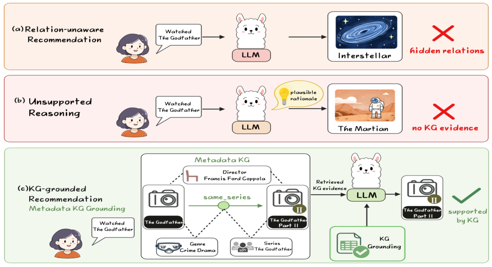
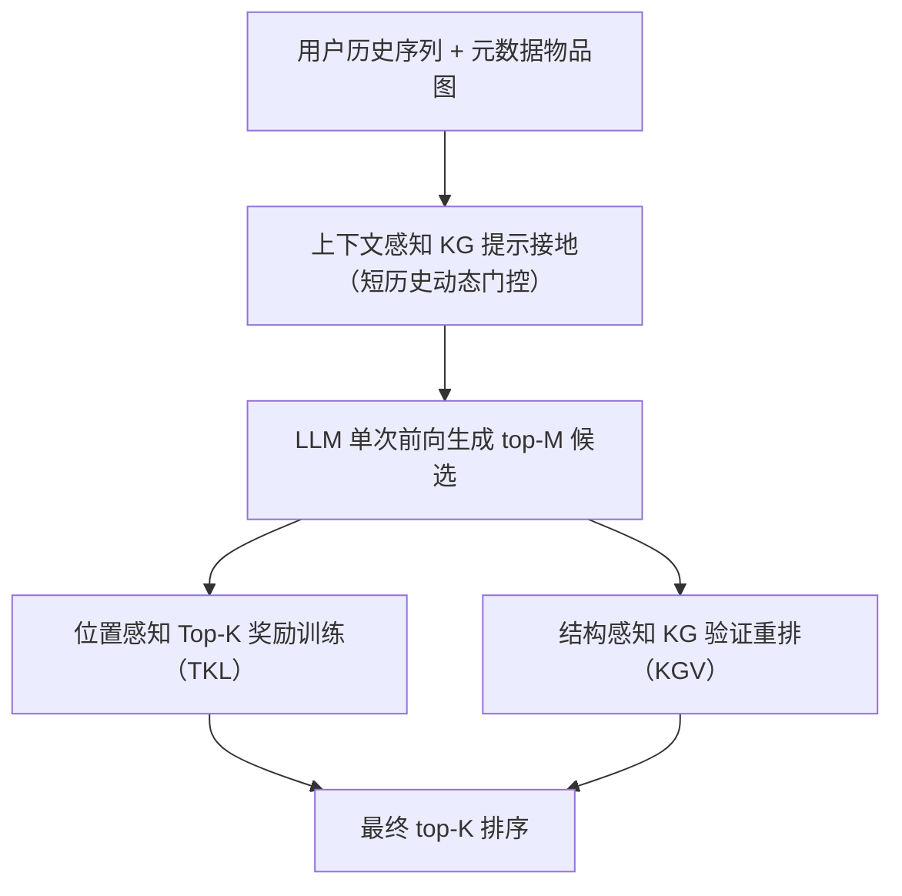
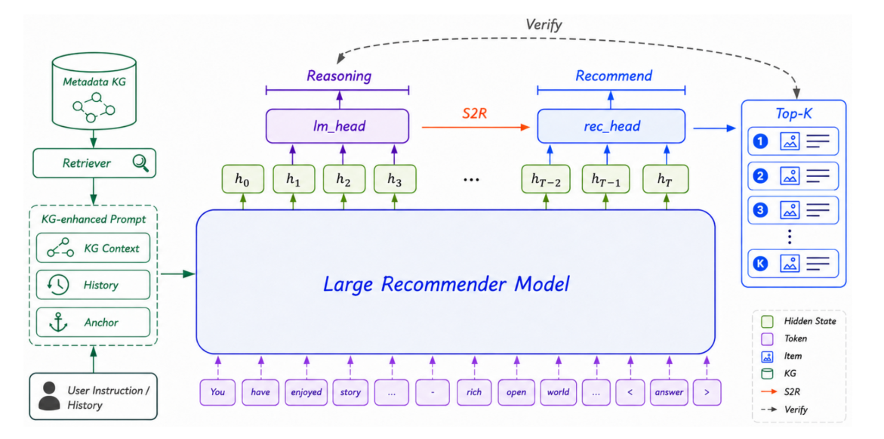

# TATK: Triple-Aware Top-K Learning with Knowledge-Grounded Verification for LLM-based Sequential Recommendation (三重感知 Top-K 学习与知识接地验证的 LLM 序列推荐)

- **会议/期刊**: EMNLP 2026 Main Conference
- **作者与机构**: Yuchen Guan, Jiaye Liu, Yifei Han, Zhenxi Zhang, Yixuan Weng, Bin Li（华东理工大学 / 中科院深圳先进院 / 西湖大学等）
- **推荐链路定位**: 端到端生成式（单次前向生成 + 轻量重排）
- **研究方向**: 大语言模型推荐 / 序列推荐
- **论文原文**: [https://arxiv.org/abs/2609.14565v1](https://arxiv.org/abs/2609.14565v1)
- **开源代码**: [https://github.com/conor1020/TATK](https://github.com/conor1020/TATK)

## TL;DR (1分钟核心速览)

LLM 序列推荐把 next-item 预测写成文本生成，但生成接口与全库 top-K 排序存在三处错配：输入缺乏结构接地、token 级似然与排序指标不对齐、生成候选缺乏验证。TATK 用同一张元数据物品图（store/category/main-category）贯穿三处：提示侧结构接地、位置感知 Top-K 奖励、推理期对 top-M 候选做图支撑重排（不增加 LLM 前向）。在 Amazon Reviews 2023 三个类目、Gemma-2-2B 与 Qwen2.5-3B 双骨干、R2ec 式全库排序协议下，36 项指标全部优于匹配复现的 R2ec，NDCG@10 最高提升 27.03%，延迟仅 1.17×。

## Background & Motivation (背景与核心矛盾)

- **主流范式**: P5/TALLRec/BIGRec/LLaRA 等把推荐输入输出都语言化；R2ec、LatentR3、Reason4Rec 进一步引入显式或隐式推理链来提升排序。
- **前人局限**: ① 纯标题历史无法显式表达同店/同类/同主类等结构关系，输入接地弱；② token 级似然对所有 token 一视同仁，而 HitRate@K/NDCG@K 只关心目标是否落在列表顶端；③ 生成出 top-M 候选后，现有方法要么直接信任语言分数，要么追加多步推理，前者无验证、后者把排序收益绑定在更长解码上。
- **核心洞察 (Key Insight)**: 商品域中有用证据本就藏在元数据关系里，问题不是"LLM 能否想得更久"，而是"轻量结构证据能否在 top-K 决策的三个关键点上分别接地、训练与验证"。
- **本文切入点**: 复用同一张元数据导出图，在输入、训练、推理三处各用一次，且不引入外部 KG 对齐、CoT 监督或额外 LLM 前向。

<figure class="paper-figure" markdown="span">
  <figcaption>图1：TATK所解决的三种不匹配问题的动机示意图。该示例为示意性说明：物品结构可以提供纯标题历史中未明确表达的证据。</figcaption>
</figure>

## Method (核心方法设计)

### 1. 整体框架 (Overall Architecture)

TATK 由训练期 Top-K Learning (TKL) 与推理期 Knowledge-Grounded Verification (KGV) 两段组成，共享一张由 store/category/main-category 三类边（先验强度递减）构成的物品图 $\mathcal{G}=(\mathcal{I},\mathcal{E})$。提示构建阶段，对历史中近期锚点检索结构邻居并序列化为紧凑自然语言上下文；训练阶段，在 S2R 流程中注入位置感知 top-K 奖励，与 token 级损失、item 级推荐损失联合优化；推理阶段，LLM 单次前向产出 top-M 候选后，用缓存的图支撑分对候选做结构感知重排。整体设计目标是在不把推荐变成多步推理流程的前提下补上结构接地。

<figure class="paper-figure" markdown="span">
  <figcaption>图2：TATK概览。由元数据导出的物品图支持上下文感知的提示接地、位置感知训练和结构感知的top-M KG验证。最终验证步骤使用同一单次生成器设置下的候选池和缓存的图支持，无需额外的LLM前向传播。</figcaption>
</figure>

### 2. 关键设计拆解 (Key Designs)

1. **上下文感知 KG 接地 + 动态门控**：纯标题历史丢失同店/同类证据 $\to$ 对近期锚点检索结构邻居并写入提示；但短历史锚点太少、证据不可靠，故设历史长度阈值，低于阈值直接跳过 KG 注入。消融显示"接地 + 位置奖励但不加门控"反而弱于单模块（平均 N@10 0.0321 vs 0.0338/0.0334），说明结构证据必须选择性使用。

2. **位置感知 Top-K 奖励**：token 似然与排序效用错配 $\to$ 定义单调位置奖励
$$r_{\text{pos}}(r)=\begin{cases}(K-r+1)/K, & r\le K,\\ 0, & r>K,\end{cases}$$
在 batch/rollout 组内中心化形成相对优势，再与 token 级学习、item 级推荐损失耦合。关键不在线性形式本身，而在于把 item 级排序效用接进 S2R 训练管线；奖励形状消融表明"是否位置敏感"远比"用哪种折扣"重要。

3. **结构感知 KG 验证重排与推理开销**：生成候选缺乏验证 $\to$对候选$c$与历史$\mathcal{H}_u$ 计算最强关系支撑与重复支撑计数：
$$m(c,\mathcal{H}_u)=\max_{h\in\mathcal{H}_u}w(c,h),\quad \text{raw}(c,\mathcal{H}_u)=\min\big(\gamma,\,m(c,\mathcal{H}_u)+\beta n(c,\mathcal{H}_u)\big),$$
在 top-M 内归一化并按分数值域缩放得 $b_{\text{KG}}$，最终$s'(u,c)=s_{\text{gen}}(u,c)+\lambda b_{\text{KG}}(c,\mathcal{H}_u)$。仅作用于 top-M，故不增加 LLM 前向；额外复杂度约$O(M|\mathcal{H}_u|)$，且每个升/降序候选都可追溯到具体 store/category 证据。主实验取$M=100,\gamma=2.5,\beta=0.15,\lambda=0.01$，并对历史长度、支撑存在性、分数带与不确定性设门控。

## Experimental Setup & Evaluation Protocol (实验设置与评估协议)

- **数据集与预处理**: Amazon Reviews 2023 三个类目，沿用 R2ec 式预处理与时序切分；图仅用数据集自带元数据字段，category/main-category 组上限 350 项以抑制高度数噪声。

| 数据集 | #Users | #Items | #Interactions | 密度 | 特征/场景说明 |
| :--- | :---: | :---: | :---: | :---: | :--- |
| Musical Instruments (MI) | 9,411 | 10,321 | 34,373 | 0.0004 | store/category/main 元数据图 |
| CDs and Vinyl (CDs) | 3,549 | 12,025 | 13,435 | 0.0003 | 同上 |
| Video Games (VG) | 18,305 | 10,145 | 63,502 | 0.0003 | 同上 |

- **数据划分与防穿越 (Splitting Strategy)**: 时序切分，每用户早期交互为历史、留出下一项为目标（R2ec 式协议）。
- **排名评测协议 (Ranking Protocol)**: 无偏 `Full-Ranking`，目标项对全量物品目录排序，而非采样负例；指标 HitRate@5/10/20 与 NDCG@5/10/20。
- **对比基线与超参设置**: 传统序列（GRU4Rec/Caser/SASRec）、生成式（TIGER/BIGRec/D3）、KG 增强（K-RagRec†）、推理增强（LatentR3/Reason4Rec†/R2ec）、偏好对齐（S-DPO/LLaRA/SPRec/LangPTune）。骨干为 Gemma-2-2B-It 与 Qwen2.5-3B-Instruct；LoRA rank 4、alpha 128、lr $10^{-5}$、3 epoch、batch 4、group size 4；主对比 5 个随机种子（42/123/256/512/1024）并做配对检验，消融为 3 种子诊断重跑。† 表示在匹配的"仅元数据"资源约束下适配复现，可能低估其原配置能力。

## Key Experimental Results (实验关键数据)

### 1. 主实验对比 (Main Results)

Gemma-2-2B-It 骨干（NDCG@10，5 种子均值）：

| 方法 | MI N@10 | CDs N@10 | VG N@10 |
| :--- | :---: | :---: | :---: |
| SASRec | 0.0162 | 0.0119 | 0.0105 |
| TIGER | 0.0132 | 0.0055 | 0.0116 |
| BIGRec | 0.0058 | 0.0037 | 0.0138 |
| LatentR3 | 0.0084 | 0.0168 | 0.0166 |
| K-RagRec† | 0.0098 | 0.0189 | 0.0182 |
| Reason4Rec† | 0.0108 | 0.0204 | 0.0194 |
| LangPTune | 0.0107 | 0.0274 | 0.0059 |
| R2ec | 0.0203 | 0.0472 | 0.0271 |
| **TATK** | **0.0258** | **0.0522** | **0.0299** |
| Improv.% | +27.03% | +10.52% | +10.23% |

Qwen2.5-3B-Instruct 骨干：TATK 在 MI/CDs/VG 的 N@10 为 0.0214/0.0432/0.0274，相对 R2ec（0.0198/0.0414/0.0264）提升 +8.05%/+4.26%/+3.78%；H@5 提升达 +15.26%/+11.28%/+10.64%。配对检验显示 6 组 N@10 差值全为正，5 组显著（$p<0.05$），仅 Qwen-VG 的 95% CI 跨零（$p=0.1841$）。

### 2. 消融实验 (Ablation Study)

Gemma 三种子诊断，平均 NDCG@10：

| 变体 | Avg. N@10 | $\Delta$ |
| :--- | :---: | :---: |
| Base RecPO | 0.0317 | 0.0000 |
| 仅上下文接地 (C) | 0.0338 | +0.0021 |
| 仅位置奖励 (P) | 0.0334 | +0.0017 |
| 仅结构重排 (S) | 0.0329 | +0.0012 |
| C + P（无门控） | 0.0321 | +0.0004 |
| TATK-TKL = C+P+门控 | 0.0346 | +0.0029 |
| **Full TATK = TKL + KGV** | **0.0358** | **+0.0041** |

奖励形状：Binary 0.0339、Linear 0.0358、Log-discount 0.0354、NDCG-shaped 0.0359，形状族内差异小于一个种子标准差。

### 3. 关键实验发现 (Key Findings)

1. **两阶段互补而非冗余**：TKL 单独贡献 +0.0029 平均 N@10，KGV 再叠加 +0.0012；且"接地 + 位置奖励但不加门控"仅 +0.0004，说明提示侧结构扩张与更锐利的 top-K 监督会放大噪声锚点，动态门控是必要安全阀。
2. **重排只"捞回"边界候选**：重排后 75.3% 目标上移（46.8% 升 1–9 位、28.5% 升 10–49 位），16.0% 目标被转为 Hit@10，KG 支撑与排名改善正相关（$r=0.25$）；11–20 桶有 268 例进入 top-5，证明 KGV 是验证器而非第二路全库召回。
3. **结构证据有质量边界**：加入共交互边把候选覆盖率从 7.93% 提到 14.19%，但 N@10 反从 0.0208 降到 0.0201；删除 50%/75% 元数据关系后 N@10 降至 0.0346/0.0334（仍高于 Base 0.0317），呈渐进退化。序列扰动下 TATK 的 NDCG@10 跌幅小于 Base RecPO（shuffle 15.2% vs 20.9%，drop-last 18.6% vs 24.4%），说明它仍是序列模型而非元数据捷径。

## Highlights & Limitations (亮点、对比与审稿批判)

- **与代表作对比 (vs. Prior Work)**: 相比 R2ec/LatentR3/Reason4Rec 靠加长推理链换排序，TATK 把额外算力挪到确定性图打分上，解码预算几乎不变（490 ms vs 420 ms/user，显存 15.0 vs 14.8 GB）；相比 K-RagRec 依赖外部 Freebase 对齐，TATK 只用数据集自带元数据，部署门槛低得多。
- **可迁移亮点**: ① "同一张图三处复用"（提示/奖励/重排）的范式可直接搬到电商、短视频等有类目体系的场景；② 位置感知奖励 $r_{\text{pos}}$ 可作为任意生成式推荐的轻量 RL 奖励塑形插件。
- **审稿级局限批判**: ① 收益强依赖元数据可用性与精度，长尾缺字段物品与稀疏/噪声关系下增益会衰减，关系权重与门控阈值仍靠开发集人工诊断而非自适应学习；② 主对比仅 5 种子、消融仅 3 种子，Qwen-VG 显著性不足；且仅离线全库排序，MovieLens-1M 只是初步可移植性检查，未测多样性、公平性与线上业务指标，KGV 还需维护图缓存与 top-M 打分，端到端延迟受服务设施影响。

## Rating (四维评分)

- **方法创新性 (Novelty)**: ⭐⭐⭐⭐ （"一图三用"的框架级整合有新意，但单点组件——元数据图、位置奖励、图支撑重排——均属已有思想的组合，理论分析偏经验）
- **评估协议与实验扎实度 (Protocol & Experiments)**: ⭐⭐⭐⭐ （全库排序 + 双骨干 + 5 种子配对检验 + 扰动/关系质量/候选池多维诊断很完整，扣分在消融仅 3 种子与 Qwen-VG 不显著）
- **写作与数学规范度 (Clarity & Rigor)**: ⭐⭐⭐⭐ （三处错配的动机链条清晰，公式简洁可复现，复杂度分析到位；奖励形状与门控的超参敏感性主要放在附录）
- **工业落地与复现价值 (Industrial & Practical Value)**: ⭐⭐⭐⭐ （仅用自带元数据、无外部 KG 对齐、延迟 1.17×、代码已开源，工程友好；但需维护图缓存，且元数据质量差的目录收益有限）
