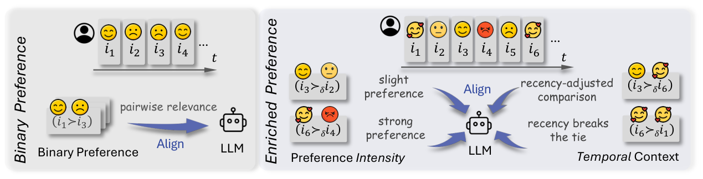
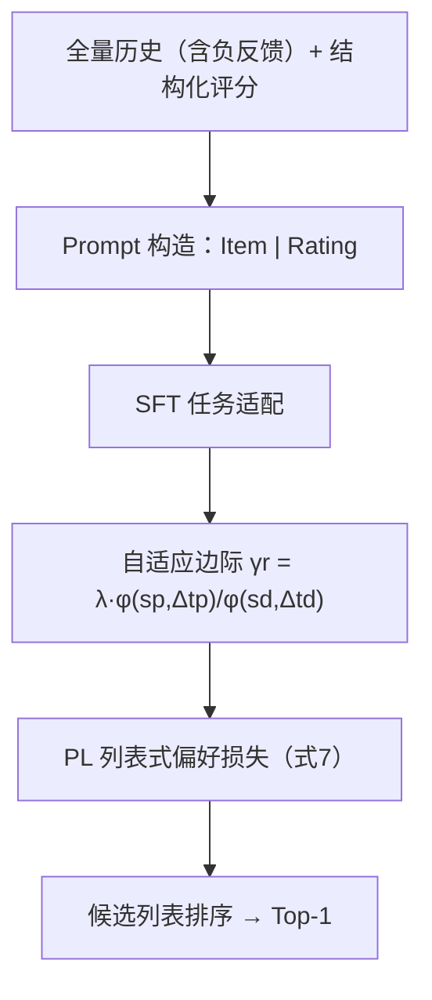

# What Makes LLMs Effective Sequential Recommenders? A Study on Preference Intensity and Temporal Context (什么让 LLM 成为有效的序列推荐器？偏好强度与时序上下文研究)

- **会议/期刊**: ACL 2026
- **作者与机构**: Zhongyu Ouyang, Qianlong Wen, Chunhui Zhang, Yanfang Ye, Soroush Vosoughi (Dartmouth College / ByteDance US / University of Notre Dame)
- **推荐链路定位**: 精排（LLM 列表级打分/生成式候选选择）
- **研究方向**: 大语言模型推荐 / 序列推荐
- **论文原文**: [https://arxiv.org/abs/2506.02261v3](https://arxiv.org/abs/2506.02261v3)
- **开源代码**: [https://github.com/zyouyang/RecPO](https://github.com/zyouyang/RecPO)

## TL;DR (1分钟核心速览)

现有 LLM 序列推荐普遍沿用 DPO/S-DPO 的**二元成对偏好**抽象，把"强喜爱"与"轻微喜欢"、把"上周交互"与"半年前交互"一视同仁，丢弃了偏好强度与时序上下文两类关键信号。作者先用受控实验证明：保留负反馈并附上评分等结构化信号，Hit@1 显著提升；据此提出 RecPO，将显式/隐式反馈统一映射为偏好分数，构造同时依赖偏好强度与交互新近度的**自适应奖励边际** $\gamma_r$，嵌入 Plackett-Luce 列表式偏好目标。在 5 个数据集、LLaMA3-8B 与 Qwen-7B 双骨干上，20 候选 Full-Ranking 协议下 HR@1 相对 S-DPO 最高提升约 19%（Amazon-Books 0.5065→0.5802），且$\lambda=0$ 时严格退化为 S-DPO。

## Background & Motivation (背景与核心矛盾)

- **主流范式**: LLM 序列推荐采用"SFT 任务适配 + 偏好对齐"两阶段范式，对齐阶段以 DPO 及其变体（SimPO、S-DPO）为主，S-DPO 进一步把单个正例与多个负例组成列表式偏好对。
- **前人局限**: 其一，二元 Bradley-Terry 假设抹平了偏好的**结构化强度**（5 星 vs 3 星被压成同一个"正例"）；其二，所有历史交互被赋予相同权重，忽视**新近度**——同样强度的交互，越靠近当前决策点越应主导预测。此外，S-DPO 类方法直接过滤掉负反馈，使模型无法学习"厌恶"信号。
- **核心洞察 (Key Insight)**: 图 2 的受控实验给出清晰结论：仅保留全量交互（含负例）而无评分标注时，性能反而低于过滤版（未标注负例坍缩为噪声）；只有"全量交互 + 结构化评分"同时具备才取得最优。这说明**综合性与结构化二者缺一不可**，而现有方法两者皆丢。
- **本文切入点**: 不改变 LLM 架构，只改偏好对齐的**奖励边际**——用偏好分数与新近度构造逐对自适应的 $\gamma_r$，把被二元化压掉的信息重新注入损失函数。

<figure class="paper-figure" markdown="span">
  <figcaption>图3：二元偏好与丰富偏好下偏好学习框架的示意图：前者假设偏好为二元区分，后者则用偏好强度和时间上下文丰富偏好区分（δ表示丰富化）。</figcaption>
</figure>

## Method (核心方法设计)

### 1. 整体框架 (Overall Architecture)

输入侧不再过滤负反馈：用户历史中每个物品格式化为 `[ItemTitle] | Rating: [ItemRating]`，显式评分直接使用，隐式反馈（Steam 游玩时长、LastFM 播放次数）经分桶转为结构化分数；候选集内物品不带偏好属性。模型先做 SFT 任务适配，再以 RecPO 目标做偏好对齐：对每个"正例 + 多个负例"的候选列表，用偏好分数与新近度算出逐对边际 $\gamma_r$，代入 Plackett-Luce 列表式似然得到最终损失。推理时给定历史与 20 个候选，模型输出排序，取 Top-1 作为推荐。

### 2. 关键设计拆解 (Key Designs)

1. **自适应奖励边际 (Adaptive Reward Margin)**：痛点是把所有偏好对施加同一边际，无法区分"强烈偏好"与"微弱偏好"。RecPO 定义 $\gamma_r=\lambda\,\phi(s_p,\Delta t_p)/\phi(s_d,\Delta t_d)$，其中$s$为结构化偏好分数、$\Delta t$为交互到当前决策点的时间距离，实例化为$\phi(s,\Delta t)=s/(\Delta t)^{0.5}$。直觉上，正例越强、越新，负例越弱、越旧，边际越大，模型被推着把这对偏好拉得更开；反之边际收缩，避免对噪声对过度惩罚。作者还验证了$\phi\propto s/(\Delta t)^{\alpha}$（$\alpha>0$）的通用族兼容性。

2. **PL 列表式偏好目标**：将边际注入 Bradley-Terry 得 $P^*(y_p\succ y_d|x)=\sigma(r(x,y_p)-r(x,y_d)-\gamma_r)$，再用 Plackett-Luce 把成对比较推广到$K$ 个候选的整表排序，最终损失为
$$\mathcal{L}=-\mathbb{E}\Big[\log\sigma\Big(-\log\!\!\sum_{y_d\in T_d}\exp\big(\beta\log\tfrac{\pi_\theta(y_d|x)}{\pi_{\text{ref}}(y_d|x)}-\beta\log\tfrac{\pi_\theta(y_p|x)}{\pi_{\text{ref}}(y_p|x)}-\lambda\tfrac{\phi(s_p,\Delta t_p)}{\phi(s_d,\Delta t_d)}\big)\Big)\Big].$$
关键性质：$\lambda=0$ 时严格退化为 S-DPO，因此 RecPO 是 S-DPO 的**严格泛化**，增益可完全归因于边际项。

3. **训练目标、负采样与推理效率**：训练候选集含 10 个后续交互（保证正例在内）+ 10 个随机采样未交互物品；验证/测试为 1 正 + 19 随机负。无显式反馈的负例赋默认偏好分数与时间延迟。推理仅需一次前向打分 20 个候选，开销与 S-DPO 同阶，无额外检索或重排模块。

## Experimental Setup & Evaluation Protocol (实验设置与评估协议)

- **数据集与预处理**: 五个数据集统一 `5-core` 过滤，按时间戳排序：

| 数据集 | 反馈类型 | 结构化信号 | 场景说明 |
| :--- | :---: | :---: | :--- |
| MovieLens-1M | 显式 | 1–5 星评分 | 电影 |
| Amazon-Books | 显式 | 评分 | 图书 |
| BeerAdvocate | 显式 | 评分 | 啤酒评论 |
| Steam | 隐式 | 游玩时长（代理） | 游戏 |
| LastFM | 隐式 | 播放次数（代理） | 音乐 |

- **数据划分与防穿越 (Splitting Strategy)**: 逐用户按时间排序，**倒数第二个交互作验证、最后一个作测试**，其余训练（等价 Leave-Last-Out），严格防穿越。
- **排名评测协议 (Ranking Protocol)**: **Sampled Ranking**——测试候选为 1 个 ground-truth + 19 个随机未交互物品（20 选 1），报告 Hit Ratio@1；同时报告 **Valid Ratio** 衡量输出是否落在候选集内且格式合规（指令遵循度）。
- **对比基线与超参设置**: 传统方法 GRU4Rec / Caser / SASRec；LLM 方法在 LLaMA3-8B 与 Qwen-7B 双骨干上对比 SFT / DPO / SimPO / S-DPO。默认 $\lambda=2$、$\beta$ 沿用 DPO 设定，8×A100-80G 训练。

## Key Experimental Results (实验关键数据)

### 1. 主实验对比 (Main Results)

LLaMA3-8B 骨干，HR@1（Valid Ratio 括号内省略，正文讨论）：

| 方法 | MovieLens | Amazon-Books | BeerAdvocate | Steam | LastFM |
| :--- | :---: | :---: | :---: | :---: | :---: |
| SASRec (传统最优) | 0.2671 | 0.1559 | 0.3800 | 0.4587 | 0.6659 |
| SFT | 0.2478 | 0.4447 | 0.2645 | 0.3122 | 0.5076 |
| DPO | 0.2809 | 0.5049 | 0.4412 | 0.3340 | 0.5719 |
| SimPO | 0.2974 | 0.5129 | 0.4020 | 0.3401 | 0.5759 |
| S-DPO | 0.2902 | 0.5065 | 0.4698 | 0.3588 | 0.5719 |
| **RecPO** | **0.3451** | **0.5802** | **0.5771** | **0.4672** | **0.6830** |
| Improv. vs S-DPO | +18.9% | +14.5% | +22.8% | +30.2% | +19.4% |

Qwen-7B 骨干上趋势一致（RecPO 0.3446 / 0.5307 / 0.4320 / 0.4143 / 0.5973），说明增益不依赖特定骨干。

### 2. 消融实验 (Ablation Study)

| 变体 | ML | AmazonB | Beer | Steam | LastFM |
| :--- | :---: | :---: | :---: | :---: | :---: |
| –I –T（= S-DPO） | 0.2902 | 0.5065 | 0.4698 | 0.3588 | 0.5719 |
| –T（仅偏好强度） | 0.3343 | 0.5661 | 0.6143* | 0.4202 | 0.6544 |
| **RecPO（强度+时序）** | **0.3451** | **0.5802** | 0.5771 | **0.4672** | **0.6830** |

边际函数形式消融（HR@1）：Log Diff / Log Ratio / 默认比值，在 LastFM 上分别为 0.5912 / 0.6388 / 0.6830，比值形式全面最优。

### 3. 关键实验发现 (Key Findings)

1. **偏好强度是主要增益来源，时序上下文是稳定器**：仅加偏好强度（–T）已在 4/5 数据集大幅超越 S-DPO（LastFM +14.4%），但 BeerAdvocate 上 Valid Ratio 跌至 0.9407，属不可部署区间；叠加时序项后 HR 略降（0.6143→0.5771）却把 Valid Ratio 拉回 0.9887，说明时序项在"精度—合规"间起正则化平衡作用，而非单纯涨点。
2. **比值型边际优于差值型**：Log Diff/Log Ratio 均超 S-DPO，但默认的 $\phi_p/\phi_d$比值在全部五个数据集最优，作者归因于除法在用户评分波动小（$\phi_p\approx\phi_d$）时仍能放大梯度，而差值型此时边际趋零、学习信号消失。
3. **行为层面与人类决策对齐**：在扩充候选的困难测试集上，RecPO 的 Adherence Rate（抵抗"未来高分但非当前所需"的诱惑）与 Avoidance Rate（抵抗"看似相关实则低分"的诱惑）均最高；无厌恶监督下直接问"最不喜欢的物品"，aversion accuracy 亦领先；BeerAdvocate 按历史长度分桶，HR@1 方差仅 8.7%（S-DPO 为 17.8%），长历史用户上优势更明显。

## Highlights & Limitations (亮点、对比与审稿批判)

- **与代表作对比 (vs. Prior Work)**: 与 S-DPO 的本质区别在于 S-DPO 过滤负反馈且施加统一边际，RecPO 保留全量交互并把边际变成逐对可变的 $\gamma_r$，$\lambda=0$ 可严格回退，属"可插拔的损失层改造"而非新架构；与 SimPO 相比，SimPO 靠固定边际+长度正则涨点但 Valid Ratio 明显下滑（0.9725/0.9564），RecPO 在精度与合规间更均衡；与传统 SASRec 相比，LLM 路线的优势在显式反馈数据集上尤为显著（Amazon-Books 0.1559→0.5802），隐式数据集上差距收窄，作者归因于代理信号同质化。
- **可迁移亮点**: 其一，"结构化分数 + 新近度衰减"构造自适应边际的思路可直接移植到任何 DPO 系变体（如把 $\phi$ 换成 CTR 预估值或停留时长）；其二，Valid Ratio 这一指令遵循指标值得在 LLM 推荐评测中推广，能暴露"精度涨但输出跑出候选集"的隐性退化。
- **审稿级局限批判**: 其一，评测为 20 候选 Sampled Ranking，与真实全库召回场景差距大，HR@1 绝对值不可直接外推，且未报告 NDCG/MRR 等排序质量指标；其二，时序项仅建模"满意度延迟"单一上下文，$\phi$的指数$\alpha=0.5$与$\lambda=2$均为人工设定，图 5 显示$\lambda>2$ 后 Valid Ratio 下滑，超参敏感度未在全部数据集验证；其三，隐式反馈的分数由时长/次数分桶代理，分桶策略对结果的影响缺乏消融。

## Rating (四维评分)

- **方法创新性 (Novelty)**: ⭐⭐⭐⭐ （不改架构只改损失边际，$\lambda=0$ 严格退化为 S-DPO 使增益归因干净，但本质是 DPO 边际的工程化重参数）
- **评估协议与实验扎实度 (Protocol & Experiments)**: ⭐⭐⭐ （五数据集双骨干+行为级探针实验丰富，但 20 候选采样排序偏弱、缺 NDCG 等指标、无全库排序与线上验证）
- **写作与数学规范度 (Clarity & Rigor)**: ⭐⭐⭐⭐ （从 BT 到 PL 的推导链条完整，$\phi$ 的通用族与边际函数对比消融到位，符号略密但可读）
- **工业落地与复现价值 (Industrial & Practical Value)**: ⭐⭐⭐⭐ （代码开源、推理开销与 S-DPO 同阶、可直接插到现有 LLM 推荐对齐管线，但依赖评分等结构化信号，隐式场景需设计代理分数）

