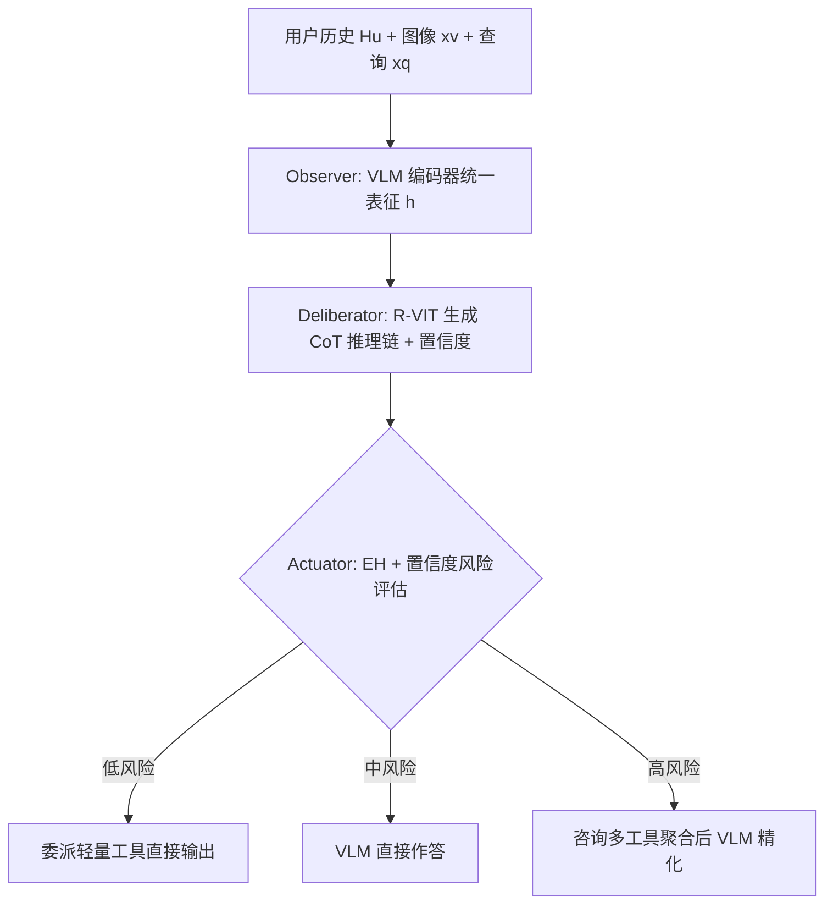

# ReasonRec: A Reasoning-Augmented Multimodal Agent for Unified Recommendation (面向统一推荐的理由增强多模态智能体)

- **会议/期刊**: ACL 2026 (第 64 届计算语言学协会年会)
- **作者与机构**: Yihua Zhang, Mingfu Liang, Jiyan Yang, Rong Jin, Xi Liu 等 (Meta AI; Michigan State University; UNC Chapel Hill)
- **推荐链路定位**: 重排 / 端到端生成式（VLM 推理打分 + 轻量模型委派）
- **研究方向**: 多模态推荐 / 大语言模型推荐
- **论文原文**: [https://arxiv.org/abs/2606.28357v1](https://arxiv.org/abs/2606.28357v1)
- **开源代码**: 暂未开源

## TL;DR (1分钟核心速览)

现有多模态推荐器擅长特征融合，却把"意图推断—语义评估—效用权衡"压缩成一次黑箱前向打分，既不可解释，也无法感知自身不确定性，更对所有查询一视同仁地消耗大模型算力。ReasonRec 将推荐重构为 **Observe → Deliberate → Act** 三阶段显式推理智能体：用推理感知视觉指令微调（R-VIT）把四类推荐任务统一为 CoT 视觉问答，用证据视界（Evidence Horizon, EH）课程学习渐进提升稀疏场景推理难度，再用不确定性引导委派把低风险查询交给轻量经典模型。在 5 个真实数据集、4 类任务上，HR@5/NDCG@5 相对 SOTA 多模态推荐器提升超 30%，同时将最多 35% 查询委派给子模型，推理延迟仅 499ms（VIP5 为 470ms）。

## Background & Motivation (背景与核心矛盾)

- **主流范式**: 以 P5/VIP5/UniMP 为代表的多模态生成式推荐，把用户历史、商品图文编码进 VLM/LLM 的 Transformer，端到端输出推荐结果或解释。
- **前人局限一（不可解释）**: 单次前向推理把多步决策坍缩为不透明打分，无法显式表达"为什么推荐"，在冷启动与跨域场景下鲁棒性差。
- **前人局限二（无自省、算力浪费）**: 单通道架构缺乏不确定性自诊断能力，无法在低置信时调用外部知识或轻量专家模型，只能对所有查询统一付出大模型推理成本。
- **核心洞察 (Key Insight)**: 推荐本质上是一个多步 deliberative 过程（推断意图 → 评估多模态相关性 → 权衡效用），因此应当用 CoT 显式建模，并让模型"知道自己不知道"，从而按风险分级分配算力。
- **本文切入点**: 构建 agentic VLM，把"显式推理 + 不确定性自评 + 动态工具委派"三者耦合进统一推荐框架。

## Method (核心方法设计)

### 1. 整体框架 (Overall Architecture)

输入为用户历史 $H_u$、候选物品图像$x_v$、查询文本$x_q$与元数据。**Observer** 用预训练 VLM 编码器生成统一表征$h=\mathrm{VLMEncoder}(x_v,x_q,H_u)$；**Deliberator** 通过 R-VIT 将任务转为 VQA 格式，自回归生成 `[Thought Tokens] → y` 的推理链，并在指令中注入 EH 分数以调节推理复杂度；**Actuator** 依据 EH 与模型置信度把查询分为低/中/高三档风险，分别走"直接委派工具 / VLM 独答 / VLM 咨询多工具后融合"三条路径。训练采用三阶段 EH 课程调度，推理时低风险查询完全绕过 VLM。

### 2. 关键设计拆解 (Key Designs)

1. **推理感知视觉指令微调 R-VIT（把四任务统一为 CoT-VQA）**：传统 VLM 缺乏结构化交互建模与任务对齐，稀疏交互下直接失效。本文将序列推荐、直接推荐、CTR、解释生成统一改写为 `User: xv <\n> xq <STOP> / Assistant: [Thought Tokens] → y <STOP>` 的自回归目标，并为每任务构造 10 套语义等价、语言风格各异的模板混合训练，迫使模型关注任务语义而非表面模式，从而抵抗分布漂移。

2. **证据视界量化与课程学习（让模型按稀疏度调节推理深度）**：冷启动下模型过度依赖高频共现模式。本文定义用户证据视界分数 $C(u)=1-\frac{|I_u|}{\max_{u'}|I_{u'}|}$，值越高表示交互越少、难度越大，并将其显式写入指令模板。训练分三阶段：预热期只采样低 EH 稠密用户 → 渐进期引入中 EH → 冷启动强化期（总步数 95% 后）上采样高 EH 样本并降低学习率，避免遗忘暖用户模式。

3. **不确定性引导工具委派与训练目标**：VLM 推理成本远高于经典模型。Actuator 以 EH 与置信度联合判定风险：低风险（$C(u)<0.3$且高置信）直接路由至工具库（MF、图模型、xDeepFM 等）；高风险（高 EH 且低置信）先由 VLM 输出带置信度的初判（如 "Confidence: 0.53"），再咨询多工具聚合精化。训练中刻意混入少量噪声工具输出，使模型学会"工具可用但非权威"，在冲突时以自身推理覆盖工具。总损失为 CoT 序列的自回归交叉熵$\mathcal{L}=-\sum_t \log p_\theta(y_t \mid y_{<t}, x_v, x_q, H_u)$，无需负采样，推理开销由风险分级自适应控制。

## Experimental Setup & Evaluation Protocol (实验设置与评估协议)

- **数据集与预处理**: 沿用 VIP5 的 Amazon 四类目与 Pixel-1M（图像像素级推荐）：

| 数据集 | #Users | #Items | #Interactions | 稀疏度/密度 | 特征/场景说明 |
| :--- | :---: | :---: | :---: | :---: | :--- |
| Amazon Clothing | 39,387 | 23,033 | 278,677 | 稀疏 | 图文+评论文本 |
| Amazon Sports | 35,598 | 18,357 | 296,337 | 稀疏 | 图文+评论文本 |
| Amazon Beauty | 22,363 | 12,101 | 198,502 | 稀疏 | 图文+评论文本 |
| Amazon Toys | 19,412 | 11,924 | 167,597 | 稀疏 | 图文+评论文本 |
| Pixel-1M | 1,001,822 | 100,541 | 19,886,579 | 中等 | 原始像素图像，13 个月时间跨度 |

- **数据划分与防穿越 (Splitting Strategy)**: 序列/直接推荐采用 `Leave-One-Out`（倒数第二交互验证、最后交互测试）；解释生成用 8:1:1 随机划分；CTR 用 8:1:1 划分并按 1:4 正负采样构造伪点击标签；Pixel-1M 采用时间序 `Leave-One-Out`，序列截断长度 10。
- **排名评测协议 (Ranking Protocol)**: 序列/直接推荐报告 HR@5、NDCG@5；直接推荐为每用户 1 正 + 9 随机负的 `Sampled Ranking`（Pixel-1M），Amazon 沿用 VIP5 的 100 候选列表协议；CTR 用 AUC/LogLoss；解释生成用 BLEU4/ROUGEL。
- **对比基线与超参设置**: 序列侧对比 SASRec、S3-Rec、LightSANs、NextItNet、P5、VIP5、UniMP 及 Majority Vote 集成；直接推荐对比 BPR-MF、BPR-MLP、LightGCN 及生成式基线；CTR 对比 AutoInt+、DLRM、FinalMLP、DCNv2、P5、VIP5。骨干为 LLaVA1.5-7B，学习率 $2\times10^{-5}$（AdamW），Amazon 训练 200k 步、Pixel-1M 400k 步，全局 batch 8，bf16 混合精度，图像统一 224×224。

## Key Experimental Results (实验关键数据)

### 1. 主实验对比 (Main Results)

序列推荐（HR@5 / NDCG@5，节选）：

| 方法 | Sports | Beauty | Clothing | Toys | Pixel-1M |
| :--- | :---: | :---: | :---: | :---: | :---: |
| SASRec | 0.0289/0.0175 | 0.0403/0.0297 | 0.0132/0.0126 | 0.0463/0.0338 | 0.0116/0.0107 |
| P5 | 0.0275/0.0176 | 0.0483/0.0398 | 0.0499/0.0392 | 0.0694/0.0523 | 0.0188/0.0115 |
| VIP5 | 0.0436/0.0371 | 0.0565/0.0489 | 0.0623/0.0597 | 0.0712/0.0596 | 0.0197/0.0123 |
| UniMP | 0.0515/0.0419 | 0.0602/0.0531 | 0.0679/0.0632 | 0.0794/0.0647 | 0.0256/0.0170 |
| **ReasonRec** | **0.0721/0.0694** | **0.0797/0.0944** | **0.0832/0.1011** | **0.1032/0.0901** | **0.0315/0.0218** |
| Improv.% (vs 最优基线) | +40.0%/+65.6% | +32.4%/+77.8% | +22.5%/+60.0% | +30.0%/+39.3% | +23.0%/+28.2% |

直接推荐（HR@5，节选）：UniMP 在 Sports/Beauty/Clothing/Toys/Pixel-1M 为 0.1940/0.1825/0.1378/0.1302/0.0703，ReasonRec 达 **0.2439/0.2351/0.1998/0.1839/0.0991**，相对提升 25.7%/28.8%/45.0%/41.2%/41.0%。

CTR（AUC，节选）：DCNv2 为 0.8024/0.8825/0.7297/0.7513/0.5323，ReasonRec 达 **0.8429/0.9113/0.7443/0.7815/0.6311**；LogLoss 在 Pixel-1M 上由 0.4242 降至 **0.3222**。

### 2. 消融实验 (Ablation Study)

| 变体 | 相对最优基线 HR@5 变化 | 说明 |
| :--- | :---: | :--- |
| w/o Curriculum | 下降 10%~45%（最大） | 均匀采样替代 EH 课程调度 |
| w/o Templates | 明显下降 | 单一模板替代 10 模板混合 |
| w/o Tools | 下降约 10% | 移除不确定性工具委派 |
| 仅 (1)+(2) | 多数场景已超全部基线 | 加 (3) 再获 ~10% 增益 |
| (A) 纯工具集成 | 0.0159/0.0117 | 无 VLM、无规划 |
| (B) 纯 VLM 无规划 | 0.0259/0.0168 | 全查询统一走 VLM |
| (C) ReasonRec | **0.0315/0.0218** | 动态风险规划 |

### 3. 关键实验发现 (Key Findings)

1. **增益来自风险规划而非模型集成**：纯工具集成仅 0.0159 HR@5，纯 VLM 无规划 0.0259，而 ReasonRec 达 0.0315；在 13.6% 与工具判断分歧的样本上，ReasonRec 准确率高达 84.2%（工具单独仅 58.4%），证明模型会主动覆盖错误工具输出而非被动跟随。
2. **课程学习是最大贡献项**：移除 EH 课程调度导致 10%~45% 的性能跌幅，远超移除模板或工具的影响；冷启动分桶中 ReasonRec 在最冷组仍保持 HR@5=0.0214（UniMP 仅 0.0155），且工具使用率从暖场景 7.3% 自适应升至 35.7%。
3. **效率与精度双赢**：47.3% 查询被路由至纯工具路径（245ms、2.1e9 VFLOPs），高风险查询 672ms；整体 499ms/query 仅比 VIP5（470ms）高 6%，但 HR@5 高出 60%（0.0315 vs 0.0197），相比全量 VLM 推理节省约 38% VFLOPs。

## Highlights & Limitations (亮点、对比与审稿批判)

- **与代表作对比 (vs. Prior Work)**: 相比 P5/VIP5 的"单次前向生成"，ReasonRec 首次把 CoT 显式推理引入多模态推荐；相比 UniMP 的统一多模态个性化，本文额外引入不确定性自评与工具委派，使模型在稀疏场景下不再"硬答"；相比通用 VLM Agent（如 LLaVA-Plus），本文的工具选择策略无需显式 API 描述，而是通过 CoT 轨迹隐式习得。
- **可迁移亮点**: ① EH 分数作为"难度标签"注入指令模板的课程调度，可直接迁移到任何 LLM4Rec 的冷启动微调；② "训练时混入噪声工具输出"以教会模型非权威地使用外部信号，是构建推荐 Agent 的通用技巧。
- **审稿级局限批判**: ① 高度依赖手工设计的 10 套指令模板与预选工具库，面对未知任务或新兴场景泛化性存疑；② 骨干为 7B VLM，即便有委派机制，整体延迟仍显著高于 SASRec（499ms vs 143ms），且多阶段推理与动态路由带来非平凡工程开销；③ 直接推荐的候选协议为 1:9 采样排序，与工业全库排序存在差距。

## Rating (四维评分)

- **方法创新性 (Novelty)**: ⭐⭐⭐⭐ （首次将 CoT 显式推理、EH 课程与不确定性工具委派三者耦合进多模态推荐，框架层面新颖，但单点技术多为已有组件的巧妙组合）
- **评估协议与实验扎实度 (Protocol & Experiments)**: ⭐⭐⭐⭐ （覆盖 5 数据集 4 任务 + 冷启动/时间漂移/多域三类挑战场景，消融与效率分析完整，但部分任务采用采样排序而非全库排序）
- **写作与数学规范度 (Clarity & Rigor)**: ⭐⭐⭐⭐ （三阶段流水线叙述清晰、图示直观，EH 定义简洁；但核心公式偏少，委派阈值的理论依据与置信度校准细节略显单薄）
- **工业落地与复现价值 (Industrial & Practical Value)**: ⭐⭐⭐⭐ （已计划部署于 Meta 生成式推理重排系统，38% VFLOPs 节省具现实意义；但未开源、依赖 7B VLM 与手工模板，复现门槛较高）
