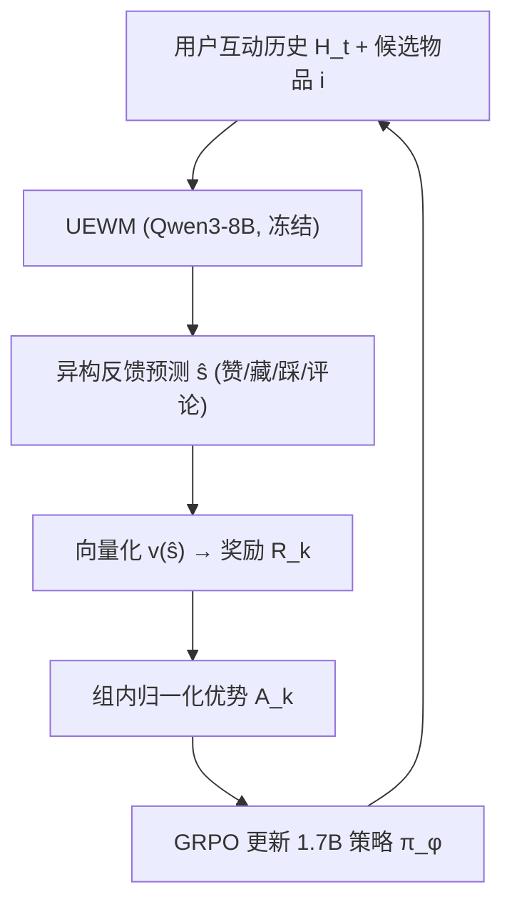
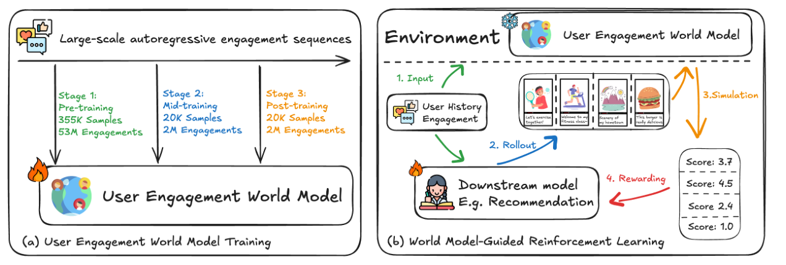

# World Model-Guided Reinforcement Learning via Counterfactual User Engagement Simulation (基于反事实用户互动模拟的世界模型引导强化学习)

- **会议/期刊**: EMNLP 2026
- **作者与机构**: Ang Li, Xin Xu, Bin Liang, Yue Ma, Fubang Zhao, Yangyang Kang, Kam-Fai Wong（香港中文大学 / 浙江大学 / 字节跳动）
- **推荐链路定位**: 重排（策略端到端决策，模拟器提供奖励）
- **研究方向**: 强化学习与动态探索推荐 / 大语言模型推荐
- **论文原文**: [https://arxiv.org/abs/2609.01067v1](https://arxiv.org/abs/2609.01067v1)
- **开源代码**: 暂未开源

## TL;DR (1分钟核心速览)

在线 RL 做推荐受制于真实反馈昂贵、且日志只记录曝光项，无法在同一用户状态下比较多个候选动作。本文把推荐建模为"动作"、异构互动（赞/藏/踩/评论）建模为"观测"，用 Qwen3-8B 训练一个用户互动世界模型 UEWM 作为冻结的反事实替代环境：策略对同一历史并行采样 $G$ 个候选，UEWM 并行预测各自反馈并转成稠密奖励，再用 GRPO 优化 1.7B 学生策略。在 Amazon Books/Movies 与 Google Local 的零样本多选推荐上，1.7B 的 WMG-RL 达 41.91/42.84/37.95 Acc，反超 OpenAI o3 与 DeepSeek-R1。

## Background & Motivation (背景与核心矛盾)

- **主流范式**: 现有工作把用户异构反馈拆成孤立的监督预测任务（用户画像、会话推荐、评论生成），或直接用 LLM 做 next-item 预测。
- **前人局限**: 其一，日志只记录被曝光的那一个物品，策略梯度所需的"同一状态下多动作对比"在真实数据中天然缺失；其二，在线收集反馈成本高、延迟大且有伤害用户的风险。
- **核心洞察 (Key Insight)**: 不同用户对同一内容有截然不同的互动动力学（健身用户 vs 美食用户），因此模拟器不应学一个固定的群体级转移函数，而应从历史中**推断用户特定的动力学**再作用于候选物品——这正是语言世界模型"以历史为条件预测下一观测"的接口。
- **本文切入点**: 把 UEWM 冻结为反事实替代环境，将模拟反馈直接转成奖励信号喂给下游策略，用"探索替代模仿"取代 SFT 蒸馏。

## Method (核心方法设计)

### 1. 整体框架 (Overall Architecture)

框架分两段。第一段实例化 UEWM：以 Qwen3-8B 为骨干，输入为序列化的用户互动历史 $H_t^u$与候选物品$i_{t+1}^u$，输出为异构反馈序列$\hat{s}_{t+1}^u$（离散动作 + 自由文本评论），训练配方为「自回归预训练 → CoT 中训练 → GRPO 可验证奖励后训练」三级渐进校准。第二段 WMG-RL：冻结 UEWM，下游 1.7B 策略对同一历史并行采样$G$ 个候选，UEWM 并行预测反馈并向量化为奖励，组内归一化得优势后用带 KL 约束的裁剪目标更新策略。

<figure class="paper-figure" markdown="span">
  <figcaption>图2：所提框架概览。(a) UEWM 由异构互动序列实例化为用户互动模拟器。(b) WMG-RL 使用冻结的 UEWM 作为反事实替代环境，为下游策略优化提供同状态奖励。</figcaption>
</figure>

### 2. 关键设计拆解 (Key Designs)

1. **用户互动世界模型 UEWM（摊销式个性化动力学推断）**：痛点是群体级响应模型无法刻画个体差异。UEWM 不显式建模每个用户的 $f_u$，而是用共享模型$\pi_E$从历史中"摊销"推断该规则：$\hat{s}_{t+1}^u \sim \pi_E(\cdot \mid i_{t+1}^u, H_t^u)$，状态更新为$h_{t+1}=h_t \,\|\, (a_t, o_{t+1})$。基础目标即标准自回归似然$\mathcal{L}_{AR}=-\sum_{k=1}^{|y|}\log\pi_E(y_k\mid x,y_{<k})$，但把异构反馈统一序列化到同一语言空间，使模型能同时学到反馈通道间的依赖与"历史→动力学"的推断过程——这是跨用户与跨域泛化的来源。

2. **同状态反事实奖励（Counterfactual Same-State Reward）**：痛点是真实曝光会改变用户状态，导致候选间不可比。WMG-RL 固定 $H_t$，令策略采样$\{i_k\}_{k=1}^G \sim \pi_\phi(\cdot\mid H_t)$，UEWM 并行给出$\hat{s}_k=\pi_E(\cdot\mid i_k,H_t)$，再经可配置向量化映射为标量奖励$R_k=\boldsymbol{w}^\top\cdot v(\hat{s}_k)$（实验中$v(\hat{s}_k)=[\hat{r}_k]$，$\hat{r}_k\in\{1,\dots,5\}$）。由于所有候选共享同一历史，奖励成为偏好的可比估计而非被状态漂移污染的观测；换$\boldsymbol{w}$ 即可适配不同业务目标。

3. **训练目标、负采样与推理效率**：优势按组内标准化 $A_k=(R_k-\mu_R)/(\sigma_R+\epsilon)$，损失为
$$\mathcal{L}_{\text{WMG}}=-\frac{1}{G}\sum_{k=1}^{G}\Big[J_k-\beta\,D_{KL}(\pi_\phi\|\pi_{\text{ref}})\Big],\quad J_k=\min\big(\rho_k A_k,\ \text{clip}(\rho_k,1-\epsilon,1+\epsilon)A_k\big)$$
其中 $\rho_k=\pi_\phi(i_k|H_t)/\pi_{\phi_{\text{old}}}(i_k|H_t)$。**无需人工负采样**：$G$ 个候选互为对照，奖励差即隐式负信号。推理时 UEWM 冻结、可并行批处理，学生仅 1.7B，在线开销远低于调用大模型。

## Experimental Setup & Evaluation Protocol (实验设置与评估协议)

- **数据集与预处理**: 训练域为某短视频平台匿名日志（2.5M 用户、636M 互动事件，过滤+平衡采样后 435K 样本、150 步历史；355K 预训练 / 20K CoT 合成 / 20K 后训练）。跨域评测用 Amazon Reviews 的 Books、Movies & TV 子集与 Google Local 的 New York 子集。

| 数据集 | 规模/来源 | 任务形式 | 反馈信号 | 说明 |
| :--- | :---: | :---: | :---: | :--- |
| 短视频平台（私有） | 435K 样本 / 2.5M 用户 | 反馈预测 | 赞/分享/藏/踩/评论 | 中文，150 步历史 |
| Amazon Books | 公开子集 | 评分预测 + 评论生成 + 多选推荐 | 1–5 星 + 评论文本 | 英文，零样本迁移 |
| Amazon Movies & TV | 公开子集 | 同上 | 同上 | 英文，零样本迁移 |
| Google Local (NY) | 公开子集 | 同上 | 同上 | 本地生活，零样本迁移 |

- **数据划分与防穿越 (Splitting Strategy)**: 域内采用**标签平衡的留出测试集**（非时间切分）；跨域为**零样本划分**（训练域与测试域完全不重叠）；下游策略学习用 48K 无标签样本训练、公开集测试。
- **排名评测协议 (Ranking Protocol)**: 下游推荐被重构为**多项选择题（multiple-choice）**，模型从候选中选出用户偏好物品，报告 Accuracy——属于**小候选集判别式评测**，而非全库 Full-Ranking。
- **对比基线与超参设置**: 通用 LLM 基线含 Qwen3-235B-A22B、DeepSeek-R1、OpenAI o3、Doubao-Seed-1.6；专用零样本基线含 SynthesizeMe、RLPF（GRPO 复现）、LettinGO（DPO 复现）；策略学习另比 DeepSeek-GRM-27B 奖励模型与 CoT SFT 蒸馏。UEWM 骨干 Qwen3-8B，SFT 阶段 batch 256、lr 1e-5；RL 阶段 GRPO 组大小 $G=8$、batch 512、lr 1e-6；学生 Qwen3-1.7B 训练 110 步。所有模型使用同一 prompt、贪心解码。

## Key Experimental Results (实验关键数据)

### 1. 主实验对比 (Main Results)

**表 1：域内模拟器保真度（Acc %，评论生成 R-Lsum / BERTScore %）**

| 方法 | Like | Share | Fav. | Disl. | Comm. | Avg. Acc | Avg. F1 | R-Lsum | BERT |
| :--- | :---: | :---: | :---: | :---: | :---: | :---: | :---: | :---: | :---: |
| Vanilla Qwen3-235B | 63.20 | 69.60 | 66.90 | 81.50 | 61.80 | 68.60 | 56.62 | 1.09 | 80.46 |
| Vanilla Qwen3-8B | 60.30 | 69.20 | 66.95 | 81.70 | 57.90 | 67.21 | 55.90 | 1.18 | 80.49 |
| Stage 1: Pre-training | 70.00 | 68.55 | 66.90 | 80.30 | 62.50 | 69.65 | 62.80 | 1.46 | 78.08 |
| Stage 2: Mid-training | 64.80 | 67.30 | 64.70 | 79.05 | 60.60 | 67.29 | 62.34 | 1.94 | 79.95 |
| **UEWM (Ours)** | 67.65 | **70.55** | **67.10** | 80.15 | **65.80** | **70.25** | **63.11** | **2.87** | **82.09** |

**表 2：跨域零样本迁移（Rating Acc % / Review R-L %）**

| 方法 | Books Acc | Books R-L | Movies Acc | Movies R-L | Google Acc | Google R-L |
| :--- | :---: | :---: | :---: | :---: | :---: | :---: |
| Qwen3-235B | 24.85 | 13.03 | 27.53 | 16.19 | 22.65 | 5.83 |
| DeepSeek-R1 | 26.25 | 13.59 | 29.32 | 16.21 | 23.85 | 6.94 |
| OpenAI o3 | 25.95 | 15.28 | 29.28 | 18.70 | 24.10 | 7.36 |
| RLPF | 26.75 | 13.91 | 29.78 | 16.82 | 25.65 | 7.96 |
| LettinGO | 29.00 | 16.15 | 31.12 | 18.05 | 24.35 | 7.29 |
| **UEWM (Ours)** | **32.90** | **18.40** | **34.47** | **20.17** | **29.20** | **9.72** |

**表 3：下游策略学习（1.7B 学生，Acc %）**

| 方法 | Books | Movies | Google |
| :--- | :---: | :---: | :---: |
| Vanilla Qwen3-235B | 29.53 | 32.11 | 30.00 |
| DeepSeek-R1 | 35.04 | 38.23 | 31.25 |
| OpenAI o3 | 37.21 | 40.15 | 33.10 |
| DeepSeek-GRM Reward (1.7B) | 39.87 | 40.52 | 35.20 |
| SFT Distillation (CoT, 1.7B) | 39.53 | 41.18 | 34.55 |
| **WMG-RL (Ours, 1.7B)** | **41.91** | **42.84** | **37.95** |

### 2. 消融实验 (Ablation Study)

| 配置 | Avg. Acc | Avg. F1 | R-Lsum | BERT |
| :--- | :---: | :---: | :---: | :---: |
| UEWM 完整 | **70.25** | **63.11** | **2.87** | **82.09** |
| w/o Pre-training | 66.40 | 60.92 | 2.01 | 79.05 |
| w/o Mid-training | 68.64 | 62.75 | 2.46 | 81.25 |
| w/o PT & MT | 69.12 | 54.46 | 1.66 | 80.76 |

### 3. 关键实验发现 (Key Findings)

1. **预训练是保真度的主引擎，对齐阶段是"校准器"**：去掉预训练使 Avg. F1 从 63.11 掉到 60.92、R-Lsum 从 2.87 掉到 2.01；而 w/o PT & MT 的 Avg. Acc 反而略高（69.12），说明大规模互动日志贡献了主要判别信号，CoT 与 GRPO 主要修复少数类信号与评论生成质量（Macro-F1 从 54.46 提升至 63.11，+8.65）。
2. **奖励信号与真实评分强相关，且是"个性化"而非"全局质量分"**：在 Amazon Movies 上 UEWM 预测奖励与真实评分的 Pearson $r=0.70$，中位数随真实评分单调上升；这解释了 WMG-RL 为何优于 DeepSeek-GRM（Books 41.91 vs 39.87），后者给出的是与用户历史无关的通用质量分。
3. **RL 探索优于模仿，小模型可反超大模型**：同为 1.7B，WMG-RL 在三个数据集上均超过 CoT SFT 蒸馏（+2.38 / +1.66 / +3.40）与 GRM 奖励（+2.04 / +2.32 / +2.75），并在 Books/Movies 上超过 o3（37.21/40.15）；反事实干预实验显示注入负反馈后预测评分从 4.72 骤降至 2.15，证明模拟器确实依赖历史而非表面相关。

## Highlights & Limitations (亮点、对比与审稿批判)

- **与代表作对比 (vs. Prior Work)**: 相比 OPeRA 等行为模拟工作只做"下一动作"评估、不产出奖励，WMG-RL 把模拟器变成策略训练环境；相比 Social World Model 建模群体级信念演化，UEWM 建模个体级互动动力学；相比 RLPF/LettinGO 用偏好优化改进单一预测器，本文用 RL 让学生"探索"而非"模仿"。
- **可迁移亮点**: ①"同状态并行采样 $G$候选 + 冻结模拟器打分"这一反事实奖励接口，可直接套用到任何缺乏反事实日志的重排/生成式推荐场景；②把异构反馈（离散动作 + 自由文本）统一序列化进同一语言空间，使奖励向量化函数$\boldsymbol{w}^\top v(\hat{s})$ 可按业务目标热插拔。
- **审稿级局限批判**: ①**无在线 A/B 或真实用户研究**，10 轮长程实验以 UEWM 自身为环境，衡量的是与学习到的模拟器的一致性而非真实长期满意度，模拟误差会随轮次累积；②训练日志不公开，域内结果与模拟器训练**无法精确复现**；③仅用文本模态，缺失短视频场景关键的视觉/音频信号，且不建模曝光分配与创作者侧动态。

## Rating (四维评分)

- **方法创新性 (Novelty)**: ⭐⭐⭐⭐ （把语言世界模型接口迁移到用户侧互动模拟，并以"同状态反事实奖励"打通模拟器与策略学习，构思新颖；但各组件本身均为已有技术的组合）
- **评估协议与实验扎实度 (Protocol & Experiments)**: ⭐⭐⭐ （三域零样本 + 保真度 + 策略学习三层证据链完整，含反事实干预与 200 例错误分析；但下游为小候选集多选而非全库排序，且完全缺失在线验证）
- **写作与数学规范度 (Clarity & Rigor)**: ⭐⭐⭐⭐ （世界模型接口的状态/动作/观测映射定义清晰，公式简洁；奖励向量化与 GRPO 细节交代充分，复杂度与超参敏感性置于附录）
- **工业落地与复现价值 (Industrial & Practical Value)**: ⭐⭐⭐ （1.7B 学生 + 冻结 8B 模拟器的并行打分在工程上可行且成本可控，但代码与训练日志均未开源，复现门槛高）

