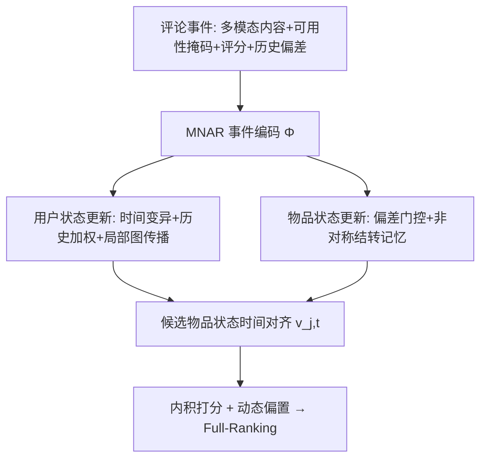
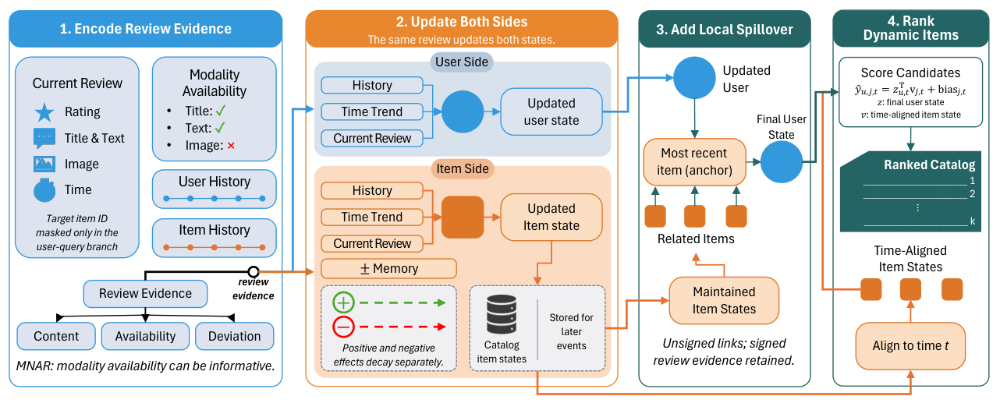

# Two-Sided State-Space Models for Sequential Recommendation with Non-Random Multimodal Review Feedback (双侧状态空间模型：面向非随机多模态评论反馈的序列推荐)

- **会议/期刊**: Findings of EMNLP 2026
- **作者与机构**: Ziwen Pan*, Zihan Liang*, Ruoxuan Xiong（Emory University，*同等贡献）
- **推荐链路定位**: 精排（事件级序列打分，Full-Ranking 全库排序）
- **研究方向**: 序列与会话推荐 / 多模态推荐
- **论文原文**: [https://arxiv.org/abs/2609.00165v2](https://arxiv.org/abs/2609.00165v2)
- **开源代码**: 暂未开源（论文声明 MIT License 下提供复现材料，但未检测到公开仓库）

## TL;DR (1分钟核心速览)

现有评论感知序列推荐把评论当作**被动信号**只更新用户侧，且默认"是否留评/留什么模态"与状态无关。本文提出 TS-SSM：把每条评论建模为**双侧状态空间中的内生事件**，用 MNAR 观测模式（模态可用性 + 历史表达偏差）编码事件，用户侧做时间变异 + 局部图消息传播，物品侧做**正负非对称衰减的评论结转记忆**。在 6 个 Amazon 类目与 Goodreads Fantasy 上，采用 `10-core` 过滤 + `leave-last-two-out` + **Full-Ranking** 协议，Recall@20 较 BSARec 提升 14.8%–18.8%，较 HM4SR 平均提升 11.7%（Goodreads 上 .5191→.5847，+12.6%）。

## Background & Motivation (背景与核心矛盾)

- **主流范式**: 评论感知推荐（DeepCoNN 系）与文本/多模态序列推荐（SAID、HM4SR、RecGPT）把评论文本或物品语义嵌入作为**静态辅助特征**注入序列编码器，物品侧表征基本不随时间演化。
- **前人局限一（生成非随机）**: 评论是否发生、以何种模态表达，取决于用户与物品的**演化隐状态**。图 1 显示：图片上传异常或文本长度突变时，5 星比例从 74.4% 降至 64.5%、1 星从 1.9% 升至 5.2%（−9.97pp）——观测模式本身携带状态信息，而现有方法将其视为随机缺失。
- **前人局限二（物品侧静态）**: 评论会**重塑物品状态**并经关联物品溢出。图 1 显示物品属性在 112 个时间分箱上持续漂移，且负向冲击半衰期（4.62 bins）显著长于正向（2.77 bins），静态物品表征无法刻画这种非对称持续性。
- **核心洞察 (Key Insight)**: 评论是"状态依赖的观测 + 状态改变的驱动力"的耦合体，必须在**用户与物品双侧**同时做状态演化，且观测机制（MNAR）与反馈持续性（非对称衰减）都应显式建模。
- **本文切入点**: 用双侧状态空间（SSM）框架统一"事件编码 → 双侧状态转移 → 图溢出 → 时间对齐打分"四阶段。

## Method (核心方法设计)

### 1. 整体框架 (Overall Architecture)

对每个评论事件 $e_{u,i}=(\tau_{u,i},O_{u,i})$，模型先编码评论记录（内容 + 模态可用性 + 评分 + 数值线索）与相对用户/物品历史的**表达偏差**，得到事件表征$\Phi_{u,i,t}$；随后同一事件**同时**驱动用户状态$Z_{u,t}$与物品状态$V_{i,t}$的转移——用户侧叠加时间变异、历史加权消息与以最近物品为锚的局部图传播，物品侧叠加时间变异、偏差门控创新与正负分离衰减的结转记忆；最后将所有候选物品状态**对齐到查询时刻**$t$ 后做内积打分。训练用温度化 pairwise BPR 加三项辅助正则。

<figure class="paper-figure" markdown="span">
  <figcaption>图2：TS-SSM 概览。阶段 1 编码多模态内容、可用性模式和历史偏差；阶段 2 以非对称的项目侧结转更新用户/项目状态；阶段 3 通过在项目图上传播评论信息来细化用户状态；阶段 4 将项目状态对齐到查询时间并对候选进行排序。</figcaption>
</figure>

### 2. 关键设计拆解 (Key Designs)

1. **MNAR 多模态评论编码（观测模式即信号）**：痛点是把缺失模态当噪声填补。本文把可用性向量 $A_{u,i}$直接嵌入为$\phi_{A_{u,i}}$，与内容、评分、静态物品特征相加：
$\Phi_{u,i,t}=\mathrm{LN}\big(f_{\text{mod}}(\mathrm{Enc}(M_{u,i}),A_{u,i})+f_{\text{num}}(r_{u,i},\kappa_{u,i})+\phi_i+\phi_t+\phi_{A_{u,i}}\big)$直觉：模态缺失不是随机噪声而是**行为偏差的显式读数**，消融显示用简单指示符替换 MNAR 门控掉 2.97%（$p<10^{-7}$）。

2. **物品侧非对称结转记忆（正负反馈不同寿命）**：痛点是历史评论影响被一次性吸收、且正负同权。本文为每条历史评论 $n$冻结其创新$h^I_n$，用四因子权重（观测模式、可靠性、符号强度$1+|q_n|$、时间衰减）聚合：
$m^I_{i,t}=\frac{\sum_{n:t_n<t}\omega^I_{n,t}\tanh(q_n)W^Ih^I_n}{\sum_{n:t_n<t}\omega^I_{n,t}},\quad \omega^I_{\text{time},n,t}=\exp(-\lambda_{\text{sign}(q_n)}\Delta b_{n,t})$其中$\lambda_+,\lambda_-$ 独立学习（初值 0.25/0.15，对应半衰期 2.77/4.62 bins）。直觉：差评的声誉损伤更持久，非对称衰减让物品状态具备"记忆惯性"。

3. **用户侧局部图溢出 + 有界更新**：痛点是新评论会改变用户对**关联物品**的偏好，但全局图传播代价高。本文以用户最近评论物品为锚 $a_{u,t}=v_{i^{\text{anc}},t}$，先用当前用户状态上下文化$a'_{u,t}=a_{u,t}+g^{UI}(z^{\text{mid}}_{u,t},a_{u,t})W^{UI}z^{\text{mid}}_{u,t}$，再对至多$K=20$个共现邻居做注意力聚合$a''_{u,t}=a'_{u,t}+\sum_{n}\alpha_nW^{II}v_{n,t}$，回传$\Delta z^{\text{mp}}_{u,t}=g^{\text{fb}}(z^{\text{mid}}_{u,t},a''_{u,t})W^{\text{fb}}a''_{u,t}$。所有状态更新经$\mathrm{Bound}_\alpha$ 限幅，防止单事件过冲。

4. **训练目标、负采样与推理效率**：$\mathcal{L}=\mathcal{L}_{\text{rank}}+\lambda_{\text{drift}}\mathcal{L}_{\text{drift}}+\lambda_{\text{carry}}\mathcal{L}_{\text{carry}}+\lambda_{\text{rel}}\mathcal{L}_{\text{rel}}$，主损失为温度化 BPR$\mathcal{L}_{\text{rank}}=\frac{1}{|P|}\sum\text{softplus}\big((s(u,i^-)-s(u,i^+))/\tau\big)$，$\tau$从 1.0 退火到 0.5；每正样本 48 个混合负样本（60% 均匀 + 难负）。三项辅助损失分别预测下一分箱物品代理、结转强度与观测/可靠性代理，权重 0.08/0.05/0.03。推理时物品状态需全库维护（存储开销），但局部传播限$K=20$、打分可接 ANN 检索。

## Experimental Setup & Evaluation Protocol (实验设置与评估协议)

- **数据集与预处理**: 6 个 Amazon Reviews 2023 类目 + Goodreads Fantasy，统一 `10-core` 迭代双侧过滤、剔除 2014 年前事件：

| 数据集 | #Users | #Items | #Interactions | 稀疏度 | 图片率 |
| :--- | :---: | :---: | :---: | :---: | :---: |
| Toys & Games | 35,690 | 28,530 | 611,908 | 99.94% | 8.1% |
| Pet Supplies | 38,427 | 31,364 | 674,821 | 99.94% | 10.2% |
| Sports & Outdoors | 27,832 | 35,284 | 473,144 | 99.95% | 5.3% |
| Electronics | 42,831 | 35,672 | 724,519 | 99.95% | 12.4% |
| Clothing | 38,294 | 31,458 | 583,621 | 99.95% | 18.7% |
| Home & Kitchen | 45,162 | 38,941 | 812,374 | 99.95% | 9.8% |

- **数据划分与防穿越**: 每用户 `leave-last-two-out`（倒数第二为验证、最后为测试）；112 个**训练对齐时间分箱**（2014-01 至 2023-03 逐月 + 2023-04~08 合并）；查询历史严格只含 $t$ 之前事件，验证事件可作为测试前缀。
- **排名评测协议**: 无偏 **Full-Ranking**（全库未交互物品排序，排除 padding、重复项与 $t$ 前已交互物品，真值物品单独打分），验证集 Recall@20 选 checkpoint；报告 R@10/20、N@10/20，附录含 R@50/MRR。
- **对比基线与超参**: 四族基线——序列（Caser/GRU4Rec/SASRec/BERT4Rec/FMLPRec/CL4SRec/DuoRec/FEARec/BSARec）、多模态（VBPR/MMGCN/LATTICE/BM3/LLMRec）、校正与辅助信号（POD/SAID）、近期强基线（RecGPT/HORAE/HM4SR）。所有基线在**同一预处理与协议下复现**；隐维 $H=320$、用户/物品 Transformer 3/2 层、4 头、dropout 0.1、AdamW、学习率$5\times10^{-4}$；多轮配对$t$ 检验 + Bonferroni 校正。

## Key Experimental Results (实验关键数据)

### 1. 主实验对比 (Main Results)

三个主数据集（Full-Ranking，节选核心指标）：

| 方法 | Toys R@20 | Pets R@20 | Sports R@20 | Toys N@20 | Pets N@20 | Sports N@20 |
| :--- | :---: | :---: | :---: | :---: | :---: | :---: |
| SASRec | .0924 | .0954 | .0646 | .0433 | .0447 | .0283 |
| LATTICE | .1019 | .1069 | .0553 | .0487 | .0511 | .0254 |
| CL4SRec | .1197 | .1246 | .0688 | .0598 | .0623 | .0339 |
| DuoRec | .1362 | .1419 | .0808 | .0733 | .0764 | .0436 |
| SAID | .1414 | .1484 | .0817 | .0757 | .0795 | .0475 |
| BSARec | .1427 | .1500 | .0838 | .0838 | .0880 | .0493 |
| RecGPT | .1463 | .1527 | .0859 | .0848 | .0885 | .0500 |
| HM4SR | .1489 | .1563 | .0872 | .0865 | .0908 | .0507 |
| **TS-SSM** | **.1683** | **.1756** | **.0962** | **.0912** | **.0953** | **.0530** |
| Improv. vs BSARec | +17.9% | +17.1% | +14.8% | +8.8% | +8.3% | +7.5% |
| Improv. vs HM4SR | +13.0% | +12.3% | +10.3% | +5.4% | +5.0% | +4.5% |

六类目 R@20 全景：Electronics .1375→.1530、Clothing .1461→.1653、Home & Kitchen .1425→.1570（均对 HM4SR），对 BSARec 提升区间 14.8%–18.8%。Goodreads Fantasy：.5191→**.5847**（+12.6%）。

### 2. 消融实验 (Ablation Study)

Toys & Games 上逐组件移除（$\Delta$R@20 相对全模型）：

| 变体 | R@20 | N@20 | $\Delta$R@20 |
| :--- | :---: | :---: | :---: |
| TS-SSM (Full) | .1683 | .0912 | — |
| w/o Item State Update | .1624 | .0878 | −3.50% |
| w/o Message Passing | .1636 | .0885 | −2.79% |
| w/o User State Update | .1641 | .0887 | −2.50% |
| w/o Carryover Memory | .1646 | .0892 | −2.20% |
| w/o Deviation Features | .1651 | .0894 | −1.90% |
| w/o Auxiliary Losses | .1661 | .0900 | −1.31% |
| MNAR 门控→指示符 | — | — | −2.97% |
| 静态物品级文本替代事件级文本 | — | — | −2.67% |
| 完全去文本 | — | — | −6.30% |

### 3. 关键实验发现 (Key Findings)

1. **物品侧动态是最大增益源**：移除 Item State Update 掉 3.50%，高于用户侧 2.50%；Goodreads 上该组件掉 6.81%，说明"评论重塑物品声誉"的建模在跨平台一致有效，而非 Amazon 特有现象。
2. **增益不能由元数据解释**：给 BSARec 直接拼接模态可用性、评分与时间分箱仅提升至多 4.7%，仍落后 TS-SSM 9.0%–11.3%；且图片率与相对增益在六类目上相关 $r=0.67$（Clothing 图片率 18.7%、增益 18.8% 最高），提示多模态表达越丰富收益越大（作者谨慎声明仅 6 个观测点，属描述性）。
3. **事件级动态文本不可替代**：用静态物品级文本替换事件级评论文本掉 2.67%，完全去文本掉 6.30%；而把文本/图像编码器换大仅增益 2.14%/0.71%–1.27%——收益来自**事件时序结构**而非编码器容量。

## Highlights & Limitations (亮点、对比与审稿批判)

- **与代表作对比 (vs. Prior Work)**: 相比 SAID/HM4SR 把评论当静态语义嵌入，本文让评论**内生地驱动双侧状态**；相比 TPNE 的时间激励，本文在物品侧保留**带符号**评论冲击并独立学习正负衰减率；相比因果去偏（MACR/AutoDebias）做倾向加权，本文的 MNAR 是**预测式**而非因果识别。
- **可迁移亮点**: (1) "模态可用性 + 历史表达偏差"作为免费的行为信号，可直接接入任意多模态序列模型；(2) 正负反馈分离衰减的结转记忆，可迁移到商家声誉、内容创作者信用等长记忆场景。
- **审稿级局限批判**: (1) 需维护**全库物品动态状态**与结转摘要，存储与更新开销显著高于 SASRec/BSARec，论文未给出线上延迟实测；(2) MNAR 权重是预测量而非因果倾向，用户特定时间约束、界面曝光差异等未观测因素仍可能混淆；(3) 仅在 Amazon + Goodreads 验证，文本无信息或历史过短时优势可能消失。

## Rating (四维评分)

- **方法创新性 (Novelty)**: ⭐⭐⭐⭐ （把评论生成视为双侧状态依赖的内生事件，MNAR 编码 + 非对称结转的组合在序列推荐中较新颖，但 SSM 骨架本身非首创）
- **评估协议与实验扎实度 (Protocol & Experiments)**: ⭐⭐⭐⭐⭐ （6+1 数据集、统一复现全部基线、Full-Ranking、Bonferroni 校正 t 检验、信息边界控制实验与跨平台消融，协议严谨度高于同类）
- **写作与数学规范度 (Clarity & Rigor)**: ⭐⭐⭐⭐ （过滤图与状态转移公式清晰，附录给出抽象到实现的完整对应；但主文符号密度高、部分权重因子需翻附录才能复现）
- **工业落地与复现价值 (Industrial & Practical Value)**: ⭐⭐⭐ （思路可落地且局部传播有界，但全库物品状态维护成本高、代码未公开，工程部署需额外改造）

