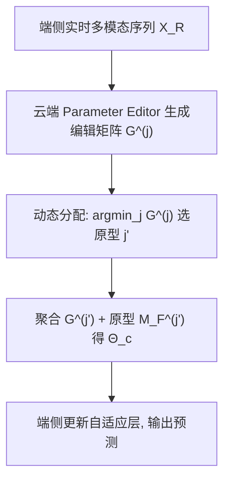
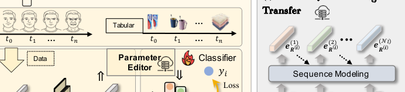

# Tackling Device Data Distribution Real-time Shift via Prototype-based Parameter Editing (基于原型参数编辑的端侧数据实时分布偏移应对)

- **会议/期刊**: ACM MM 2025
- **作者与机构**: Zheqi Lv, Wenqiao Zhang, Kairui Fu, Qi Tian, Shengyu Zhang, Jiajie Su, Jingyuan Chen, Kun Kuang, Fei Wu（浙江大学）
- **推荐链路定位**: 端侧推理（召回/排序模型的在线个性化适配）
- **研究方向**: 冷启动与长尾推荐 / 工业架构与端云协同
- **论文原文**: [https://arxiv.org/abs/2509.06552v1](https://arxiv.org/abs/2509.06552v1)
- **开源代码**: 暂未开源

## TL;DR (1分钟核心速览)

端侧轻量模型部署后遭遇实时数据分布偏移（用户兴趣漂移、视角变化），传统微调需大量算力与标注且延迟高（62.63s）。本文提出 Persona：云端神经适配器（Parameter Editor）依据实时设备数据**免反向传播**地生成参数编辑矩阵，直接"编辑"端侧模型自适应层参数，并通过多原型聚类+动态分配+跨层知识迁移平衡泛化性与稳定性。在 Beauty/Electronic/Music/MovieLens 四个序列推荐数据集上，Persona(m) 相对 SASRec 基线 NDCG@5 提升约 9%–35%，推理仅 10.78ms（较微调快约 5800 倍）。

## Background & Motivation (背景与核心矛盾)

- **主流范式**: 云端用全局数据预训练静态模型后直接下发端侧推理（图 1a），或部署后做即时微调/TTA/端云协同（DCCL、DUET）以适配本地分布。
- **前人局限**: ① 微调与 TTA 依赖端侧算力与标注，实时数据稀疏时易过拟合，Beauty 上甚至出现 AUC/NDCG 全面劣化；② DCCL 等协同框架延迟高达 882ms，难以满足实时响应。
- **核心洞察 (Key Insight)**: 全局模型对"靠近全局数据中心"的样本泛化好，对远端样本差；若用参数编辑矩阵把模型"拉近"到当前分布，则无需重训练即可泛化——但编辑幅度阈值存在**泛化性 vs 稳定性**的根本矛盾（阈值小则远端样本欠适配，阈值大则稀疏样本引入不确定性，图 3 t-SNE 佐证）。
- **本文切入点**: 用多个"原型模型"把原型中心推向样本簇，使编辑幅度落在合理区间，从而同时兼顾泛化与稳定。

## Method (核心方法设计)

### 1. 整体框架 (Overall Architecture)

Persona 将端侧自适应模型（DAM）解耦为**共享层**（全局数据训练、参数冻结 $\Theta_b$）与**自适应层**（参数$\Theta_c$由云端 Parameter Editor 实时生成）。推理时设备上传实时多模态序列$X_R^{(i)}$，云端各原型编辑器$\{M_G^{(j)}\}$基于对应原型模型$\{M_F^{(j)}\}$生成参数编辑矩阵$\{G^{(j)}\}$，动态分配选出编辑量最小的原型$j'$，聚合得到$\Theta_c$ 下发，端侧仅更新自适应层即可完成个性化，全程无反向传播。

<figure class="paper-figure" markdown="span">
  <figcaption>图 2：Persona 概览。(a) 原型模型包括共享层和自适应层。自适应层的参数由全局 PE M (0) 动态生成</figcaption>
</figure>

### 2. 关键设计拆解 (Key Designs)

1. **参数编辑矩阵（Parameter Editing Matrix）**：痛点是不许反传、要一次前向即适配。编辑器对第 $n$层生成$G_R^{(i)} = g_n(e_R^{(i)})$，经裁剪后叠加到预训练参数上：
$$K_R^{(i)} = \mathrm{Clip}(\Theta^\triangle) + \Theta^n,\quad \Theta^\triangle = \mathrm{Reshape}(G_R^{(i)}; N_{in}^n, N_{out}^n)$$
直觉是预训练参数已把样本映射到"不差"的位置，最优解应在其邻域内，Clip 到 $[-\mathcal{T},\mathcal{T}]$既保证 Lipschitz 连续性又将泛化误差界收紧$\Delta R = 2(K - K_{\Delta W}\sqrt{n}\sqrt{m_G}) > 0$（Lemma 1）。

2. **多原型 + 动态分配**：单原型下阈值矛盾无解。先用全局编辑器对历史数据生成 $\{G^{(i)}\}$并聚类得初始划分$C^{(i)}$，再在各簇上微调出$\{M_F^{(j)}, M_G^{(j)}\}$；推理时选编辑量最小的原型$j' = \arg\min_j \{G^{(j)}\}$，即"哪个原型最懂当前数据就用哪个"，把编辑幅度压回稳定区间。

3. **跨层知识迁移（CLKT）**：各层编辑器分支独立会导致同一样本被分到不同簇（划分不一致）。用序列模块 $\Omega_{seq}$串联各层特征$e_R^{(i)}$，使$e_H^{(j+1)}$依赖$e_H^{(j)}$，保证多层编辑矩阵落在同一空间。训练目标为交叉熵$\mathcal{L}_{PE} = \sum_i\sum_j l_{ce}(y, \Omega(x;\Theta_b); \Theta_c{=}G(x;\Theta_{Gs})+\Theta_c)$，**免负采样**（分类/序列预测范式），推理仅一次编辑器前向（10.78ms）。

## Experimental Setup & Evaluation Protocol (实验设置与评估协议)

- **数据集与预处理**: 6 个公开序列数据集（Beauty、CDs、Electronic、Book、Music、MovieLens-1M）+ 视觉 CK+；正文主表报告 Beauty/Electronic/Music/MovieLens 四个。

| 数据集 | 领域 | 模态 | 说明 |
| :--- | :---: | :---: | :--- |
| Beauty | 电商 | 表格序列 | 小规模，兴趣漂移快 |
| Electronic | 电商 | 表格序列 | 规模较大 |
| Music | 豆瓣 | 表格序列 | 用户建模 |
| MovieLens-1M | 电影 | 表格序列 | 经典基准 |
| CK+ | 视觉 | 图像 | 反映端侧分布变化 |

- **数据划分与防穿越 (Splitting Strategy)**: 序列推荐标准 `Leave-One-Out` 式下一物品预测（按用户历史时序构造实时数据 $D_R$与历史数据$D_H$）。
- **排名评测协议 (Ranking Protocol)**: 报告 AUC 与 Top-K 的 NDCG@5/10、HR@5/10（K=5,10），属采样/候选集排序评估，非全库 Full-Ranking。
- **对比基线与超参设置**: 端侧骨干 GRU4Rec、SASRec（默认）；个性化方法 Fine-tune、TTA；端云协同 DCCL、DUET。原型数 $N_M \in \{2,3,5,10\}$，编辑阈值$\mathcal{T} \in \{0.1,0.5,1.0,5.0\}$。

## Key Experimental Results (实验关键数据)

### 1. 主实验对比 (Main Results)

以 SASRec 为骨干（Beauty/Electronic，指标 NDCG@5 / HR@10）：

| 方法 | Electronic NDCG@5 | Electronic HR@10 | Beauty NDCG@5 | Beauty HR@10 | 耗时 |
| :--- | :---: | :---: | :---: | :---: | :---: |
| SASRec | 0.2743 | 0.5162 | 0.1672 | 0.3892 | 0 |
| TTA | 0.2726 | 0.5157 | 0.1616 | 0.3839 | 2.96s |
| Fine-tune | 0.2482 | 0.4842 | 0.1826 | 0.4264 | 89.21s |
| DCCL | 0.2738 | 0.5167 | 0.1587 | 0.3867 | 882.4ms |
| DUET | 0.2934 | 0.5311 | 0.2064 | 0.4040 | 10.78ms |
| Persona (s) | 0.2898 | 0.5296 | 0.2029 | 0.3976 | 10.78ms |
| **Persona (m)** | **0.2991** | **0.5430** | **0.2241** | **0.4407** | 10.78ms |
| Improv. vs SASRec | **+9.0%** | **+5.2%** | **+34.0%** | **+13.2%** | — |

视觉任务 CK+（MobileNetV3-Large）：Persona ACC 74.76 / AUC 81.01，优于 Fine-tune（71.92/79.99）与 DUET（71.47/79.03），耗时 18.83ms vs 微调 19.50s。

### 2. 消融实验 (Ablation Study)

Beauty 数据集（$N_M=10$）：

| 配置 | AUC | NDCG@5 | HR@10 |
| :--- | :---: | :---: | :---: |
| SASRec 基线 | 0.6588 | 0.1672 | 0.3892 |
| Group Fine-tuning | 0.6647 | 0.2059 | 0.4066 |
| Persona w/o CLKT | 0.6639 | 0.1702 | 0.3956 |
| Persona w/ CLKT | 0.6677 | 0.2228 | 0.4173 |
| Persona 全局原型（无动态分配） | 0.6654 | 0.2525 | 0.5094 |
| **Persona 分组原型（完整）** | **0.6677** | **0.2527** | **0.5124** |

### 3. 关键实验发现 (Key Findings)

1. **免反传编辑远胜重训练**：微调在 Beauty 上 NDCG@5 仅 0.1826 且耗时 89.21s，Persona(m) 达 0.2241 且 10.78ms，说明稀疏实时数据下微调过拟合严重，而参数编辑把搜索限制在预训练邻域内更鲁棒。
2. **多原型是阈值矛盾的解药**：单原型 Persona(s) 在 Beauty NDCG@5 为 0.2029，多原型升至 0.2241（+10.4%），且分组原型在 $N_M=10$ 时 HR@20 达 0.5124 高于全局原型 0.5094，验证"原型中心靠近样本簇"降低编辑不确定性。
3. **CLKT 与阈值需协同调优**：去掉 CLKT 后 NDCG@5 从 0.2228 跌至 0.1702（-23.6%），划分一致性至关重要；阈值 $\mathcal{T}=1.0$最优，$\mathcal{T}=0.1$欠适配、$\mathcal{T}=5.0$ 不稳定，与理论假设吻合。

## Highlights & Limitations (亮点、对比与审稿批判)

- **与代表作对比 (vs. Prior Work)**: 相较 Fine-tune/TTA 的"重训练换泛化"，Persona 用一次前向生成编辑矩阵，延迟低 3–4 个数量级；相较 DCCL 的样本迁移与 DUET 的端云双塔，Persona 以原型聚类显式建模"分布簇"，在同等 10.78ms 延迟下全面优于 DUET。
- **可迁移亮点**: ① "冻结共享层 + 生成式编辑自适应层"的解耦范式可迁移到任何端侧轻量排序模型；② 用编辑矩阵本身作为聚类特征做原型划分，是一种低成本的无监督分布分桶技巧。
- **审稿级局限批判**: ① 评测为采样/候选集排序而非全库 Full-Ranking，且未报告显著性检验，提升幅度在小数据集上波动较大；② 原型数 $N_M$与阈值$\mathcal{T}$ 需按数据集规模手工调（Beauty 最优 5、Electronic 最优 10），缺乏自适应选择机制，且多原型带来云端存储与聚类开销未量化。

## Rating (四维评分)

- **方法创新性 (Novelty)**: ⭐⭐⭐⭐ （免反传参数编辑 + 多原型聚类的组合新颖，且有 Lipschitz 泛化界理论支撑）
- **评估协议与实验扎实度 (Protocol & Experiments)**: ⭐⭐⭐ （覆盖 6 数据集双模态，但为采样排序、缺显著性检验与全库评估）
- **写作与数学规范度 (Clarity & Rigor)**: ⭐⭐⭐⭐ （编辑矩阵公式与 Lemma 推导清晰，符号略密但可读）
- **工业落地与复现价值 (Industrial & Practical Value)**: ⭐⭐⭐⭐ （10.78ms 端侧推理极具部署价值，但代码未开源、超参需人工调）

