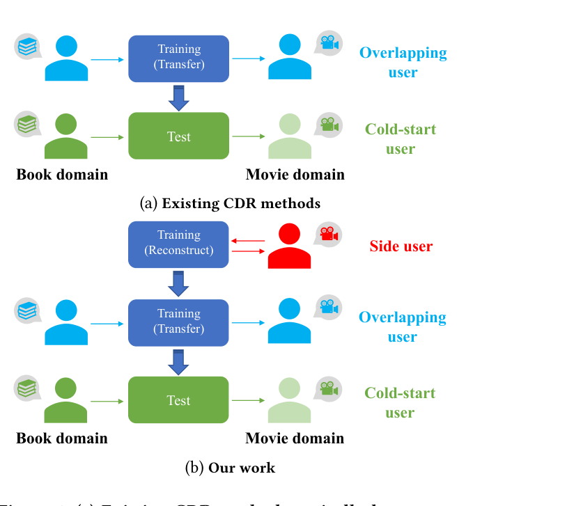
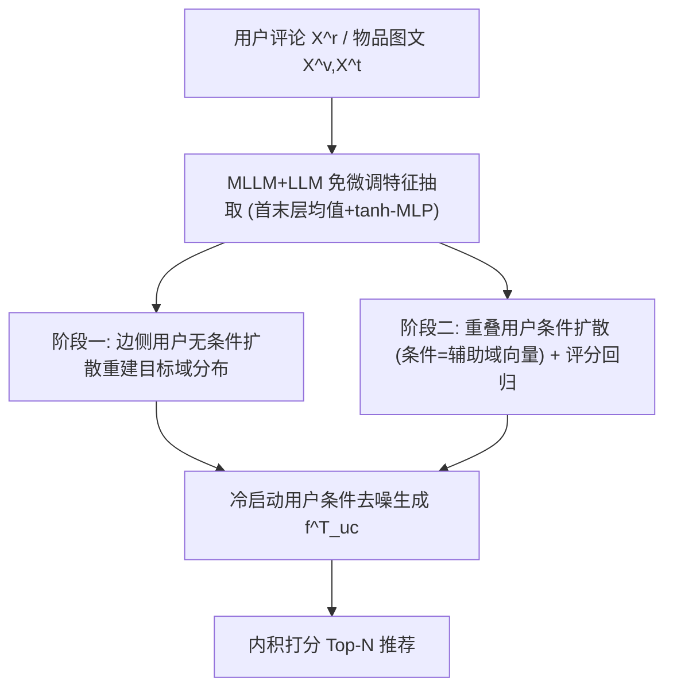

# Leveraging Multimodal Data and Side Users for Diffusion Cross-Domain Recommendation (利用多模态数据与边侧用户的扩散跨域推荐)

- **会议/期刊**: ACM MM 2025
- **作者与机构**: Fan Zhang, Jinpeng Chen, Huan Li, Senzhang Wang, Yuan Cao, Kaimin Wei, Jianxiang He, Feifei Kou, Jinqing Wang（北京邮电大学、浙江大学、中南大学、新加坡国立大学、暨南大学）
- **推荐链路定位**: 召回（冷启动用户向量生成 + 内积打分）
- **研究方向**: 跨域与多场景推荐 / 冷启动与长尾推荐
- **论文原文**: [https://arxiv.org/abs/2507.04000v1](https://arxiv.org/abs/2507.04000v1)
- **开源代码**: [https://anonymous.4open.science/r/MuSiC-310A/](https://anonymous.4open.science/r/MuSiC-310A/)

## TL;DR (1分钟核心速览)

跨域推荐（CDR）长期依赖重叠用户做映射，既浪费了图文多模态语义，也完全忽略了只在目标域交互的"边侧用户"，导致目标域向量空间分布学不准、映射函数过拟合。MuSiC 用 MLLM/LLM 免微调抽取域统一的多模态特征做初步对齐，再把 CDR 类比为"文本→图像"的条件生成：先用边侧用户无条件下学习目标域分布，再用重叠用户以辅助域特征为条件学习跨域变换，最后对冷启动用户做条件去噪生成。在 Amazon 三个跨域任务、$\beta\in\{20\%,50\%,80\%\}$ 冷启动强度下，MAE 相对最优基线最高降 13.56%，双冷启动场景 MAE 最高降 31.34%。

## Background & Motivation (背景与核心矛盾)

- **主流范式**: 以 EMCDR/PTUPCDR 为代表的映射式 CDR，用重叠用户学一个从辅助域到目标域的函数；CATN/OmniMatch 引入评论文本，DiffCDR 用扩散模型生成目标域向量。
- **前人局限一**: 多模态数据仅用 PLM/视觉编码器（如 BERT+ResNet）处理，未发挥 LLM 的推理与泛化能力，跨域语义对齐停留在浅层；且多数方法只用评分或评论文本，图像信息被浪费。
- **前人局限二**: 训练信号几乎全部来自重叠用户，模型只学会"精确复现特定样本"，泛化到未见冷启动用户时过拟合；而目标域中大量只在单域交互的边侧用户被完全丢弃，目标域嵌入分布估计样本严重不足。
- **核心洞察 (Key Insight)**: 扩散模型做 text-to-image 的本质是"把源域数据分布搬到目标域"，那么把辅助域向量当"文本"、目标域向量当"图像"，就能用条件扩散直接建模 $p(\boldsymbol{f}^T_u \mid \boldsymbol{f}^A_u)$，而非学一个点对点映射。
- **本文切入点**: 两阶段扩散——阶段一用边侧用户重建目标域分布（无条件），阶段二用重叠用户学跨域条件变换，二者解耦后冷启动用户即可被"生成"。

<figure class="paper-figure" markdown="span">
  <figcaption>图1：(a) 现有跨域推荐方法通常通过重叠用户学习跨域迁移。(b) 我们的方法首先通过重建边侧用户学习目标域的特征分布，然后利用重叠用户促进跨域迁移。</figcaption>
</figure>

## Method (核心方法设计)

### 1. 整体框架 (Overall Architecture)

输入为辅助域/目标域的用户评论 $X^r$与物品图文$X^v, X^t$。特征抽取模块用 MiniCPM-Llama3-V 2.5 对物品图文做 prompt 融合编码、用 Llama3-8B 对用户评论编码，均免微调，取首末隐层 token 均值后过 tanh-MLP 得 32 维向量。跨域扩散模块分两阶段训练：阶段一以边侧用户$u_s$的目标域向量$\boldsymbol{f}^T_{u_s}$为重建目标、无条件下训练；阶段二以重叠用户$u_o$的辅助域向量$\boldsymbol{f}^A_{u_o}$为条件、目标域向量为重建目标，并联合评分回归损失。推理时对冷启动用户$u_c$从纯高斯噪声出发、以$\boldsymbol{f}^A_{u_c}$为条件迭代去噪$T$步得$\hat{\boldsymbol{f}}^T_{u_c}$，与目标域物品向量内积排序出 Top-N。

### 2. 关键设计拆解 (Key Designs)

1. **MLLM 免微调多模态特征与域统一对齐**：痛点是用 PLM 编码的图文特征跨域语义不一致、且需微调成本高。做法是对 MiniCPM-V 施加 prompt 引导其"基于图文总结物品关键特征"，再取首末隐层 token 平均 $\boldsymbol{h}=\frac{1}{2}\big(\frac{1}{n}\sum_i \boldsymbol{H}^1_i+\frac{1}{n}\sum_i \boldsymbol{H}^L_i\big)$ 作为融合表征。直觉：LLM 的 next-word 预训练赋予其跨域通用的语义推理能力，首末层均值兼顾浅层词法与深层语义，使两域特征天然落在同一语义空间，为后续扩散提供良好初值。

2. **两阶段跨域扩散（边侧重建 + 重叠迁移）**：痛点是仅用重叠用户学映射会过拟合、目标域分布估计样本不足。前向过程为标准 DDPM 加噪 $q(\boldsymbol{x}_t|\boldsymbol{x}_0)=\mathcal{N}(\boldsymbol{x}_t;\sqrt{\bar\alpha_t}\boldsymbol{x}_0,(1-\bar\alpha_t)\mathbf{I})$；反向用向量化 U-Net 预测$\mu_\theta=\frac{1}{\sqrt{\alpha_t}}\big(\boldsymbol{x}_t-\frac{\beta_t}{\sqrt{1-\bar\alpha_t}}f_\theta(\boldsymbol{x}_t,t,\boldsymbol{f}_{con})\big)$。关键在条件项$\boldsymbol{f}_{con}$：边侧用户无辅助域记录，故$\boldsymbol{f}_{con}=\varnothing$，损失为$\mathcal{L}_{dm\_us}=\mathbb{E}\|\boldsymbol{x}_0-f_\theta(\boldsymbol{x}_t,t)\|^2$；重叠用户则$\boldsymbol{f}_{con}=\boldsymbol{f}^A_{u_o}$。直觉：先让模型"见过"目标域长什么样（分布先验），再学"怎么从辅助域变过来"（条件变换），两者解耦避免映射过拟合。

3. **训练目标、负采样与推理效率**：总损失 $\mathcal{L}_{total}=\mathcal{L}_{dm\_us}+\lambda\mathcal{L}_{dm\_uo}+(1-\lambda)\mathcal{L}_{rating}$，其中$\mathcal{L}_{rating}$为重叠用户评分 MSE，$\lambda\in[0.2,0.6]$。训练按阶段一→阶段二顺序进行。**无负采样**：Top-N 由评分预测内积排序自然导出，不做正负对比优化。推理开销极低——特征抽取为一次性离线（>10 小时），扩散训练 <30 分钟，因$T=10$ 且向量仅 32 维（远低于像素级扩散）。

## Experimental Setup & Evaluation Protocol (实验设置与评估协议)

- **数据集与预处理**: Amazon 三子集构造三任务，过滤评论 <10 词、无描述/无图物品、评论数 <20 的用户：

| 任务 | 辅助域→目标域 | #Users(辅/目) | #Items(辅/目) | #Overlap | #Ratings(辅/目) |
| :--- | :--- | :---: | :---: | :---: | :---: |
| Task 1 | Movie→Music | 18,045 / 10,292 | 156,884 / 159,997 | 2,165 | 881,003 / 513,247 |
| Task 2 | Book→Movie | 53,442 / 18,045 | 674,378 / 156,884 | 3,545 | 2,772,516 / 881,003 |
| Task 3 | Book→Music | 53,442 / 10,292 | 674,378 / 159,997 | 1,519 | 2,772,516 / 513,247 |

- **数据划分与防穿越 (Splitting Strategy)**: 沿用 PTUPCDR 策略，随机抽取 $\beta\in\{20\%,50\%,80\%\}$的重叠用户作为测试冷启动用户，其余重叠用户作训练；$\beta$ 越大冷启动越严苛。属**冷启动划分**。
- **排名评测协议 (Ranking Protocol)**: 评分预测用 MAE/RMSE（全测试集回归），排序用 NDCG@20；未采用全库 Full-Ranking 负采样对比，Top-N 由预测分直接排序。
- **对比基线与超参设置**: 8 个基线——评分型 CMF/EMCDR/SSCDR/LACDR/PTUPCDR、扩散型 DiffCDR、模态型 CATN/OmniMatch。特征维度 $d=32$，扩散步$T\in\{2,5,10,20,50\}$，$\beta_t$线性$1e^{-4}\to0.02$，Adam 学习率$\{1e^{-5},1e^{-4},1e^{-3}\}$，dropout$\{0.1,\dots,0.5\}$。

## Key Experimental Results (实验关键数据)

### 1. 主实验对比 (Main Results)

Task 1（Movie→Music）与 Task 3（Book→Music）代表性结果（MAE/RMSE 越低越好，NDCG@20 越高越好）：

| 任务/$\beta$ | 指标 | PTUPCDR | DiffCDR | CATN | OmniMatch | **MuSiC** | Improv. |
| :--- | :--- | :---: | :---: | :---: | :---: | :---: | :---: |
| T1 / 20% | MAE | 0.7766 | 0.7914 | 0.7289 | 0.7798 | **0.6636** | 8.96% |
| T1 / 20% | RMSE | 1.0629 | 1.0510 | 1.0007 | 1.0085 | **0.9243** | 7.63% |
| T1 / 50% | MAE | 0.7847 | 0.7976 | 0.7320 | 0.8452 | **0.6623** | 9.52% |
| T1 / 80% | MAE | 0.8112 | 0.7988 | 0.7444 | 0.9200 | **0.6901** | 7.29% |
| T2 / 50% | MAE | 0.8787 | 0.8849 | 0.8504 | 0.8326 | **0.7889** | 5.24% |
| T2 / 50% | NDCG | 0.8206 | 0.8189 | 0.8329 | 0.8342 | **0.8482** | 2.63% |
| T3 / 20% | MAE | 0.7705 | 0.7764 | 0.7213 | 0.7954 | **0.6235** | 13.56% |
| T3 / 20% | RMSE | 1.0356 | 1.0345 | 1.0030 | 1.0061 | **0.8654** | 13.72% |
| T3 / 80% | NDCG | 0.8354 | 0.8366 | 0.8616 | 0.8346 | 0.8546 | -0.81% |

### 2. 消融实验 (Ablation Study)

| 任务/$\beta$ | 指标 | w/o MLLM | w/o diffusion | w/o side | **MuSiC** |
| :--- | :--- | :---: | :---: | :---: | :---: |
| T1 / 20% | MAE | 0.7010 | 0.7750 | 0.6990 | **0.6636** |
| T1 / 50% | RMSE | 0.9626 | 0.9696 | 0.9297 | **0.9228** |
| T2 / 20% | MAE | 0.8372 | 0.7777 | 0.7841 | **0.7646** |
| T2 / 80% | RMSE | 1.1001 | 1.0729 | 1.0571 | **1.0466** |
| T3 / 20% | MAE | 0.7381 | 0.7346 | 0.6385 | **0.6235** |
| T3 / 80% | RMSE | 0.9539 | 0.9476 | 0.9898 | **0.9416** |

### 3. 关键实验发现 (Key Findings)

1. **多模态 MLLM 是最大增益源**：去掉 MLLM 后 Task 2 的 MAE 从 0.7646 升至 0.8372（+9.5%），且 w/o MLLM 仍优于所有纯评分基线，说明增益一半来自语义对齐、一半来自扩散模块，二者互补而非冗余。
2. **边侧用户的价值随重叠用户稀缺而放大**：w/o side 在 Task 3/$\beta=80\%$时 RMSE 恶化至 0.9898（vs. 0.9416），而在$\beta=20\%$ 时差距较小，验证了"重叠用户越少、边侧用户提供的目标域分布先验越关键"的设计动机。
3. **扩散步数存在最优区间且 $\beta$越高越脆弱**：$T$从 2 增至 10 时 RMSE 持续下降，$T=50$时反向过程噪声过量导致回升；Task 3/$\beta=80\%$ 的 NDCG 出现 -0.81% 的唯一下降，暴露了重叠用户稀缺时条件扩散对齐能力受限的边界。

## Highlights & Limitations (亮点、对比与审稿批判)

- **与代表作对比 (vs. Prior Work)**: 相比 PTUPCDR 的元网络个性化映射，MuSiC 不学点对点函数而学分布，天然抗过拟合；相比 DiffCDR 仅用重叠用户做扩散，MuSiC 引入边侧用户补足目标域分布样本；相比 CATN/OmniMatch 仅用评论文本，MuSiC 融合图像+文本并借 LLM 语义泛化。
- **可迁移亮点**: ①"边侧用户无条件下重建 + 重叠用户条件下迁移"的两阶段解耦训练范式，可迁移到任何源-目标分布偏移的生成式迁移任务；②首末隐层 token 均值作为免微调 LLM 特征，是低成本高质量表征的通用技巧。
- **审稿级局限批判**: ①特征抽取需离线跑 MLLM 超 10 小时，且依赖 MiniCPM-V/Llama3-8B 两个大模型，冷启动物品若图文缺失则特征退化；②评测仅用 MAE/RMSE/NDCG@20，未做全库 Full-Ranking 与负采样对比，且 $\beta=80\%$ 时 NDCG 反降，说明方法对重叠用户比例敏感，工业冷启动极端场景鲁棒性存疑。

## Rating (四维评分)

- **方法创新性 (Novelty)**: ⭐⭐⭐⭐ （将 CDR 重构为"辅助域→目标域"条件生成，并以边侧用户解耦分布学习与跨域变换，视角新颖但扩散骨架为标准 DDPM）
- **评估协议与实验扎实度 (Protocol & Experiments)**: ⭐⭐⭐ （三任务×三冷启动强度+双冷启动+消融+超参分析较完整，但缺全库排序协议与显著性检验）
- **写作与数学规范度 (Clarity & Rigor)**: ⭐⭐⭐⭐ （前向/反向/损失公式推导清晰，向量化 U-Net 适配说明到位，符号统一）
- **工业落地与复现价值 (Industrial & Practical Value)**: ⭐⭐⭐ （代码已匿名开源、扩散训练 <30 分钟且 32 维极轻量，但 MLLM 离线抽取成本与图文依赖是落地门槛）

