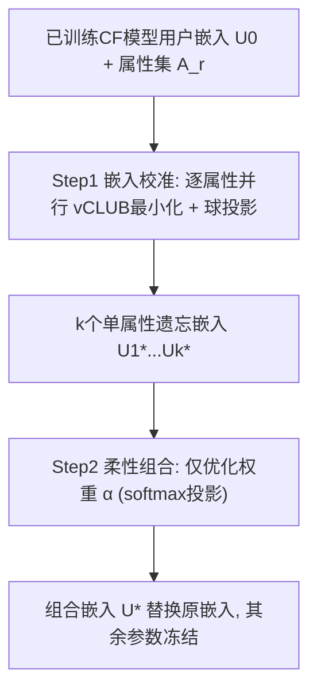
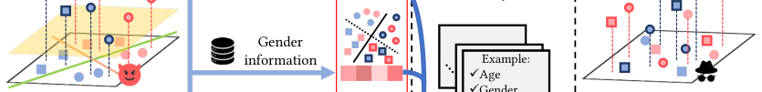

# LEGO: A Lightweight and Efficient Multiple-Attribute Unlearning Framework for Recommender Systems (轻量高效的多属性推荐遗忘框架)

- **会议/期刊**: ACM MM 2025
- **作者与机构**: Fengyuan Yu, Yuyuan Li, Xiaohua Feng, Junjie Fang, Tao Wang (Midea Group), Chaochao Chen (浙江大学 / 杭州电子科技大学 / 美的集团)
- **推荐链路定位**: 后处理（训练后嵌入层改写，不改动模型其余参数）
- **研究方向**: 去偏公平、可信隐私与工业架构 / 协同过滤
- **论文原文**: [https://arxiv.org/abs/2510.20327v1](https://arxiv.org/abs/2510.20327v1)
- **开源代码**: [https://github.com/anonymifish/lego-rec-multiple-attribute-unlearning](https://github.com/anonymifish/lego-rec-multiple-attribute-unlearning)

## TL;DR (1分钟核心速览)

真实隐私诉求往往同时涉及多个敏感属性且动态增删改，而现有单属性遗忘方法（顺序遗忘、D2DFR）会互相干扰、且每次需求变更需重训；唯一的多属性方法 AdvX 依赖逐属性对抗判别器，优化方向冲突且不可复用。LEGO 把多属性遗忘拆为「并行单属性嵌入校准（vCLUB 互信息最小化 + 参数球约束）」与「仅优化 $k$ 个组合权重的柔性组合」两步，理论上证明线性组合结果与端到端联合遗忘的 MI 目标差距有界。在 ML-100K/ML-1M/KuaiSAR 三数据集、NCF/LightGCN/MultVAE 三模型上，BAcc 平均下降 24.31%（优于 D2DFR 的 20.84%），NDCG@10 仅降 3.43%，且多属性遗忘耗时几乎等同单属性。

## Background & Motivation (背景与核心矛盾)

- **主流范式**: 推荐遗忘分两支——输入遗忘（删特定交互，SISA/精确重训）与属性遗忘（删性别/年龄等未被显式训练、却已被嵌入隐式编码的敏感属性）。本文聚焦后者，现有工作几乎全是单属性、静态设定。
- **前人局限**: ① 顺序遗忘（把 D2DFR 逐属性串行套用）在遗忘新属性时会重新引入已遗忘属性的信息，且需求变更时须对全部属性重跑；② AdvX 为每个属性配一个对抗判别器，多目标优化方向相互冲突，且需求一变就得整体重训，中间模型也无法加速（图 1(b)）。
- **核心洞察 (Key Insight)**: 属性信息在用户嵌入空间中是**近似可加/可分离**的——单独抹去属性 $A_t$得到的嵌入$U_t^*$ 再做线性组合，仍能同时压制全部敏感属性；因此"遗忘"可被降维成"组合权重优化"这一极轻量问题。
- **本文切入点**: 用互信息（MI）最小化替代分布对齐/对抗训练作为统一目标，使两步分解具备可证明的近似等价性，从而同时解决 CH1（同时遗忘）与 CH2（动态适配）。

## Method (核心方法设计)

### 1. 整体框架 (Overall Architecture)

给定已训练 CF 模型的用户嵌入 $U_0$与待保护属性集$\mathcal{A}_r=\{A_1,\dots,A_k\}$：**Step 1 嵌入校准**对每个属性独立地（可并行）求解一个受球约束的 MI 最小化问题，得到$k$个各自"忘掉"单一属性的嵌入$U_1^*,\dots,U_k^*$；**Step 2 柔性组合**固定这些嵌入，只优化权重$\boldsymbol{\alpha}\in\Delta^{k-1}$，令$U^*=\sum_i \alpha_i U_i^*$同时压制所有属性，最后用$U^*$ 替换原用户嵌入、其余参数不动。需求变更时：新属性只需并行补跑 Step 1，已有属性直接复用缓存嵌入，Step 2 秒级重解权重。

<figure class="paper-figure" markdown="span">
  <figcaption>图2：LEGO概览。我们提出的LEGO将多属性遗忘分为两步：嵌入校准和灵活组合。为说明每一步的目标，我们提供了嵌入分布的示意图。在示意图中，数据点的形状、颜色和边框分别表示年龄、性别和职业信息。线条和平面表示分类器的决策边界。</figcaption>
</figure>

### 2. 关键设计拆解 (Key Designs)

1. **嵌入校准：vCLUB 互信息最小化 + 参数球约束**：直接最小化 $I(U_t;A_t)$不可解，故用变分对比对数比上界 vCLUB 替代，交替优化变分网络$\phi$（最大化对数似然）与嵌入$U_t$（最小化 MI 估计）：
$$\hat{I}_{\text{vCLUB}}=\frac{1}{B}\sum_{i=1}^{B}\Big[\log q_\phi(A_{t,i}|u_{t,i})-\frac{1}{B}\sum_{j=1}^{B}\log q_\phi(A_{t,j}|u_{t,i})\Big].$$
为防推荐性能崩塌，约束 $U_t\in\mathcal{B}_\epsilon(U_0)$，梯度更新后做闭式欧氏投影$U_t=U_0+\frac{\epsilon}{\|U_t-U_0\|_2}(U_t-U_0)$。直觉：MI 趋零意味着最优攻击分类器退化为按先验随机猜，而球约束把"遗忘"限制在原始嵌入的$\epsilon$ 邻域内，保住协同信号。

2. **柔性组合与同时遗忘的理论保证**：固定 $U_i^*$后仅优化$\boldsymbol{\alpha}$，目标为$\min_{\boldsymbol{\alpha}}\sum_{t=1}^{k}I\big(\sum_i \alpha_i U_i^*;A_t\big)$，用 softmax 投影保证$\alpha_i>0,\|\boldsymbol{\alpha}\|_1=1$且避免$\boldsymbol{\alpha}=\mathbf{0}$的平凡解。**Theorem 1** 给出：设$U_i^*=\arg\min_{U_i\in\mathcal{B}_\epsilon(U_0)}I(U_i,A_i)$且$\|U_0\|_2\le C$，则两步解$P_1$与端到端联合遗忘解$P_2$满足$|P_1-P_2|\le 2kL(C+2\epsilon)$（$L$ 为 MI 的 Lipschitz 常数）。这正是选择 MI 而非分布对齐/对抗训练的原因——后两者无法给出组合后仍有效的保证。

3. **训练目标、负采样与推理开销**：总目标即上述两阶段 MI 最小化之和，无 BPR/InfoNCE 式负采样，攻击模型 $q_\phi$以用户嵌入为输入、属性为标签做多分类。开销上 Step 1 只更新$N\times d$的用户嵌入（物品嵌入与网络参数冻结），Step 2 只更新$k$ 维权重；动态场景下新增属性可并行校准，故多属性总耗时与单属性几乎持平。

## Experimental Setup & Evaluation Protocol (实验设置与评估协议)

- **数据集与预处理**: 三个含用户属性（性别/年龄/职业；KuaiSAR 为两个加密特征 Feat1/Feat2）的真实数据集：

| 数据集 | #Users | #Items | #Interactions | 稀疏度/密度 | 特征/场景说明 |
| :--- | :---: | :---: | :---: | :---: | :--- |
| ML-100K | 1,000 | 1,700 | 100,000 | 密度 5.88% | 性别/年龄/职业三属性 |
| ML-1M | 6,000 | 4,000 | 1,000,000 | 密度 4.17% | 同上，规模更大 |
| KuaiSAR-small | 大规模短视频 | — | — | 极稀疏 | 快手短视频，Feat1/Feat2 加密属性 |

- **数据划分与防穿越 (Splitting Strategy)**: 沿用各 CF 模型标准训练/测试划分（交互级划分），遗忘在**训练完成后**的后处理阶段进行，不触碰训练数据，故无穿越风险。
- **排名评测协议 (Ranking Protocol)**: 推荐侧采用 `Full-Ranking` 风格的 HR@10 / NDCG@10；遗忘侧用属性推断攻击（AIA）的 **BAcc 与 F1**（越低越好），灰盒设定下攻击者仅见用户嵌入，在 shadow 数据集上为每个属性独立训练攻击分类器。
- **对比基线与超参设置**: 基线为 Original、DP（推理期加噪）、D2DFR（SOTA 单属性，顺序扩展至多属性）、AdvX（唯一多属性方法，扩展至三种模型）；嵌入维度 $d$依模型默认，$\epsilon/N\in\{0,0.1,\dots,0.4,\infty\}$，所有结果跑 10 次取均值±标准差。

## Key Experimental Results (实验关键数据)

### 1. 主实验对比 (Main Results)

以 ML-1M + NCF 与 ML-100K + LightGCN 为代表（完整表见原文 Table 1，覆盖 3 数据集 × 3 模型 × 多属性组合）：

| 数据集/模型 | 保护属性 | 方法 | HR@10↑ | NDCG@10↑ | BAcc↓ | F1↓ |
| :--- | :--- | :--- | :---: | :---: | :---: | :---: |
| ML-1M / NCF | Gender,Age,Occupation | Original | 8.20 | 4.10 | 51.25 | 51.07 |
| | | DP | 2.20 | 0.97 | 33.46 | 33.43 |
| | | D2DFR | 8.40 | 4.10 | 42.20 | 41.89 |
| | | AdvX | 8.30 | 4.00 | 44.32 | 44.33 |
| | | **LEGO** | **8.23** | **4.00** | **41.55** | **41.02** |
| ML-100K / LightGCN | Gender,Age | Original | 16.07 | 8.60 | 60.30 | 60.54 |
| | | D2DFR | 16.23 | 8.50 | 52.65 | 51.69 |
| | | AdvX | 12.53 | 6.33 | 48.20 | 49.32 |
| | | **LEGO** | **16.50** | **8.40** | **36.11** | **35.57** |
| ML-100K / MultVAE | Gender,Age,Occupation | D2DFR | 15.83 | 8.27 | 37.69 | 38.15 |
| | | AdvX | 6.25 | 3.50 | 28.01 | 27.83 |
| | | **LEGO** | **16.33** | **8.40** | 30.85 | 30.88 |

整体统计：相较 Original，DP/D2DFR/AdvX/LEGO 的 BAcc 平均下降 12.77% / 20.84% / 18.37% / **24.31%**；NDCG@10 平均下降 48.17% / 5.64% / 30.30% / **3.43%**。

### 2. 消融实验 (Ablation Study)

ML-1M + NCF，逐步替换两步组件：

| 变体 | HR@10↑ | NDCG@10↑ | BAcc↓ | F1↓ |
| :--- | :---: | :---: | :---: | :---: |
| D2DFR-FC（Step1 换成 D2DFR） | 7.56 | 3.24 | 47.65 | 47.39 |
| EC-AC（Step2 换成等权平均） | 8.19 | 3.96 | 45.57 | 44.35 |
| **LEGO（完整）** | **8.23** | **4.00** | **41.55** | **41.02** |

### 3. 关键实验发现 (Key Findings)

1. **多属性场景才是 LEGO 的主场**：D2DFR 在 1/2/3 个属性上的 BAcc 降幅为 25.08%→22.58%→13.79%，随属性数增加急剧衰减（顺序遗忘互相回灌）；而 LEGO 在 3 属性下仍保持最强遗忘（如 ML-100K/LightGCN 上 BAcc 36.11 vs D2DFR 52.65），且 NDCG 降幅仅 1.99%。
2. **MI 目标 + 球约束是保性能的关键**：消融中把 Step1 换成 D2DFR 后 NDCG 从 4.00 掉到 3.24、BAcc 反升至 47.65，说明没有 MI 校准，柔性组合无法保证遗忘；把 Step2 换成等权平均则 BAcc 升至 45.57，证明权重优化不可省。
3. **动态适配近乎零成本**：图 3 显示 D2DFR 耗时随属性数线性增长，AdvX 因对抗训练远超原始训练时间虚线，而 LEGO 多属性总耗时与单属性几乎相同（Step1 并行 + Step2 仅 $k$维权重）；$\epsilon/N$增大时 BAcc 与 NDCG 同降，呈清晰的隐私-效用权衡，且 LightGCN 上 NDCG 甚至随$\epsilon$ 上升（负偏置被顺带削弱，与 D2DFR 前人观察一致）。

## Highlights & Limitations (亮点、对比与审稿批判)

- **与代表作对比 (vs. Prior Work)**: 与 D2DFR（分布对齐、单属性、顺序扩展）相比，LEGO 用 MI 目标天然支持并行与组合，多属性下遗忘更强且不牺牲推荐；与 AdvX（逐属性对抗判别器）相比，LEGO 无多目标冲突、可跨 NCF/LightGCN/MultVAE 通用，且需求变更无需重训；与 DP（推理加噪）相比，LEGO 几乎不损 NDCG（3.43% vs 48.17%）。
- **可迁移亮点**: ① "单属性算子并行 + 轻量权重组合"这一分解范式可迁移到多模态特征擦除、跨域多敏感字段脱敏等场景；② 用 vCLUB 上界 + 闭式球投影做约束优化，是后处理式遗忘的通用低成本模板。
- **审稿级局限批判**: ① 仅处理离散属性，连续属性（如精确年龄、收入）需先分箱，作者亦在结论中承认此为开放问题；② 理论保证依赖 MI 的 Lipschitz 常数 $L$与$\|U_0\|_2\le C$假设，实际中$L$ 不可估，界较松；③ 遗忘效果以灰盒 AIA 衡量，未评估白盒攻击或嵌入反演等更强威胁模型。

## Rating (四维评分)

- **方法创新性 (Novelty)**: ⭐⭐⭐⭐ （首次将多属性遗忘分解为并行校准+权重组合，并给出 MI 目标下的近似等价界，思路简洁且有理论支撑）
- **评估协议与实验扎实度 (Protocol & Experiments)**: ⭐⭐⭐⭐ （3 数据集 × 3 模型 × 多属性组合 + 效率与敏感性分析齐全，但攻击模型仅灰盒、缺显著性检验）
- **写作与数学规范度 (Clarity & Rigor)**: ⭐⭐⭐⭐ （vCLUB 推导与 Theorem 1 陈述清晰，符号统一；定理证明置于附录、界较松）
- **工业落地与复现价值 (Industrial & Practical Value)**: ⭐⭐⭐⭐⭐ （仅改用户嵌入、Step2 秒级重解、代码开源，对动态合规需求极具工程价值）

