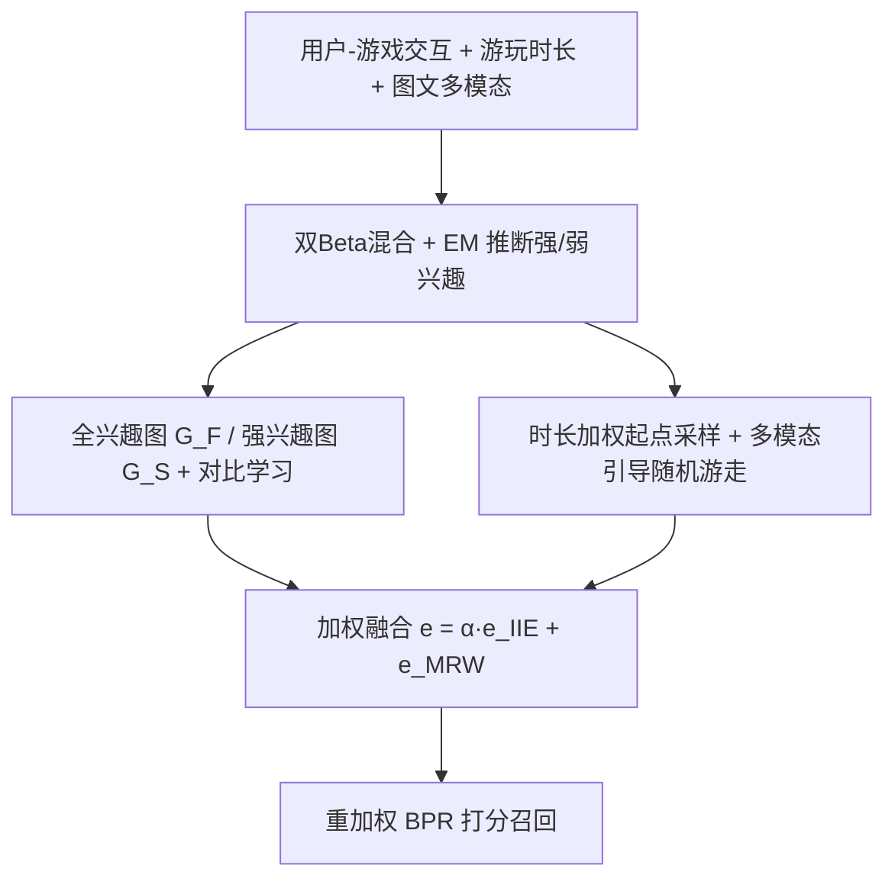
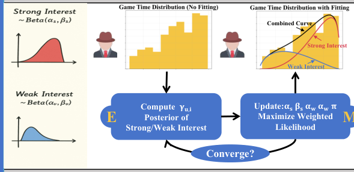

# Dual-Phase Playtime-guided Recommendation: Interest Intensity Exploration and Multimodal Random Walks (双阶段游玩时长引导推荐：兴趣强度探索与多模态随机游走)

- **会议/期刊**: ACM Multimedia (ACM MM) 2025
- **作者与机构**: Jingmao Zhang, Zhiting Zhao, Yunqi Lin, Jianghong Ma, Tianjun Wei, Haijun Zhang, Xiaofeng Zhang（哈尔滨工业大学（深圳）、南洋理工大学）
- **推荐链路定位**: 召回（图嵌入召回 + 候选扩展）
- **研究方向**: 多模态推荐 / 图神经网络与知识图谱推荐
- **论文原文**: [https://arxiv.org/abs/2508.14058v1](https://arxiv.org/abs/2508.14058v1)
- **开源代码**: [https://github.com/zqxwcevrtyui/DP2Rec](https://github.com/zqxwcevrtyui/DP2Rec)

## TL;DR (1分钟核心速览)

游戏推荐中"游玩时长"这一强行为信号长期被当作二值交互处理，且多模态信息只被用来提准确率、未被用于提多样性。本文提出 DP2Rec：用双 Beta 混合分布 + EM 把用户兴趣解耦为强/弱两层并做双图对比学习（提准确率），再用游玩时长与多模态相似度共同引导的随机游走做跨类目探索（提多样性），最后加权融合。在 Steam 真实数据（60,742 用户 / 7,726 游戏 / 414 万交互）上，准确率导向版本 NDCG@5 达 0.3032（较 SMORE 提升约 10.6%），多样性导向版本 Coverage@5 达 7.91（较 DGRec 提升约 35.4%）。

## Background & Motivation (背景与核心矛盾)

- **主流范式**: 游戏推荐沿两条线演进——准确率侧用 GNN 建模社交/上下文图（SCGRec、RGCF、CPGRec），多样性侧用重排（MMR/DPP）或聚类选点（DRGame、DGRec）；多模态模型（BM3、SLMRec、MGCN、SMORE）则几乎全部服务于准确率。
- **前人局限**: 其一，CPGRec 完全忽略游玩时长，SCGRec/DRGame 把交互当二值，无法区分"深度沉迷"与"浅尝辄止"；其二，多模态相似度被约束在历史偏好邻域内，导致推荐同质化，跨类目发现能力缺失。
- **核心洞察 (Key Insight)**: 作者做了两项数据分析：(1) 将游玩时长按游戏内百分位归一化到 $[0,1]$后，53,025 名有效用户中 99.96% 的兴趣分布可被双 Beta 混合精确拟合（平均$p$值 0.9638），强兴趣平均$\mathrm{Beta}(9.58, 2.26)$左偏、弱兴趣平均$\mathrm{Beta}(4.68, 8.37)$ 右偏；(2) 多模态嵌入的 t-SNE 显示类目间高度重叠，Action 类目 Top-10 多模态近邻中仅 11.30% 同类、15.88% 完全异类，说明多模态相似度天然可跨越类目边界。
- **本文切入点**: 把游玩时长当作"兴趣强度连续谱"而非二值标签，并把多模态相似度从"提准确率的特征"改造为"引导跨类目探索的转移概率"。

## Method (核心方法设计)

### 1. 整体框架 (Overall Architecture)

DP2Rec 由三部分组成：上层 IIE 模块先用双 Beta 混合 + EM 为每条交互推断强兴趣后验 $\gamma^{(S)}_{u,i}$，据此切出全兴趣图$\mathcal{G}_F$与强兴趣图$\mathcal{G}_S$，两图分别过 LightGCN 后做用户/物品双侧对比学习，得到融合强弱信号的嵌入$\mathbf{e}^{IIE}$；下层 MRW 模块从用户强兴趣节点出发，按游玩时长多项式采样选起点，逐跳在"每类目多模态最近邻"构成的候选集中按多模态相似度、兴趣相似度、类目平衡系数三项打分采样，路径权重累积后送入加权 LightGCN 得到$\mathbf{e}^{MRW}$；最后平衡模块以$\alpha$ 加权融合两路嵌入并用负样本重加权 BPR 训练。

<figure class="paper-figure" markdown="span">
  <figcaption>图2：所提出的𝐷𝑃2𝑅𝑒𝑐模型示意图。上层模块采用游玩时长引导的IIE，通过两个子模块将强兴趣与弱兴趣解耦并编码。下层模块采用游玩时长引导的MRW，其中多模态相似性与基于兴趣的相似性通过五个子模块引导用户探索，在保留核心偏好的同时，基于多模态相似性和自适应类别平衡系数通过跨类别发现增强多样性。右侧的平衡模块通过加权集成融合两个模块，以提升准确性和多样性。</figcaption>
</figure>

### 2. 关键设计拆解 (Key Designs)

1. **双 Beta 混合 + EM 的强弱兴趣解耦**：痛点是把时长当二值会抹平兴趣强度谱。作者对归一化时长 $\hat{t}_{u,i}$建混合密度$p(\hat{t}_{u,i})=\pi\cdot\mathrm{Beta}(\hat{t}_{u,i};\alpha_S,\beta_S)+(1-\pi)\cdot\mathrm{Beta}(\hat{t}_{u,i};\alpha_W,\beta_W)$，E 步算强兴趣后验$\gamma^{(S)}_{u,i}=\frac{\pi f_S}{\pi f_S+(1-\pi)f_W}$，M 步以软标签做加权 MLE 更新$(\alpha_S,\beta_S)$、$(\alpha_W,\beta_W)$与$\pi$，收敛后以$\gamma^{(S)}_{u,i}>0.5$切图。直觉在于：Beta 分布的定义域恰为$[0,1]$ 且形状参数天然编码"偏向高百分位/低百分位"，与"沉迷/浅尝"的物理语义一一对应，比高斯混合更贴合时长数据的偏态特性。
2. **多模态引导的随机游走与类目平衡**：痛点是传统游走只在协同图上扩散，跳不出类目。候选集定义为每类目多模态最近邻的并集 $\Omega_u(i)=\bigcup_{c\in\mathcal{C}}\{\arg\max_{j\in\mathcal{I}_c,j\neq i}\phi(\mathbf{e}^m_i,\mathbf{e}^m_j)\}$，再按"未交互、未推荐、类目计数$<Q$"过滤；综合打分$\mathrm{score}_u(i,j)=\mathrm{Agg}(\hat{s}^{m}_{ij},\hat{s}^{t}_{ij},\hat{\omega}_u(j))$，其中兴趣相似度$\hat{s}^{t}_{ij}=1-\frac{1}{|\mathcal{U}_{i,j}|}\sum_{u}|\gamma_{u,i}-\gamma_{u,j}|$，类目平衡系数$\omega_u(j)=\frac{Q-|c^*(j)|}{Q}$。路径权重$w_{u,i_l}=\hat{t}_{u,i_1}\prod_{k=1}^{l-1}s^{m}_{i_k,i_{k+1}}$把"起点兴趣强度 × 沿途语义一致性"注入加权 LightGCN 聚合。作者进一步证明类目覆盖数$C_t(\mathcal{P})$ 在该转移核下构成受控下鞅，期望多样性单调不减，为"探索可控"提供了理论背书。
3. **训练目标、负采样与推理效率**：总损失 $\mathcal{L}=\mathcal{L}_{ssl}+\mathcal{L}_{balance}$，其中$\mathcal{L}_{ssl}=\mathcal{L}_{ssl,user}+\lambda\mathcal{L}_{ssl,item}$为 InfoNCE 形式（温度$\tau$），$\mathcal{L}_{balance}=-\sum\log\sigma(s_{u,i}-\tilde{s}_{u,j})$对负样本做$\tilde{s}_{u,j}=s_{u,j}\cdot\frac{1}{1+e^{-s_{u,j}\cdot\zeta\cdot K}}$ 的重加权以抑制易负样本。负采样为训练集内均匀采样 + 上述重加权，无需难负样本挖掘；推理阶段随机游走离线预生成扩展边，在线仅需图嵌入内积检索，开销与标准 LightGCN 召回同阶。

## Experimental Setup & Evaluation Protocol (实验设置与评估协议)

- **数据集与预处理**: Steam 平台爬取，按 DRGame 方法采集并补充图文多模态内容。

| 数据集 | #Users | #Items | #Interactions | 稀疏度/密度 | 特征/场景说明 |
| :--- | :---: | :---: | :---: | :---: | :--- |
| Steam | 60,742 | 7,726 | 4,145,359 | 密度约 0.88% | 20 个类目；封面图经 Qwen-2.5-VL-72B 生成描述后与简介融合，BERT 编码 |

- **数据划分与防穿越 (Splitting Strategy)**: 原文未明确披露划分细节（未标注 LOO 或时间戳切分），仅说明结果为 5 次运行平均，属可复现性上的信息缺口。
- **排名评测协议 (Ranking Protocol)**: 采用 `Full-Ranking` 风格的全库未交互排序，$K\in\{5,10,20\}$；准确率用 NDCG/Recall/Hit Ratio/Precision，多样性用 Coverage@K（推荐结果覆盖的不同类目数）。
- **对比基线与超参设置**: 准确率基线 SCGRec、RGCF、CPGRec、BM3、SLMRec、MGCN、SMORE；多样性基线 EDUA、DGCN、DGRec、CPGRec；平衡基线 CPGRec。最优超参 $\alpha=0.6$（NDCG@5 与 Coverage@5 几何均值峰值 2.00）、$Q=1$（GM 峰值 1.71）。

## Key Experimental Results (实验关键数据)

### 1. 主实验对比 (Main Results)

| 方法 | NDCG@5 | NDCG@20 | Recall@20 | Hit@20 | Coverage@5 | Coverage@20 |
| :--- | :---: | :---: | :---: | :---: | :---: | :---: |
| SCGRec | 0.2150 | 0.2592 | 0.3208 | 0.8785 | 3.2348 | 6.5225 |
| RGCF | 0.2628 | 0.2607 | 0.2651 | 0.8179 | 4.8120 | 8.5280 |
| SLMRec | 0.2621 | 0.2841 | 0.3279 | 0.8954 | 5.4632 | 8.3717 |
| SMORE | 0.2741 | 0.2903 | 0.3242 | 0.8871 | 5.0582 | 8.1871 |
| CPGRec (acc) | 0.2594 | 0.2791 | 0.3186 | 0.8783 | 5.1467 | 8.3357 |
| DGRec | 0.1134 | 0.0931 | 0.2165 | 0.7860 | 5.8438 | 9.9746 |
| CPGRec (div) | 0.2257 | 0.2343 | 0.2671 | 0.8341 | 6.0860 | 9.3547 |
| **DP2Rec (acc)** | **0.3032** | **0.3169** | **0.3503** | **0.9008** | 5.2076 | 8.2847 |
| **DP2Rec (div)** | 0.2346 | 0.2518 | 0.2862 | 0.8586 | **7.9133** | **14.7972** |
| **DP2Rec (trade-off)** | 0.2518 | 0.2688 | 0.3038 | 0.8722 | 6.6499 | 12.0228 |
| Improv. (acc vs SMORE) | +10.6% | +9.2% | +8.0% | +1.5% | — | — |
| Improv. (div vs DGRec) | — | — | — | — | +35.4% | +48.4% |

### 2. 消融实验 (Ablation Study)

| 变体 | NDCG@5 | Recall@20 | Coverage@5 | Coverage@20 |
| :--- | :---: | :---: | :---: | :---: |
| DP2Rec (acc) 完整 | **0.3032** | **0.3503** | 5.2076 | 8.2847 |
| w/o DIR (EM 双 Beta) | 0.2877 | 0.3381 | 5.0780 | 8.1875 |
| w/o DIGL (双图对比) | 0.2743 | 0.3083 | 4.8388 | 7.9043 |
| DP2Rec (div) 完整 | 0.2346 | 0.2862 | **7.9133** | **14.7972** |
| w/o CCNS (跨类候选) | 0.2528 | 0.3011 | 5.6348 | 8.5220 |
| w/o CBC (类目平衡) | 0.2493 | 0.2952 | 5.9722 | 11.2468 |

### 3. 关键实验发现 (Key Findings)

1. **强弱兴趣解耦是准确率的主要来源**：移除 EM 双 Beta 建模后 NDCG@5 从 0.3032 降至 0.2877（-5.1%），移除双图对比学习进一步降至 0.2743（-9.5%），说明"切图 + 对比"的组合比单纯的概率分层更关键——弱兴趣边并非噪声，而是通过对比学习提供了正则化信号。
2. **跨类目候选与类目平衡是多样性的双支柱，且存在"准确率换多样性"的明确代价**：去掉 CCNS 后 Coverage@20 从 14.80 暴跌至 8.52（-42.4%），但 NDCG@5 反升至 0.2528；去掉 CBC 后 Coverage@20 降至 11.25。这印证了游走机制确实在"牺牲局部准确率换取类目覆盖"，而非免费午餐。
3. **超参 $\alpha$与$Q$的几何均值曲线呈单峰**：$\alpha$从 0.4 增至 1.6 时 NDCG@5 由 0.19 升至 0.26 而 Coverage@5 由 9.10 降至 5.84，GM 在$\alpha=0.6$取峰 2.00；$Q$ 在 1 处 GM 达 1.71，说明每类目仅允许新增 1 个节点时探索收益最大，过度放开反而稀释多样性。

## Highlights & Limitations (亮点、对比与审稿批判)

- **与代表作对比 (vs. Prior Work)**: 相比 CPGRec 的"类目约束图传播"，本文把类目控制从硬约束改为游走中的软平衡系数，并首次引入游玩时长作为连续兴趣强度；相比 SMORE 等把多模态当准确率特征的做法，本文把多模态相似度用作跨类目转移概率，目标函数层面就不同；相比 DGRec 的聚类选点，本文的游走是路径级累积语义一致性，而非一次性聚类划分。
- **可迁移亮点**: (1) "百分位归一化 + Beta 混合 + EM"这套流程可直接迁移到电商停留时长、短视频观看完成度等任意有偏态连续行为信号的场景；(2) 把多样性目标编码为随机游走的受控下鞅并给出期望增益的闭式刻画，为"可控探索"提供了可复用的分析模板。
- **审稿级局限批判**: 其一，数据划分协议未在正文明确（LOO 还是时间切分、是否防穿越），且仅单数据集验证，跨平台泛化性存疑；其二，随机游走需离线预生成扩展边，$Q$ 与游走轮数增加时构图开销与存储膨胀缺乏复杂度分析，线上增量更新成本未讨论；此外多模态嵌入依赖 Qwen-2.5-VL-72B 离线生成，推理链路较重。

## Rating (四维评分)

- **方法创新性 (Novelty)**: ⭐⭐⭐⭐ （首次把游玩时长建模为双 Beta 连续兴趣谱，并用受控下鞅理论刻画多模态游走的多样性增益，机制组合新颖）
- **评估协议与实验扎实度 (Protocol & Experiments)**: ⭐⭐⭐ （基线覆盖准确率/多样性/平衡三类较全面，但仅单数据集、划分协议未披露、缺显著性检验）
- **写作与数学规范度 (Clarity & Rigor)**: ⭐⭐⭐⭐ （EM 推导与下鞅证明完整，公式符号统一；部分超参如 $\zeta$、$K$ 的取值与敏感性未充分交代）
- **工业落地与复现价值 (Industrial & Practical Value)**: ⭐⭐⭐⭐ （代码与数据集已开源，游走可离线预计算、在线仅内积检索，工程可落地；但多模态离线生成链路较重）

