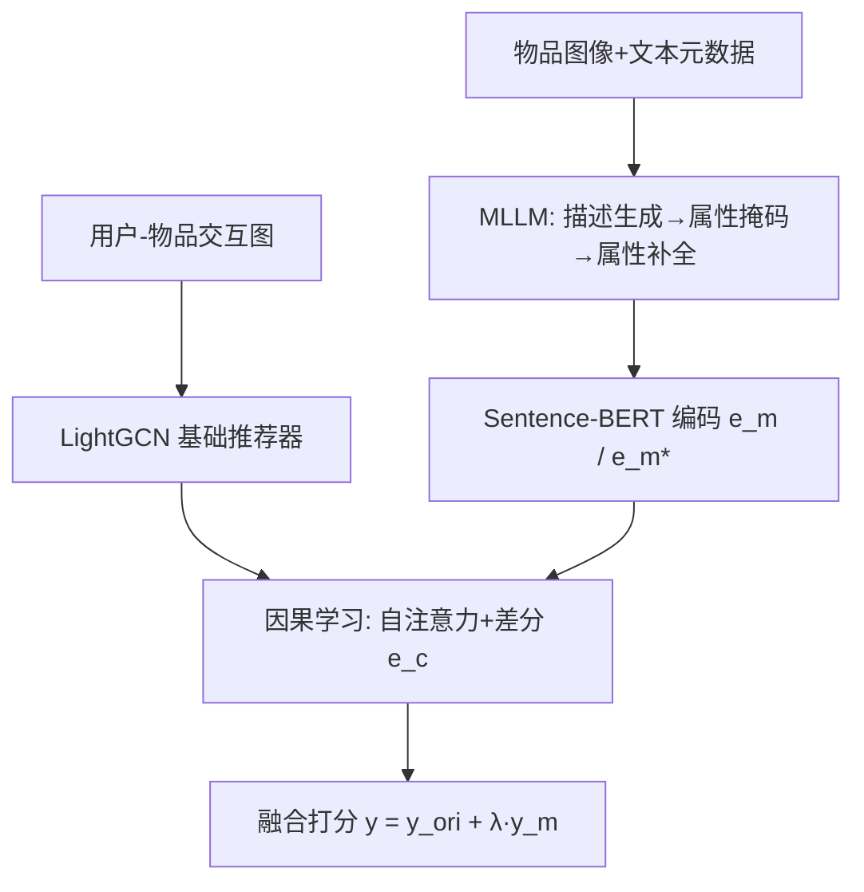
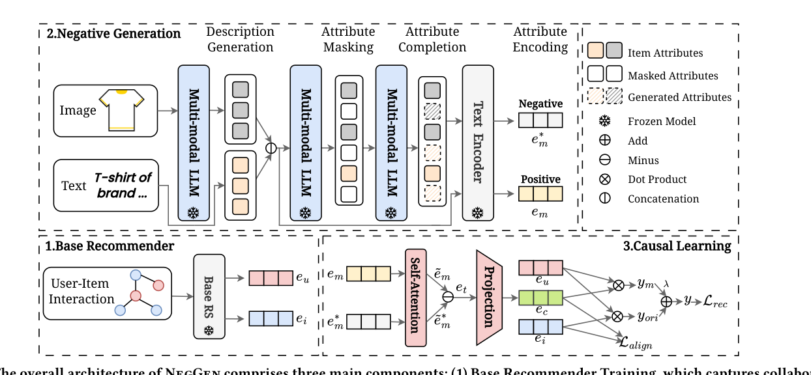

# Generating Negative Samples for Multi-Modal Recommendation (面向多模态推荐的负样本生成)

- **会议/期刊**: ACM MM 2025
- **作者与机构**: Yanbiao Ji, Chang Liu, Shaokai Wu, Jing Tong, Qicheng He, Hongtao Lu, Yue Ding (上海交通大学)；Dan Luo (Lehigh University)；Deyi Ji (腾讯)
- **推荐链路定位**: 召回（BPR 训练阶段的负采样与表征学习）
- **研究方向**: 多模态推荐 / 自监督对比与交互去噪
- **论文原文**: [https://arxiv.org/abs/2501.15183v3](https://arxiv.org/abs/2501.15183v3)
- **开源代码**: 暂未开源（仅给出所用 MLLM 权重 [Llama-3.2-11B-Vision](https://huggingface.co/meta-llama/Llama-3.2-11B-Vision)）

## TL;DR (1分钟核心速览)

多模态推荐（MMRS）中的负采样长期被当作 ID 层面的随机抽样问题处理，导致负样本既缺乏跨模态对比性、又让文本模态单方面主导梯度。NegGen 用 MLLM 以「描述生成 → 属性掩码 → 属性补全」三步提示构造属性级难负样本，再用因果学习模块以 $do(\cdot)$干预差分显式建模正负样本的总因果效应。在 Amazon 四个类目、80-10-10 划分、全库排序协议下，Recall@10 相对最强基线最高提升 9.02%（Baby），NDCG@10 提升 8.70%（Clothing），全部指标$p<0.05$ 显著。

## Background & Motivation (背景与核心矛盾)

- **主流范式**: MMRS 普遍沿用 BPR 训练，负样本或来自均匀/难负采样（DNS、AHNS、MixGCF），或来自 GAN/扩散生成（IRGAN），但这些策略均在 ID 或单模态特征空间操作，未触及多模态属性语义。
- **前人局限一**: 直接用 MLLM「一步直出」负样本反而劣于均匀采样（图 2，Baby 上 R@20 从 0.0973 掉到约 0.09 量级），因为通用预训练模型不懂推荐语境，生成的负样本与正样本对比度不足。
- **前人局限二**: 模态贡献严重失衡。表 1 显示 FREEDOM 仅用文本即达 R@10=0.0643，优于图文并用（0.0614）；图 3 进一步证实文本负样本梯度幅值始终小于视觉，模型过拟合易分的文本模态而忽略视觉。
- **核心洞察 (Key Insight)**: 作者由 Lemma 1 与 Proposition 2 推出 NDCG 下界 $\mathrm{NDCG}(u)\ge \frac{1}{|\mathcal{I}_u|}\sum_{i}(1-\|\nabla\|/\|e_u\|)$，即负样本梯度越小下界越高——这解释了文本主导的成因，也说明「一味求难」会压低下界，理想负样本须在凝聚力（cohesion）与难度（hardness）间取平衡（图 1）。
- **本文切入点**: 用属性级、受控的 MLLM 生成替代自由生成，并以因果干预剥离虚假相关，同时兼顾对比性与模态均衡。

## Method (核心方法设计)

### 1. 整体框架 (Overall Architecture)

NegGen 分三阶段闭环：先以 LightGCN 在用户-物品图上预训练基础推荐器，得到协同嵌入 $e_u,e_i$；再由 MLLM 对每个物品执行描述生成、属性掩码、属性补全，产出与正样本同结构但关键属性被替换的负样本文本，经 Sentence-BERT 编码为$e_m,e_m^*$；最后因果学习模块对正负多模态嵌入做自注意力与差分，投影到协同空间得$e_c,e_c^*$，与基础打分线性融合后以 BPR + 对齐损失联合优化。推理阶段仅走基础推荐器与已缓存的多模态嵌入，MLLM 不参与在线服务。

<figure class="paper-figure" markdown="span">
  <figcaption>图 4：NegGen 的整体架构包含三个主要组件：（1）基础推荐器训练，从用户-物品交互中捕获协同过滤信号；（2）负样本生成，通过 MLLM 生成对比性物品属性；（3）因果学习，建模多模态物品特征与推荐结果之间的因果关系。</figcaption>
</figure>

### 2. 关键设计拆解 (Key Designs)

1. **三步提示的属性级负样本生成**：痛点是一步直出负样本对比度不足。做法是先让 MLLM 看图写描述以把视觉信息显式转成文本（缓解视觉欠拟合），再掩码核心特征/规格词得模板，最后在模板约束下补全替代词。由于生成过程以正样本全模态属性为条件，负样本天然「同结构、异关键属性」，既保证凝聚力又保留难度，且强制视觉信息进入监督信号。
2. **因果学习模块（总因果效应差分）**：痛点是推荐分数与无关属性间的虚假相关。作者构建 SCM（$V,T\to M\to Y$，$U\to Y$），以$do$-算子定义总因果效应$\mathrm{TE}=f_Y(f_M(v,t),u)-f_Y(f_M(v^*,t^*),u)$，并用自注意力后的差分$e_t=\tilde{e}_m-\tilde{e}_m^*$实例化，再经两层 MLP 投影得$e_c$。差分算子把「关键属性变化引起的分数变化」从背景属性中剥离，等价于对无关属性做隐式边缘化。
3. **训练目标、负采样与推理效率**：最终损失 $\mathcal{L}=\mathcal{L}_{rec}+\alpha\mathcal{L}_{align}$，其中$\mathcal{L}_{rec}=-\log\sigma(\lambda e_u^\top e_c+e_u^\top e_i-e_u^\top e_c^*)$，$\mathcal{L}_{align}=-\log\frac{\exp(e_c^\top e_i/\tau)}{\exp(e_c^{*\top}e_i/\tau)}$。负样本完全由 MLLM 离线生成（免在线负采样），每物品仅需一次生成并缓存；在线开销与 LightGCN 同级，MLLM 成本一次性摊销。

## Experimental Setup & Evaluation Protocol (实验设置与评估协议)

- **数据集与预处理**: Amazon 评论四个类目，均做 `5-core` 过滤：

| 数据集 | #Users | #Items | #Interactions | 密度 | 场景说明 |
| :--- | :---: | :---: | :---: | :---: | :--- |
| Baby | 19,445 | 7,050 | 139,110 | 0.00101 | 母婴，模态依赖中等 |
| Beauty | 22,363 | 12,101 | 172,188 | 0.00064 | 美妆，视觉属性重要 |
| Clothing | 39,387 | 23,033 | 278,677 | 0.00031 | 服饰，强视觉依赖、最稀疏 |
| Sports | 33,598 | 18,357 | 296,337 | 0.00048 | 运动户外，弱模态依赖 |

- **数据划分与防穿越**: `80-10-10` 比例划分（训练/验证/测试），以验证集 Recall@20 早停（20 轮无提升），未采用全局时间戳切分，存在轻度未来信息泄漏风险。
- **排名评测协议**: 论文报告 Recall@10/20 与 NDCG@10/20，按测试集全体用户平均；正文未显式声明候选集构造，从基线惯例推断为全库未交互物品排序（Full-Ranking），未报告采样负例比例。
- **对比基线与超参设置**: 三组基线——协同过滤（BPR、LightGCN）、负采样（IRGAN、MixGCF、DENS、DNS(M,N)、AHNS）、MMRS（VBPR、MMGCN、BM3、FREEDOM、DRAGON、DiffMM、LGMRec）。嵌入维度 $d=64$，Xavier 初始化，Adam，batch=2048，最多 1000 epoch；MLLM 用 Llama-3.2-11B-Vision，文本编码用 Sentence-BERT；配对 t 检验报告 p 值。

## Key Experimental Results (实验关键数据)

### 1. 主实验对比 (Main Results)

| Model | Baby R@10 | Baby N@10 | Beauty R@10 | Beauty N@10 | Clothing R@10 | Clothing N@10 | Sports R@10 | Sports N@10 |
| :--- | :---: | :---: | :---: | :---: | :---: | :---: | :---: | :---: |
| LightGCN | 0.0458 | 0.0236 | 0.0676 | 0.0403 | 0.0328 | 0.0184 | 0.0547 | 0.0305 |
| AHNS | 0.0465 | 0.0292 | 0.0635 | 0.0426 | 0.0335 | 0.0237 | 0.0554 | 0.0352 |
| BM3 | 0.0542 | 0.0296 | 0.0728 | 0.0425 | 0.0451 | 0.0242 | 0.0663 | 0.0354 |
| FREEDOM | 0.0614 | 0.0306 | 0.0771 | 0.0441 | 0.0617 | 0.0317 | 0.0714 | 0.0368 |
| DRAGON | 0.0643 | 0.0325 | 0.0792 | 0.0455 | 0.0621 | 0.0322 | 0.0732 | 0.0389 |
| DiffMM | 0.0625 | 0.0306 | 0.0783 | 0.0447 | 0.0622 | 0.0313 | 0.0715 | 0.0350 |
| LGMRec | 0.0631 | 0.0327 | 0.0781 | 0.0448 | 0.0531 | 0.0296 | 0.0723 | 0.0385 |
| **NegGen** | **0.0701** | **0.0342** | **0.0823** | **0.0473** | **0.0654** | **0.0350** | **0.0763** | **0.0411** |
| Improv. | +9.02% | +7.95% | +3.91% | +3.96% | +5.14% | +8.70% | +4.23% | +5.66% |
| p-val | 0.0093 | 0.0028 | 0.0221 | 0.0017 | 0.0098 | 0.0423 | 0.0044 | 0.0079 |

### 2. 消融实验 (Ablation Study)

| 变体 | Baby R@10 | Baby N@10 | Beauty R@10 | Beauty N@10 | Clothing R@10 | Clothing N@10 | Sports R@10 | Sports N@10 |
| :--- | :---: | :---: | :---: | :---: | :---: | :---: | :---: | :---: |
| w/o NEG（退回均匀采样） | 0.0571 | 0.0307 | 0.0714 | 0.0416 | 0.0626 | 0.0327 | 0.0627 | 0.0336 |
| w/o CF（去因果模块） | 0.0641 | 0.0321 | 0.0805 | 0.0457 | 0.0637 | 0.0341 | 0.0714 | 0.0374 |
| w/o both | 0.0466 | 0.0235 | 0.0682 | 0.0402 | 0.0336 | 0.0187 | 0.0539 | 0.0304 |
| **NegGen** | **0.0701** | **0.0342** | **0.0832** | **0.0473** | **0.0654** | **0.0350** | **0.0763** | **0.0411** |

模态消融（表 4）：NegGen 的 V&T 变体在四个数据集上全面优于单模态 V 与 T（如 Sports R@10 从 T 的 0.0687 升至 0.0763），说明属性级负样本确实修复了模态失衡。

### 3. 关键实验发现 (Key Findings)

1. **生成模块贡献大于因果模块，但二者强互补**：Baby 上去掉 NEG 使 R@10 从 0.0701 跌至 0.0571（−18.5%），去掉 CF 仅跌至 0.0641；而两者同时移除跌至 0.0466，甚至低于 LightGCN 的 0.0458，说明因果模块的价值高度依赖高质量负样本作为输入。
2. **负样本质量同时体现在精度与收敛速度**：图 6 显示 NegGen（去掉因果模块的公平版本）在更低收敛轮次下取得更高 NDCG@20，验证其负样本同时具备高凝聚力与高难度，而非以牺牲收敛换取精度。
3. **强视觉依赖场景收益最大**：Clothing（密度仅 0.00031、最依赖图像）NDCG@10 提升 8.70%，而弱模态依赖的 Sports 仅 5.66%，说明把视觉信息转写为文本描述再参与负样本构造，恰好补上了视觉欠拟合这一短板。

## Highlights & Limitations (亮点、对比与审稿批判)

- **与代表作对比 (vs. Prior Work)**: 相比 AHNS/DNS 等 ID 级难负采样，NegGen 在属性语义空间而非物品池中构造负样本，可控性更强；相比 IRGAN 的对抗生成，它无需训练生成器、规避模式崩溃；相比 FREEDOM/DRAGON 等 MMRS，它不改图结构而改监督信号，属于正交增强，理论上可叠加。
- **可迁移亮点**: (1) 「掩码-补全」模板化提示可迁移到任何需要受控难负样本的对比学习任务（如序列推荐、跨域对齐）；(2) 用梯度幅值诊断模态主导性，是一个低成本、可复用的多模态训练监控指标。
- **审稿级局限批判**: (1) 依赖 11B 级 MLLM 离线为每个物品生成三次，物品量级上万时预处理成本与存储开销未量化，且生成质量对提示模板敏感、缺乏鲁棒性分析；(2) 评测仅用 80-10-10 随机划分而非时间切分，且未明确候选集规模，全库排序声明不够严谨，线上时延与 A/B 验证完全缺失。

## Rating (四维评分)

- **方法创新性 (Novelty)**: ⭐⭐⭐⭐ （首次系统诊断 MMRS 负采样的对比性与模态失衡问题，并用梯度下界给出理论解释，MLLM 受控生成 + 因果差分的组合较新颖）
- **评估协议与实验扎实度 (Protocol & Experiments)**: ⭐⭐⭐ （四数据集、13 个基线、配对 t 检验与三重消融较完整，但随机划分、候选集协议未明示、缺线上验证）
- **写作与数学规范度 (Clarity & Rigor)**: ⭐⭐⭐⭐ （Lemma/Proposition 推导简洁自洽，SCM 与 $do$-算子表述清晰，提示模板全文给出便于复现）
- **工业落地与复现价值 (Industrial & Practical Value)**: ⭐⭐⭐ （在线开销与 LightGCN 同级、负样本可离线缓存，但 11B MLLM 预处理成本高且代码未开源，复现门槛偏高）

