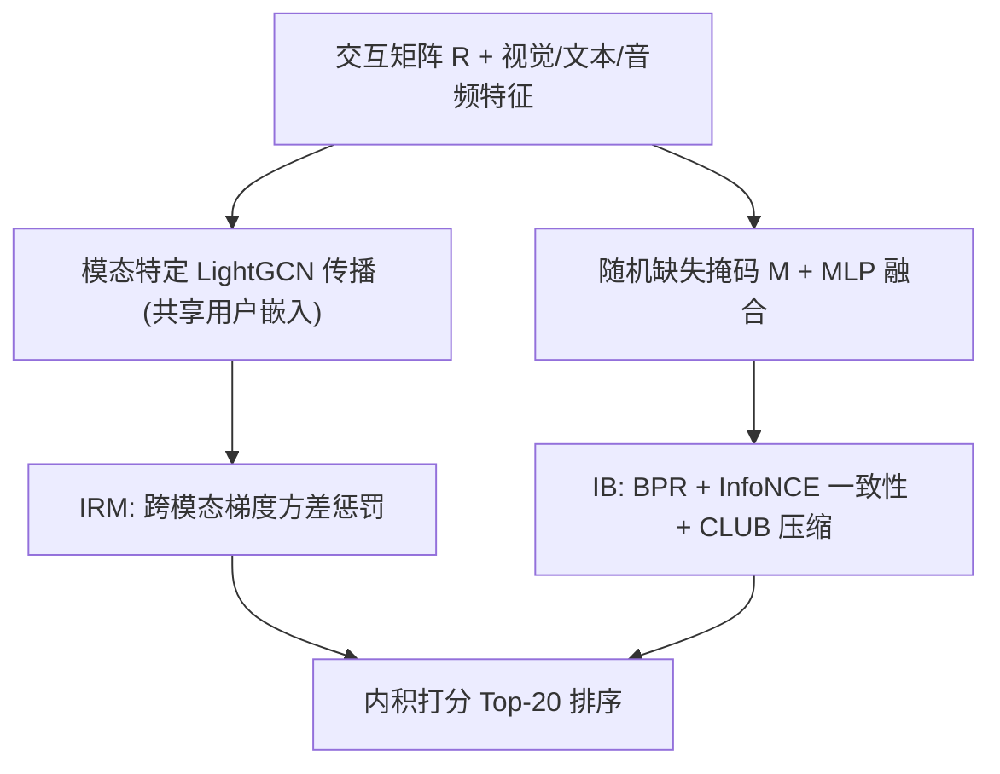
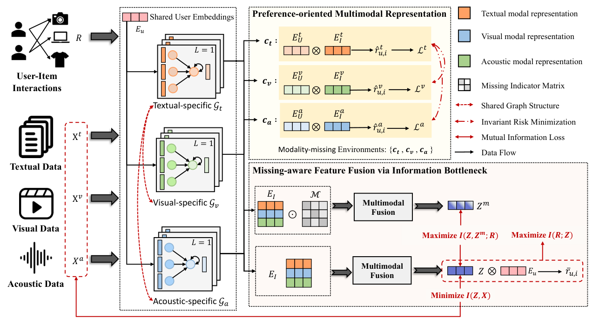

# I$^3$-MRec: Invariant Learning with Information Bottleneck for Incomplete Modality Recommendation (面向不完整模态推荐的不变学习与信息瓶颈框架)

- **会议/期刊**: ACM Multimedia 2025
- **作者与机构**: Huilin Chen, Miaomiao Cai, Fan Liu, Zhiyong Cheng, Richang Hong, Meng Wang（合肥工业大学、新加坡国立大学）
- **推荐链路定位**: 召回（多模态图协同过滤表征学习）
- **研究方向**: 多模态推荐 / 自监督与去噪
- **论文原文**: [https://arxiv.org/abs/2508.04247v3](https://arxiv.org/abs/2508.04247v3)
- **开源代码**: [https://github.com/HuilinChenJN/I3-MRec](https://github.com/HuilinChenJN/I3-MRec)

## TL;DR (1分钟核心速览)

真实平台图像缺失、描述不全使多模态推荐（MRS）性能骤降（图 1 显示 MMGCN 等在缺失场景 Recall@20 掉至单模态基线以下）。本文提出 I$^3$-MRec：把视觉/文本/音频各模态当作独立"语义环境"，用 IRM 梯度方差惩罚学习跨模态不变的用户/物品偏好表征；再用 IB 引导的缺失感知融合模块，在随机掩码模拟的缺失场景下最大化偏好互信息、最小化与原始模态特征的互信息。在 Baby/Clothing/TikTok 三数据集、FTMT 与 MTMT 两种缺失协议下，Full-Ranking Recall@20 相对最强基线 MoDiCF/SMORE 提升 2.1%–4.2%（$p<0.05$）。

## Background & Motivation (背景与核心矛盾)

- **主流范式**: 以 VBPR、MMGCN、LATTICE、SMORE 为代表，先抽取各模态特征再融合进图协同过滤，默认训练与测试阶段模态完整。
- **前人局限**: ① 生成式补全（MoDiCF、CI2MG）需大规模完整多模态数据预训练，与"模态缺失"前提自相矛盾，且三模态弱相关时（TikTok）补全不可靠；② 表征式方法（MILK 的 modality-wise mixup）在原始特征空间做插值，破坏模态特有语义结构，且假设训练期模态完整。
- **核心洞察 (Key Insight)**: 用户偏好在不同模态来源间本质一致（跨模态偏好不变性），而模态特有信息在缺失时恰恰是不可靠噪声源——因此"少依赖原始模态、多保留偏好信号"才是鲁棒关键。
- **本文切入点**: 不做重建，而是用 IRM 强制跨模态环境预测一致性 + IB 压缩模态特有信息，从表征层面直接获得缺失鲁棒性。

## Method (核心方法设计)

### 1. 整体框架 (Overall Architecture)

模型分两支：上支为偏好导向的多模态表征学习——对每个模态 $k\in\{v,t,a\}$用线性投影得$\boldsymbol{F}_k$，在共享的用户-物品交互图（LightGCN 式对称归一化传播，各模态共享用户 ID 嵌入）上做$L$层消息传递并层平均得$\boldsymbol{E}_k=\{\boldsymbol{E}_U^k,\boldsymbol{E}_I^k\}$，以各模态为环境施加 IRM；下支为缺失感知融合——对模态特征施加动态二值掩码$\boldsymbol{M}\in\{0,1\}^K$后经单层 MLP 融合得$z_{i,m}$，由 IB 目标（BPR 保偏好 + InfoNCE 保跨掩码一致性 + CLUB 压缩原始模态）联合优化，最终以用户嵌入与融合物品嵌入内积排序。

<figure class="paper-figure" markdown="span">
  <figcaption>图 2：所提出的 I3-MRec 框架概览。该模型首先使用基于图的方法学习面向偏好的用户/物品表示，并由 IRM 引导以确保跨模态的不变性。然后，基于 IB 的融合模块通过最大化偏好相关信息并压缩模态特定信息，生成紧凑而有效的表示。</figcaption>
</figure>

### 2. 关键设计拆解 (Key Designs)

1. **模态即环境的 IRM 不变学习**：痛点在于合成分布偏移构造的环境不贴合多模态语义。本文将"仅第 $k$模态可用"定义为环境$c_k$，各环境共享图结构与用户嵌入、仅保留本模态物品特征，优化
$$\mathcal{L}_{IRM}=\mathbb{E}_{k}\mathcal{L}_k+\delta\left\|\mathrm{Var}_{k\in\{a,t,v\}}\left(\nabla_{\theta_1}\mathcal{L}_k\right)\right\|^2$$
其中 $\mathcal{L}_k$为模态$k$ 下的 BPR 损失。梯度方差惩罚迫使共享参数在各模态环境下走向同一最优方向，使单模态表征也足以支撑偏好预测——这正是缺失场景下"剩哪个模态都能用"的物理直觉。

2. **IB 引导的缺失感知融合**：痛点在于缺失时模态特征不可靠，融合器易被噪声主导。训练时对每个 batch 动态采样掩码 $m$ 置零缺失模态，融合目标为
$$IB=I(Z;R)+I(Z,Z_m;R)-\beta I(X;Z)$$
三项分别由 BPR 损失 $\mathcal{L}_{rec}$、跨掩码 InfoNCE 一致性$\mathcal{L}_{pcon}$（同物品不同掩码表征互为正样本、batch 内其他物品为负）与 CLUB 变分上界$\mathcal{L}_{comp}$（对每个模态用两层 MLP$q_{\phi_k}$估计$\log q_{\phi_k}(z_i|e_i^k)-\log q_{\phi_k}(z_i|x_i^k)$）实现。压缩项显式切断对原始模态内容的依赖，使表征在 90% 缺失率下仍稳定。

3. **训练目标与开销**：总损失 $\mathcal{L}=\mathcal{L}_{rec}+\mathcal{L}_{IRM}+(\alpha\mathcal{L}_{pcon}+\beta\mathcal{L}_{comp})$；负采样为标准 BPR 随机负采样 + batch 内 in-batch 负样本（InfoNCE），无需难负采样挖掘。推理时仅需一次 MLP 融合与前向打分，无生成式补全的额外扩散/预训练开销。

## Experimental Setup & Evaluation Protocol (实验设置与评估协议)

- **数据集与预处理**（均按 `5-core` 过滤）：

| 数据集 | #Users | #Items | #Interactions | 稀疏度 | 特征/场景说明 |
| :--- | :---: | :---: | :---: | :---: | :--- |
| Baby | 19,445 | 7,050 | 160,792 | 99.88% | VGG16 视觉 4096d + BERT 文本 1024d |
| Clothing | 39,387 | 23,033 | 278,677 | 99.97% | 同上，视觉主导 |
| TikTok | 9,319 | 6,710 | 68,722 | 99.89% | 视觉+音频+文本三模态短视频 |

- **数据划分与防穿越**: 沿用 SMORE 的训练/验证/测试比例划分；缺失协议分两种——`FTMT`（训练完整、测试随机 50% 物品置零模态）与 `MTMT`（训练 30% 物品随机缺失 + 测试同 FTMT），后者更贴近真实且防"训练期偷看完整模态"。
- **排名评测协议**: 采用 `Full-Ranking`（全库未交互物品排序），报告 Recall@20 与 NDCG@20，按测试用户平均。
- **对比基线与超参**: 基线覆盖单模态（MFBPR、InvPref、LightGCN）、多模态（VBPR、MMGCN、GRCN、DualGNN、LATTICE、InRL、BM3、MGCN、SMORE）与缺失感知（MILK、SIBRAR、MoDiCF）三类；嵌入维度 64、batch 1024，$\alpha,\beta,\delta$逐数据集网格搜索（Baby:$10^{-3},10^{-5},300$），显著性用双尾配对 t 检验$p<0.05$。

## Key Experimental Results (实验关键数据)

### 1. 主实验对比 (Main Results)

| 设置 | FTMT (Baby R@20 / N@20) | FTMT (Clothing R@20) | FTMT (TikTok R@20) | MTMT (Baby R@20) | MTMT (Clothing R@20) | MTMT (TikTok R@20) |
| :--- | :---: | :---: | :---: | :---: | :---: | :---: |
| LightGCN | 0.0687 / 0.0320 | 0.0436 | 0.0736 | 0.0687 | 0.0436 | 0.0736 |
| LATTICE | 0.0632 / 0.0278 | 0.0511 | 0.0743 | 0.0542 | 0.0437 | 0.0627 |
| InRL | 0.0663 / 0.0284 | 0.0568 | 0.0752 | 0.0551 | 0.0421 | 0.0618 |
| BM3 | 0.0683 / 0.0296 | 0.0572 | 0.0760 | 0.0611 | 0.0510 | 0.0670 |
| MGCN | 0.0788 / 0.0322 | 0.0591 | 0.0861 | 0.0697 | 0.0527 | 0.0745 |
| SMORE | 0.0792 / 0.0332 | 0.0610 | 0.0903 | 0.0712 | 0.0540 | 0.0756 |
| MoDiCF | 0.0798 / 0.0348 | 0.0602 | 0.0902 | 0.0724 | 0.0537 | 0.0775 |
| **I$^3$-MRec** | **0.0815** / **0.0361** | **0.0635** | **0.0929** | **0.0744** | **0.0551** | **0.0804** |
| Improv. | +2.10% / +3.62% | +3.94% | +2.76% | +2.70% | +2.14% | +3.63% |

（NDCG@20 提升 2.17%–4.22%，全部 $p<0.05$ 显著。）

### 2. 消融实验 (Ablation Study)

| 变体 | FTMT R@20 | FTMT N@20 | MTMT R@20 | MTMT N@20 |
| :--- | :---: | :---: | :---: | :---: |
| I$^3$-MRec$_{IB}$（仅 IB） | 0.0763 | 0.0338 | 0.0596 | 0.0254 |
| I$^3$-MRec$_{IRM}$（仅 IRM） | 0.0799 | 0.0348 | 0.0638 | 0.0279 |
| I$^3$-MRec$^{*}$（去压缩项） | 0.0809 | 0.0351 | 0.0727 | 0.0307 |
| **I$^3$-MRec（完整）** | **0.0817** | **0.0361** | **0.0744** | **0.0325** |

### 3. 关键实验发现 (Key Findings)

1. **IRM 是鲁棒性主引擎，IB 压缩项在训练期缺失时价值放大**：仅 IRM 变体 MTMT Recall@20 达 0.0638，远高于仅 IB 的 0.0596；而去掉压缩项的 I$^3$-MRec$^{*}$ 在 MTMT 掉 0.0017（0.0744→0.0727），说明训练期见到缺失模态时，压缩原始模态依赖是必要防线。
2. **缺失率越高优势越大**：图 4 显示相对 SMORE 的提升随缺失率单调上升，90% 缺失率时超 7%，且归一化性能仅降 12%；而 MoDiCF 在 10% 缺失时保留 98% 性能，50%–90% 时 Recall 骤降近 20%，暴露生成式补全在极端缺失下的失效。
3. **对视觉缺失的鲁棒性尤为突出**：图 3 中传统 MRS 在图像缺失时性能断崖式下跌（Clothing 高度依赖视觉），I$^3$-MRec 在文本缺失、图像缺失、双模态缺失三种情形下均保持稳定且全面领先，验证"跨模态偏好不变"假设的成立。

## Highlights & Limitations (亮点、对比与审稿批判)

- **与代表作对比 (vs. Prior Work)**: 与 MILK 的本质区别在于——MILK 在原始特征空间做 mixup 构造环境且要求训练期模态完整，本文在表征空间以真实模态划分环境并允许训练期缺失；与 MoDiCF 相比，本文不做任何模态重建，避免扩散模型预训练开销与三模态弱相关时的补全失真；与 InRL 相比，本文不依赖原始多媒体内容推断环境，缺失时环境定义依然可靠（InRL 在 MTMT 下掉幅达 25%）。
- **可迁移亮点**: ① "模态即环境"的 IRM 建模可直接迁移到多场景/跨域推荐的环境划分；② CLUB 压缩项可作为通用正则，用于任何需降低辅助特征依赖的推荐模型（如冷启动中的内容特征去噪）。
- **审稿级局限批判**: ① 掩码为均匀随机采样，未建模真实缺失的模态相关性（如商品图缺失常伴随描述简略），可能低估结构化缺失的挑战；② 三模态数据集仅 TikTok 一个，且 Baby/Clothing 仅两模态，IRM 梯度方差项在 $K=2$时退化为两环境约束，泛化性证据偏薄；③ 未报告训练时间与显存开销，CLUB 的逐模态变分网络带来额外参数与调参负担（$\alpha,\beta,\delta$ 三数据集取值差异达两个数量级，超参敏感）。

## Rating (四维评分)

- **方法创新性 (Novelty)**: ⭐⭐⭐⭐ （"模态即环境"+IB 压缩的组合视角清晰，但 IRM 与 IB 均为成熟工具，创新在组合与问题映射而非新算子）
- **评估协议与实验扎实度 (Protocol & Experiments)**: ⭐⭐⭐⭐ （FTMT/MTMT 双协议 + 缺失类型/缺失率双维度扫描 + 显著性检验完整，但三模态数据集仅一个）
- **写作与数学规范度 (Clarity & Rigor)**: ⭐⭐⭐⭐ （两大性质—方法—损失的对应关系清晰，IB 三项分解与 CLUB 上界交代明确，互信息估计的近似误差未讨论）
- **工业落地与复现价值 (Industrial & Practical Value)**: ⭐⭐⭐⭐ （代码开源、无生成式预训练、推理仅一次 MLP 融合，工程友好；但需按数据集重调三个超参）

