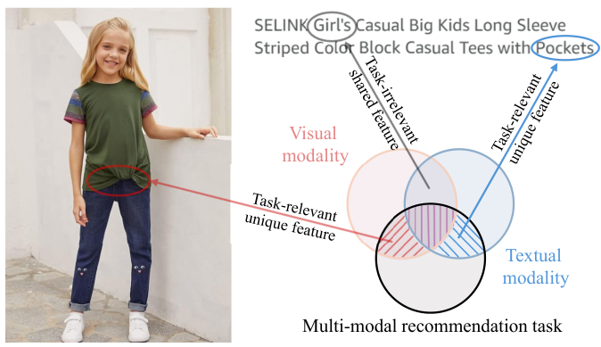
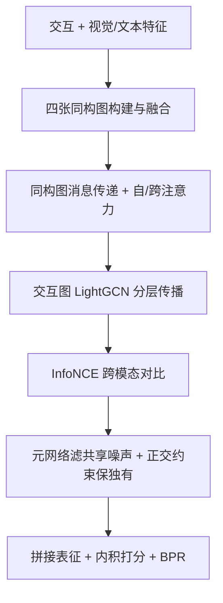

# Refining Contrastive Learning and Homography Relations for Multi-Modal Recommendation (精炼对比学习与同构图关系的多模态推荐)

- **会议/期刊**: ACM MM 2025 (Full Paper)
- **作者与机构**: Shouxing Ma (UTS), Yawen Zeng (湖南大学), Shiqing Wu (澳门城市大学), Guandong Xu (香港教育大学)
- **推荐链路定位**: 召回 (用户-物品表征学习与 Top-K 排序)
- **研究方向**: 多模态推荐 / 自监督对比学习与交互去噪
- **论文原文**: [https://arxiv.org/abs/2508.13745v1](https://arxiv.org/abs/2508.13745v1)
- **开源代码**: [https://github.com/MrShouxingMa/REARM](https://github.com/MrShouxingMa/REARM)

## TL;DR (1分钟核心速览)

现有多模态推荐用跨模态对比学习缓解稀疏性，但简单对齐会**丢失模态独有特征**且**模态共享特征夹带任务无关噪声**；同时同构图只挖了用户共现与物品语义，漏掉用户兴趣与物品共现关系。REARM 用**元网络**从共享特征中滤噪、用**正交约束**保留独有信息，并补建用户兴趣图与物品共现图。在 Baby/Sports/Clothing 三数据集、8:1:1 划分 + 全库排序协议下，R@20 相对最强基线 DRAGON/MIG-GT 提升 3.2%–9.8%。

## Background & Motivation (背景与核心矛盾)

- **主流范式**: GNN 建模用户-物品二部图 + 多模态特征（视觉/文本），并用跨模态对比学习（InfoNCE）构造自监督信号缓解交互稀疏（如 DiffMM、SLMRec、LGMRec）。
- **前人局限一**: 对比学习隐含"多视图冗余"假设 $I(X_1;Y|X_2)\le\varepsilon$，即任务相关信息几乎全在共享部分；但推荐中"图片里的时尚扭结设计""文本里的口袋描述"等**模态独有信息**同样与任务强相关，强行对齐会将其抹掉。
- **前人局限二**: 共享特征并非都干净——图 1 中"Big Kids"标签使女童衬衫也可能属于男童，这类**共享噪声**被直接送入表征，损害精度。
- **前人局限三**: 同构图只用了用户共现图与物品语义图（DRAGON），**用户兴趣图与物品共现图**这两类结构/语义互补关系未被挖掘。
- **核心洞察**: 任务相关信息应分解为"共享（需滤噪）+ 独有（需保留）"两部分分别优化；同构关系应从共现与相似两个视角、用户与物品两个侧面对称补全。
- **本文切入点**: 在对比学习之后加"精炼"环节（元网络滤共享噪声 + 正交约束保独有），并把同构图从 2 张扩到 4 张。

<figure class="paper-figure" markdown="span">
  <figcaption>图1：多模态推荐中模态对比学习的示意图。仅通过对比学习获取模态共享特征会忽略有价值的模态独有特征，并存在模态共享特征包含噪声（与多模态推荐任务无关）的风险。</figcaption>
</figure>

## Method (核心方法设计)

### 1. 整体框架 (Overall Architecture)

REARM 分三块闭环：**同构图学习**先用交互与多模态特征离线构图（用户共现图 $\bar{\mathcal{G}}_{uu}$、用户兴趣图$\tilde{\mathcal{G}}_{uu}$、物品共现图$\bar{\mathcal{G}}_{ii}$、物品语义图$\tilde{\mathcal{G}}_{ii}$），按系数融合成用户/物品同构图并做消息传递，得到含结构语义的 ID 与模态表征；再经自注意力（模态内调幅）与跨注意力（模态间互补）融合；**异构图学习**在用户-物品交互图上按模态独立跑 LightGCN，避免模态互相干扰；**精炼对比学习**先做 InfoNCE 对齐，再用元网络从共享特征中抽取推荐相关知识、用正交约束逼出独有信息，最后与 ID 表征相加拼接，内积打分 + BPR 训练。

### 2. 关键设计拆解 (Key Designs)

1. **模态共享元网络（Meta-network 滤噪）**：痛点是对比后的共享特征含任务无关噪声。做法是先把两模态拼接得元知识 $\mathbf{i}_{share}=\mathbf{W}^{i}_{share}(\bar{\mathbf{i}}_v\|\bar{\mathbf{i}}_t)+\mathbf{b}^{i}_{share}$，再由两层前馈网络**按样本动态生成**一对低秩变换矩阵$\mathbf{W}^{i1}_{share}\in\mathbb{R}^{d\times k},\mathbf{W}^{i2}_{share}\in\mathbb{R}^{k\times d}$（$k<d$），以桥接函数作用于 ID 表征：$\bar{\mathbf{i}}_{share}=\mathbf{W}^{i1}_{share}\mathbf{W}^{i2}_{share}\bar{\mathbf{i}}_{id}$。直觉是"用 ID 行为信号做门控的低秩投影"，只放行与推荐目标相关的共享成分，同时$k<d$ 控制参数量。
2. **模态独有正交约束（Orthogonal Constraint 保独有）**：痛点是余弦对齐会把独有信息压没。做法是在两模态表征间加软正交惩罚 $\mathcal{L}_{ort}=\sum_{i\in\mathcal{I}}\|\bar{\mathbf{i}}_v^{\top}\bar{\mathbf{i}}_t\|_F^2$（用户侧同理），迫使两模态表征张成近正交子空间、各自保留不重叠成分；随后用 BPR 把独有信息中与推荐相关的部分"钉住"，避免正交后留下纯噪声。
3. **四图同构关系补全**：物品共现图按共同交互数取 top-$k$并 softmax 归一；物品语义图按余弦相似度取 top-$k$并度归一，多模态语义图按系数$\alpha^{item}_m$加权求和；最终$\mathcal{G}_{ii}=\alpha^{item}_{co}\bar{\mathcal{G}}_{ii}+(1-\alpha^{item}_{co})\tilde{\mathcal{G}}_{ii}$。用户侧对称构造。四图**训练前离线构建**，不增加训练开销。
4. **训练目标与推理**：$\mathcal{L}=\mathcal{L}_{bpr}+\lambda_{cl}\mathcal{L}_{cl}+\lambda_{ort}\mathcal{L}_{ort}+\lambda_p\|\Theta\|_2^2$，负采样为标准 BPR 单负样本（每正样本配一未交互物品），无额外难负采样设计；推理为内积全库排序，无额外在线开销。

## Experimental Setup & Evaluation Protocol (实验设置与评估协议)

- **数据集与预处理**（Amazon 三域，`5-core` 过滤，视觉 4096 维 / 文本 384 维预提取特征）：

| 数据集 | #Users | #Items | #Interactions | 稀疏度 | 场景说明 |
| :--- | :---: | :---: | :---: | :---: | :--- |
| Baby | 19,445 | 7,050 | 160,792 | 99.88% | 母婴，图文描述较规整 |
| Sports | 35,598 | 18,357 | 296,337 | 99.95% | 运动户外，交互最多 |
| Clothing | 39,387 | 23,033 | 278,677 | 99.97% | 服饰，视觉风格差异大 |

- **数据划分与防穿越**: 随机 `8:1:1` 比例划分训练/验证/测试（非全局时间戳切分，存在轻度未来信息泄漏风险，但与同期基线一致以保证可比）。
- **排名评测协议**: 无偏 `Full-Ranking`（全库未交互物品排序），报告 R@10/R@20/N@10/N@20，测试集全用户平均。
- **对比基线与超参**: 通用模型 BPR/LightGCN/ApeGNN/MGDN + 多模态模型 VBPR/MMGCN/DualGNN/GRCN/LATTICE/BM3/SLMRec/MICRO/MGCN/DiffMM/FREEDOM/LGMRec/DRAGON/MIG-GT；嵌入维度 $d=64$，batch 2048，早停 20 轮、总 2000 轮，以验证集 R@20 为停止指标；LightGCN 层数 1–10、模态/共现系数 0.1–1、矩阵秩 1–10、dropout 0–1 网格搜索。

## Key Experimental Results (实验关键数据)

### 1. 主实验对比 (Main Results)

| Dataset | Metric | BPR | LightGCN | LATTICE | MICRO | MGCN | FREEDOM | DRAGON | MIG-GT | **REARM** | Improv.% |
| :--- | :---: | :---: | :---: | :---: | :---: | :---: | :---: | :---: | :---: | :---: | :---: |
| Baby | R@20 | 0.0575 | 0.0754 | 0.0850 | 0.0929 | 0.0964 | 0.0992 | 0.1021 | 0.1021 | **0.1105** | +8.2% |
| Baby | N@20 | 0.0249 | 0.0328 | 0.0370 | 0.0407 | 0.0427 | 0.0424 | 0.0435 | 0.0452 | **0.0479** | +6.0% |
| Sports | R@20 | 0.0653 | 0.0864 | 0.0953 | 0.1050 | 0.1106 | 0.1089 | 0.1139 | 0.1130 | **0.1231** | +8.1% |
| Sports | N@20 | 0.0298 | 0.0387 | 0.0421 | 0.0463 | 0.0496 | 0.0481 | 0.0512 | 0.0511 | **0.0553** | +8.0% |
| Clothing | R@20 | 0.0303 | 0.0544 | 0.0733 | 0.0772 | 0.0945 | 0.0941 | 0.0979 | 0.0934 | **0.0998** | +1.9% |
| Clothing | N@20 | 0.0138 | 0.0243 | 0.0330 | 0.0347 | 0.0428 | 0.0420 | 0.0443 | 0.0422 | **0.0454** | +2.5% |

（Improv.% 相对最强基线 DRAGON 或 MIG-GT 计算；Clothing 上 R@10 提升更显著：0.0671→0.0700。）

### 2. 消融实验 (Ablation Study)

| 变体 | Baby R@20 | Sports R@20 | Clothing R@20 | Clothing N@20 |
| :--- | :---: | :---: | :---: | :---: |
| w/o uu（去用户同构图） | 0.1055 | 0.1209 | 0.0984 | 0.0446 |
| w/o ii（去物品同构图） | 0.0972 | 0.1011 | 0.0676 | 0.0298 |
| w/o co（去共现图） | 0.1057 | 0.1158 | 0.0968 | 0.0434 |
| w/o sim（去语义图） | 0.0903 | 0.0982 | 0.0708 | 0.0325 |
| w/o hom（去全部同构图） | 0.0926 | 0.0975 | 0.0653 | 0.0290 |
| w/o meta（去元网络） | 0.1078 | 0.1214 | 0.0995 | 0.0451 |
| w/o ort（去正交约束） | 0.1079 | 0.1201 | 0.0983 | 0.0447 |
| w/o ref（去全部精炼） | 0.1070 | 0.1190 | 0.0982 | 0.0446 |
| **REARM** | **0.1105** | **0.1231** | **0.0998** | **0.0454** |

### 3. 关键实验发现 (Key Findings)

1. **同构图是主增益来源，且物品侧 > 用户侧**：去掉全部同构图后 Clothing R@20 从 0.0998 崩到 0.0653（-34.6%），远大于精炼模块的损失（w/o ref 仅 -1.6%）；w/o ii（0.0676）显著差于 w/o uu（0.0984），说明物品侧结构/语义关系对稀疏域更关键。
2. **精炼模块增益小但稳定，且两子模块互补**：w/o meta 与 w/o ort 在三个数据集上均一致下降（Baby 0.1105→0.1078/0.1079），单独去掉任一都不如全去掉的 w/o ref 更差，说明滤共享噪声与保独有信息是两条独立增益路径。
3. **文本模态强于视觉、且不可替代**：REARM$_T$在 Clothing 上 R@20 达 0.100，高于 REARM$_V$ 的 0.092，但两者均低于融合版 0.123（Sports），印证服饰场景文本（尺码/款式）信息密度更高、噪声更低。
4. **最优传播层数 >3，与主流 2 层结论相悖**：作者归因于自/跨注意力先做了模态内与模态间的关系筛选，使高阶 GNN 传播不易过平滑，可承载更深邻域；矩阵秩在 Sports（交互最多）取到 7，说明交互越丰富越需要更大模型容量。

## Highlights & Limitations (亮点、对比与审稿批判)

- **与代表作对比**: 相比 **DiffMM/SLMRec** 只做跨模态对齐、不区分共享/独有，REARM 显式分解并分别优化；相比 **DRAGON** 只用用户共现 + 物品语义两张图，REARM 对称补齐用户兴趣图与物品共现图；相比 **LGMRec** 的超图全局建模，REARM 走"多图 + 精炼对比"路线，参数量更可控（低秩 $k<d$）。
- **可迁移亮点**: ①"元网络按样本生成低秩变换矩阵 + 桥接 ID 表征"的滤噪范式可直接搬到跨域/多行为推荐的噪声视图融合；②软正交约束作为"防表征坍缩/防信息重叠"的正则项，可低成本插入任意双塔对比学习框架。
- **审稿级局限批判**: ①随机 8:1:1 划分而非时间切分，存在未来交互泄漏，全库排序下的绝对数值可能偏乐观；②精炼模块的绝对增益偏小（Clothing R@20 仅 +0.3%），且四张同构图需离线构图与多组系数（$\alpha^{item}_m$、$\alpha^{item}_{co}$）调参，跨域迁移的调参成本与鲁棒性未充分讨论；③缺少与 LLM 语义表征基线及线上 A/B 的对照。

## Rating (四维评分)

- **方法创新性 (Novelty)**: ⭐⭐⭐⭐ （把"共享滤噪 + 独有正交"的任务相关信息分解理论落到推荐场景，配合四图对称补全，机制清晰但组件均为已有技术的组合式创新）
- **评估协议与实验扎实度 (Protocol & Experiments)**: ⭐⭐⭐⭐ （三数据集 + 15 个基线 + 全库排序 + 完整消融与超参曲线，但随机划分而非时间切分、缺显著性检验）
- **写作与数学规范度 (Clarity & Rigor)**: ⭐⭐⭐⭐ （多视图冗余假设与正交约束的理论铺垫到位，公式与符号统一；部分注意力公式的下标书写略紧凑）
- **工业落地与复现价值 (Industrial & Practical Value)**: ⭐⭐⭐⭐ （代码已开源，同构图离线构建、低秩元网络开销可控，推理为标准内积全库排序，工程落地门槛低）

