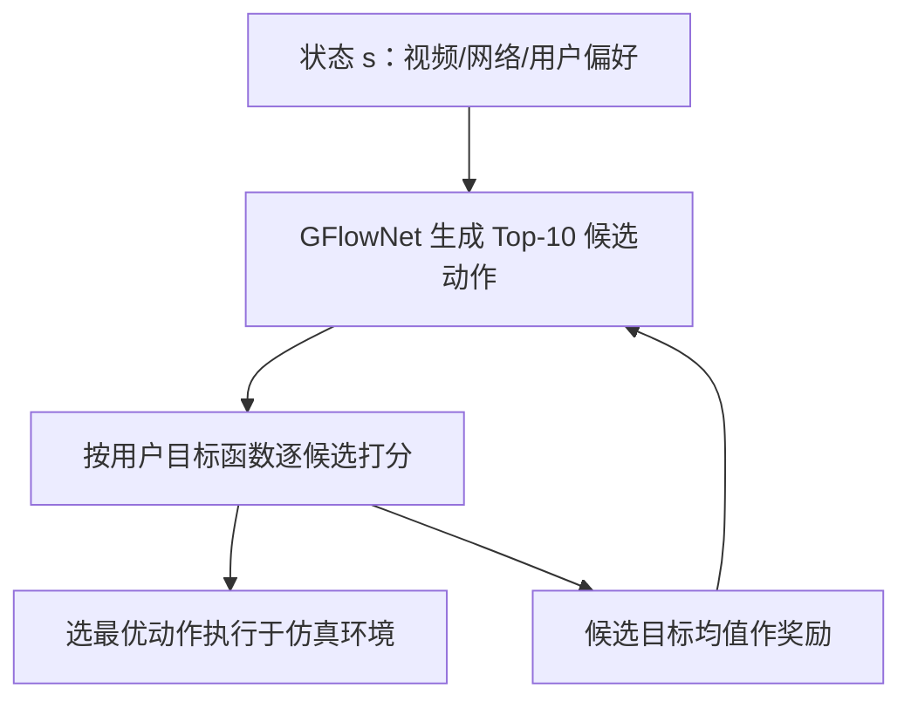
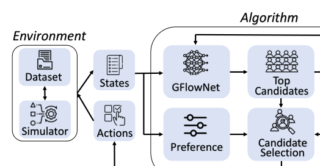

# Generative Flow Networks for Personalized Multimedia Systems: A Case Study on Short Video Feeds (面向个性化多媒体系统的生成流网络：短视频信息流案例研究)

- **会议/期刊**: ACM Multimedia 2025
- **作者与机构**: Yili Jin (McGill), Ling Pan (HKUST), Rui-Xiao Zhang (ByteDance), Jiangchuan Liu (SFU), Xue Liu (MBZUAI/McGill)
- **推荐链路定位**: 端到端生成式（系统控制层：预取决策 + 码率自适应）
- **研究方向**: 强化学习与动态探索推荐 / 生成式推荐
- **论文原文**: [https://arxiv.org/abs/2508.17166v1](https://arxiv.org/abs/2508.17166v1)
- **开源代码**: 暂未开源

## TL;DR (1分钟核心速览)

短视频信息流的个性化预取需要在"看什么、下不下、下多快"三个维度上同时决策，而现有规则法（PDAS）与 RL 法（DAM、Incendio）每步只输出单一动作或单一分布，难以适配异构用户偏好。本文首次将 GFlowNet 引入多媒体系统控制：每步生成 Top-10 候选动作、按用户偏好打分选最优执行，并以候选平均目标值作为奖励训练流匹配。在 DUASVS + Oboe/FCC 网络轨迹的 chunk 级仿真器上，QoE 相对 SOTA 提升约 13–14%，重缓冲降至 2.05–4.05 s，带宽浪费降至 12.7–16.2%。

## Background & Motivation (背景与核心矛盾)

- **主流范式**: 短视频预取由 CDN 与推荐系统协同完成，控制算法（规则法 PDAS、RL 法 DAM/Incendio）依据缓冲区与吞吐状态决定预取视频、码率与暂停时长。
- **前人局限**: 其一，现有系统控制算法"只对状态反应"，不显式建模用户偏好权重 $(\alpha,\beta,\gamma,\theta)$，同一策略服务所有用户；其二，已有的两条个性化路线——多控制算法（逐用户调参/微调）与多系统（逐用户定制架构）——都需为每个 setup 增加专用组件，带来算力冗余与可扩展性瓶颈。
- **核心洞察 (Key Insight)**: 个性化不必"为每人学一个最优策略"，而可以让一个生成模型在每步采样出**一族高质量候选动作**，再由用户偏好函数现场挑选；偏好变化时只需换打分函数，采样分布无需重训。
- **本文切入点**: 用 GFlowNet 的"按奖励比例采样多样化解"性质，把单动作 RL 策略替换为多候选生成 + 偏好选择的两段式控制。

## Method (核心方法设计)

### 1. 整体框架 (Overall Architecture)

环境（数据集 + chunk 级仿真器）输出状态 $s$，包含视频侧信息（chunk 大小、已缓存分片码率）、网络侧信息（重缓冲时长、带宽）与用户偏好参数；GFlowNet 据此生成 Top-10 候选动作（预取哪个视频、哪个 chunk、何种码率）；打分模块按用户目标函数逐候选估值，取最大者下发执行；训练时则用 10 个候选的目标值**均值**作为奖励回传，更新流网络参数。该设计把"探索多样性"交给生成器、把"个性化取舍"交给可替换的奖励函数，二者解耦。

<figure class="paper-figure" markdown="span">
  <figcaption>图3：我们提出的基于GFlowNet方法的流程。</figcaption>
</figure>

### 2. 关键设计拆解 (Key Designs)

1. **流一致性建模与训练目标**：将预取过程视为 DAG $G=(\mathcal{S},\mathcal{A})$上的轨迹构造，学习前向策略$P_F(s'|s)=F(s\to s')/F(s)$使终止对象采样概率正比于奖励$\pi(x)\propto R(x)$。核心采用轨迹平衡损失
$\mathcal{L}_{TB}(\tau)=\left(\log\frac{Z_\theta\prod_t P_{F_\theta}(s_{t+1}|s_t)}{R(x)\prod_t P_{B_\theta}(s_t|s_{t+1})}\right)^2$，
在对数空间优化以保证数值稳定。直觉上，该损失强制"前向生成路径的流量"与"奖励回传的流量"对齐，从而让高奖励动作被高频采样、低奖励动作仍保留非零概率——这正是多候选多样性的来源。
2. **多候选生成 + 偏好选择（MC）**：传统 RL 策略输出单动作或单分布，无法在推理时注入用户偏好。本文让 GFlowNet 输出排序候选列表 $\{\tau_1,\dots,\tau_k\}$，选择模块执行$\tau^*=\arg\max_{\tau_i}\mathbb{E}[R(\tau_i)]$，其中奖励按用户参数化：
$R(s,a)=\alpha Q(s,a)-\beta L(s,a)-\gamma C(s,a)$。
由于训练奖励取候选均值而非被选动作，模型被鼓励维持"一整片好解"的宽分布，偏好权重 $(\alpha,\beta,\gamma,\theta)$ 改变时分布可平滑迁移，无需重训。
3. **训练目标、负采样与推理效率**：总损失即 TB 损失（可替换为 Flow Matching 的 $\mathcal{L}_{FM}$），无负采样概念（生成式采样替代对比学习）；推理时每步仅需一次前向产出 10 个候选并做轻量打分，作者声称多候选机制**不引入额外时延**，开销主要取决于候选打分模块的复杂度。

## Experimental Setup & Evaluation Protocol (实验设置与评估协议)

- **数据集与预处理**: 网络轨迹来自 Oboe + FCC 公开日志，按 1.5 / 3 Mbps 阈值划分为低/中/高带宽三档；视频与用户轨迹来自 DUASVS（百万级 per-chunk 统计与用户留存记录）；用户偏好参数 $(\alpha,\beta,\gamma,\theta)$ 为合成采样。

| 数据源 | 规模/内容 | 用途 | 场景说明 |
| :--- | :--- | :--- | :--- |
| Oboe + FCC traces | 公开带宽日志 | 网络条件 | 低/中/高三档带宽 |
| DUASVS | 百万级 chunk 记录 | 视频 + 用户 | 多码率 chunk 大小、观看时长与留存 |
| 合成偏好 | 逐用户采样 | 个性化 | $\alpha,\beta,\gamma,\theta$ 个体差异 |

- **数据划分与防穿越 (Splitting Strategy)**: 非传统交互划分；每个仿真场景由"一条网络轨迹 + 一段短视频序列 + 一个用户留存画像"组合而成，属**场景级组合评测**，训练/测试通过不同轨迹组合隔离。
- **排名评测协议 (Ranking Protocol)**: 非 ranking 指标；采用 chunk 级仿真回放的**在线指标**：归一化 QoE（$[0,1]$，越高越好）、重缓冲时长（秒，越低越好）、带宽用量（MB）与带宽浪费率（%，下载未观看占比）。
- **对比基线与超参设置**: 基线含规则法 PDAS（快手，RobustMPC 多 chunk 优化）、RL 法 DAM（联合决定播放/码率/暂停）、Incendio（多智能体 RL + 专家引导）；候选数 $k=10$；QoE 权重沿用视频流领域标准模型，未报告显著性检验。

## Key Experimental Results (实验关键数据)

### 1. 主实验对比 (Main Results)

| 方法 | 场景 | QoE ↑ | Rebuf (s) ↓ | BW Usage (MB) ↓ | BW Wastage (%) ↓ |
| :--- | :--- | :---: | :---: | :---: | :---: |
| PDAS | Low | 0.65 | 5.71 | 62.2 | 20.8 |
| DAM | Low | 0.67 | 5.11 | 58.7 | 19.3 |
| Incendio | Low | 0.70 | 4.64 | 56.9 | 18.4 |
| **Ours** | Low | **0.80** | **4.05** | **55.1** | **16.2** |
| PDAS | Medium | 0.72 | 4.01 | 68.4 | 17.6 |
| DAM | Medium | 0.75 | 3.89 | 66.8 | 16.8 |
| Incendio | Medium | 0.78 | 3.52 | 65.2 | 15.1 |
| **Ours** | Medium | **0.88** | **2.97** | **63.9** | **13.9** |
| PDAS | High | 0.76 | 3.47 | 79.1 | 15.9 |
| DAM | High | 0.79 | 2.95 | 77.2 | 15.2 |
| Incendio | High | 0.83 | 2.43 | 74.5 | 13.5 |
| **Ours** | High | **0.94** | **2.05** | **72.3** | **12.7** |

相对最强基线 Incendio：Low 场景 QoE +14.3%、重缓冲 −12.7%、浪费 −2.2 pt；Medium 场景 QoE +12.8%、重缓冲 −15.6%；High 场景 QoE +13.3%、重缓冲 −15.6%。

### 2. 消融实验 (Ablation Study)

| 变体 | QoE ↑ | Rebuf (s) ↓ | BW Wastage (%) ↓ |
| :--- | :---: | :---: | :---: |
| Single-Candidate (SC) | 0.76 | 3.42 | 15.8 |
| **Multi-Candidate (MC)** | **0.88** | **2.97** | **13.9** |
| Fixed Preferences（非个性化） | 0.78 | 3.52 | 14.4 |
| **Personalized** | **0.88** | **2.97** | **13.9** |

### 3. 关键实验发现 (Key Findings)

1. **多候选机制是主要增益来源**：SC→MC 带来 QoE +0.12（0.76→0.88）、重缓冲 −0.45 s、浪费 −1.9 pt，说明"每步保留一族解再择优"比单动作策略更能覆盖异构网络状态，且该增益（+0.12）甚至略大于个性化本身（+0.10）。
2. **个性化收益集中在 QoE 与流畅度而非带宽**：固定偏好→个性化使 QoE +0.10、重缓冲 −0.55 s，但带宽浪费仅从 14.4% 降至 13.9%，表明偏好权重主要调节"画质 vs 卡顿"的取舍，对预取激进程度的调节有限。
3. **高带宽下增益最大**：QoE 从 0.83 提升至 0.94（+13.3%），重缓冲降至 2.05 s，说明带宽充裕时多候选策略有更大空间做码率爬升与平滑性优化；低带宽下增益主要体现为浪费率下降（18.4%→16.2%）。

## Highlights & Limitations (亮点、对比与审稿批判)

- **与代表作对比 (vs. Prior Work)**: 与 PDAS 的本质区别在于后者是手工留存模型 + RobustMPC 的确定性规则，无法注入个体偏好；与 DAM 的区别在于其单动作 DRL 策略在偏好变化时需重训；与 Incendio 的区别在于后者用多智能体拆分"选视频/选码率"决策，而本文用单一生成器产出联合候选集，架构更简洁且天然支持偏好切换。
- **可迁移亮点**: 其一，"生成器产出候选集 + 可替换偏好打分器"的解耦范式可直接迁移到多目标重排与多场景混排；其二，以候选均值作奖励的训练技巧可缓解 RL 策略在稀疏奖励下的模式坍塌。
- **审稿级局限批判**: 其一，用户偏好参数为**合成采样**、环境为仿真器，缺乏真实线上 A/B 验证，个性化收益的可信度受限；其二，奖励函数形式（线性加权 QoE−$\theta$BW）本身是强假设，参数误设会直接削弱个性化效果，且论文未报告候选数$k$ 的敏感性与推理时延实测数据。

## Rating (四维评分)

- **方法创新性 (Novelty)**: ⭐⭐⭐⭐ （首次将 GFlowNet 引入多媒体系统控制，多候选生成替代单动作策略的思路清晰，但流匹配/TB 损失本身为既有方法直接套用）
- **评估协议与实验扎实度 (Protocol & Experiments)**: ⭐⭐⭐ （三档带宽 × 四指标覆盖较全，但仅仿真环境、合成偏好、无显著性检验与超参敏感性分析）
- **写作与数学规范度 (Clarity & Rigor)**: ⭐⭐⭐⭐ （GFlowNet 基础公式与统一框架五要素表述完整，但个性化与多候选的增益归因在正文中略有重叠）
- **工业落地与复现价值 (Industrial & Practical Value)**: ⭐⭐⭐ （问题定义贴近快手等真实业务，但无开源代码、依赖仿真器与合成偏好，线上部署前需补齐时延与奖励校准验证）

