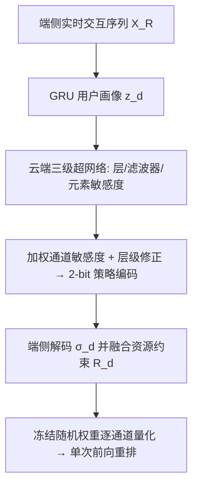
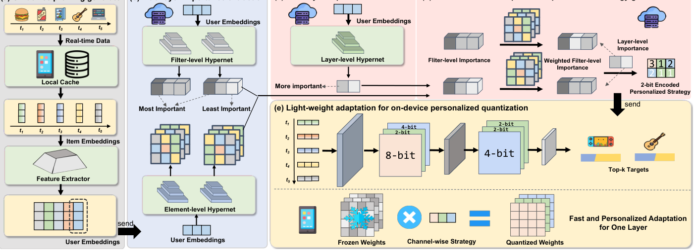

# CHORD: Customizing Hybrid-precision On-device Model for Sequential Recommendation with Device-cloud Collaboration (面向序列推荐的设备-云协同混合精度端侧模型定制)

- **会议/期刊**: ACM MM 2025
- **作者与机构**: Tianqi Liu, Kairui Fu, Shengyu Zhang 等（浙江大学；华为诺亚方舟实验室；上海交通大学）
- **推荐链路定位**: 端侧重排（reranking）
- **研究方向**: 序列与会话推荐 / 工业架构与端云协同
- **论文原文**: [https://arxiv.org/abs/2510.03038v1](https://arxiv.org/abs/2510.03038v1)
- **开源代码**: 暂未开源

## TL;DR (1分钟核心速览)

端侧重排模型受设备算力异构与带宽限制必须压缩，但现有混合精度量化用**统一重要性准则**分配比特，忽视用户兴趣异构性；端侧微调虽能个性化却需本地反向传播、更新期间只能跑次优模型。CHORD 把"找最优量化策略"类比为彩票假设下的子网发现：云端用超网络从用户画像预测**层/滤波器/元素三级敏感度**，合成逐通道比特分配并编码为每通道 2-bit 下发；端侧对冻结随机初始化权重做单次前向量化即完成适配。在 10-core 划分、Leave-One-Out 协议下，Caser 于 CD 上 NDCG@5 相对最优基线提升 62.8%，传输参数量降低 173.8×。

## Background & Motivation (背景与核心矛盾)

- **主流范式**: 云端训练统一模型 + 端侧部署重排模型；压缩侧以混合精度量化（HAWQ、MPQ、MBQuant、AdaBits）为主，个性化侧以端侧微调（Finetune）或参数增量下发（DCCL、ODUpdate）为主。
- **前人局限**: ① 量化方法用**全局统一的重要性准则**（Hessian 谱、scale factor）分配比特，对某些设备"不重要"的低比特通道可能恰是另一用户的关键兴趣通道，造成信息损失；② 端侧微调需本地反向传播，兴趣漂移时重训周期内只能依赖次优模型，且全精度权重下发带宽开销大。
- **核心洞察 (Key Insight)**: 随机初始化网络中已存在性能可比全训练网络的"最优子网"（彩票假设）；因此**个性化量化策略的搜索可等价为在冻结随机权重中寻找用户专属子网**，无需任何梯度更新。
- **本文切入点**: 用云端超网络学习"用户画像 → 参数敏感度"的映射，把个性化压缩从"训练问题"降维成"策略生成 + 单次前向"问题。

## Method (核心方法设计)

### 1. 整体框架 (Overall Architecture)

设备端用轻量 GRU 从实时交互序列抽取用户隐兴趣向量 $z_d$上传云端；云端三组超网络分别输出滤波器级$\alpha^F_i$、元素级$\alpha^E_i$、层级$\alpha^L$敏感度，经"元素聚合重建滤波器重要性 + 层级修正"得到逐通道比特分配，编码为每通道 2-bit 策略$\sigma'_d$下发；设备结合自身资源条件$R_d$解码为$\sigma_d$，对共享的冻结随机初始化权重执行逐通道混合精度量化，单次前向即完成个性化推理。全流程无反向传播、无全精度权重传输。

<figure class="paper-figure" markdown="span">
  <figcaption>图 2：CHORD 概览。(a) 设备将基于实时交互生成潜在兴趣嵌入。(b) 云端将基于用户画像发现每一层参数的滤波器级与元素级关系。(c) 云端的另一模块将为每个用户生成层级参数敏感度。(d) 云端将进一步利用元素级重要性重建滤波器级重要性。随后，云端将基于加权后的滤波器级重要性与层级重要性制定逐通道量化策略。通过 t 传输</figcaption>
</figure>

### 2. 关键设计拆解 (Key Designs)

1. **多粒度敏感度超网络（解决"统一准则忽视用户异构"）**：对每个冻结层用独立超网络 $H^F_i, H^E_i$从$z_d$预测滤波器级与元素级重要性，另有$H^L$输出层级重要性：$\alpha^F_i=H^F_i(z_d),\ \alpha^E_i=H^E_i(z_d),\ \alpha^L=H^L(z_d)$。直觉是不同结构层级承载的个性化信息不同，单粒度必然漏判；三级联合才能把"哪些通道对该用户关键"定位到通道粒度。

2. **加权通道敏感度与 2-bit 策略编码（解决"仅滤波器级无法刻画通道内分布"）**：先用 L1 聚合元素级分数重建通道重要性 $S_{i,j}=\sum_{k\in C_j}|\alpha^E_{i,k}|$，再与 softmax 归一化的滤波器级分数相乘得$\alpha^W_{i,j}=\mathrm{softmax}(\alpha^F_i)\cdot S_{i,j}$；随后映射函数$\Gamma$按超参$\beta$将通道分为三档（top$\beta$% 取 8-bit、次$\beta$% 取 4-bit、其余 2-bit），层级修正$\Lambda$ 再对最敏感层升精度、最不敏感层降精度，形成 2/4/6/8 四档。映射不可导处用 straight-through estimator 传梯度。每通道仅 2-bit 编码，替代 32-bit 权重下发。

3. **训练目标、负采样与推理效率**：总损失为量化后模型在端侧实时序列上的下一项交叉熵（以 NDCG/HR 为评测目标），训练时仅更新超网络参数，主干权重全程冻结、免负采样（全库 softmax 式下一项预测）。推理侧平均 3-bit，端侧仅一次前向，无反向传播；通信量为每通道 2-bit，Caser 场景下参数传输量从 0.4968 降至 0.0029（百万比特计）。

## Experimental Setup & Evaluation Protocol (实验设置与评估协议)

- **数据集与预处理**: 三数据集均采用 `10-core` 过滤（用户与物品交互数 <10 剔除）：

| 数据集 | #Users | #Items | #Interactions | 密度 | 场景说明 |
| :--- | :---: | :---: | :---: | :---: | :--- |
| Amazon-CD | 31,482 | 68,307 | 867,853 | 0.040% | 稀疏电商音乐 |
| Yelp | 97,052 | 94,279 | 2,943,170 | 0.032% | 超稀疏本地生活 |
| ML-100K | 943 | 928 | 94,672 | 10.802% | 稠密电影 |

- **数据划分与防穿越**: 按用户交互时间排序，**最近一次交互作测试、其余全部作训练**（Leave-One-Out 式时序划分），无验证集泄漏。
- **排名评测协议**: 采用 `Full-Ranking`（对全库未交互物品排序），指标 NDCG@{5,10}、HR@{5,10}；效率指标为平均比特数（Avg Bits）与传输参数量（Param，百万比特）。
- **对比基线与超参**: 主干为 SASRec（Transformer）与 Caser（CNN）；基线含 On-device Static / Finetune、PEMN、Quant、AdaBits、RFQuant、MBQuant 共 7 个。通道选择率 $\beta$ 默认 0.125（平均 3-bit），比特组合 2-4-6-8。

## Key Experimental Results (实验关键数据)

### 1. 主实验对比 (Main Results)

| 主干 | 方法 | Avg Bits | CD NDCG@5 | CD HR@10 | Yelp NDCG@5 | ML-100K NDCG@5 | ML-100K HR@10 | Param |
| :--- | :--- | :---: | :---: | :---: | :---: | :---: | :---: | :---: |
| Caser | Base (32-bit) | 32 | 0.0183 | 0.0356 | 0.0097 | 0.0439 | 0.1177 | 0.4968 |
| Caser | Finetune | 32 | 0.0184 | 0.0358 | 0.0097 | 0.0448 | 0.1188 | 0.4968 |
| Caser | Quant | 3 | 0.0090 | 0.0191 | 0.0066 | 0.0217 | 0.0615 | 0.0490 |
| Caser | AdaBits | 3 | 0.0067 | 0.0157 | 0.0062 | 0.0335 | 0.0944 | 0.0490 |
| Caser | RFQuant | 3 | 0.0061 | 0.0136 | 0.0035 | 0.0278 | 0.0764 | 0.0490 |
| Caser | MBQuant | 3 | 0.0149 | 0.0310 | 0.0075 | 0.0347 | 0.0954 | 0.0490 |
| Caser | **CHORD** | **3** | **0.0298** | **0.0468** | **0.0104** | **0.0493** | **0.1220** | **0.0029** |
| Caser | Improv. | — | +62.8% | +31.5% | +7.2% | +12.3% | +3.7% | ×173.8 |
| SASRec | Base (32-bit) | 32 | 0.0258 | 0.0431 | 0.0107 | 0.0342 | 0.1092 | 3.9936 |
| SASRec | PEMN | 3† | 0.0375 | 0.0566 | 0.0115 | 0.0429 | 0.1326 | 0.3072 |
| SASRec | MBQuant | 3 | 0.0293 | 0.0465 | 0.0105 | 0.0353 | 0.1018 | 0.4301 |
| SASRec | **CHORD** | **3** | **0.0370** | **0.0584** | **0.0118** | **0.0519** | **0.1463** | **0.0653** |
| SASRec | Improv. | — | +43.4% | +35.5% | +10.3% | +51.8% | +34.0% | ×61.2 |

### 2. 消融实验 (Ablation Study)

| 主干 | 配置 | ML-100K NDCG@10 | ML-100K HR@10 | Yelp NDCG@10 | Yelp HR@10 |
| :--- | :--- | :---: | :---: | :---: | :---: |
| Caser | Quant | 0.0298 | 0.0615 | 0.0092 | 0.0188 |
| Caser | +Customization | 0.0569 | 0.1156 | 0.0141 | 0.0284 |
| Caser | +Weighted Channel | 0.0587 | 0.1198 | 0.0141 | 0.0287 |
| Caser | **CHORD** | **0.0639** | **0.1220** | **0.0143** | **0.0290** |
| SASRec | Quant | 0.0479 | 0.1029 | 0.0115 | 0.0233 |
| SASRec | +Customization | 0.0687 | 0.1432 | 0.0157 | 0.0314 |
| SASRec | +Weighted Channel | 0.0699 | 0.1421 | 0.0159 | 0.0319 |
| SASRec | **CHORD** | **0.0707** | **0.1463** | **0.0160** | **0.0318** |

### 3. 关键实验发现 (Key Findings)

1. **个性化是最大增益来源，而非量化本身**：Caser 上从 Quant 到 +Customization，ML-100K NDCG@10 从 0.0298 跃至 0.0569（+91%），远超后续加权通道（+3.2%）与层级修正（+8.9%）的贡献——说明"按用户分配比特"比"更精细的重要性估计"更关键。
2. **量化模型可反超全精度模型**：CHORD 在 3-bit 下 Caser/CD NDCG@5 达 0.0298，是 Base（0.0183）的 1.63 倍；SASRec/ML-100K 亦从 0.0342 升至 0.0519。作者归因于随机初始化 + 个性化比特分配起到了隐式正则与子网集成效果，而非单纯压缩。
3. **比特差异化比比特总量更重要**：同为平均 3-bit，2-4-6-8 组合在 SASRec/ML-100K 上比 2-5-6-7 高 5.21% NDCG@10、6.94% HR@10；且 $\beta=0.125$为最优拐点，$\beta$ 过大（0.1875）反而掉点，证明高敏感通道必须被"区别对待"而非平均加码。此外 3-bit 训练模型降级部署到 2-bit 仅损失 1.81% NDCG@10，具备优雅降级能力。

## Highlights & Limitations (亮点、对比与审稿批判)

- **与代表作对比 (vs. Prior Work)**: 相比 MBQuant/AdaBits 等量化方法，CHORD 的本质差异是把"重要性准则"从**数据无关的全局统计量**换成**用户条件化的超网络预测**，且策略以 2-bit 编码传输而非权重；相比 DCCL/ODUpdate 等端云协同个性化方案，CHORD 完全免除端侧反向传播与全精度权重下发，适配开销从"重训周期"压缩到"一次前向"。
- **可迁移亮点**: ① "冻结随机权重 + 策略生成"范式可迁移到端侧 CTR/多任务模型的资源自适应部署；② 元素级分数 L1 聚合重建通道级重要性的做法，可直接复用到结构化剪枝的通道打分。
- **审稿级局限批判**: ① 云端超网络需为每层单独建模，层数增长时参数量与推理开销线性上升，论文未给出云端侧延迟与显存实测；② 实验仅在两个轻量主干（SASRec/Caser）与三个中小规模数据集上验证，未涉及工业级千万物品全库排序与真实设备异构性 A/B，Full-Ranking 下的绝对指标（NDCG@5 < 0.05）也偏低，泛化性存疑。

## Rating (四维评分)

- **方法创新性 (Novelty)**: ⭐⭐⭐⭐ （将彩票假设与超网络结合，把个性化量化重构为"用户条件化子网搜索"，视角新颖但组件均为已有技术的巧妙拼装）
- **评估协议与实验扎实度 (Protocol & Experiments)**: ⭐⭐⭐⭐ （三数据集 × 两主干 × 七基线 + 消融/敏感度/降级部署分析完整，但缺显著性检验与工业规模验证）
- **写作与数学规范度 (Clarity & Rigor)**: ⭐⭐⭐⭐ （公式简洁、三级敏感度定义清晰，但 Eq.1 目标函数与后续实现之间的推导衔接略跳跃，部分符号复用易混淆）
- **工业落地与复现价值 (Industrial & Practical Value)**: ⭐⭐⭐⭐ （2-bit 策略传输与免重训适配极具工程价值，但代码未开源、云端超网络开销未量化，复现门槛中等）

