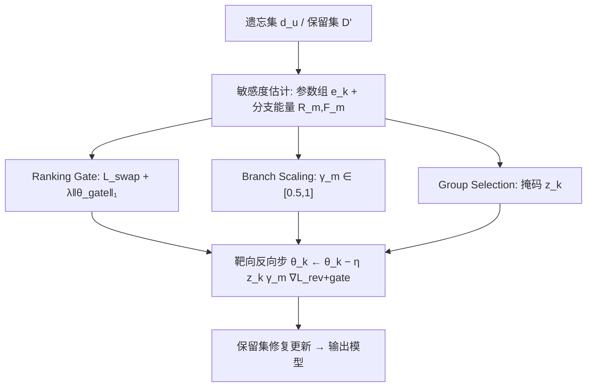

# TRU: Targeted Reverse Update for Efficient Multimodal Recommendation Unlearning (面向高效多模态推荐遗忘的靶向反向更新)

- **会议/期刊**: ACM MM 2026 (Author Accepted Manuscript)
- **作者与机构**: Zhanting Zhou, Zeyu Ma, Yang Yang, Ziqiang Zheng (电子科技大学); KaHou Tam (澳门大学)
- **推荐链路定位**: 训练后模型维护 / 隐私删除（不改变推理链路，plug-and-play）
- **研究方向**: 去偏公平、可信隐私与工业架构 / 多模态推荐
- **论文原文**: [https://arxiv.org/abs/2604.02183v4](https://arxiv.org/abs/2604.02183v4)
- **开源代码**: 暂未开源

## TL;DR (1分钟核心速览)

多模态推荐系统 (MRS) 将协同图与图文内容深度耦合，用户删除请求下"全量重训练"代价不可承受，而现有近似遗忘方法 MMRecUn 对全网施加**均匀反向梯度**，与 MRS 的异构结构严重错配。本文诊断出三层非均匀性——目标物品在排序中残留、模态分支响应失衡、删除敏感度集中于少数模块——并提出 TRU：用排序融合门控、分支级模态缩放、容量感知参数组隔离三项靶向干预重构反向步。在 2 个骨干 × 3 个数据集 × 3 种删除粒度下，TRU 在多数设置把 Retain/Forget 双侧指标同时推向精确重训练前沿（如 MIG-GT/Baby 上 Forget Recall@20 由 0.0775 降至 0.0132），并取得近似方法中最低 MIA BalAcc。

## Background & Motivation (背景与核心矛盾)

- **主流范式**: MRS 用模态感知图卷积 (MGCN) 或模态独立图+全局 Transformer (MIG-GT) 联合建模交互图与图文特征；遗忘侧则以 MMRecUn 为代表，采用"遗忘集梯度上升 + 保留集修复"的反向-修复协议。
- **前人局限**: ① 分区重训练类 (RecEraser/UltraRE) 与图遗忘类 (GNNDelete/ScaleGUN) 不建模跨模态耦合；多模态遗忘 (MultiDelete) 不建模协同图与排序目标。② MMRecUn 虽专为 MRS 设计，却对全部参数施加**同一反向信号**，而各模态分支表征空间本就弱对齐。
- **核心洞察 (Key Insight)**: 作者用三组诊断实验证明遗忘影响是**结构性非均匀**的：(a) Amazon-Clothing 上遗忘集对多数物品的交互占比不足 10%，即使完全重训练，MGCN/MIG-GT 的 Top-20 目标物品曝光仍仅下降 12.4%/18.3%——协同流行度惯性使"删边"无法压制曝光；(b) 用 CKA 度量 ID/图像/文本三分支跨模态相似度，绝大多数低于 0.1，均匀反向必然"过校正脆弱分支、欠校正主导分支"；(c) 层敏感度错配：MMRecUn 在 Image Embedding 层的归一化参数偏移达 0.166，远超重训练基准 0.089。
- **本文切入点**: 放弃全局均匀惩罚，改为在**输出层（排序）、表征层（模态分支）、参数层（模块组）** 三级协同地"靶向"施加反向更新。

## Method (核心方法设计)

### 1. 整体框架 (Overall Architecture)

TRU 保持骨干网络、保留集目标与推理流程完全不变，仅重写反向步。每个 epoch 先做两件事：用遗忘批次的梯度能量估计各参数组敏感度并生成二值掩码，同时用保留/遗忘双侧梯度能量比估计三个模态分支的缩放系数；随后挂载梯度 hook，在遗忘批次上最小化"交换正负样本的排序损失 + 门控 $\ell_1$ 稀疏惩罚"，此时反向梯度被掩码与缩放联合调制；最后卸载 hook，在保留批次上执行原始前向修复。三项干预分别对应三个诊断出的瓶颈，形成"抑制什么—在哪抑制—抑制多强"的闭环。

### 2. 关键设计拆解 (Key Designs)

1. **排序融合门控 (Ranking Gate)**：针对协同流行度惯性导致的物品残留，在反向步中对门控参数施加 $\ell_1$ 稀疏惩罚，使跨模态融合权重主动收缩，从输出端压制目标物品得分：
$$\mathcal{L}_{rev+gate}(b_f)=\mathcal{L}_{swap}(b_f)+\lambda_{gate}\sum_{\vartheta\in\mathcal{G}_{gate}}\|\vartheta\|_1$$
其中 $\mathcal{L}_{swap}$ 为遗忘批次中交换正负样本后的排序损失。直觉是：既然残留曝光来自"其他保留用户对目标物品的协同支撑"，就必须直接惩罚其排序通路而非仅删边。

2. **分支级模态缩放 (Branch-wise Scaling)**：针对三分支弱对齐导致的响应失衡，用双侧梯度能量比自适应衰减反向梯度：
$$\gamma_m=\max\!\left(0.50,\ \min\!\left(1,\ \frac{\max(10^{-12},R_m)}{\max(10^{-12},F_m)}\right)\right)$$
其中 $R_m,F_m$分别为分支$m$在保留/遗忘批次上的梯度范数均值。仅当遗忘侧能量超过保留侧 ($F_m>R_m$) 时才把反向梯度压到$[0.5,1]$，从而保护脆弱分支的保留表征、同时不削弱真正需要遗忘的分支。

3. **容量感知参数组隔离与训练目标**：针对层敏感度集中，按遗忘梯度能量 $e^{rev}_k$降序选取参数组，先取前$\lceil p|\mathcal{K}|\rceil$组，再扩展至覆盖至少$\tau_{\min}$比例的命名参数，得到掩码$z_k=\mathbb{I}[k\in\mathcal{K}_{sel}]$。最终统一反向步为：
$$\theta_k\leftarrow\theta_k-\eta\,z_k\,\gamma_{m(k)}\,\nabla_{\theta_k}\mathcal{L}_{rev+gate}$$
负采样沿用骨干原有 BPR 式采样，无额外负采样开销；推理阶段零改动，仅训练期多一次梯度能量估计。

## Experimental Setup & Evaluation Protocol (实验设置与评估协议)

- **数据集与预处理**: 采用 Amazon 评论三品类，遵循 CURE4Rec 基准的过滤与构图流程：

| 数据集 | #Users | #Items | #Interactions | 稀疏度/密度 | 特征/场景说明 |
| :--- | :---: | :---: | :---: | :---: | :--- |
| Baby | 未报告 | 未报告 | 未报告 | 未报告 | 图文多模态，用户级删除主场景 |
| Sports | 未报告 | 未报告 | 未报告 | 未报告 | 图文多模态，MIG-GT 挑战场景 |
| Clothing | 未报告 | 未报告 | 未报告 | 未报告 | 图文多模态，物品流行度长尾显著 |

- **数据划分与防穿越 (Splitting Strategy)**: 沿用骨干的标准训练/验证/测试划分；遗忘集 $d_u$按三种粒度独立构造——用户级 (U-U，模拟账号删除)、物品级 (I-I，模拟内容下架)、交互级 (U-I，模拟偏好纠正)，保留集$\mathcal{D}'=\mathcal{D}\setminus d_u$。
- **排名评测协议 (Ranking Protocol)**: 采用 `Full-Ranking` 全库未交互排序，报告 Retain Recall@20 / NDCG@20（越高越好）与 Forget Recall@20 / NDCG@20（越低越好）双侧指标；另设安全审计：MIA 平衡准确率 (BalAcc，越接近 0.5 越好) 与后门攻击成功率 (ASR，越接近 0 越好)，以及挂钟时间收敛轨迹。
- **对比基线与超参设置**: 基线含 Original、Retrain（精确遗忘金标准）、UltraRE、MultiDelete、ScaleGUN、MMRecUn；骨干为 MGCN 与 MIG-GT；门控稀疏系数 $\lambda_{gate}$、选取比例$p$、最小容量$\tau_{\min}$ 及缩放下界 0.5 为关键超参，详见附录敏感性分析。

## Key Experimental Results (实验关键数据)

### 1. 主实验对比 (Main Results)

以最具代表性的 MIG-GT 骨干为例（MGCN 上 TRU 在 Baby/Clothing 的 Retain Recall@20 亦全面超过 MMRecUn，如 Clothing 0.0945 vs. 0.0909）：

| 骨干/数据集 | 方法 | Retain R@20↑ | Retain N@20↑ | Forget R@20↓ | Forget N@20↓ |
| :--- | :--- | :---: | :---: | :---: | :---: |
| MIG-GT / Baby | Original | 0.0987 | 0.0435 | 0.6787 | 0.5223 |
| | Retrain | — | — | — | — |
| | MMRecUn | 0.0825 | 0.0383 | 0.0775 | 0.0515 |
| | **TRU** | **0.1008** | **0.0442** | **0.0132** | **0.0095** |
| MIG-GT / Clothing | MMRecUn | 0.0847 | 0.0383 | 0.5234 | 0.4572 |
| | **TRU** | **0.0917** | **0.0417** | **0.0022** | **0.0014** |
| MIG-GT / Sports | MMRecUn | 0.1074 | 0.0476 | 0.0457 | 0.0301 |
| | **TRU** | 0.1036 | **0.0494** | **0.0051** | **0.0034** |
| MGCN / Clothing | MMRecUn | 0.0909 | 0.0401 | 0 | 0 |
| | **TRU** | **0.0945** | **0.0436** | **0** | **0** |

用户级挑战场景（表 2）：MIG-GT/Sports 上 TRU 达 Retain 0.1036 / Forget 0.0072，逼近 Retrain 的 0.1046 / 0.0095；MGCN/Clothing 上 Retain 0.0945 高于 MMRecUn 的 0.0909，Forget 双侧均低于 0.00005。

安全审计（表 3）：MIG-GT/Sports 上 TRU 取得近似方法中最低 MIA BalAcc 0.5253（最接近理想 0.5，Retrain 为 0.6153）并并列最低 ASR 0.0811；MGCN/Clothing 上 BalAcc 0.9388 为近似方法最低，但整体仍远离 0.5，仅属部分缓解。

### 2. 消融实验 (Ablation Study)

Baby 数据集、用户级删除、聚焦遗忘侧：

| 骨干 | 变体 | Forget R@20↓ | Clean-after↓ |
| :--- | :--- | :---: | :---: |
| MGCN | Full Model | **0** | **0.0871** |
| | w/o Ranking Gating | 0.0746 | 0.0904 |
| | w/o Modality Scaling | 0.0074 | 0.0903 |
| | w/o Group Selection | 0.0075 | 0.0906 |
| MIG-GT | Full Model | **0.0077** | **0.0934** |
| | w/o Ranking Gate | 0.0153 | 0.0953 |
| | w/o Modality Scaling | 0.0081 | 0.0950 |
| | w/o Group Selection | 0.0093 | 0.0959 |

### 3. 关键实验发现 (Key Findings)

1. **排序门控是表层擦除的主防线**：移除后 MGCN 的 Forget Recall@20 从 0 暴涨至 0.0746，说明协同流行度惯性必须靠输出端稀疏化融合权重来压制，单纯删边或均匀反向无效。
2. **参数组隔离决定遗忘深度**：所有消融变体都能把显式后门触发降到 0，但审计干净输入上的残留 (Clean-after) 时，去掉容量感知掩码在 MIG-GT 上造成最大抬升（0.0934→0.0959），证明不隔离敏感模块的遗忘只是"表层"的。
3. **模态缩放提供双向护栏**：去掉分支缩放同时恶化表层与深层指标（MGCN 上 Forget R@20 0→0.0074、Clean-after 0.0871→0.0903），印证弱对齐的模态分支无法吸收均匀梯度；三项组件构成严格互补的三元组。

## Highlights & Limitations (亮点、对比与审稿批判)

- **与代表作对比 (vs. Prior Work)**: 相较 MMRecUn 的"全网同一反向信号"，TRU 首次把 MRS 遗忘拆成排序/模态/参数三层并分别靶向；相较 UltraRE 的分区重训练与 ScaleGUN 的纯结构擦除，TRU 不分区、不改骨干、显式建模跨模态耦合；相较 MultiDelete 的样本级跨模态解耦，TRU 直接面向协同图与排序输出。
- **可迁移亮点**: ① "梯度能量比 → 分支缩放系数"是一种轻量、免调参的异构分支梯度调制手段，可直接迁移到多任务/多模态联合训练中的梯度冲突缓解；② 容量感知参数组掩码（按敏感度排序 + 最小覆盖比例）可作为通用 PEFT/遗忘的稀疏更新模板。
- **审稿级局限批判**: ① 数据集统计量未在主文报告，且仅覆盖 Amazon 三品类，缺乏短视频、跨域等更强异构场景；② MGCN/Clothing 上 MIA BalAcc 仍高达 0.9388，安全审计仅"部分缓解"，且每 epoch 需额外估计梯度能量，训练期开销与超参 ($p,\tau_{\min},\lambda_{gate}$) 敏感性需更充分讨论。

## Rating (四维评分)

- **方法创新性 (Novelty)**: ⭐⭐⭐⭐ （三层非均匀性诊断扎实且有 CKA/层偏移定量支撑，靶向反向更新思路清晰，但各组件本身较工程化）
- **评估协议与实验扎实度 (Protocol & Experiments)**: ⭐⭐⭐⭐ （2 骨干×3 数据集×3 删除粒度 + 双侧指标 + MIA/ASR 安全审计 + 挂钟轨迹，覆盖全面；数据集统计缺失略扣分）
- **写作与数学规范度 (Clarity & Rigor)**: ⭐⭐⭐⭐ （三瓶颈到三干预的映射一目了然，公式简洁；部分符号如 $\mathcal{G}_m$与$\mathcal{K}$ 的层级关系需对照附录）
- **工业落地与复现价值 (Industrial & Practical Value)**: ⭐⭐⭐⭐ （plug-and-play、推理零改动、收敛快于全量重训练 50 倍以上，工程价值高；暂未开源降低复现便利性）

