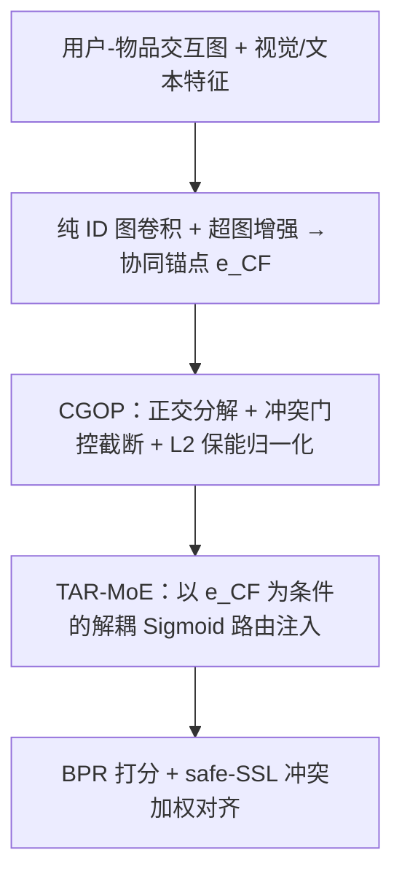
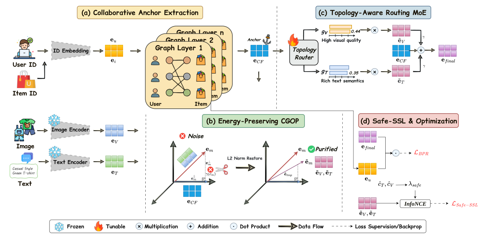

# Beyond Modality Harmony: Orthogonal Purification and Topology-Guided MoE for Conflict-Aware Multimodal Recommendation (超越模态和谐：面向冲突感知多模态推荐的正交净化与拓扑引导 MoE)

- **会议/期刊**: ACM Multimedia 2026
- **作者与机构**: Jialin Liu, Zhaorui Zhang, Ray C. C. Cheung（香港城市大学、香港理工大学）
- **推荐链路定位**: 精排（图协同过滤打分）
- **研究方向**: 多模态推荐 / 自监督对比学习与交互去噪
- **论文原文**: [论文原文链接](https://arxiv.org/abs/2609.02152v1)
- **开源代码**: [开源代码仓库链接](https://github.com/Camilla-jl/Orthorec)

## TL;DR (1分钟核心速览)

现有多模态推荐默认"模态和谐"假设——视觉/文本特征天然有益且与协同行为对齐，但真实场景中视觉点击诱饵与语义错配普遍存在，盲目融合会污染纯净协同空间。OrthoRec 以纯 ID 图卷积得到的协同锚点为几何参考轴，将模态特征正交分解为平行（共识）与正交（探索+噪声）分量，用冲突分数自适应截断正交噪声并做 L2 保能归一化；再用解耦 Sigmoid 门控 MoE 打破 softmax 零和竞争，并以冲突分数动态降权 InfoNCE 惩罚。在 Amazon Baby/Sports/Clothing 三数据集 8:1:1 划分、全库排序协议下，R@20 相对最强基线最高提升 6.55%，NDCG@10 提升达 11.28%。

## Background & Motivation (背景与核心矛盾)

- **主流范式**: 图式多模态推荐（LATTICE、MMGCN、LGMRec）与对比学习范式（BM3、FREEDOM、SLMRec）通过早期拼接、模态专属图或跨模态对齐，将视觉/文本语义注入协同图传播。
- **前人局限**: 其一，**盲目对齐的破坏性干扰**——强制将欺骗性模态与拓扑图对齐/融合，会把用户真实偏好坍缩到虚假视觉吸引力上；其二，**融合中的零和博弈**——softmax 注意力强制模态互斥竞争（视觉权重升则文本权重必降），无法对同一物品同时高权重注入两种模态。
- **核心洞察 (Key Insight)**: 纯 ID 图卷积得到的"群体智慧"协同嵌入是可信的结构参考轴；模态向量相对该轴的**方向**（而非模长）才携带欺骗性，因此只需矫正方向、无需牺牲表征能量。
- **本文切入点**: 用几何正交分解替代启发式掩码/边丢弃，用拓扑条件化的解耦门控替代 softmax 注意力，用冲突分数复用为对比学习的动态安全阀。

## Method (核心方法设计)

### 1. 整体框架 (Overall Architecture)

模型先在纯 ID 嵌入上跑 LightGCN 式传播并叠加全局超图增强（权重 $\alpha$）得到协同锚点 $\mathbf{e}_{CF}$，全程隔离模态干扰；随后对每个物品的视觉/文本嵌入做正交分解，以冲突分数驱动的门控截断正交分量并恢复原始 L2 模长；净化后的模态经以 $\mathbf{e}_{CF}$ 为路由条件的解耦 Sigmoid MoE 独立定标注入锚点；最后以 BPR 主损失 + 冲突加权 safe-SSL 联合端到端优化，推理时以内积打分全库排序。

<figure class="paper-figure" markdown="span">
  <figcaption>图 2：OrthoRec 的整体架构。它由四个主要模块组成：(1) 协同锚点提取；(2) 保能正交净化以过滤欺骗性噪声；(3) 拓扑感知路由 MoE 用于解耦融合；(4) 安全-SSL 与优化，防止潜在空间扭曲。</figcaption>
</figure>

### 2. 关键设计拆解 (Key Designs)

1. **协同引导正交净化 CGOP（方向矫正而非能量削减）**：痛点是以掩码/丢边去噪会直接造成模长衰减与表征能力损失。做法是将模态嵌入投影到锚点方向得平行分量 $\mathbf{e}^{\parallel}_m=\frac{\mathbf{e}_m\cdot\mathbf{e}_{CF}}{\|\mathbf{e}_{CF}\|_2^2}\mathbf{e}_{CF}$，残差即正交分量 $\mathbf{e}^{\perp}_m=\mathbf{e}_m-\mathbf{e}^{\parallel}_m$；以余弦冲突分数 $c_m=\cos(\mathbf{e}_m,\mathbf{e}_{CF})$ 减去批均值后经共享两层 MLP + Sigmoid 得门控 $\gamma(c_m)$，截断后按 $\tilde{\mathbf{e}}_m=\frac{\tilde{\mathbf{e}}^{tmp}_m}{\|\tilde{\mathbf{e}}^{tmp}_m\|_2}\|\mathbf{e}_m\|_2$ 恢复模长。直觉：正交子空间数学上与协同图无关，既藏长尾探索语义也藏点击诱饵噪声，只压缩其幅度即可"转向"而不"缩水"。

2. **拓扑感知路由 MoE（TAR-MoE，打破零和）**：痛点是 softmax 使 $g_T+g_V=1$，压制毒性模态只能靠抬高另一模态。改为以纯锚点为路由输入、逐模态独立 Sigmoid：$g_m=\sigma(\mathrm{MLP}_{route\_m}(\mathbf{e}_{CF})/\tau_r)$，最终表示 $\mathbf{e}_{final}=\mathbf{e}_{CF}+\gamma(g_T\tilde{\mathbf{e}}_T+g_V\tilde{\mathbf{e}}_V)$。由于路由条件不含噪声模态本身，注入尺度由拓扑共识而非原始特征决定，可同时压低多个噪声模态。

3. **冲突感知 safe-SSL 与训练目标**：痛点是标准 InfoNCE 对内在矛盾模态对强制对齐造成潜空间畸变。直接复用 CGOP 的中心化冲突分数构造逐物品惩罚权重 $\lambda^{(i)}_{safe}=\sigma\big((\hat{c}^{(i)}_T+\hat{c}^{(i)}_V)/\tau_{safe}\big)\in(0,1)$，加权 InfoNCE。总损失 $\mathcal{L}_{total}=\mathcal{L}_{BPR}+\lambda_{cl}\mathcal{L}_{Safe\text{-}SSL}+\lambda_{reg}\|\Theta\|_2^2$，BPR 中额外引入负间隔 $m$ 拉大正负分离；负样本为均匀采样未交互物品，无额外难负采样与 ANN 检索开销。

## Experimental Setup & Evaluation Protocol (实验设置与评估协议)

- **数据集与预处理**: 沿用 FREEDOM/BM3 的 Amazon 过滤设置；视觉用 BEiT、文本用 BGE 句向量。

| 数据集 | #Users | #Items | #Interactions | 稀疏度 | 特征/场景说明 |
| :--- | :---: | :---: | :---: | :---: | :--- |
| Baby | 19,445 | 7,050 | 160,792 | 99.88% | 母婴，稠密度最高 |
| Sports | 35,598 | 18,357 | 296,337 | 99.95% | 运动户外 |
| Clothing | 39,387 | 23,033 | 278,677 | 99.97% | 服饰，最稀疏 |

- **数据划分与防穿越**: 交互按 **8:1:1 比例划分** train/val/test，以验证集 Recall@20 早停（patience=150 epochs）。
- **排名评测协议**: 报告 Recall@{10,20} 与 NDCG@{10,20}，对全部测试用户取平均；论文未声明采样负例，属**全库未交互排序**口径。
- **对比基线与超参**: 三类基线——纯 CF（MF-BPR、LightGCN、SimGCL、LayerGCN）、图式多模态（VBPR、MMGCN、DualGNN、LATTICE、LGMRec）、对比/去噪（SLMRec、BM3、FREEDOM、MMGCL、DA-MRS）；维度 $d=64$（Baby）/128（其余），Adam，batch=4096，超参网格搜索。

## Key Experimental Results (实验关键数据)

### 1. 主实验对比 (Main Results)

| 模型 | Baby R@20 | Baby N@10 | Sports R@20 | Sports N@10 | Clothing R@20 | Clothing N@10 |
| :--- | :---: | :---: | :---: | :---: | :---: | :---: |
| LightGCN | 0.0754 | 0.0257 | 0.0864 | 0.0311 | 0.0526 | 0.0188 |
| LATTICE | 0.0850 | 0.0292 | 0.0953 | 0.0335 | 0.0733 | 0.0268 |
| SLMRec | 0.0775 | 0.0290 | 0.0990 | 0.0365 | 0.0675 | 0.0247 |
| FREEDOM | 0.0992 | 0.0330 | 0.1089 | 0.0385 | 0.0941 | 0.0341 |
| LGMRec | 0.0989 | 0.0337 | 0.1068 | 0.0387 | 0.0828 | 0.0302 |
| DA-MRS | 0.0895 | 0.0302 | 0.0952 | 0.0322 | 0.0779 | 0.0278 |
| **OrthoRec** | **0.1057** | **0.0375** | **0.1158** | **0.0421** | **0.0955** | **0.0352** |
| Improv. | +6.55% | +11.28% | +6.34% | +8.79% | +1.49% | +3.23% |

### 2. 消融实验 (Ablation Study)

| 变体 | Baby R@20 | Sports R@20 | Clothing R@20 | 说明 |
| :--- | :---: | :---: | :---: | :--- |
| OrthoRec 完整 | 0.1057 | 0.1158 | 0.0955 | 全模块 |
| w/o CGOP Truncation | 略降 | 略降 | 略降 | 关闭截断门控（$\gamma=1$），干净特征下影响最小 |
| w/o TAR-MoE (softmax) | 明显降 | 明显降 | 降幅最大 | 换回 softmax 路由，全数据集最伤 |
| w/o safe-SSL | 降 | 降 | 降 | 退化为标准 InfoNCE |
| w/o SSL | 降 14.1–19.7% | 同左 | 同左 | 完全去掉对比学习 |

### 3. 关键实验发现 (Key Findings)

1. **盲融合可主动致害**：MMGCN（Baby R@20=0.0615）等信息更多的多模态模型反而低于纯 CF 的 LightGCN（0.0754），直接证伪"模态和谐"假设；而 OrthoRec 相对最强基线 FREEDOM/LGMRec 在 NDCG@10 上提升 8.79–11.28%，说明净化的是特征方向本身而非仅靠结构对冲。
2. **解耦路由是最大贡献项，截断是"下界"**：消融中替换 softmax 路由在所有数据集上损伤最大（Clothing 尤甚），且重调注入尺度 $\gamma$ 也无法挽回，证明瓶颈来自互斥约束而非幅度；反之关闭截断在干净基准特征上影响温和，说明 CGOP 的收益在噪声注入与冷启场景才被放大。
3. **鲁棒性与稀疏性收益集中而非均摊**：在 30% 视觉特征随机打乱下，LGMRec 相对下降 11.6% 而 OrthoRec 仅 10.6%，且各噪声比例下始终领先；按训练频次分桶后，OrthoRec 在 Cold（≤5）物品上 R@20 相对 LGMRec 高约 41%，而在 Popular 物品上差距收窄至 4% 以内——净化价值恰在协同证据稀缺处最大。

## Highlights, Limitations & Rating (亮点、对比与审稿评价)

- **与代表作对比 (vs. Prior Work)**: 相比 FREEDOM 的冻结去噪物品-物品图与 LGMRec 的全局超图，二者是"结构性对冲"噪声，OrthoRec 直接对特征做几何方向矫正；相比 BM3/SLMRec 的无差别跨模态对齐，safe-SSL 用同一冲突分数做逐物品软惩罚，避免假阳性对齐。
- **可迁移亮点**: ①"以可信信号为参考轴做正交分解 + L2 保能"可迁移到跨域迁移中的域噪声抑制与序列推荐中的兴趣漂移矫正；②冲突分数在截断门控与对比损失间复用，零额外参数实现"一处检测、两处使用"。
- **审稿级局限批判**: ①鲁棒性实验仅用随机打乱视觉特征的合成噪声，未验证真实点击诱饵/语义错配分布，且未报告训练与推理时延、MoE 参数量开销；②超参 $\alpha$ 在 Clothing 上需 $\ge 0.3$、$\lambda_{cl}$ 超过 $5\times10^{-4}$ 即显著退化，跨数据集迁移需重调；③仅三个 Amazon 域、单一 8:1:1 划分，缺少时间切分与冷启动严格划分下的验证。
- **四维评分**: 创新性 ⭐⭐⭐⭐ | 实验扎实度 ⭐⭐⭐⭐ | 方法清晰度 ⭐⭐⭐⭐⭐ | 落地价值 ⭐⭐⭐⭐

