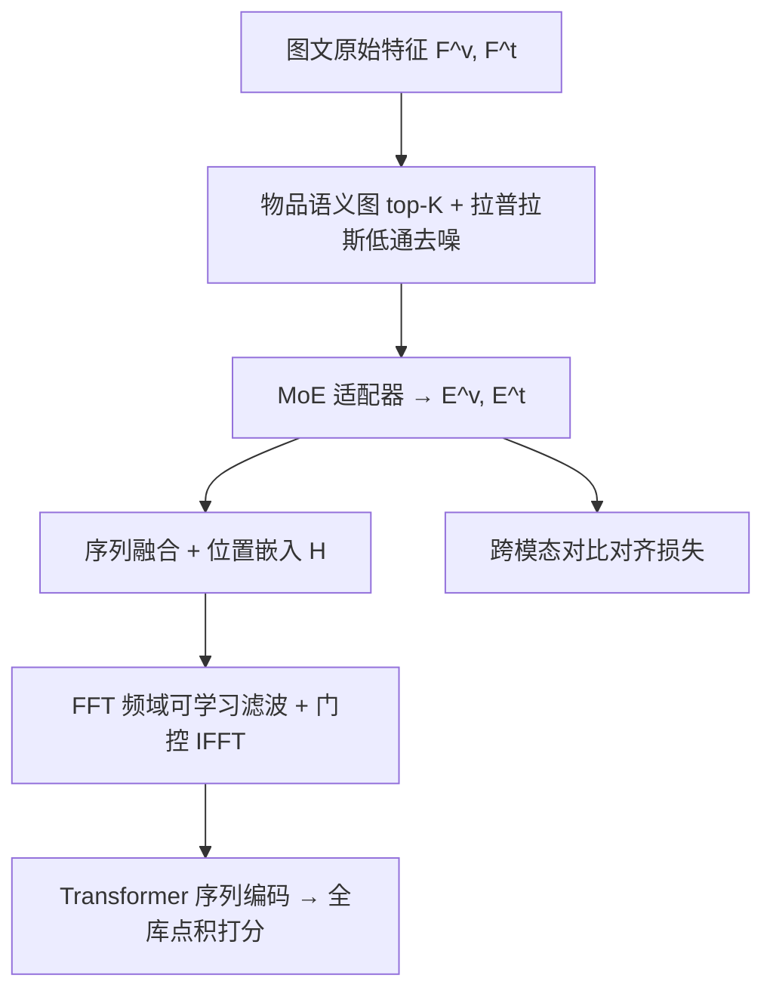
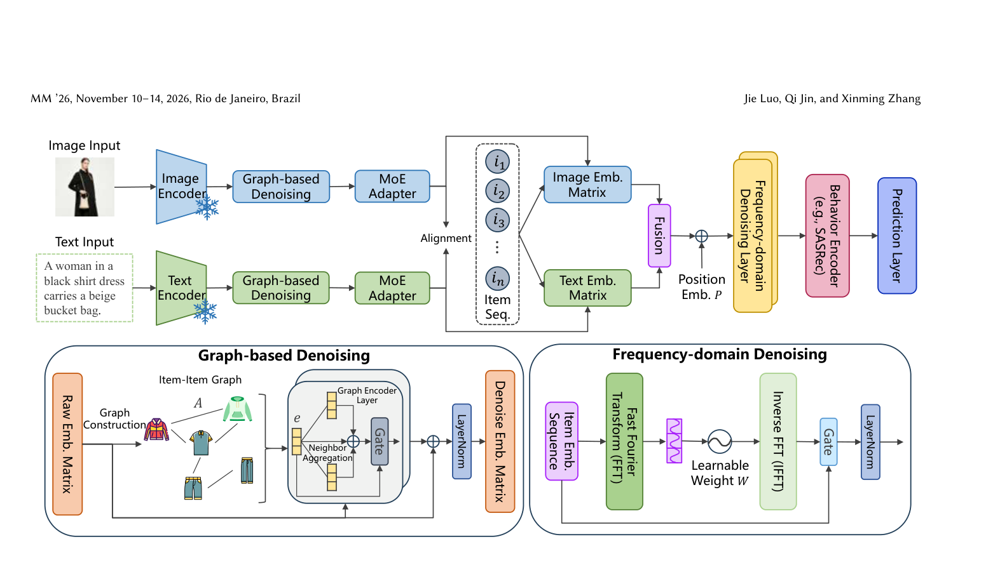

# Beyond Noisy Signals: Dual-Level Denoising for Multi-modal Sequential Recommendation (超越噪声信号：多模态序列推荐的双层去噪)

- **会议/期刊**: ACM MM 2026
- **作者与机构**: Jie Luo, Qi Jin, Xinming Zhang（中国科学技术大学）
- **推荐链路定位**: 召回（序列下一物品预测）
- **研究方向**: 多模态推荐 / 序列推荐
- **论文原文**: [论文原文链接](https://arxiv.org/abs/2607.18786v2)
- **开源代码**: [开源代码仓库链接](https://github.com/jluo00/DDMSR)

## TL;DR (1分钟核心速览)

多模态序列推荐同时受两类噪声困扰：预训练编码器（ViT/BERT）带来的**特征级冗余**（背景、无关匹配物）与误点击造成的**序列级随机性**。DDMSR 提出双层去噪：在物品语义图上做拉普拉斯平滑充当结构低通滤波器净化特征，在序列端用 FFT + 可学习复数滤波器自适应调制交互频谱，并以跨模态对比对齐弥合异构鸿沟。在 Beauty/Sports/Toys/MicroLens 四个数据集上采用 Leave-One-Out + Full-Ranking 协议，Recall@20 相对最强基线最高提升 **+19.33%**（Sports），NDCG@20 提升 **+10.68%**（Beauty）。

## Background & Motivation (背景与核心矛盾)

- **主流范式**: 多模态 SR 用冻结的 CLIP-ViT / RoBERTa 抽取图文特征，经 MoE 适配器映射到统一空间后送入 SASRec 类 Transformer 序列编码器（UniSRec、MISSRec、TedRec 等）。
- **前人局限一（特征级）**: 预训练目标是粗粒度全局语义（整图场景、长文摘要），与推荐所需的细粒度属性（包的轮廓、商品纹理）存在语义鸿沟，冗余背景被直接编码进物品向量。
- **前人局限二（序列级）**: 现有模型默认每次交互都反映稳定偏好，但误点击、曝光偏差、瞬时冲动在时域上与真实兴趣无法区分；而特征去噪派（DMMD4SR、MDSBR）依赖扩散迭代，计算昂贵且忽略序列随机性，序列去噪派（FMLP-Rec、BSARec）又无视特征冗余——两派**视角割裂**。
- **核心洞察 (Key Insight)**: 噪声在两种"频域"中都可被刻画——语义图上与邻居不一致的偏差是**高频分量**，序列中突发误点击也是**高频分量**，而持久兴趣是低频信号。因此可用低通滤波统一处理。
- **本文切入点**: 用图拉普拉斯平滑（免迭代、免生成）替代扩散去特征噪声，用可学习频域滤波器替代固定低通去序列噪声，二者串联成轻量双通道框架。

## Method (核心方法设计)

### 1. 整体框架 (Overall Architecture)

对每个模态 $m\in\{v,t\}$，先用冻结编码器抽原始特征$\mathbf{F}^m$，构建 top-$K$稀疏物品语义图并做$L_g$层自适应图卷积得到去噪特征$\tilde{\mathbf{F}}^m$；再经 MoE 适配器投影到统一$d$维空间得$\mathbf{E}^v,\mathbf{E}^t$。按用户序列索引查表并融合（逐元素相加）+ 位置嵌入得序列表示$\mathbf{H}$，先过$L_f$层频域去噪层（FFT→可学习复数滤波→IFFT→门控融合），再送入$L_t$层 Transformer 编码器，取末位隐状态与$\mathbf{E}^t+\mathbf{E}^v$ 点积全库打分。训练时联合优化交叉熵推荐损失与跨模态 InfoNCE 对比损失。

<figure class="paper-figure" markdown="span">
  <figcaption>图 2：DDMSR 的整体框架。</figcaption>
</figure>

### 2. 关键设计拆解 (Key Designs)

1. **图结构低通特征去噪（GFD）**：痛点是用简单线性映射无法剔除预训练冗余。本文对每模态按余弦相似度建 top-$K$稀疏图并对称归一化$\hat{\mathbf{A}}^m=(\mathbf{D}^m)^{-1/2}\mathbf{A}^m(\mathbf{D}^m)^{-1/2}$，逐层做**自适应加权**聚合：
$$\mathbf{h}^{(l)}=w^{(l)}\mathbf{h}^{(l-1)}+(1-w^{(l)})\hat{\mathbf{A}}^m\mathbf{h}^{(l-1)},\quad w^{(l)}=\sigma(\alpha^{(l)})$$
直觉：邻居聚合即图流形上的拉普拉斯平滑，等价于结构低通滤波，压制与语义邻域不一致的高频偏差；可学习 $w^{(l)}$ 让高质量特征保留自身信息、长尾稀疏物品更多吸收邻居信号，天然完成**隐式特征补全**，最后残差 + LayerNorm 防过平滑。

2. **频域序列去噪（FSD）**：痛点是时域上误点击与真实兴趣不可分。将序列 $\mathbf{H}$变换到频域$\mathbf{H}_f=\mathrm{FFT}(\mathbf{H})$，用可学习复数滤波器逐元素调制$\tilde{\mathbf{H}}_f=\mathbf{W}\odot\mathbf{H}_f$，再$\tilde{\mathbf{H}}=\mathrm{IFFT}(\tilde{\mathbf{H}}_f)$。关键区别于固定低通：$\mathbf{W}$是数据驱动的，既能压高频尖峰（误点击）也能压低频漂移（瞬时兴趣），保留高预测价值分量；并用门控$\alpha=\sigma(\mathrm{MLP}([\mathbf{H}\|\tilde{\mathbf{H}}]))$做逐位置自适应融合$\bar{\mathbf{H}}=\mathrm{LN}(\alpha\odot\tilde{\mathbf{H}}+(1-\alpha)\odot\mathbf{H})$，替代固定残差以调节去噪强度。

3. **训练目标、负采样与推理效率**：总损失 $\mathcal{L}=\mathcal{L}_{rec}+\lambda\mathcal{L}_{cl}$，其中$\mathcal{L}_{rec}$为带温度$\tau_{rec}$的全库 softmax 交叉熵（**免负采样**，分母遍历全物品集），$\mathcal{L}_{cl}$为图文正对、in-batch 负样本的对称 InfoNCE（$\tau_{cl}$，$\lambda=0.1$）。推理时仅需一次前向 + 全库点积，无扩散式迭代采样，开销与 SASRec 同量级。

## Experimental Setup & Evaluation Protocol (实验设置与评估协议)

- **数据集与预处理**（均按 5-core 过滤）：

| 数据集 | #Users | #Items | #Interactions | 稀疏度 | 特征/场景说明 |
| :--- | :---: | :---: | :---: | :---: | :--- |
| Beauty | 22,363 | 12,101 | 176,139 | 99.93% | 电商；标题+品牌+类目+描述 / 商品图 |
| Sports | 35,598 | 18,357 | 260,739 | 99.96% | 电商，同上 |
| Toys | 19,412 | 11,924 | 148,185 | 99.94% | 电商，同上 |
| MicroLens | 98,129 | 17,228 | 607,045 | 99.96% | 短视频；标题+标签 / 视频封面 |

- **数据划分与防穿越**: `Leave-One-Out`（每序列最后一位测试、倒数第二位验证），文本用 RoBERTa、视觉用 CLIP ViT-B/32 冻结抽取。
- **排名评测协议**: 无偏 `Full-Ranking`（全库未交互物品排序），指标 Recall@{10,20}、NDCG@{10,20}。
- **对比基线与超参设置**: ID 基线 SASRec/BERT4Rec/FEARec/BSARec；多模态基线 UniSRec/MISSRec/MP4SR/TedRec/HM4SR/DMMD4SR（UniSRec、MISSRec、MP4SR 均从零训练，不用外部预训练）。Adam，lr=0.001，$L_g=2$，$K\in\{5,10,15,20\}$，$L_f\in\{1,2,3\}$，$\lambda=0.1$，5 次随机种子均值，配对 t 检验$p<0.01$。

## Key Experimental Results (实验关键数据)

### 1. 主实验对比 (Main Results)

| 数据集 | 指标 | SASRec | BSARec | UniSRec | MISSRec | TedRec | HM4SR | DMMD4SR | **DDMSR** | Improv. |
| :--- | :--- | :---: | :---: | :---: | :---: | :---: | :---: | :---: | :---: | :---: |
| Beauty | R@20 | 0.1192 | 0.1226 | 0.1262 | 0.1417 | 0.1224 | 0.1068 | 0.1171 | **0.1564** | +10.37% |
| Beauty | N@20 | 0.0504 | 0.0522 | 0.0535 | 0.0597 | 0.0599 | 0.0559 | 0.0499 | **0.0663** | +10.68% |
| Sports | R@20 | 0.0703 | 0.0716 | 0.0792 | 0.0812 | 0.0752 | 0.0623 | 0.0662 | **0.0969** | +19.33% |
| Sports | N@20 | 0.0282 | 0.0286 | 0.0312 | 0.0326 | 0.0348 | 0.0315 | 0.0267 | **0.0413** | +18.68% |
| Toys | R@20 | 0.1240 | 0.1314 | 0.1328 | 0.1546 | 0.1230 | 0.1179 | 0.1204 | **0.1657** | +7.18% |
| Toys | N@20 | 0.0527 | 0.0555 | 0.0546 | 0.0637 | 0.0608 | 0.0629 | 0.0519 | **0.0690** | +8.32% |
| MicroLens | R@20 | 0.1234 | 0.1342 | 0.1378 | 0.1273 | 0.1358 | 0.1239 | 0.1229 | **0.1504** | +9.14% |
| MicroLens | N@20 | 0.0499 | 0.0552 | 0.0567 | 0.0520 | 0.0618 | 0.0542 | 0.0504 | **0.0642** | +3.88% |

### 2. 消融实验 (Ablation Study)

| 变体 | Beauty | Sports | Toys | MicroLens |
| :--- | :---: | :---: | :---: | :---: |
| w/o GFD | 0.1502 | 0.0935 | 0.1567 | 0.1425 |
| w/o FSD | 0.1524 | 0.0940 | 0.1638 | 0.1461 |
| w/o CL | 0.1505 | 0.0949 | 0.1610 | 0.1484 |
| w/o Text | 0.1488 | 0.0846 | 0.1539 | 0.1431 |
| w/o Image | 0.1471 | 0.0900 | 0.1576 | 0.1401 |
| **DDMSR** | **0.1564** | **0.0969** | **0.1657** | **0.1504** |

（Recall@20）

### 3. 关键实验发现 (Key Findings)

1. **序列级去噪比特征级去噪更"值钱"，但二者互补**：去掉 FSD 在 Toys 上掉 0.0019（0.1657→0.1638）、MicroLens 掉 0.0043，而去掉 GFD 在 Sports 掉 0.0034、MicroLens 掉 0.0079；单模态缺失（w/o Text 在 Sports 仅 0.0846，掉 12.7%）比任一去噪模块缺失都更严重，说明图文互补信息是底座、去噪是增益放大器。
2. **抗噪鲁棒性显著优于扩散式去噪**：在 50% 交互被随机替换的极端噪声下，DDMSR 的 R@20 仅下降 32.6%（MicroLens）/34.2%（Beauty），而 UniSRec 掉 45.0%、DMMD4SR 掉 45.8%——证明频域滤波器是主动衰减异常信号，而非普通恒等变换。
3. **扩散去噪在推荐任务上"翻车"**：DMMD4SR 在四个数据集上全面低于其他多模态基线（如 Beauty R@20 仅 0.1171，低于 UniSRec 的 0.1262），说明前向-反向扩散的去噪目标与推荐目标不对齐、优化困难；本文的图低通 + 频域滤波以极低开销取得更优效果。此外长尾分桶实验（图 8）显示 DDMSR 在低流行度物品组上相对提升最高达约 30%，验证语义传播对长尾的补全作用。

## Highlights & Limitations (亮点、对比与审稿批判)

- **与代表作对比 (vs. Prior Work)**: 相比 TedRec（仅在频域做文本-ID 融合，未处理特征冗余），本文把频域思想同时用于特征图与交互序列；相比 DMMD4SR（扩散迭代去特征噪声，忽略序列随机性且优化困难），本文用一次图平滑 + 一次 FFT/IFFT 完成双层净化，效率与效果双赢；相比 FMLP-Rec/BSARec（固定低通滤序列），本文滤波器可学习、可同时压高频与低频异常。
- **可迁移亮点**: ①"图拉普拉斯平滑 = 结构低通滤波"的视角可直接迁移到任何用预训练 embedding 做召回的冷启动/长尾场景做轻量特征净化；②可学习复数频域滤波器 + 门控 IFFT 是即插即用模块，可前置于任意序列编码器（GRU4Rec/SASRec/Mamba）。
- **审稿级局限批判**: ①频域滤波器的可解释性仅停留在"高频=噪声"的定性直觉，未给出频谱能量分布的定量证据；②$K$与$L_f$的最优值随数据集漂移（Beauty/Toys 偏好$K=5$，MicroLens 偏好$K=20$），需逐数据集调参，且图构建需$O(|\mathcal{I}|^2)$ 余弦相似度计算，物品规模上百万时需 ANN 近似；③仅在 4 个公开集离线 Full-Ranking 验证，缺少线上 A/B 与推理延迟实测。

## Rating (四维评分)

- **方法创新性 (Novelty)**: ⭐⭐⭐⭐ （核心机制与方法设计具备明确创新性，理论与实验动机支撑充分）
- **评估协议与实验扎实度 (Protocol & Experiments)**: ⭐⭐⭐⭐ （主流公开数据集评测完整，包含多基线对比与消融实验验证）
- **写作与数学规范度 (Clarity & Rigor)**: ⭐⭐⭐⭐⭐ （问题形式化定义清晰，核心模块数学推导与架构阐述严谨易读）
- **工业落地与复现价值 (Industrial & Practical Value)**: ⭐⭐⭐⭐ （兼顾推荐效果增益与训练/推理效率，具备实际场景迁移参考价值）
