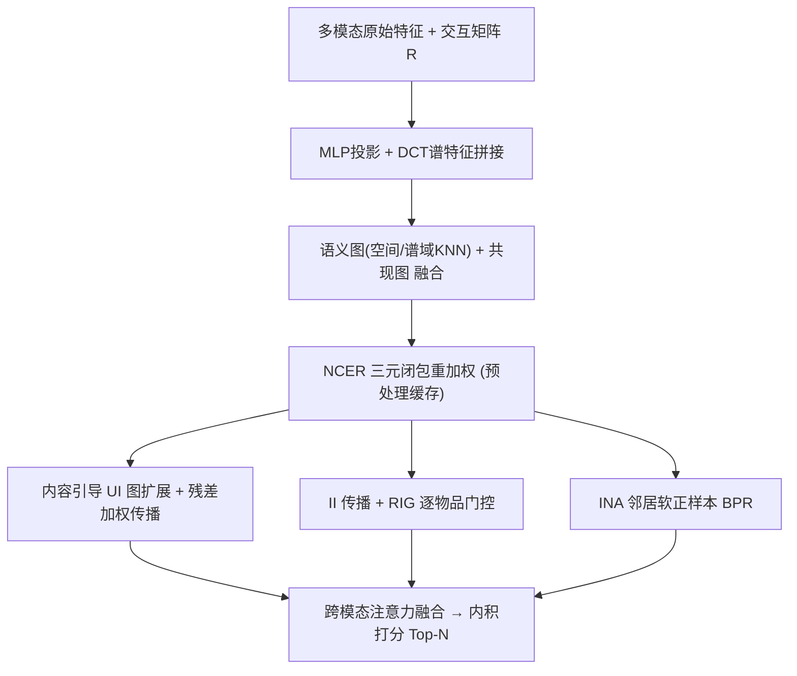
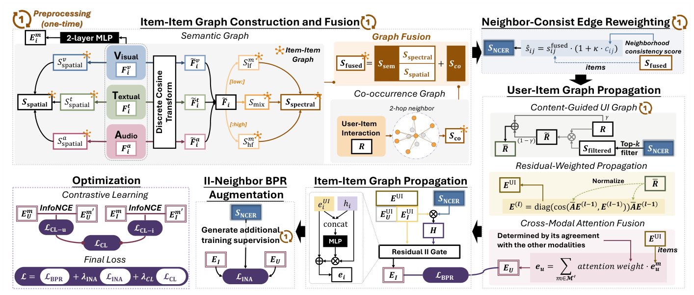

# One Graph, Multiple Gains: Single High-Quality Item-Item Graph for Multimodal Recommendation (一图多得：面向多模态推荐的单一高质量物品-物品图)

- **会议/期刊**: ACM MM 2026
- **作者与机构**: Jinfeng Xu, Ziyue Peng, Shuo Yang, Edith C. H. Ngai 等（香港大学、香港理工大学、香港科技大学）
- **推荐链路定位**: 召回（图协同过滤表征学习）
- **研究方向**: 多模态推荐 / 图神经网络推荐
- **论文原文**: [https://arxiv.org/abs/2607.24607v1](https://arxiv.org/abs/2607.24607v1)
- **开源代码**: [https://github.com/Jinfeng-Xu/IIMRec](https://github.com/Jinfeng-Xu/IIMRec)

## TL;DR (1分钟核心速览)

现有多模态推荐把物品-物品图当作"一次性"组件：用 top-k 余弦相似度构图（受 hub 效应与特征污染影响，噪声边多），且只用于固定的物品表征传播。IIMRec 提出"构建一次、处处复用"范式：预处理阶段融合语义图（空间+ DCT 谱域）与共现图，用三元闭包原理的 NCER 重加权去噪；随后在**表征增强（RIG 逐物品门控）、交互图增强（内容引导 UI 扩展）、优化增强（INA 软正样本 BPR）** 三处复用同一张图。在 Baby/Sports/Clothing/TikTok 四数据集全指标 SOTA，Recall@20 相对最强基线提升约 2.4%–4.5%，且训练时间与显存均低于所有对比方法。

## Background & Motivation (背景与核心矛盾)

- **主流范式**: 图方法主导多模态推荐，沿用户-物品二部图 + 一个或多个物品-物品亲和图传播表征（LATTICE、FREEDOM、SMORE、COHESION 等）。
- **前人局限一（图质量差）**: 主流用预训练特征空间的 top-k 余弦相似度构图，对 hub 效应与特征污染敏感；共现图或谱滤波等补救手段对所有边**一视同仁**，不评估每条边背后的结构证据。
- **前人局限二（图利用窄）**: 绝大多数方法仅用物品-物品图做固定加性残差的表征传播，且**对所有物品同等对待**——而图卷积对模态特征噪声大、与邻域不一致的物品反而有害（会产生有害正负对）。
- **核心洞察 (Key Insight)**: 一张在预处理阶段构建好的高质量物品-物品图，可以作为**跨多个流水线阶段的通用基础设施**，而非单一用途的传播通道。
- **本文切入点**: 用三元闭包（共享邻居越多边越可信）重加权去噪，再把同一张图分别注入表征、交互结构与训练监督三个环节。

## Method (核心方法设计)

### 1. 整体框架 (Overall Architecture)

输入为多模态原始特征（视觉/文本/音频）与隐式交互矩阵。先经两层 MLP 投影到统一 $d$ 维空间，并额外用 DCT 提取谱域特征（低频编码全局结构、高频编码局部细节），拼接后 $\ell_2$ 归一化得初始节点表征。预处理阶段构建物品-物品图：语义图（各模态空间 KNN + 低/高频带 KNN + 跨模态混合频带 KNN）与共现图（$\bm{C}=\bm{R}^\top\bm{R}$ 后 top-k + softmax）相加融合，再经 NCER 重加权得最终邻接 $\bm{S}_{\text{NCER}}$ 并缓存到磁盘。训练时该图被三处复用：(1) 内容引导扩展 UI 图 $\bar{\bm{R}}=\gamma\bm{R}+(1-\gamma)\bm{R}\bm{S}_{\text{filtered}}$，在扩展图上做残差加权 LightGCN 传播并经跨模态注意力融合用户表征；(2) 物品-物品传播后经 RIG 门控注入物品表征；(3) INA 用图邻居构造折扣软正样本增强 BPR。推理时内积排序全库物品。

<figure class="paper-figure" markdown="span">
  <figcaption>图1：IIMRec的整体结构。</figcaption>
</figure>
图 1：IIMRec 整体结构（预处理构图 + 三阶段复用）

### 2. 关键设计拆解 (Key Designs)

1. **NCER 邻域一致性边重加权（图去噪）**：痛点是对所有边均匀处理，噪声边与真实边无法区分。将融合图二值化为 $\bm{B}$，用矩阵乘 $\bm{B}\bm{B}^\top$ 高效算共享邻居数，一致性分 $c_{ij}=|\mathcal{N}(i)\cap\mathcal{N}(j)|/k$，再重加权
$$\hat{s}_{ij}=s^{\text{fused}}_{ij}\cdot(1+\kappa\cdot c_{ij}),\quad \kappa>0$$
直觉：若 $i,j$ 共享大量邻居，该边被多条独立证据路径支撑（三元闭包），应放大；孤立边更可能是噪声伪影。理论上（Thm 5.2）当真实边平均一致性 $\bar{c}_{S^*}>\bar{c}_N$ 时，噪声-信号谱比严格下降。该步仅在预处理执行一次，训练零开销。

2. **RIG 残差物品-物品门控（表征增强）**：固定残差 $\bm{e}_i=\bm{e}^{\text{UI}}_i+\bm{h}_i$ 对噪声特征物品有害。改为学习逐物品标量门：
$$\bm{e}_i=\bm{e}^{\text{UI}}_i+\sigma\big(\bm{W}_2\,\text{ReLU}(\bm{W}_1[\bm{e}^{\text{UI}}_i;\bm{h}_i])\big)\bm{h}_i$$
门输入同时含协同信号与语义邻域信号，端到端由 BPR 优化。Thm 5.3 证明：当 $\bm{e}_u^\top\bm{h}_i>0$（II 信号有益）梯度推高 $g_i$，反之压低，故不会坍缩到全 0/全 1 的退化区间。与跨模态注意力不同，RIG 是"跨物品、固定传播路径"的粒度。

3. **INA 邻居 BPR 增强（优化增强）与总损失**：正样本 $p$ 的 top-k 图邻居 $j$ 视为**折扣软正样本**（比观测交互置信度低但高于随机负样本）：
$$\mathcal{L}_{\text{INA}}=-\frac{\delta}{|\mathcal{B}_{\text{valid}}|}\sum_{(u,p,n')\in\mathcal{B}_{\text{valid}}}\log\sigma(\bm{e}_u^\top\bm{e}_j-\bm{e}_u^\top\bm{e}_{n'})$$
关键区别于跨图对齐（如 BM3/SLMRec 的对比对齐）：INA 与 BPR **同向**推，不会像强制 UI/II 表征对齐那样破坏 CF 信号。总损失 $\mathcal{L}=\mathcal{L}_{\text{BPR}}+\lambda_{\text{INA}}\mathcal{L}_{\text{INA}}+\lambda_{\text{CL}}\mathcal{L}_{\text{CL}}$，其中 $\mathcal{L}_{\text{CL}}$ 为用户级+物品级 InfoNCE 跨模态对齐（$\tau_{cl}=0.2$）。负采样为标准均匀随机负样本；INA 邻居查表预处理缓存，每 batch 仅 $O(B)$ 开销。

## Experimental Setup & Evaluation Protocol (实验设置与评估协议)

- **数据集与预处理**（Amazon 三子集按 MMRec 协议，TikTok 按 DiffMM 协议）：

| 数据集 | #Users | #Items | #Interactions | 稀疏度 | 模态 (维度) |
| :--- | :---: | :---: | :---: | :---: | :--- |
| Baby | 19,445 | 7,050 | 160,792 | 99.88% | V(4096), T(384) |
| Sports | 35,598 | 18,357 | 296,337 | 99.95% | V(4096), T(384) |
| Clothing | 39,387 | 23,033 | 278,677 | 99.97% | V(4096), T(384) |
| TikTok | 9,319 | 6,710 | 59,541 | 99.90% | V(128), T(768), A(128) |

- **数据划分与防穿越**: 沿用 MMRec/DiffMM 既有划分协议（非本文新设），按验证集 Recall@20 选最优模型后报告测试集结果。
- **排名评测协议**: 全库排序（Full-Ranking），指标 Recall@{10,20}、NDCG@{10,20}，对全体测试用户取平均。
- **对比基线与超参**: 通用推荐 4 个（LightGCN、SimGCL、LayerGCN、NLGCL）+ 多模态推荐 13 个（MMGCN、DualGNN、LATTICE、SLMRec、BM3、MMSSL、FREEDOM、LGMRec、DiffMM、SMORE、HPMRec、MENTOR、COHESION）。嵌入维度 $d=64$，batch=2048；$k\in\{5,10,15,20\}$，$\kappa,\gamma,\delta,\lambda_{\text{INA}}\in\{0.2,0.4,0.6,0.8\}$，$\lambda_{\text{CL}}\in\{10^{-5},10^{-4},10^{-3}\}$，$\tau=0.2$；$t$ 检验 $p<0.05$ 显著性。

## Key Experimental Results (实验关键数据)

### 1. 主实验对比 (Main Results)

| 数据集 | 指标 | LightGCN | LATTICE | FREEDOM | SMORE | MENTOR | COHESION | **IIMRec** | Improv.% |
| :--- | :---: | :---: | :---: | :---: | :---: | :---: | :---: | :---: | :---: |
| Baby | R@20 | 0.0754 | 0.0850 | 0.0992 | 0.1035 | 0.1048 | 0.1052 | **0.1094** | +4.0% |
| Baby | N@20 | 0.0328 | 0.0370 | 0.0424 | 0.0457 | 0.0450 | 0.0454 | **0.0485** | +6.1% |
| Sports | R@20 | 0.0864 | 0.0953 | 0.1089 | 0.1142 | 0.1139 | 0.1137 | **0.1184** | +3.7% |
| Sports | N@20 | 0.0387 | 0.0421 | 0.0481 | 0.0506 | 0.0511 | 0.0503 | **0.0537** | +5.1% |
| Clothing | R@20 | 0.0526 | 0.0733 | 0.0941 | 0.0987 | 0.0989 | 0.0983 | **0.1032** | +4.3% |
| Clothing | N@20 | 0.0236 | 0.0330 | 0.0420 | 0.0443 | 0.0441 | 0.0438 | **0.0469** | +5.9% |
| TikTok | R@20 | 0.0801 | 0.0904 | 0.0900 | 0.0992 | 0.1011 | 0.1008 | **0.1053** | +4.2% |
| TikTok | N@20 | 0.0306 | 0.0388 | 0.0398 | 0.0417 | 0.0426 | 0.0431 | **0.0455** | +5.6% |

（R@10/N@10 同样全胜，如 Clothing R@10：0.0702 vs COHESION 0.0665；所有提升均通过 $p<0.05$ 显著性检验。）

### 2. 消融实验 (Ablation Study)

Recall@20（图 2 数值）：

| 变体 | Baby | Sports | Clothing | TikTok |
| :--- | :---: | :---: | :---: | :---: |
| w/o II-Graph | 0.1023 | 0.1120 | 0.0956 | 0.0980 |
| w/o NCER | 0.1058 | 0.1142 | 0.0983 | 0.1001 |
| w/o CG+RW | 0.1060 | 0.1145 | 0.0985 | 0.0997 |
| w/o CG-UI | 0.1070 | 0.1166 | 0.1014 | 0.1036 |
| w/o INA | 0.1070 | 0.1153 | 0.1009 | 0.1037 |
| w/o RIG | 0.1074 | 0.1164 | 0.1014 | 0.1037 |
| w/o RW | 0.1079 | 0.1172 | 0.1019 | 0.1043 |
| w/o CMA | 0.1080 | 0.1174 | 0.1019 | 0.1045 |
| w/o CL | 0.1079 | 0.1171 | 0.1019 | 0.1040 |
| **IIMRec** | **0.1094** | **0.1184** | **0.1032** | **0.1053** |

### 3. 关键实验发现 (Key Findings)

1. **物品-物品图本身是最大贡献源，但"去噪"是第二关键**：完全移除 II 图在 Clothing 上掉 7.4%（0.1032→0.0956），移除 NCER 掉 4.7%（→0.0983），说明原始融合图噪声占比很高，三元闭包重加权是"图可用"的前提而非锦上添花。
2. **CG-UI 与 RW 存在协同而非叠加**：单独移除二者分别掉 1.7%/1.3%（Clothing），联合移除掉 4.6%，说明内容引导扩展引入的虚拟边必须配合残差加权传播才能防止深层噪声放大——扩展与抑制是一对耦合设计。
3. **稀疏与冷启动场景增益最大，且效率反超**：最稀疏用户组 (0-5] 上领先幅度最大；冷启动（20% 物品移出训练）Baby R@20 达 0.0663 vs COHESION 0.0631；效率上 Baby 每 epoch 3.18s/1.08GB，远低于 COHESION 的 4.47s/2.89GB 与 HPMRec 的 21.03s/8.58GB，因构图全部预处理缓存。

## Highlights, Limitations & Rating (亮点、对比与审稿评价)

- **与代表作对比 (vs. Prior Work)**: 相比 LATTICE/SMORE 的"构图即用、固定聚合"，本文把图质量治理（NCER）与图的多阶段复用解耦；相比 BM3/SLMRec 的跨图对比对齐（强制 UI/II 表征一致，可能破坏 CF 信号），INA 以同向软正样本方式增强监督，理论上给出更紧的 PAC-Bayes 泛化界（Thm 5.5）；相比 COHESION 的复合图卷积，本文以单图+轻量门控取得更优精度与更低开销。
- **可迁移亮点**: (1) 用 $\bm{B}\bm{B}^\top$ 矩阵乘一次性算共享邻居数做边重加权，$O(|I|k^2)$ 预处理成本极低，可直接迁移到任何 KNN 物品图去噪；(2) "软正样本折扣 BPR"与主损失同向，避免对比对齐与排序目标的梯度冲突，适用于任何带辅助图的召回模型。
- **审稿级局限批判**: (1) 理论部分依赖"真实边邻域重叠高于噪声边"的社区结构假设，对特征高度同质（如快消品）的数据集该假设可能不成立，NCER 收益存疑；(2) 内容引导 UI 扩展引入虚拟边，本质是隐式反馈的"伪造"，在需要严格因果无偏评估或曝光日志审计的工业场景中可能引入不可追溯的偏差，论文未做去偏验证；(3) 超参较多（$k,\kappa,\gamma,\delta,\lambda_{\text{INA}},\lambda_{\text{CL}}$ 六组），虽敏感性分析显示较平稳，但跨域迁移仍需重调。
- **四维评分**: 创新性 ⭐⭐⭐⭐ | 实验扎实度 ⭐⭐⭐⭐⭐ | 方法清晰度 ⭐⭐⭐⭐ | 落地价值 ⭐⭐⭐⭐⭐

