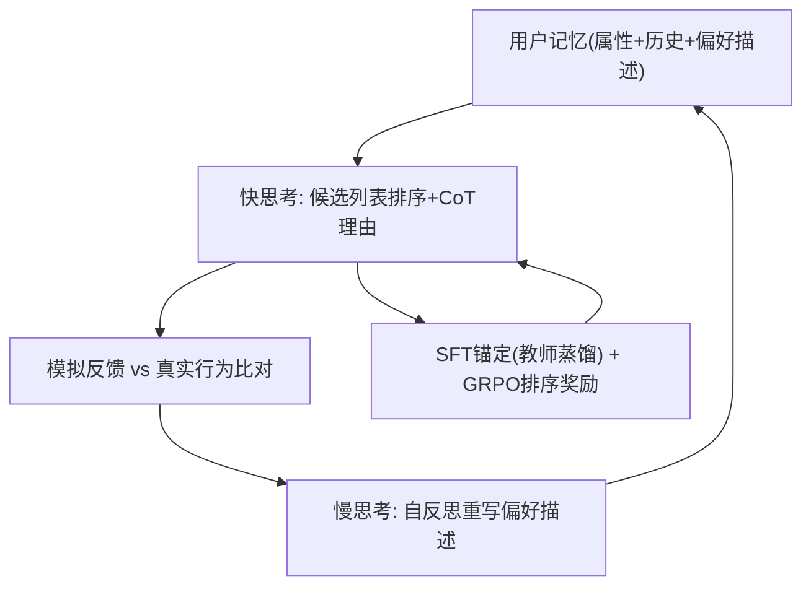
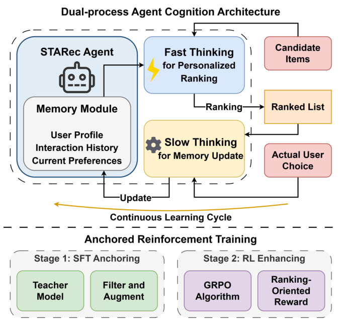

# STARec: An Efficient Agent Framework for Recommender Systems via Autonomous Deliberate Reasoning (基于自主审慎推理的高效推荐智能体框架)

- **会议/期刊**: CIKM 2025
- **作者与机构**: Chenghao Wu, Ruiyang Ren, Junjie Zhang, Wayne Xin Zhao 等（中国人民大学高瓴人工智能学院）；Ruirui Wang, Zhongrui Ma, Qi Ye（华为 Poisson Lab）
- **推荐链路定位**: 重排（候选列表排序）+ 用户偏好记忆更新
- **研究方向**: 对话推荐与智能体仿真 / 大语言模型推荐
- **论文原文**: [https://arxiv.org/abs/2508.18812v1](https://arxiv.org/abs/2508.18812v1)
- **开源代码**: 暂未开源

## TL;DR (1分钟核心速览)

现有 LLM 推荐 Agent 停留在"System 1"式启发式模式匹配，缺乏因果偏好建模与多步推理，在稀疏数据下极易失效。STARec 把每个用户建模为具备"快思考排序 + 慢思考反思"双认知的 Agent，并提出锚定强化训练（DeepSeek-R1-32B 蒸馏 SFT 打底 + GRPO 排序奖励精调）。在 ML-1M 与 Amazon CDs 的 Leave-One-Out + 20 候选采样排序协议下，STARec-7B 取得 NDCG@10 77.16 / 82.63，仅用全量数据 0.4% 即超越 SASRec_full 与 AgentCF。

## Background & Motivation (背景与核心矛盾)

- **主流范式**: LLM4Rec 分两路——端到端生成式推荐（P5、LLMRank 等把排序转成语言建模）与 LLM 增强传统模型（融合协同信号、生成用户画像）；AgentCF 等进一步把用户/物品建模为自主 Agent 做协同仿真。
- **前人局限**: 其一，现有 Agent 依赖用户输入与物品间的启发式模式匹配，只能捕获浅层相关性，无法做偏好分解与反事实评估；其二，面对冲突信号或稀疏历史时推理链断裂，推荐脆弱且缺乏长期效用对齐。
- **核心洞察 (Key Insight)**: 直接对推荐任务上 RL 会遭遇三重困境——动作空间组合爆炸加剧冷启动、CTR 类奖励与延迟多维满意度错配、LLM 预训练语料与推荐推理模式存在语义鸿沟；因此必须先"锚定"基础推理能力，再谈策略优化。
- **本文切入点**: 用双过程认知架构（快思考排序 / 慢思考反思更新记忆）承载推理，用"蒸馏 SFT 锚定 + GRPO 奖励锐化"两阶段训练把慢思考内化为模型本能。

## Method (核心方法设计)

### 1. 整体框架 (Overall Architecture)

每个用户对应一个 LLM Agent，其记忆模块以自然语言文本存储人口属性、历史交互与当前偏好描述。推理时 Agent 先以**快思考**读取记忆与候选物品列表，输出带 `<think>` 推理链的排序结果及逐项理由；随后将排序位置映射为"预测喜欢/不喜欢"的模拟反馈，与真实行为比对产生差异，触发**慢思考**自反思：将「当前记忆 + 目标物品 + 原预测 + 真实反馈」拼成反思 query，让模型重写偏好描述并回写记忆，形成"预测→比对→反思→记忆更新"的自主闭环。训练侧则由 SFT 锚定与 GRPO 强化两阶段赋予该闭环稳定的推理能力。

<figure class="paper-figure" markdown="span">
  <figcaption>图1：所提出的STARec框架概览。</figcaption>
</figure>

### 2. 关键设计拆解 (Key Designs)

1. **双过程认知与记忆自更新（Dual-process Cognition）**：痛点在于静态画像无法纠偏。本文把排序位次当作隐式反馈代理（高位=预测喜欢），差异样本触发反思 query 重写记忆。其有效性直觉是：把"用户真实反馈"作为外部监督信号注入语言记忆，使 Agent 在无梯度的情况下也能在线适应偏好漂移，且反思产物天然可解释。

2. **SFT 锚定（Anchored Distillation）**：直接用 RL 训练推荐 Agent 会因动作空间爆炸而崩溃。本文用 DeepSeek-R1-Distill-Qwen-32B 作教师，对代表性偏好场景生成最优排序、CoT 理由与偏好描述，经"格式校验 + NDCG 阈值筛选 + prompt-error-rethink 迭代增广"两道清洗后做蒸馏：
$$\mathcal{L}_{SFT}(\Phi)=\sum_{(x,y)\in\mathcal{Z}}\sum_{t=1}^{|y|}\log P_{\Phi}(y_t\mid x,y_{<t})$$
关键在于先让模型学会"推荐领域该怎么想"，为 RL 提供高回报区域内的起点，而非从通用预训练分布盲目探索。

3. **GRPO 排序奖励与推理效率**：RL 阶段采用免 critic 的 GRPO，以规则化奖励替代奖励模型，规避 reward hacking：
$$\mathcal{J}_{GRPO}(\theta)=\mathbb{E}\Big[\tfrac{1}{G}\sum_{i=1}^{G}\tfrac{1}{|o_i|}\sum_{t}\big(\min(r_{i,t}\hat{A}_{i,t},\ \mathrm{clip}(r_{i,t},1-\epsilon,1+\epsilon)\hat{A}_{i,t})-\beta D_{KL}[\pi_\theta\|\pi_{ref}]\big)\Big]$$
其中 $r_{i,t}=\pi_\theta(o_{i,t}|q,o_{i,<t})/\pi_{\theta_{old}}(o_{i,t}|q,o_{i,<t})$。奖励按正样本位次分档：第 1 名$+1.0$、2–5 名$+0.5$、6–10 名$0$、11–20 名$-0.5$、20 名外$-1.0$，与 NDCG 的位次折扣逻辑同构。记忆更新任务无直接奖励，采用**间接奖励**：用新偏好描述立即执行一次后续排序，以其排序表现回传奖励，从而逼迫摘要"对下游有用"。KL 惩罚锚定 SFT 参考策略，防止知识遗忘。

## Experimental Setup & Evaluation Protocol (实验设置与评估协议)

- **数据集与预处理**: 交互按时间排序、序列截断至 40；过滤交互数 $<10$的用户与物品；每数据集采样 1,000 训练用户 + 1,000 测试用户；评分$>3$ 记为正向。

| 数据集 | #Users | #Items | #Interactions | 稀疏度 | 特征/场景说明 |
| :--- | :---: | :---: | :---: | :---: | :--- |
| ML-1M (Full) | 6,040 | 3,883 | 1,000,209 | 95.74% | 用户性别/年龄/职业 + 电影标题/类型/年份 |
| ML-1M (Sample) | 1,000 | 2,739 | 40,000 | 98.54% | 同上，训练子集 |
| CDs (Full) | 1,944,316 | 544,442 | 4,543,369 | 99.99% | 商品标题/乐队名 |
| CDs (Sample) | 1,000 | 29,483 | 40,000 | 99.86% | 同上，训练子集 |

- **数据划分与防穿越 (Splitting Strategy)**: `Leave-One-Out`——每个用户序列最后一项为 ground-truth，其余为历史。
- **排名评测协议 (Ranking Protocol)**: `Sampled Ranking`，ground-truth 与 19 个随机负样本组成 20 候选列表（正负比 1:19），指标 NDCG@{1,5,10,20}，全部测试实例重复 3 次取均值以抵消采样随机性。
- **对比基线与超参设置**: 基线含 Pop、BPR、GRU4Rec、SASRec（均给 sample/full 两版）、零样本 LLMRank、AgentCF，以及教师模型 STARec-Teacher(R1-32B) 与仅 SFT 版。Agent 底座为 Qwen2.5-7B（分析实验用 0.5B/1.5B）；SFT 学习率 1e-5（7B）/1e-4（小模型），3 epoch，最大输入 16384 token；RL 用 VeRL 实现 GRPO，学习率 1e-6，1 epoch，batch 64，rollout 8，KL 系数 1e-3。

## Key Experimental Results (实验关键数据)

### 1. 主实验对比 (Main Results)

| Method | ML-1M N@1 | N@5 | N@10 | N@20 | CDs N@1 | N@5 | N@10 | N@20 |
| :--- | :---: | :---: | :---: | :---: | :---: | :---: | :---: | :---: |
| Pop | 20.50 | 41.89 | 49.08 | 52.86 | 24.10 | 43.18 | 47.69 | 55.13 |
| BPR_full | 33.50 | 54.92 | 60.85 | 62.60 | 46.20 | 60.35 | 63.66 | 67.72 |
| GRU4Rec_full | 54.70 | 72.97 | 75.47 | 76.46 | 60.00 | 68.43 | 70.84 | 75.22 |
| SASRec_full | 57.50 | 73.29 | 76.51 | 77.47 | 62.30 | 77.13 | 79.47 | 80.32 |
| LLMRank (zero-shot) | 31.90 | 52.70 | 56.19 | 60.76 | 58.70 | 72.35 | 73.54 | 74.31 |
| AgentCF | 40.30 | 59.88 | 65.26 | 70.28 | 64.00 | 76.19 | 79.15 | 80.37 |
| STARec-Teacher (R1-32B) | 39.00 | 57.27 | 62.35 | 65.12 | 60.00 | 74.91 | 77.18 | 78.46 |
| STARec-SFT_sample | 35.60 | 55.74 | 60.87 | 63.24 | 57.30 | 72.88 | 74.90 | 76.58 |
| **STARec_sample (7B)** | **55.40** | **75.27** | **77.16** | **77.96** | **68.30** | **81.40** | **82.63** | **84.36** |
| Improv. vs SASRec_full | −3.7% | +2.7% | +0.8% | +0.6% | +9.6% | +5.5% | +4.0% | +5.0% |

### 2. 消融实验 (Ablation Study)

| 变体 (1.5B) | ML-1M N@1 | ML-1M N@10 | CDs N@1 | CDs N@10 |
| :--- | :---: | :---: | :---: | :---: |
| STARec (full) | **51.30** | **75.19** | 66.10 | 80.66 |
| 换用 Reinforce++ | 49.50 | 73.87 | 65.20 | **82.54** |
| w/o SFT Anchoring | 26.10 | 53.97 | 41.20 | 63.57 |
| w/o Self-Reflection | 46.60 | 71.31 | 62.40 | 76.88 |

### 3. 关键实验发现 (Key Findings)

1. **SFT 锚定是绝对命门**：去掉 SFT 直接 RL，ML-1M NDCG@10 从 75.19 暴跌至 53.97（−28.2%），CDs 从 80.66 跌至 63.57，说明推荐动作空间下 RL 冷启动问题被彻底暴露，蒸馏提供的"高回报起点"不可替代。
2. **RL 的本质是"成功放大"而非知识注入**：SFT-1.5B 单次采样 NDCG@10 不及 RL 版，但 Best-of-N 随 $N$ 增大迅速逼近 RL 单次水平，证明高质量解已在 SFT 输出空间内，GRPO 只是用奖励信号锐化采样分布、提升单次命中概率。
3. **数据效率与稀疏鲁棒性双优**：仅用 0.4% 全量数据（40k vs 1M 交互），7B 版在 CDs 上 NDCG@1 达 68.30，超全量训练的 SASRec_full（62.30）与 AgentCF（64.00）；低活跃用户组（10–24 交互）仍保持可观 NDCG@10，验证慢思考反思对冷启动的补偿效应。此外 0.5B 模型保留 7B 约 88%–97% 性能，具备边缘部署可行性。

## Highlights & Limitations (亮点、对比与审稿批判)

- **与代表作对比 (vs. Prior Work)**: 相比 AgentCF 的协同 Agent 仿真，STARec 引入显式慢思考反思与 RL 策略优化，CDs NDCG@10 高出 3.5 个点；相比 LLMRank 的零样本排序，本文通过蒸馏 + GRPO 把 7B 学生模型从 56.19 拉到 77.16（ML-1M），说明"会推理"比"会读 prompt"更关键；相比教师 R1-32B，学生模型反超 14.8 点，体现领域锚定的价值。
- **可迁移亮点**: ①"间接奖励"设计——对无直接监督的中间产物（偏好摘要）用其下游任务表现回传奖励，可迁移至 query 改写、用户画像生成等任务；②Best-of-N 诊断法可低成本判断某任务上 RL 的增益上限来自"探索新解"还是"锐化旧解"。
- **审稿级局限批判**: ①评估仅用 1:19 采样排序，未做 Full-Ranking，且每数据集仅 1,000 测试用户，结论的统计外推性有限；②7B 模型逐用户生成 CoT 排序，在线推理延迟与 token 开销远高于 SASRec 类模型，论文未给出 latency/吞吐对比；③记忆更新依赖模拟反馈与真实反馈的比对，真实工业场景中反馈延迟与噪声会显著削弱反思信号质量。

## Rating (四维评分)

- **方法创新性 (Novelty)**: ⭐⭐⭐⭐ （双过程认知 + 间接奖励的 Agent 训练范式在推荐场景属首次系统化落地，但各组件均为已有技术的组合创新）
- **评估协议与实验扎实度 (Protocol & Experiments)**: ⭐⭐⭐ （消融、缩放律、活跃度分桶、Best-of-N 分析齐全，但采样排序 + 小测试集削弱了结论强度）
- **写作与数学规范度 (Clarity & Rigor)**: ⭐⭐⭐⭐ （框架图与 prompt 模板交代清晰，GRPO 与奖励分档定义完整，缺少复杂度与延迟分析）
- **工业落地与复现价值 (Industrial & Practical Value)**: ⭐⭐⭐ （0.4% 数据即达全量基线水平极具吸引力，但未开源、7B 在线推理成本高，落地需蒸馏至小模型）

