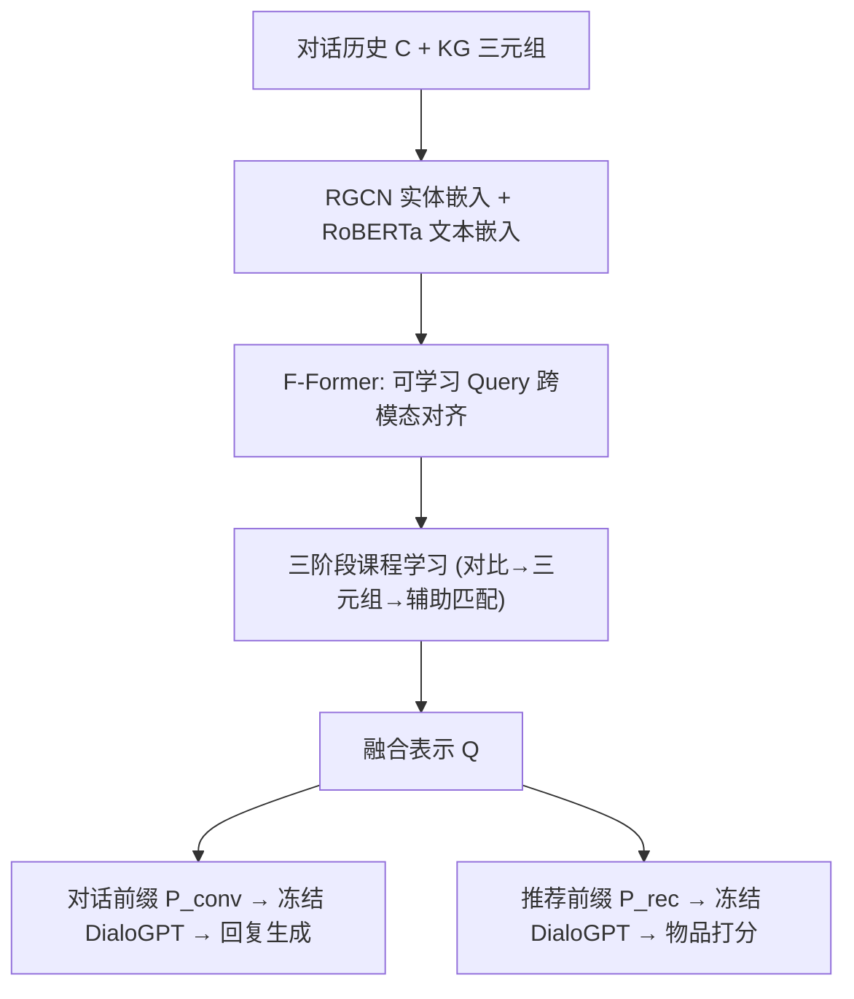
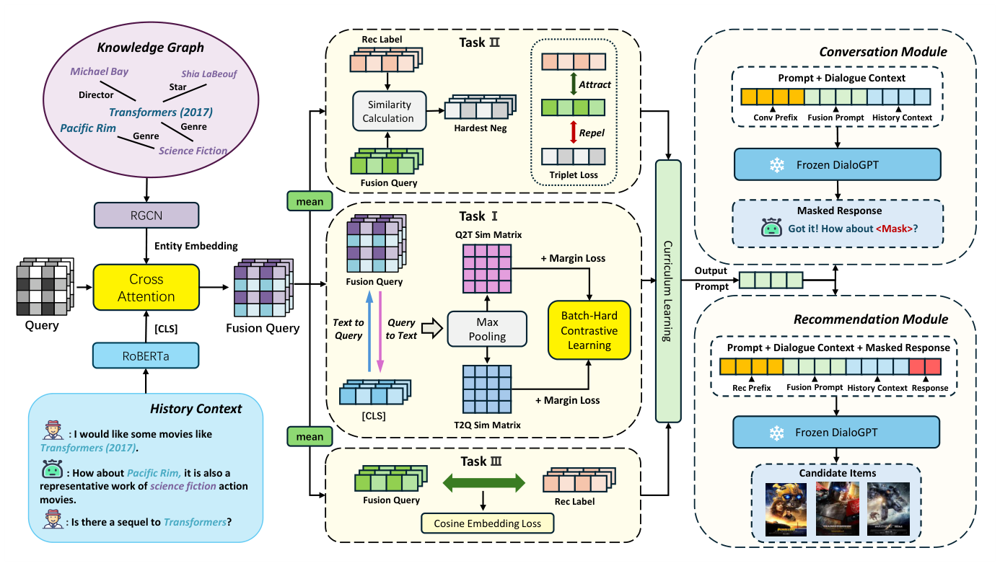

# STEP: Stepwise Curriculum Learning for Context-Knowledge Fusion in Conversational Recommendation (面向对话推荐中上下文-知识融合的阶梯式课程学习)

- **会议/期刊**: CIKM 2025
- **作者与机构**: Zhenye Yang, Jinpeng Chen, Huan Li, Xiongnan Jin 等（北京邮电大学、浙江大学、深圳大学等）
- **推荐链路定位**: 端到端生成式（对话生成 + 物品推荐联合）
- **研究方向**: 对话推荐与智能体仿真 / 大语言模型推荐
- **论文原文**: [论文原文链接](https://arxiv.org/abs/2508.10669v1)
- **开源代码**: [开源代码仓库链接](https://github.com/Alex-bupt/STEP)

## TL;DR (1分钟核心速览)

对话推荐系统（CRS）的核心痛点是：对话文本的纯语言语义与知识图谱（KG）的结构化语义之间存在细粒度错配，而现有方法（UniCRS、DCRS）仅用单层拼接或基础 cross-attention 做融合，PLM 难以真正"读懂"KG 信号。STEP 提出 F-Former 模块，以**三阶段课程学习**（对比预热 → 三元组精炼 → 辅助匹配巩固）渐进对齐对话上下文与 KG 实体，再通过**对话前缀 + 推荐前缀**双提示注入冻结的 DialoGPT。在 ReDial / INSPIRED 上，Recall@1 相对最强基线 DCRS 分别提升 **15.7% / 40.8%**，Distinct-4 亦全面领先。

## Background & Motivation (背景与核心矛盾)

- **主流范式**: 以 PLM（DialoGPT）为统一骨干，用 RGCN 编码 KG 实体，再通过提示学习（UniCRS）或知识感知对比检索（DCRS）将 KG 信息注入对话生成与物品推荐两个子任务。
- **前人局限**: ① 融合模块过于"浅"——单层拼接或基础 cross-attention 无法处理对话与 KG 之间的复杂语义关系，导致推荐偏离用户隐式意图（如用户要"类似《银翼杀手》的科幻片"，系统却推了《黑客帝国》而非续集《银翼杀手 2049》）；② 冻结 PLM 参数虽高效，但缺乏让 PLM 主动"检索并整合"最相关 KG 信息的机制。
- **核心洞察 (Key Insight)**: 上下文-知识融合不应是一次性的静态工程管线，而应被重新概念化为**一组由易到难的渐进对齐目标**——先建立粗粒度跨模态语义对齐，再锐化对困难负样本的判别力，最后巩固与下游推荐标签的邻近性。
- **本文切入点**: 将课程学习（Curriculum Learning）思想嵌入跨模态对齐模块 F-Former，配合双前缀提示实现"融合即演化"。

## Method (核心方法设计)

### 1. 整体框架 (Overall Architecture)

输入为对话历史 $C$与 KG 三元组。RGCN 先在 DBpedia 上做关系图卷积得到实体嵌入；F-Former 用$K$个可学习 query 向量，先对实体嵌入做 cross-attention 提取关系结构，再对 RoBERTa 编码的对话 [CLS] 表示做 cross-attention 捕获对话语义，二者逐元素取均值得到融合表示$Q$。该融合表示经两层 MLP 精炼后，分别拼接到**对话前缀**$P_{conv}$与**推荐前缀**$P_{rec}$中，注入冻结的 DialoGPT 完成回复生成与物品打分。训练时 F-Former 按三阶段课程调度三个子损失，主任务损失与课程损失以$\alpha$ 加权联合优化。

<figure class="paper-figure" markdown="span">
  <figcaption>图2：本文提出的STEP模型架构包含三个主要模块：基于课程学习的F-Former知识-上下文融合模块、基于提示学习的回复生成模块以及物品推荐模块。</figcaption>
</figure>

### 2. 关键设计拆解 (Key Designs)

1. **F-Former 跨模态 Query 对齐（解决结构空间与语言空间的错配）**：RGCN 嵌入居于结构向量空间，与 PLM 的语言语义空间不对齐。F-Former 用固定 query bank $Q^0=\{q_1,\dots,q_K\}$依次对实体嵌入与文本 [CLS] 做残差式 cross-attention：$Q^{l+1}_e = Q^l_e + \mathrm{Attention}(Q^l_e, H)$，再以$Q_e$为初值对文本做同样操作得$Q_t$，最终$Q = \mathrm{mean}(Q_e, Q_t)$。直觉：query 先"吸收"图谱关系结构、再"吸收"对话语义，形成双向信息汇聚的瓶颈表示，避免直接拼接带来的维度噪声。

2. **三阶段课程学习（解决难负样本判别力不足）**：直接联合优化三个目标易使模型在早期被困难负样本主导。Stage I（前 $E_1$轮）仅优化 batch-hard 对比损失$\mathcal{L}_{s1}=\mathcal{L}_{CE}+\mathcal{L}_{margin}$，其中$\mathcal{L}_{margin}$显式惩罚每个锚点与 batch 内最难负样本的间隔：$\max(0, m + h_i - p_i)$；Stage II 以线性爬坡权重$w_{triplet}(e)=\frac{e-E_1}{E_n-E_1}$引入推荐特征三元组对齐$\mathcal{L}_{triplet}$；Stage III 再以$w_{aux}(e)$引入余弦辅助匹配$\mathcal{L}_{aux}=\frac{1}{B}\sum_i(1-\cos(\tilde{e}_i,\tilde{r}_i))$。直觉：先粗后细，让模型在"地基"稳固后再学细粒度判别，避免课程后期目标被早期噪声淹没。

3. **双前缀提示与训练目标**：对话前缀 $P_{conv}=\sigma(W_c E_{conv}+b)+E_{conv}$与融合表示拼接，驱动回复生成；推荐前缀额外引入缩放因子$\lambda$的二次融合$H'_{context-item}=H_{context-item}+\lambda H$及回复模板$S$，避免融合表示淹没原始语义。总损失$\mathcal{L}'_{rec}=\mathcal{L}_{rec}+\alpha\mathcal{L}_{cl}$（对话侧同理）。训练采用 in-batch 困难负样本（batch-hard），无需额外负采样器；推理时 PLM 与 RoBERTa 均冻结，仅训练 F-Former 与提示参数，开销可控。

## Experimental Setup & Evaluation Protocol (实验设置与评估协议)

- **数据集与预处理**:

| 数据集 | #Conversations | #Utterances | #Entities/#Items | 场景说明 |
| :--- | :---: | :---: | :---: | :--- |
| ReDial | 10,006 | 182,150 | 64,364 / 6,924 | 众包电影推荐，多轮长对话、话题跳跃频繁 |
| INSPIRED | 1,001 | 35,811 | 17,321 / 1,123 | 结构化 Q&A 式电影推荐，单目标、低噪声 |

- **数据划分与防穿越 (Splitting Strategy)**: 沿用 CRSLab 工具包的对话级划分协议，训练/验证/测试按对话切分，测试集对话不参与训练。
- **排名评测协议 (Ranking Protocol)**: 推荐任务采用 **Full-Ranking 全库排序**（在全部物品上排序），报告 Recall@1/10/50；对话任务用词级 Distinct-2/3/4 衡量多样性。
- **对比基线与超参设置**: 基线含 DialoGPT、GPT-3.5-turbo、GPT-4（零样本）及 ReDial、KBRD、KGSF、UniCRS、VRICR、DCRS 六类 CRS 方法。DialoGPT-small + 冻结 RoBERTa-base + 单层 RGCN；前缀长度 16（ReDial）/ 8（INSPIRED），query 数 $K=32$，课程轮次$E_1=2, E_2=3, E_n=5$，$\alpha=0.5$，AdamW，显著性检验$p<0.05$（t-test）。

## Key Experimental Results (实验关键数据)

### 1. 主实验对比 (Main Results)

推荐任务（Recall@k，加粗为最优）：

| 模型 | ReDial R@1 | ReDial R@10 | ReDial R@50 | INSPIRED R@1 | INSPIRED R@10 | INSPIRED R@50 |
| :--- | :---: | :---: | :---: | :---: | :---: | :---: |
| KGSF | 0.036 | 0.177 | 0.363 | 0.058 | 0.165 | 0.256 |
| GPT-4 | 0.045 | 0.194 | – | 0.091 | 0.194 | – |
| VRICR | 0.057 | 0.251 | 0.416 | 0.056 | 0.179 | 0.345 |
| UniCRS | 0.051 | 0.224 | 0.428 | 0.090 | 0.277 | 0.426 |
| DCRS | 0.070 | 0.248 | 0.434 | 0.093 | 0.226 | 0.414 |
| **STEP** | **0.081** | **0.256** | **0.440** | **0.131** | **0.301** | **0.433** |
| Improv.% (vs DCRS) | +15.7% | +3.2% | +1.4% | +40.8% | +8.6% | +1.6% |

对话任务（Distinct-n，ReDial / INSPIRED）：

| 模型 | ReDial D-2 | ReDial D-3 | ReDial D-4 | INSPIRED D-2 | INSPIRED D-3 | INSPIRED D-4 |
| :--- | :---: | :---: | :---: | :---: | :---: | :---: |
| UniCRS | 0.404 | 0.518 | 0.832 | 3.039 | 4.657 | 5.635 |
| DCRS | 0.608 | 0.905 | 1.075 | 3.950 | 5.729 | 6.233 |
| **STEP** | **0.637** | **1.017** | **1.294** | **3.968** | **5.856** | **6.631** |

### 2. 消融实验 (Ablation Study)

ReDial 数据集上逐组件移除（推荐 Recall / 对话 Distinct）：

| 变体 | R@1 | R@10 | R@50 | D-2 | D-3 | D-4 |
| :--- | :---: | :---: | :---: | :---: | :---: | :---: |
| w/o CL（去课程调度） | 0.071 | 0.238 | 0.417 | 0.536 | 0.840 | 1.058 |
| w/o Task1（去对比预热） | 0.070 | 0.234 | 0.411 | 0.489 | 0.773 | 0.850 |
| w/o Task2（去三元组对齐） | 0.074 | 0.241 | 0.422 | 0.583 | 0.872 | 1.075 |
| w/o Task3（去辅助匹配） | 0.076 | 0.242 | 0.435 | 0.605 | 0.901 | 1.113 |
| **STEP** | **0.081** | **0.256** | **0.440** | **0.637** | **1.017** | **1.294** |

### 3. 关键实验发现 (Key Findings)

1. **Task1（batch-hard 对比预热）是双任务最关键组件**：移除后 R@1 从 0.081 跌至 0.070（降幅 13.6%），Distinct-4 从 1.294 暴跌至 0.850（降幅 34.3%），说明粗粒度跨模态对齐是后续所有细粒度目标的"地基"，缺失时模型退化为模板化回复。
2. **课程调度本身贡献显著且对对话多样性尤为敏感**：w/o CL 的 Distinct-4 仅 1.058，远低于完整模型的 1.294，验证了"由易到难"的渐进引入能防止早期困难负样本压制语言模式的探索空间。
3. **INSPIRED 上 R@1 提升高达 40.8% 而 R@50 仅 1.6%**，说明 STEP 的收益集中在**头部排序精度**而非召回广度——融合表示主要帮助模型把最相关物品"顶上去"，而非扩大候选覆盖；这与 INSPIRED 单目标、低噪声的对话特性一致（前缀长度 8 即最优，过长反而引入低相关噪声）。

## Highlights & Limitations (亮点、对比与审稿批判)

- **与代表作对比 (vs. Prior Work)**: UniCRS 用统一架构 + 知识增强提示做语义融合，但融合深度有限；DCRS 用知识感知对比检索增强提示，但难以处理复杂多轮场景；STEP 的本质区别在于把"融合"从静态算子升级为**带调度策略的渐进对齐过程**，并用双前缀显式分离对话与推荐两个目标，兼顾共享语义与任务特异性。
- **可迁移亮点**: ① "课程式跨模态对齐"可迁移到任意需要融合结构化知识（KG/表格/图）与文本的推荐场景；② batch-hard margin loss 与对比损失的组合是低成本提升难负样本判别力的通用技巧，无需额外负采样器。
- **审稿级局限批判**: ① 仅在两个电影领域数据集上验证，且 INSPIRED 规模仅 1,001 段对话，泛化性存疑；② 三阶段课程引入 $E_1, E_2, E_n$ 及前缀长度、query 数等多个数据集敏感超参（ReDial 需 16 前缀、INSPIRED 仅需 8），调参成本较高；③ 对话质量仅用 Distinct-n 衡量多样性，缺乏人工评估或连贯性/信息量指标，Distinct-n 高不等于回复质量高。

## Rating (四维评分)

- **方法创新性 (Novelty)**: ⭐⭐⭐⭐ （将课程学习引入跨模态知识融合是有洞察力的重构，但 F-Former 本身借鉴 BLIP2 Q-Former，增量主要在调度策略）
- **评估协议与实验扎实度 (Protocol & Experiments)**: ⭐⭐⭐ （Full-Ranking 协议规范、含 GPT-4 基线，但数据集仅两个且偏小，对话评估缺人工评测）
- **写作与数学规范度 (Clarity & Rigor)**: ⭐⭐⭐⭐ （三阶段损失与调度权重公式定义清晰，符号统一，但部分公式排版有 OCR 噪声）
- **工业落地与复现价值 (Industrial & Practical Value)**: ⭐⭐⭐⭐ （PLM 冻结、仅训轻量模块，代码已开源，单卡 L20 可复现，工程部署门槛低）

