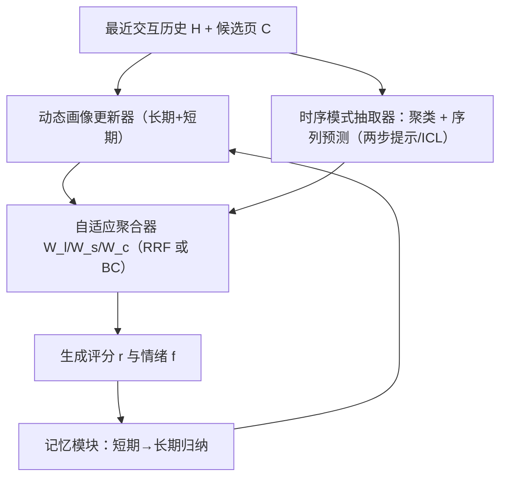
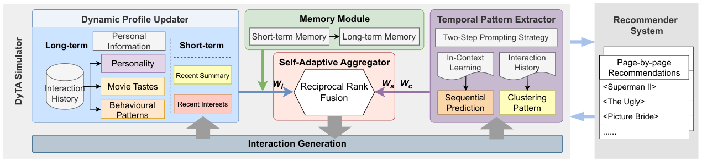

# Temporal-Aware User Behaviour Simulation with Large Language Models for Recommender Systems (面向推荐系统的时序感知大模型用户行为模拟)

- **会议/期刊**: CIKM 2025
- **作者与机构**: Xinye Wanyan, Danula Hettiachchi, Chenglong Ma, Ziqi Xu, Jeffrey Chan (RMIT University)
- **推荐链路定位**: 离线仿真评测（Simulator，服务于召回/排序策略的 A/B 前置评估）
- **研究方向**: 对话推荐与智能体仿真 / 序列推荐
- **论文原文**: [https://arxiv.org/abs/2509.16895v1](https://arxiv.org/abs/2509.16895v1)
- **开源代码**: [https://github.com/WennyXY/DyTA4Rec](https://github.com/WennyXY/DyTA4Rec)

## TL;DR (1分钟核心速览)

现有 LLM 用户模拟器（Agent4Rec / RecAgent / AgentCF）普遍依赖**静态用户画像**，把用户兴趣当作一次性抽取的固定文本，无法刻画兴趣漂移与序列依赖；而 LLM 本身对长序列模式建模能力弱（Hou et al. 已实证）。本文提出 DyTA4Rec：用**动态画像更新器**每 $n$ 轮刷新短期兴趣、用**时序模式抽取器**（聚类 + 序列预测 + 两步提示）显式注入时序上下文、用**自适应聚合器**（RRF/BC）按是否存在时序模式动态加权融合多路信号。在 ML-1M、Leave-One-Out、1 正 9 负采样排序协议下，nDCG@5 从 RecAgent 的 0.431 提升至 0.551（+27.8%），HR@3 从 0.391 提升至 0.480（+22.8%），且评分分布与真实用户的群体级对齐更优。

## Background & Motivation (背景与核心矛盾)

- **主流范式**: 以 LLM 为中央推理模块，配画像、记忆、动作选择三件套，让 Agent 扮演用户与推荐系统交互（Agent4Rec 注入统计行为模式与情绪动作，AgentCF 用用户/物品双 Agent 互学，RecAgent 引入社交上下文）。
- **前人局限**: 其一，画像从静态历史一次性抽取后**冻结**，无法反映短期兴趣漂移，模拟出的行为在时间维度上"平";其二，语言建模与行为建模之间存在**结构性错位**——LLM 擅长语义理解却不擅长从原始交互序列中自行归纳顺序依赖，导致时序模式被淹没在长 prompt 中。
- **核心洞察 (Key Insight)**: 时序信息不应"指望 LLM 自己悟"，而应作为**显式中间产物**（聚类模式 + 序列预测）被抽取出来，再与静态画像做**条件化加权融合**；同时画像本身需要滚动更新以承载短期意图。
- **本文切入点**: 把"时序感知"拆成可插拔的三个工程化模块（更新器 / 抽取器 / 聚合器），全部通过 ICL 实现、零训练成本。

## Method (核心方法设计)

### 1. 整体框架 (Overall Architecture)

Agent 侧维护长期画像（人口属性、LLM 抽取的人格与物品级偏好、评分倾向与观影行为统计）与短期画像（每 $n$轮由 LLM 从最近交互摘要刷新），并配短/长期双层记忆（短期存原始交互与情绪感受，长期存 LLM 归纳的高层模式）。每轮推荐系统以**分页候选集**$C=\{c_1,\dots,c_m\}$呈现，时序模式抽取器对最近$n$条交互$H=\{h_1,\dots,h_n\}$（$h_t=(i_t,r_t,f_t)$，含物品、评分、生成情绪）并行做聚类与序列预测，自适应聚合器将画像/记忆输出$r_l$、序列输出$r_s$、聚类输出$r_c$ 加权融合后产出交互（评分 + 情绪），写回记忆并触发画像更新。

<figure class="paper-figure" markdown="span">
  <figcaption>图1：所提出的 DyTA4Rec 概览，包含基于 LLM 的生成式智能体和推荐系统。推荐系统被设计为可灵活重配置以支持不同目标的组件。在模拟过程中，智能体复现真实用户行为，从而实现与推荐系统的逼真交互。</figcaption>
</figure>

### 2. 关键设计拆解 (Key Designs)

1. **时序模式抽取器 TPE（把"隐性时序"变成"显式中间结果"）**：痛点是 LLM 直接读原始序列时顺序依赖被稀释。TPE 将决策分解为聚类与序列两路，并采用**两步提示**——先让 LLM 独立输出模式分析，再把该分析作为上下文执行排序/预测：
$\mathrm{TPE}(H,C)=f_{act}\big(f_{cluster}(H)\big)+f_{seq}\big(\mathrm{ICL}(H)\big)$
直觉：把"理解"与"决策"解耦，避免 LLM 在一步内同时做模式归纳与候选打分而互相干扰（图 2a 显示两步提示全面优于单步）。

2. **自适应聚合器 SAA（按上下文可信度动态分配权重）**：固定权重平均/多数投票无法区分"当前历史到底有没有明显序列或聚类模式"。SAA 令画像/记忆权重 $W_l=1$恒定为基座，再由 LLM 判定历史中是否存在清晰序列依赖或时序簇，若存在则分别激活$W_s$、$W_c$：
$\mathrm{Aggregator}(R)=W_l\cdot r_l+W_s\cdot r_s+W_c\cdot r_c$
实现上比较 Borda Count 与 Reciprocal Rank Fusion 两种融合算子。直觉：让"有信号的那一路"主导决策，避免无模式时噪声模块污染结果。

3. **训练目标、负采样与推理效率**：**完全免训练**，全部能力由 GPT-4o-mini 的 ICL 承载（temperature 0.1、top-$p$ 0.9），无梯度更新、无负采样设计；代价是每轮需多次 LLM 调用（画像更新 + 聚类 + 序列 + 聚合），推理开销随历史长度与 ICL 示例数线性增长，这是该方法落地的主要瓶颈。

## Experimental Setup & Evaluation Protocol (实验设置与评估协议)

- **数据集与预处理**: 仅 ML-1M 单数据集，长期画像由数据集元数据初始化，未报告显式 $k$-core 过滤细节。

| 数据集 | #Users | #Items | #Interactions | 稀疏度/密度 | 特征/场景说明 |
| :--- | :---: | :---: | :---: | :---: | :--- |
| ML-1M | 6,040 | 3,706 | 1,000,209 | 密度约 4.47% | 电影评分 1–5，含人口属性；社交关系缺失，故 RecAgent 需裁剪适配 |

- **数据划分与防穿越 (Splitting Strategy)**: `Leave-One-Out`——每个用户历史序列的最后一项作为 ground-truth，其余作为历史输入。
- **排名评测协议 (Ranking Protocol)**: `Sampled Ranking`，每用户构造 **1 正 + 9 负** 候选集；指标 nDCG@5、nDCG@10、HR@3；结果取 3 次独立运行均值。额外做**群体级行为对齐**评估（评分分布与真实分布对比）。
- **对比基线与超参设置**: Random、BM25、UniSRec（预训练序列推荐）、RecAgent（LLM Agent 基线，ML-1M 适配版）；LLM 固定 GPT-4o-mini；历史长度默认 10，ICL 示例数在 $\{0,3,6,9\}$ 中调优；采用 Direct Prompting 显式告知"候选位置无意义"以抑制位置偏置。

## Key Experimental Results (实验关键数据)

### 1. 主实验对比 (Main Results)

| Model | nDCG@5 | nDCG@10 | HR@3 |
| :--- | :---: | :---: | :---: |
| Random | 0.326 | 0.509 | 0.240 |
| BM25 | 0.260 | 0.428 | 0.242 |
| UniSRec | 0.340 | 0.484 | 0.365 |
| RecAgent | 0.431 | 0.571 | 0.391 |
| **DyTA4Rec (RRF)** | **0.551** | **0.639** | **0.480** |
| Improv. vs RecAgent | +27.8% | +11.9% | +22.8% |

### 2. 消融实验 (Ablation Study)

| 配置 | nDCG@5 | nDCG@10 | HR@3 |
| :--- | :---: | :---: | :---: |
| Long-term only | 0.434 | 0.568 | 0.360 |
| Long- & Short-term | 0.467 | 0.599 | 0.400 |
| Sequential only | 0.466 | 0.584 | 0.418 |
| Clustering only | 0.462 | 0.593 | 0.409 |
| Sequential + Long-term | 0.494 | 0.622 | 0.458 |
| w/o SAA (BC 静态) | 0.489 | 0.602 | 0.427 |
| w/o SAA (RRF 静态) | 0.457 | 0.585 | 0.396 |
| **Full (RRF 自适应)** | **0.551** | **0.639** | **0.480** |

### 3. 关键实验发现 (Key Findings)

1. **短期画像的边际收益最大且最廉价**：仅加入短期动态特征即把 nDCG@5 从 0.434 拉到 0.467（+7.6%），说明"兴趣漂移"确实是静态模拟器的主要失真源，而非画像信息量不足。
2. **自适应聚合优于任何静态融合，且融合算子选择敏感**：同为 RRF，静态加权仅 0.457，自适应后跃至 0.551（+20.6%）；而 BC 在静态下反而优于 RRF（0.489 vs 0.457），说明 RRF 的秩融合收益必须靠"按模式存在性激活权重"才能释放。
3. **时序信号与长期画像互补而非替代**：Sequential + Long-term 达 0.494，高于任一单路（0.466 / 0.434），但低于完整模型，证明聚类路与自适应权重仍贡献独立增量；同时图 2d/2e 显示历史长度越长性能越降、ICL 示例 3 条最优，印证 LLM 对长序列的建模瓶颈与提示噪声问题。

## Highlights & Limitations (亮点、对比与审稿批判)

- **与代表作对比 (vs. Prior Work)**: 与 Agent4Rec 相比，本文不满足于把统计行为模式塞进静态画像，而是让画像**滚动更新**并显式抽取时序结构；与 RecAgent 相比，不依赖社交图，转而用聚类/序列双路时序推理补足上下文；与 AgentCF 的双 Agent 互学相比，本文聚焦单 Agent 的时间维度保真度，工程更轻但覆盖面更窄。
- **可迁移亮点**: (1) "两步提示 = 先分析后决策"的解耦范式可直接迁移到 LLM 重排与可解释推荐理由生成；(2) 按"信号是否存在"动态赋权的聚合思路，可迁移到多路召回融合的加权策略。
- **审稿级局限批判**: 其一，**评估规模与协议偏弱**——仅 ML-1M 单数据集、1 正 9 负的采样排序（非 Full-Ranking），且候选集极小，nDCG 绝对值易被高估，缺乏跨域泛化验证；其二，**成本与稳健性**——每轮多次 GPT-4o-mini 调用、无训练但推理昂贵，且作者自承对 prompt 设计与过度自信输出敏感，缺少延迟/费用的定量报告与方差分析。

## Rating (四维评分)

- **方法创新性 (Novelty)**: ⭐⭐⭐ （把时序感知工程化为"更新器+抽取器+聚合器"三件套，思路清晰但各模块均为 ICL 提示工程组合，缺少理论或架构层面的新算子）
- **评估协议与实验扎实度 (Protocol & Experiments)**: ⭐⭐⭐ （消融与参数分析较完整、3 次运行取均值，但单数据集 + 1:9 采样排序 + 无显著性检验，说服力受限）
- **写作与数学规范度 (Clarity & Rigor)**: ⭐⭐⭐⭐ （5 页短文结构紧凑、公式简洁、模块职责界定清楚，但 TPE 公式对 $f$ 的算子语义刻画偏抽象）
- **工业落地与复现价值 (Industrial & Practical Value)**: ⭐⭐⭐ （代码已开源、免训练易复现，但逐轮多次 LLM 调用的成本与 prompt 敏感性使其更适合作为离线仿真沙盒而非线上组件）

