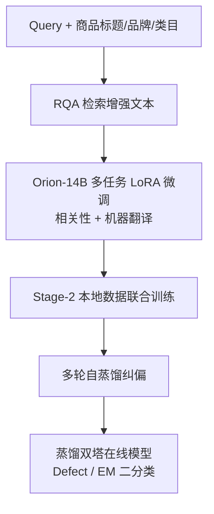
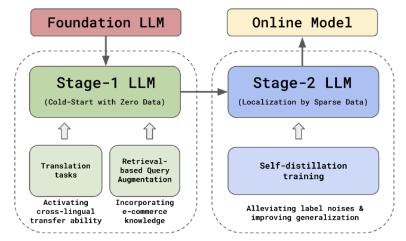

# CSRM-LLM: Embracing Multilingual LLMs for Cold-Start Relevance Matching in Emerging E-commerce Markets (面向新兴电商市场冷启动相关性匹配的多语言 LLM 框架)

- **会议/期刊**: CIKM 2025
- **作者与机构**: Yujing Wang, Yiren Chen, Huoran Li 等，Coupang, Inc.（韩国/北京/山景城）
- **推荐链路定位**: 精排（相关性判别，兼作召回过滤与排序提权）
- **研究方向**: 冷启动与长尾推荐 / 大语言模型推荐
- **论文原文**: [论文原文链接](https://arxiv.org/abs/2509.01566v2)
- **开源代码**: 暂未开源

## TL;DR (1分钟核心速览)

跨境电商进入新市场时，目标语言零标注、零行为，通用 LLM 零样本又不懂电商标注规范（"红衬衫"应指人穿而非宠物装）。本文提出 CSRM-LLM：以 Orion-14B 为底座，用**辅助机器翻译任务**激活跨语言迁移、用**检索式查询增强 (RQA)** 注入电商知识、用**多轮自蒸馏**纠正人工标注噪声。在韩语→繁体中文迁移场景下，离线三分类 micro-F1 从 GPT-4o 的 0.850 提升至 0.965，线上缺陷率降 45.8%、会话购买率升 0.866%。

## Background & Motivation (背景与核心矛盾)

- **主流范式**: 相关性匹配长期走 DSSM/DRMM 类双塔或交互式精排；LLM 时代则多用零样本打分或 LLM 做标注增强。
- **前人局限**: ① 通用翻译器（Google Translate、GPT-4）在 query-product 对上引入 **超过 30% 的领域性错误**，直接翻译训练数据反而掉点；② 电商相关性有强业务规范（替代品 vs 不相关），零样本 GPT-4o 仅 0.850，无法对齐细粒度标注指南。
- **核心洞察 (Key Insight)**: 多语言 LLM 的跨语言能力是"沉睡"的——源语言与目标语言样本在隐空间中距离过大（cross-lingual transfer gap 0.689），需用翻译任务显式拉近；同时人工标注在冷启动期噪声极大，模型自身的高置信软标签可充当"标签投票"。
- **本文切入点**: 把问题拆成 Stage-1（零数据冷启）与 Stage-2（稀疏数据本地化）两阶段，分别用 MT 辅助任务 + RQA 与多轮自蒸馏逐级抬升。

## Method (核心方法设计)

### 1. 整体框架 (Overall Architecture)

以开源 Orion-14B 为底座，将相关性匹配形式化为生成任务：输入 query 与商品侧特征（标题、品牌、类目、RQA 文本）拼成的 prompt，模型只对 "0/1/2" 三个 token 的条件概率归一化后输出三分类（不相关/替代/精确匹配）。Stage-1 仅用韩国市场 500 万标注做 LoRA 微调，并混入人工精翻的翻译任务（类目 5 万、品牌 5 万、标题 70 万、query 3 万）以激活跨语言迁移；同时用 LLM 教师蒸馏出的 EBR 模型生成 RQA 文本注入 prompt。Stage-2 引入台湾市场 50 万标注联合训练，并用多轮自蒸馏以软标签修正硬标签噪声。最终将三分类 LLM 蒸馏为双塔在线模型（XLM-R base，128 维），拆成 Defect 与 Exact-Match 两个二分类器分别用于过滤与提权。

<figure class="paper-figure" markdown="span">
  <figcaption>图1：CSRM的整体框架</figcaption>
</figure>

### 2. 关键设计拆解 (Key Designs)

1. **辅助翻译任务激活跨语言迁移**：痛点是不做处理时源/目标语言表征割裂。做法不是"先翻译再训练"，而是在同一 LLM 内按预设比例交错采样相关性样本与翻译样本联合优化，翻译任务权重 0.1。直觉是翻译迫使模型把两种语言的同义商品语义对齐到同一区域，实测 cross-lingual transfer gap 由 0.689 降至 0.676，且典型"菊花茶 vs 草本茶"样本的归一化距离从 0.735 缩至 0.495。

2. **检索式查询增强 (RQA)**：冷启动无行为数据，无法训练 EBR。先用 BM25 生成伪 query-product 对（准确率仅 65%），再让 LLM 以"该商品在 query 下被转化的概率"作软标签，通过对比损失 + MSE 蒸馏出 EBR：
$\mathcal{L}_{cl}=\sum_{q}\frac{\mathrm{CVR}(q,p)\exp(\langle e_q,e_p\rangle)}{\sum_{p^-}\exp(\langle e_q,e_{p^-}\rangle)},\quad \mathcal{L}_{mse}=\sum_{q}\sum_{p}\|\mathrm{CVR}(q,p)-\langle e_q,e_p\rangle\|^2$
以 CVR 加权使高相关对主导梯度，压制 BM25 噪声；检索回的相似标题作为 query 的显式语义补充（如"安城"→"安城汤面"），RQA 准确率升至 82%，引入本地行为后达 88%。

3. **多轮自蒸馏与训练目标**：每轮以上一轮 checkpoint 为教师，对全训练集推理软标签 $\langle p_e,p_s,p_i\rangle$，下一轮损失为硬软标签加权交叉熵：
$\mathcal{L}=\sum_{j\in\mathcal{D}}\alpha\,\mathrm{CE}(hl_j,\hat{p}_j)+(1-\alpha)\,\mathrm{CE}(sl_j,\hat{p}_j),\ \alpha=0.5$软标签相当于训练集内的标签投票，把被误标为"不相关"的孕妇叶酸商品纠正为 77.77% 相关。在线蒸馏阶段用$\hat{p}_{q,i}=\sigma(8\cdot c_{q,i})$ 把余弦相似度映射为概率，仅用软标签做 KD（硬标签过稀疏），每 query 采 Top-20 曝光商品 + Top-100 EBR 商品以平衡替代/不相关样本。

## Experimental Setup & Evaluation Protocol (实验设置与评估协议)

- **数据集与预处理**: 源市场韩国 500 万韩语标注，目标市场台湾 50 万繁体中文标注（约为源市场 10%）；各取 2 万作 dev。测试集 2 万样本，**8 名标注员投票、至少 7 人一致才保留标签**，覆盖多品类。

| 数据集 | #Users | #Items | #Interactions | 稀疏度/密度 | 特征/场景说明 |
| :--- | :---: | :---: | :---: | :---: | :--- |
| KR 相关性标注 | — | — | 5,000,000 | — | 韩语，源市场，人工标注 |
| TC 相关性标注 | — | — | 500,000 | — | 繁体中文，目标市场，人工标注 |
| 翻译辅助数据 | — | — | 830,000 | — | 类目/品牌/标题/query 人工精翻 |

- **数据划分与防穿越 (Splitting Strategy)**: 随机比例划分（各市场抽 2 万作 dev，其余训练），测试集独立构造并经多人一致性过滤；Stage-1 只用 KR，Stage-2 用 KR+TC。
- **排名评测协议 (Ranking Protocol)**: 非全库排序，采用**三分类 micro-F1**（式 5）在固定测试集上评估；线上另用 EM@1 与 Defect@5 人工抽检。
- **对比基线与超参设置**: GPT-4o 零样本、XLM-RoBERTa-base/large SFT、Orion-14B 各消融变体。LoRA $r=128,\alpha=256$，dropout 0.01，可训练参数 1.07%；AdamW，lr$2e^{-5}$，batch 64，最大长度 2048，L2 0.01。

## Key Experimental Results (实验关键数据)

### 1. 主实验对比 (Main Results)

| 模型设置 | 训练数据 | F1 |
| :--- | :---: | :---: |
| GPT-4o (Zero-shot) | — | 0.850 |
| RoBERTa-base SFT | KR | 0.764 |
| RoBERTa-large SFT | KR | 0.780 |
| CSRM-LLM SFT | KR | 0.908 |
| CSRM-LLM SFT+MT | KR | 0.916 |
| CSRM-LLM SFT+MT+RQA | KR | 0.937 |
| CSRM-LLM SFT+MT+RQA | KR+TC | 0.951 |
| CSRM-LLM SFT+MT+RQA*+SD-2 | KR+TC | **0.965** |

相对 RoBERTa-large 绝对提升 12.8%（0.780→0.908），相对 GPT-4o 零样本提升约 11.5 个点。

### 2. 消融实验 (Ablation Study)

| 配置 | F1 | Δ |
| :--- | :---: | :---: |
| SFT (baseline) | 0.908 | — |
| + MT | 0.916 | +0.008 |
| + MT + RQA | 0.937 | +0.021 |
| + MT + RQA + TC 数据 | 0.951 | +0.014 |
| + RQA*（本地行为 EBR） | 0.956 | +0.005 |
| + SD-1 | 0.962 | +0.006 |
| + SD-2 | **0.965** | +0.003 |
| + SD-3 | 0.964 | −0.001 |

### 3. 关键实验发现 (Key Findings)

1. **RQA 是单点增益最大的模块**（+0.021），远超翻译任务（+0.008），说明冷启动瓶颈更多在"query 语义太短、缺电商常识"而非纯语言鸿沟；RQA 文本准确率从 BM25 的 65% 经 LLM 蒸馏升至 82%、再经本地行为升至 88%，增益与准确率单调对应。
2. **自蒸馏两轮即饱和**（0.965），第三轮回落到 0.964；图 3 显示本地样本越少、自蒸馏相对增益越大，印证其本质是抑制小数据下的过拟合与标签噪声，而非持续注入新知识。
3. **在线蒸馏几乎无损**：Defect 模型 F1 0.9509 逼近教师 0.9518，EM 模型 0.9317 略低于 0.9553（双塔结构所限）；线上 Defect@5 相对降 45.8%、EM@1 升 3.5%、会话购买率 +0.866%，证明离线 F1 增益可转化为商业指标。

## Highlights & Limitations (亮点、对比与审稿批判)

- **与代表作对比 (vs. Prior Work)**: 相比 Thomas 等用 LLM 做标注增强、Liu 等用 LLM 直接当相关性判别器，本文不把 LLM 当"零样本裁判"，而是把翻译、检索增强、自蒸馏全部内化为 SFT 的多任务信号；相比 Que2Search 类双塔，本文的增量在于用 LLM 教师为冷启动市场"造"出可蒸馏的软标签与 EBR。
- **可迁移亮点**: ① "翻译任务作为辅助多任务"比"先机翻再训练"更稳，可直接迁移到任何跨语言冷启动排序任务；② 用 LLM 的 CVR 软标签蒸馏 EBR，可在无行为数据时快速搭起检索增强链路。
- **审稿级局限批判**: ① 仅报告单一语言对（KR→TC）与单一底座（Orion-14B），缺少多语言对、多底座及与更大规模 LLM 的横向对比，泛化性证据偏弱；② 全流程依赖人工精翻的 83 万条翻译数据与 8 人标注一致性过滤，冷启动"零成本"叙事被削弱；③ 在线 EM 模型蒸馏损失较大（0.9317 vs 0.9553），双塔结构的天花板未充分讨论。

## Rating (四维评分)

- **方法创新性 (Novelty)**: ⭐⭐⭐⭐ （三个模块单看均非首创，但"翻译任务激活跨语言 + LLM 软标签造 EBR + 多轮自蒸馏纠偏"的组合针对冷启动场景自洽，且有 transfer gap 量化佐证）
- **评估协议与实验扎实度 (Protocol & Experiments)**: ⭐⭐⭐⭐ （8 人标注 7 人一致的测试集构造严谨，离线+线上 A/B 双验证；但仅单语言对、缺少显著性检验与多底座对比）
- **写作与数学规范度 (Clarity & Rigor)**: ⭐⭐⭐⭐ （工业落地叙事清晰、公式简洁；式 1 对比损失的下标与负样本记号略欠规范，部分符号未完全统一）
- **工业落地与复现价值 (Industrial & Practical Value)**: ⭐⭐⭐⭐⭐ （真实全流量上线，缺陷率降 45.8%、购买率 +0.866%，双塔 CPU 部署方案与 KD 采样策略可直接复用；扣分项为未开源）

